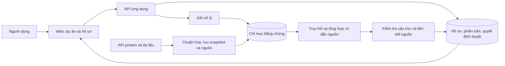

# Chọn đề tài tin sinh thiên về ứng dụng và hệ thống

> **LƯU TRỮ — không dùng để ra quyết định.** Tài liệu lịch sử; mọi câu "chốt / quyết định / khuyến nghị" bên dưới đã hết hiệu lực. Trạng thái hiện hành: [DECISIONS.md](../../DECISIONS.md).

Ngày khảo sát: 01/10/2026. Chuẩn bị trao đổi sáng 02/10/2026.

**Đã xác nhận với người làm:** luận văn một người, 14 tuần; RAG hoặc CNN/MCNN đều được, chọn theo bài toán; trọng tâm là phát triển ứng dụng/hệ thống. Chưa chọn đề tài. Tài liệu này bổ sung và điều chỉnh ưu tiên của khảo sát trước, không phải quyết định chốt ATP hay một hướng mới.

**Kết luận đề xuất:** mang hai lựa chọn chính tới GVHD: (A) hệ thống lập và rà soát hồ sơ bằng chứng cho protein bằng RAG; (B) hệ thống phân tích theo lô và rà soát vị trí gắn ATP bằng CNN/MCNN. A ưu tiên theo mong muốn phát triển hệ thống và điều kiện máy không GPU ghi trong repo; B ưu tiên nếu thầy muốn bám sát mô hình protein của nhóm và có thể cung cấp pipeline chạy được. C — tìm và sàng lọc bộ dữ liệu GEO — là lựa chọn thứ ba nếu thầy ưu tiên khai thác dữ liệu. Đây là đánh giá khả thi của báo cáo, không phải xếp hạng từ thực nghiệm.

## 1. Căn cứ chọn đề tài

[Đề cương CT553H](../../resources/course/CT553H.pdf), mục 10.1, phân bổ 40% cho kỹ năng/kết quả phát triển ứng dụng, 40% cho kiến thức/báo cáo khoa học, 20% cho thái độ và trình bày. Nội dung đánh giá có phân tích yêu cầu, thiết kế, đảm bảo chất lượng và kiểm thử. **Suy luận:** một hệ thống tin sinh có đánh giá thực nghiệm phù hợp học phần; tài liệu không buộc phải phát minh kiến trúc neural mới. Mức đóng góp cụ thể vẫn cần thầy xác nhận.

Các báo cáo cũ bắt đầu từ mô hình rồi thêm trang web. Với yêu cầu mới, nên quyết theo thứ tự:

1. **Người dùng và công việc:** ai dùng, đang phải làm thủ công bước nào, đầu ra nào được dùng tiếp?
2. **Dữ liệu và đáp án kiểm tra:** lấy ở đâu, có nhãn/nguồn gốc không, có thể tạo bộ đánh giá trong hai tuần đầu không?
3. **Quy trình hệ thống:** nhập dữ liệu → xử lý → rà soát → lưu quyết định → xuất kết quả.
4. **Vai trò AI:** có bước nào tìm kiếm thông thường hoặc quy tắc chưa đáp ứng tốt, và dùng AI có cải thiện được không?
5. **Đóng góp đo được:** chất lượng kết quả, thời gian hoàn thành công việc, lỗi thao tác, khả năng truy xuất nguồn và tái lập.

Không dùng số màn hình hoặc số công nghệ làm thước đo đóng góp. CRUD, đăng nhập và dashboard chỉ có giá trị khi phục vụ quy trình trên.

### Phạm vi kỹ thuật

- **RAG tài liệu:** truy hồi bằng chứng và cho LLM tổng hợp có dẫn nguồn. Dùng cho A và C.
- **Truy hồi đặc trưng protein:** lấy protein/residue gần nhau để hỗ trợ dự đoán, như dòng bài RAG của nhóm. Không mặc nhiên là chatbot.
- **CNN/MCNN:** học mẫu trên chuỗi hoặc ảnh. Với MCNN theo tài liệu của nhóm, dùng nhiều kích thước cửa sổ; phải xác định đúng biến thể khi triển khai.
- Không bắt buộc ghép cả ba. Mỗi hướng chỉ có một năng lực AI cốt lõi trong MVP.

## 2. Đối chiếu công cụ và nghiên cứu đã có

| Nguồn trực tiếp | Điều xác minh được | Hệ quả khi chọn đề tài |
|---|---|---|
| [GeneGPT, 2024](https://pmc.ncbi.nlm.nih.gov/articles/PMC10904143/) | Dùng API NCBI hỗ trợ hỏi đáp genomics; có mã và dữ liệu công khai | “LLM gọi cơ sở dữ liệu sinh học” đã có tiền lệ; cần phạm vi và đánh giá cụ thể hơn |
| [BioChatter](https://github.com/biocypher/biochatter) | Thư viện backend cho AI hội thoại trong y sinh | Chat với tài liệu y sinh không tự nó đủ làm tuyên bố mới |
| [2D-ProteinRAG, bản thảo 2026](https://arxiv.org/abs/2605.17261) | Đề xuất protein-text QA tích hợp quy trình BLAST | Không tuyên bố RAG kết hợp protein và văn bản là hướng đầu tiên; mới kiểm tra abstract, không tái lập |
| [UniProt API](https://www.uniprot.org/api-documentation/support-data) và [QuickGO API](https://www.ebi.ac.uk/QuickGO/api/) | Truy cập dữ liệu protein và chú giải GO/ECO bằng API | Là nguồn xây hồ sơ có cấu trúc; dữ liệu định danh nên lấy bằng API, không để LLM đoán |
| [PubTator 3.0](https://pmc.ncbi.nlm.nih.gov/articles/PMC11223843/) | Tìm kiếm thực thể/quan hệ và xuất annotation | Chỉ làm tìm bài theo gene/protein sẽ trùng chức năng sẵn có; bài đọc qua kết quả tìm kiếm do trang mở trực tiếp gặp CAPTCHA |
| [InterPro](https://www.ebi.ac.uk/training/online/courses/interpro-quick-tour/searching-interpro/) | Có tìm kiếm chuỗi để dự đoán họ và miền protein | Một trang FASTA → tên họ chưa tạo khác biệt rõ về hệ thống |
| [RTK_RAG](https://github.com/B1607/RTK_RAG) | Có dữ liệu, code, hướng dẫn dự đoán FASTA bằng Colab; README nêu giấy phép AFL 3.0 | Có nền cho B, nhưng cần xác minh pipeline chạy được; thêm một form tải FASTA là phạm vi quá mỏng |
| [GEO search](https://www.ncbi.nlm.nih.gov/geo/info/qqtutorial.html), [OmicsDI](https://www.omicsdi.org/) | Đã có tìm kiếm và lọc dữ liệu omics | C cần đánh giá khả năng kiểm tra tiêu chí chọn dataset, không chỉ tìm kiếm |
| [Brown và cộng sự, Bioinformatics 2026](https://academic.oup.com/bioinformatics/article/42/3/btag053/8455039) | Nghiên cứu semantic search cho GEO, đối chiếu GEO Advanced Search Builder | Tìm GEO bằng embedding không phải ý tưởng mới |
| [ScIRGen, bản thảo 2025](https://arxiv.org/abs/2506.11117) | Đề xuất dữ liệu QA/truy hồi khoa học, có ScIRGen-Geo | Có tiền lệ gần C; cần kiểm tra tải dữ liệu, giấy phép và chất lượng trước khi sử dụng benchmark |
| [Cellpose 2.0](https://www.nature.com/articles/s41592-022-01663-4) | Có GUI gán nhãn và quy trình người dùng sửa kết quả để huấn luyện | Hướng ảnh tế bào phải có phạm vi sử dụng/đánh giá rõ; “human-in-the-loop” tự nó không mới |

Các nguồn trên xác nhận tiền lệ và nguồn dữ liệu; chưa chứng minh nhu cầu của người dùng trong lab hoặc tính mới toàn cầu của ba đề xuất. Cần phỏng vấn ngắn GVHD/người dùng mục tiêu để xác nhận vấn đề.

## 3. So sánh năm hướng

Đánh giá định tính theo một người/14 tuần, chưa có đo thời gian hoặc chi phí thực tế.

| Hướng | AI cốt lõi | Phần hệ thống có ý nghĩa | Phụ thuộc lớn nhất | Khuyến nghị |
|---|---|---|---|---|
| A. Hồ sơ bằng chứng protein | RAG tài liệu + dữ liệu có cấu trúc | Hồ sơ, đối chiếu nguồn, duyệt nhận định, xuất báo cáo | Người kiểm tra nội dung và ngân sách LLM | Ưu tiên theo định hướng mới |
| B. Rà soát vị trí gắn ATP | CNN/MCNN kế thừa | Xử lý theo lô, bản đồ residue, so sánh annotation, ghi nhận rà soát | Pipeline, nhãn, chi phí embedding | Ưu tiên nếu thầy hỗ trợ mô hình |
| C. Sàng lọc dataset GEO | RAG trên metadata | Tiêu chí chọn/loại, bảng bằng chứng, danh sách dataset có thể tái sử dụng | Metadata thiếu và bộ đánh giá phù hợp | Phương án thứ ba |
| D. Phân đoạn và định lượng tế bào | CNN/U-Net | Sửa mask, đếm, thống kê diện tích, xuất kết quả | Gán nhãn, GPU, xác nhận phù hợp chuyên môn | Chỉ chọn khi có người dùng và dữ liệu ảnh |
| E. Diễn giải danh sách gene sau phân tích biểu hiện | RAG | Nhập danh sách, liên kết chức năng/tài liệu, xuất báo cáo | Kiến thức thống kê và xác minh diễn giải | Chưa ưu tiên trong 14 tuần |

D có dữ liệu công khai như [LIVECell](https://sartorius-research.github.io/LIVECell/), với ảnh và các tập chia được cung cấp. Không mặc định ảnh y sinh được chấp nhận như hướng tin sinh chuỗi của nhóm. E có thể thu hẹp vào bảng gene đã phân tích; nếu thêm pipeline RNA-seq từ dữ liệu thô, chọn nhóm, chuẩn hóa và xử lý batch thì phạm vi tăng mạnh. Công cụ [GEO2R](https://www.ncbi.nlm.nih.gov/geo/info/geo2r.html) đã tồn tại; trang hướng dẫn gặp CAPTCHA trong phiên này, không dùng nó để suy ra các giới hạn chi tiết.

## 4. A — Hệ thống lập và rà soát hồ sơ bằng chứng về chức năng protein sử dụng RAG

### Người dùng, bài toán, đầu ra

**Người dùng dự kiến:** sinh viên hoặc thành viên lab cần chuẩn bị hồ sơ về một nhóm protein. **Giả thuyết nhu cầu:** đối chiếu chú giải và tài liệu ở nhiều nguồn gây tốn thời gian, dễ nhầm loài, isoform hoặc loại bằng chứng. Chưa có phỏng vấn chứng minh mức độ vấn đề.

**Ví dụ sử dụng:** nhập một danh sách UniProt accession thuộc họ protein đã thống nhất; chọn câu hỏi “chức năng nào có bằng chứng thực nghiệm, nguồn nào hỗ trợ?”. Hệ thống trả bảng protein–nhận định–loại bằng chứng–đoạn nguồn. Người dùng mở nguồn, chấp nhận/sửa/loại nhận định, rồi xuất hồ sơ.

Đầu vào là protein **đã định danh**, không hứa dự đoán chức năng của mọi chuỗi mới. Nếu chọn RTK để gần hướng thầy, giới hạn đúng họ và loài đã thống nhất; không lấy liên quan bệnh làm suy luận điều trị.

### Phạm vi MVP

1. Tạo dự án và nhập danh sách accession; tên gene mơ hồ phải được người dùng xác nhận định danh/loài.
2. Nạp snapshot UniProt; lấy annotation GO nếu cần và tài liệu liên quan từ một nguồn văn bản.
3. Hiển thị bảng bằng chứng có accession, loài, PMID/PMCID, đoạn hỗ trợ, ngày truy xuất.
4. RAG sinh hồ sơ theo mẫu giới hạn; từng nhận định liên kết được với nguồn. Không tìm thấy nguồn thì ghi “chưa tìm thấy trong kho đã xét”.
5. Người dùng duyệt và lưu phiên bản hồ sơ; xuất Markdown/CSV và danh sách tài liệu.

**Một tác vụ RAG chính:** tổng hợp bằng chứng cho chức năng đã mô tả trong nguồn. Q&A tự do là phần mở rộng sau khi MVP ổn. Không thêm GraphRAG, sinh protein, dự đoán cấu trúc hay tự động thiết kế thí nghiệm.

### Dữ liệu và cách lấy

UniProt có API và tài liệu giấy phép dữ liệu CC BY 4.0 tại [trang tài liệu chính thức](https://www.uniprot.org/api-documentation/support-data). QuickGO cung cấp GO, ECO và annotation. Chọn một nguồn chuẩn cho mỗi trường để hạn chế trùng lặp. Một annotation có mã bằng chứng không có nghĩa mọi phát biểu sinh ra về protein đều đã được chứng minh.

[Europe PMC](https://europepmc.org/RestfulWebService) cung cấp tìm kiếm và truy cập dữ liệu bài báo; [hướng dẫn](https://europepmc.org/help) phân biệt toàn văn XML trong tập open access. Chỉ nạp nội dung được phép sử dụng và lưu giấy phép từng bài; không coi tất cả bài PubMed là toàn văn tự do.

**Mục tiêu quy mô đề xuất, chưa tải/đếm:** 30–50 protein cùng phạm vi, vài trăm tài liệu liên quan, 60–100 yêu cầu kiểm tra. Tuần 1 phải kiểm tra độ phủ thật; nếu thiếu bằng chứng thì giảm loại câu hỏi hoặc đổi họ protein cùng thầy.

### Câu hỏi nghiên cứu và đánh giá

- **RQ1:** chuẩn hóa thực thể và truy hồi kết hợp từ khóa/ngữ nghĩa có tăng tỷ lệ lấy đúng bằng chứng so với tìm từ khóa và RAG ngữ nghĩa cơ bản không?
- **RQ2:** ràng buộc từng nhận định vào nguồn và cho phép không trả lời có giảm nhận định thiếu căn cứ mà vẫn giữ độ phủ hữu ích không?
- **RQ3 ở mức đánh giá ứng dụng:** người dùng có hoàn thành hồ sơ đúng nhanh hơn so với tra cứu thủ công không?

**Đối chứng:** B0 tìm bằng accession/từ khóa + biểu mẫu thủ công; B1 RAG ngữ nghĩa đơn giản; B2 cùng LLM với chuẩn hóa định danh, hybrid retrieval và hồ sơ có nguồn. Tách ablation của truy hồi và ràng buộc sinh để biết thành phần nào có tác dụng. Dùng cùng snapshot và giới hạn tài liệu cho so sánh công bằng.

**Bộ chấm:** người đánh giá lập đáp án/bằng chứng từ nguồn độc lập với đầu ra hệ thống; chia phát triển/test theo protein hoặc nhóm tài liệu, tránh cùng bài bị chia đoạn sang cả hai. Nguồn đúng vẫn được phép nằm trong chỉ mục RAG — đó là thiết kế của tác vụ open-book; không đưa đáp án benchmark hoặc kết quả chấm vào chỉ mục. Có ca nhầm tên, nhầm loài, nguồn không đủ và bất đồng chưa thể giải quyết. Không dùng LLM duy nhất vừa sinh đáp án vừa chấm.

**Chỉ số:** Recall@k trên tập bằng chứng đã gán nhãn; tỷ lệ trích dẫn thực sự hỗ trợ nhận định; tỷ lệ nhận định được hỗ trợ; độ đầy đủ so với rubric; độ chính xác/độ phủ trên câu hệ thống chấp nhận trả lời; độ trễ và chi phí mỗi hồ sơ. Recall trên bộ bằng chứng được gán nhãn không đồng nghĩa đã tìm hết tài liệu ngoài kho.

Đánh giá người dùng dự kiến 3–5 người có nền phù hợp, với các tác vụ tương đương và đổi thứ tự điều kiện; ghi thời gian, lỗi và mức hoàn thành. Cỡ này chỉ là khảo sát thử nghiệm. Nếu không tuyển được, dùng ca kiểm thử có đáp án và đánh giá chuyên gia giới hạn; không tuyên bố đã cải thiện năng suất người dùng thực.

### Đóng góp và rủi ro

Đóng góp dự kiến là quy trình lập hồ sơ có nguồn, cơ chế kiểm tra theo thực thể/bằng chứng, và đánh giá thực nghiệm trong một miền hẹp. **Không tuyên bố thuật toán RAG mới hoặc chưa có công cụ tương tự.** Nhu cầu thực tế và chất lượng bộ chấm quan trọng hơn việc đặt tên hệ thống.

Rủi ro chính: đọc sai bằng chứng sinh học; văn bản thiếu; dịch thuật làm sai nghĩa; chi phí/độ trễ LLM. MVP nên dùng nguồn và đánh giá tiếng Anh, giao diện có thể tiếng Việt. Theo [resources](../../resources/README.md), máy hiện ghi không có GPU và chưa có API key; cần xác nhận lại. Không cần huấn luyện LLM, nhưng vẫn cần chốt phương án suy luận và đo chi phí trong tuần 1. Phương án chỉ truy hồi/điền mẫu là chế độ dự phòng, không được gọi đó là RAG sinh văn bản đã hoàn thành.

## 5. B — Hệ thống hỗ trợ phân tích và rà soát vị trí gắn ATP trên protein RTK bằng CNN/MCNN

### Người dùng và quy trình

Người dùng dự kiến là người nghiên cứu muốn kiểm tra một lô protein RTK, đối chiếu dự đoán với chú giải sẵn có và lưu danh sách vị trí cần xem xét. **Giả thuyết cần xác nhận với thầy:** quy trình này hữu ích hơn một lần chạy notebook và xuất nhãn.

FASTA theo lô → kiểm tra dữ liệu → job dự đoán → bản đồ điểm theo residue → đối chiếu annotation/chuỗi tham chiếu → người dùng ghi chú và chọn vị trí → xuất báo cáo cùng phiên bản mô hình.

### MVP và giá trị hệ thống

- Quản lý lô và trạng thái job; tiếp tục/xử lý lại mẫu lỗi; cache theo hash chuỗi và phiên bản mô hình.
- Bản đồ 1D theo residue, có điểm số và chú giải được xác minh nguồn. Điểm mô hình chưa hiệu chuẩn không được gọi là xác suất tin cậy.
- So sánh kết quả trên cùng chuỗi giữa phiên bản chạy; lưu annotation nguồn và ghi chú của người dùng thành các trường khác nhau.
- Kiểm tra tọa độ: canonical/isoform/chuỗi tự nhập không tự động dùng chung vị trí; ghi phương pháp ánh xạ và báo không khớp.
- Xuất bảng residue và bản ghi có input hash, model version, ngưỡng, data snapshot, trạng thái duyệt.

Không làm mô phỏng gắn thuốc, thiết kế thuốc hoặc suy luận cấu trúc 3D. Không thêm LLM chỉ để diễn giải lại một dãy điểm.

### Dữ liệu, mô hình, đánh giá

[RTK_RAG](https://github.com/B1607/RTK_RAG) liệt kê 549 protein train, 69 RTK kiểm tra độc lập và kho truy hồi 244 protein; có hướng dẫn dự đoán Colab và giấy phép AFL 3.0. Đây là điểm khởi đầu chứ chưa chứng minh notebook có thể chạy lại trong môi trường hiện tại. Không kế thừa các ước lượng GPU rất ngắn trong tài liệu cũ như số đã đo.

Chọn pipeline có thể chạy được do thầy cung cấp hoặc baseline CNN/MCNN phù hợp. Dùng PLM đóng băng và cache embedding nếu tài nguyên cho phép. Chỉ nghiên cứu thêm truy hồi khi baseline và hệ thống đã ổn; đổi PLM đồng nghĩa đổi baseline, không phải tái lập nguyên bài.

**RQ1:** hệ thống tích hợp dự đoán, annotation và lưu vết có giảm thời gian/lỗi khi rà soát vị trí so với notebook + bảng tính không? **RQ2:** mô hình CNN/MCNN được tích hợp đạt chất lượng nào trên protein giữ riêng, và tín hiệu thiếu tương đồng có giúp người dùng nhận biết trường hợp cần thận trọng không?

Đánh giá mô hình bằng AUPRC, MCC/F1 ở ngưỡng chọn trên validation, tách theo protein/cụm tương đồng, kiểm tra trùng giữa train/test/kho truy hồi. Nếu có lấy khoảng tin cậy, lấy mẫu lại theo protein. So với baseline đơn giản và CNN/MCNN dưới cùng phép chia, không so trực tiếp số bài báo ở giao thức khác như một cải thiện đã chứng minh. Tín hiệu tương đồng là thông tin tham khảo cho đến khi được kiểm định về khả năng dự báo lỗi.

Đánh giá ứng dụng bằng ca rà soát có đáp án, lỗi ánh xạ residue, độ tái lập, xử lý input lỗi, thời gian lô và thời gian thao tác. Không lấy tỷ lệ đồng ý của người dùng thay cho nhãn sinh học. Nếu kết quả AI không hơn baseline, hệ thống có thể vẫn có giá trị, nhưng cần thầy chấp nhận đóng góp đó từ đầu.

**Cổng dừng cuối tuần 2:** không có pipeline chạy được, không rõ nhãn/quyền sử dụng hoặc embedding vượt tài nguyên thì đổi sang A/C theo thỏa thuận. Không dùng “MCC phải gần bài báo” làm cổng sống còn vì giao thức đánh giá có thể khác.

## 6. C — Hệ thống tìm kiếm và sàng lọc bộ dữ liệu biểu hiện gene GEO theo tiêu chí nghiên cứu bằng RAG

**Bài toán:** người dùng muốn tìm dataset phù hợp loài, mô, phương pháp đo, nhóm so sánh và khả năng tải dữ liệu. Đầu ra là danh sách được kiểm tra theo tiêu chí, có nguồn cho từng trường và lý do giữ/loại/chưa rõ.

**Ví dụ:** tìm human bulk RNA-seq trong một chủ đề được chọn, có nhóm bệnh và đối chứng, dữ liệu đếm có thể tải. Hệ thống không suy từ tiêu đề rằng dataset đã đủ nhóm hoặc đủ file.

**MVP:** lập bộ tiêu chí → tìm trên snapshot metadata GEO → bảng tiêu chí đạt/không đạt/chưa biết với dẫn nguồn → mở GSE/GSM liên quan → người dùng duyệt shortlist → xuất manifest. Không tải FASTQ và chạy phân tích khác biệt biểu hiện trong MVP.

[GEO programmatic access](https://www.ncbi.nlm.nih.gov/geo/info/geo_paccess.html) phân biệt metadata trong Entrez với dữ liệu tải qua các kênh khác. Nguồn thiếu ở cấp Series có thể cần kiểm tra Sample và bài báo; vì thế đây là bài toán chất lượng metadata, không chỉ hỏi đáp.

**Tiền lệ sát:** [semantic search GEO, 2026](https://academic.oup.com/bioinformatics/article/42/3/btag053/8455039) và [ScIRGen-Geo](https://arxiv.org/abs/2506.11117). Đóng góp đề xuất là kiểm tra tiêu chí với khả năng nói “chưa rõ” và lưu quyết định của người dùng; chưa xác minh đây là tính năng mới so với mọi hệ thống.

**RQ:** hybrid retrieval + kiểm tra tiêu chí có tăng độ chính xác shortlist so với GEO Advanced Search/từ khóa và dense retrieval không? RAG có nêu đúng lý do phù hợp thay vì chỉ sinh mô tả hợp lý không?

**Bộ đánh giá đề xuất:** một miền hẹp, vài trăm Series đã chụp metadata, 30–50 yêu cầu tìm; gán nhãn mức phù hợp và từng tiêu chí trên tập ứng viên hợp nhất từ các baseline. Giữ riêng yêu cầu và tránh để các paraphrase cùng ý xuất hiện ở cả dev/test. Báo nDCG@k/precision@k, lỗi khẳng định tiêu chí, tỷ lệ “chưa rõ” và thời gian sàng lọc. Không gọi recall trên ứng viên đã chấm là recall trên toàn GEO. Nhãn sinh từ LLM trong benchmark ngoài phải được kiểm tra người trước khi làm chuẩn chính.

**Rủi ro:** metadata dị thể và tạo gold set tốn thời gian. Nếu cuối tuần 2 chưa gán nhãn nhất quán được các tiêu chí thì giảm tiêu chí/miền; không hứa giải quyết mọi bộ dữ liệu omics.

## 7. Kiến trúc và kế hoạch 14 tuần

Kiến trúc dự kiến cho A; B thay khối truy hồi/sinh bằng worker mô hình và C thay nguồn protein bằng metadata GEO.

Kiểm tra cấu trúc/citation ID chỉ xác minh liên kết tồn tại, không tự chứng minh nhận định sinh học đúng. Cần đánh giá nội dung và bước duyệt. Dùng backend quen thuộc; nếu chọn Spring Boot + React + Python thì giới hạn Python vào xử lý AI. Không cần microservices phức tạp hay Kubernetes cho một người.

| Tuần | Kết quả cần đạt |
|---|---|
| 1–2 | Chốt một hướng với thầy; 3–5 tình huống sử dụng; mẫu dữ liệu; baseline; dự thảo bộ đánh giá; đo tài nguyên; xác nhận có người kiểm tra |
| 3–4 | Lát cắt chạy xuyên suốt từ nhập → xử lý → xem nguồn/kết quả → xuất; cơ sở dữ liệu và kiểm tra input |
| 5–6 | Hoàn thiện AI cốt lõi và baseline; khóa test, nguồn dữ liệu, rubric; ghi lại yêu cầu/thiết kế trong báo cáo |
| 7–8 | Rà soát, lưu phiên bản, job/cache, xử lý lỗi; alpha đủ cho người dùng thử |
| 9–10 | Chạy đánh giá chất lượng AI và hệ thống; phân tích lỗi; ablation nhỏ có mục đích |
| 11 | Đánh giá tác vụ với người dùng/chuyên gia nếu tuyển được; sửa lỗi ưu tiên |
| 12 | Khóa tính năng, kiểm thử tích hợp và hồi quy; hoàn thiện triển khai/demo |
| 13–14 | Hoàn thiện báo cáo, video/demo dự phòng, slide, luyện bảo vệ và thời gian đệm |

Mục tiêu ứng dụng định lượng như độ trễ và số mẫu/lô phải đặt sau benchmark tuần 1. Chưa có số đo để hứa “phản hồi tức thì” hoặc một số giờ GPU cố định. Luôn ghi và viết báo cáo từ đầu, không dồn toàn bộ phần viết vào hai tuần cuối.

## 8. Quyết định nên xin từ GVHD sáng mai

1. Luận văn lấy hệ thống và đánh giá sử dụng làm đóng góp chính, kế thừa AI có sẵn, có đáp ứng kỳ vọng của thầy không?
2. Với A/B, ai trong nhóm có thể nêu 3–5 tác vụ thực tế và kiểm tra bộ bằng chứng/nhãn?
3. Nếu B: thầy có pipeline, trọng số, dữ liệu và hướng dẫn chạy nào sinh viên được dùng? Có cần đạt cải thiện mô hình không?
4. Nếu A/C: có thể dùng LLM qua API trong ngân sách nào, và có người giúp kiểm tra gold set không?
5. Thầy ưu tiên hướng nào và đồng ý cổng quyết định cuối tuần 2 ra sao?

Đề xuất lời mở đầu: “Em muốn làm một hệ thống hỗ trợ công việc tin sinh cụ thể trong 14 tuần. Em kế thừa mô hình phù hợp và đánh giá cả chất lượng AI lẫn hiệu quả quy trình. Em đang cân nhắc hồ sơ bằng chứng protein bằng RAG và công cụ rà soát vị trí gắn ATP bằng CNN/MCNN.”

## 9. Giới hạn khảo sát

- Đã đọc rubric cục bộ, tài liệu chính thức, README và các bài/abstract liên quan; đây là khảo sát định hướng có đối chiếu tiền lệ, không phải systematic review vét cạn.
- Chưa phỏng vấn người dùng, chạy mô hình, kiểm thử API, tải toàn bộ dataset hoặc đo tài nguyên. “Có API/dữ liệu công khai” khác với “pipeline đã được kiểm chứng hoạt động”.
- Một số trang UniProt cần JavaScript, Europe PMC mở trực tiếp lỗi và NCBI gặp CAPTCHA; các chi tiết tương ứng chỉ lấy từ tài liệu chính thức truy xuất được/kết quả chỉ mục và được giới hạn ở mức đó.
- 2D-ProteinRAG và ScIRGen được dùng như tiền lệ từ bản thảo/abstract đã đọc, không coi là kết quả tái lập độc lập hay mặc định đã bình duyệt.
- Điều kiện 14 tuần và một người đã được người dùng xác nhận; tình trạng không GPU/API key lấy từ resources của repo, cần xác nhận lại. Không có cam kết thực nghiệm hoặc khả năng công bố.
- Chưa sửa slide/Notion cũ; khi trình bày nên dùng [bản trao đổi mới](../meetings/bioinformatics-application-pitch.md) để không vô tình coi ATP + kiểm toán giao thức là hướng đã chốt.
