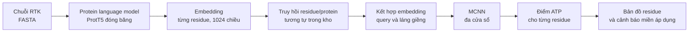

# Thuyết minh đề tài — Dự đoán vị trí gắn ATP ở protein RTK có cảnh báo miền áp dụng

> **LƯU TRỮ — không dùng để ra quyết định.** Tài liệu lịch sử; mọi câu "chốt / quyết định / khuyến nghị" bên dưới đã hết hiệu lực. Trạng thái hiện hành: [DECISIONS.md](../../../../DECISIONS.md).

> Bản soạn ngày 02/10/2026 cho buổi gặp GVHD. Đây là **thuyết minh của sinh viên**, chưa có phê duyệt của GVHD. Mọi số liệu dữ liệu trong bản này được đếm trực tiếp từ tệp đã tải (xem [báo cáo dữ liệu](../03-data/data-report.md)); mọi nhận xét về mã nguồn công khai được dẫn tới dòng mã cụ thể. Chưa có kết quả mô hình nào của đề tài.

---

## 1. Tên đề tài

**Tiếng Việt:** Xây dựng hệ thống dự đoán vị trí gắn ATP ở protein RTK có cảnh báo miền áp dụng, sử dụng PLM–MCNN và truy hồi, được đánh giá bằng giao thức kiểm soát rò rỉ dữ liệu.

**Tên ngắn dùng trên slide:** Dự đoán vị trí gắn ATP ở RTK với cảnh báo miền áp dụng.

**Tiếng Anh:** An Applicability-Aware System for ATP-Binding Site Prediction in Receptor Tyrosine Kinases Using Protein Language Models, Multi-Window CNNs, and Retrieval under a Leakage-Controlled Evaluation Protocol.

Dùng cụm **“kiểm soát rò rỉ”**, không dùng “chống rò rỉ” hay “không rò rỉ”. Lý do: giao thức của đề tài chỉ kiểm soát được phần dữ liệu downstream (chia tập, kho truy hồi, chọn cấu hình). Protein language model có thể đã gặp chính các chuỗi này trong giai đoạn tiền huấn luyện, và đề tài **không** có cách loại bỏ hoặc đo trực tiếp ảnh hưởng đó.

---

## 2. Đề tài giải quyết đúng bài toán gì

### 2.1 Đầu vào và đầu ra

Đầu vào là chuỗi amino acid FASTA của một protein RTK. Đầu ra là điểm dự đoán cho **từng residue**:

```text
Chuỗi:      M     S     R     R     P     D     L     L   ...
Điểm ATP:   0,01  0,03  0,87  0,92  0,88  0,12  0,04  0,02 ...
Nhãn:       0     0     1     1     1     0     0     0   ...
```

Đây là bài toán **phân loại nhị phân ở mức residue**:

- `1`: residue được dự đoán tham gia vị trí gắn ATP.
- `0`: residue không tham gia vị trí gắn ATP.

### 2.2 Đề tài không làm gì

Nói rõ ngay từ đầu để không bị hỏi vặn ngoài phạm vi:

- **Không** dự đoán ái lực gắn ATP (affinity, Kd/Ki).
- **Không** mô phỏng docking hoặc dựng cấu trúc 3D.
- **Không** thiết kế thuốc hay đề xuất phân tử ức chế.
- **Không** chứng minh bằng thực nghiệm sinh học; nhãn được kế thừa từ dữ liệu công khai.
- **Không** làm chatbot, không sinh văn bản, không fine-tune nhiều PLM để so sánh.
- **Không** tuyên bố “vượt SOTA” hoặc “đầu tiên”.

---

## 3. Mô hình nền: RTK_RAG

Đề tài kế thừa kiến trúc của [RTK_RAG](https://github.com/B1607/RTK_RAG) (Wei và cộng sự, 2025, *J. Chem. Inf. Model.*), công trình của nhóm GVHD, đúng bài toán RTK–ATP.



### 3.1 “RAG” ở đây nghĩa là gì

**Không phải chatbot, không phải sinh văn bản.** Nó truy hồi embedding protein/residue gần với mẫu đầu vào để **bổ sung đặc trưng** trước khi MCNN phân loại. Đọc trực tiếp [`Dataset/rag_prottrans_GPU.py`](https://github.com/B1607/RTK_RAG/blob/b7bd4c2347c7d44d24ae3d13e42082ba6cd62627/Dataset/rag_prottrans_GPU.py) tại snapshot đã tải:

| Bước trong mã | Điều mã thực sự làm |
|---|---|
| `load_database` | Nối embedding mọi protein trong kho bằng `torch.cat(..., dim=0)` → một ma trận `(tổng số residue, 1024)`. Hàm lọc theo đuôi `.esm` dù tên hàm và mô tả nói ProtTrans |
| `torch.cdist` | Tính khoảng cách Euclid từ mỗi residue truy vấn tới **mọi residue** trong kho |
| `argsort(...)[:, :5]` | Lấy **5 residue gần nhất**, tức k = 5 ở mức residue, không phải mức protein |
| `torch.mean(..., dim=1)` | Trung bình 5 vector láng giềng |
| `(batch + avg_embedding) / 2` | Trộn **tỷ lệ 1:1** giữa embedding truy vấn và trung bình láng giềng |

Cấu hình MCNN trong [`CODE/MCNN_npy.ipynb`](https://github.com/B1607/RTK_RAG/blob/b7bd4c2347c7d44d24ae3d13e42082ba6cd62627/CODE/MCNN_npy.ipynb) của snapshot: `WINDOW = 6` (cửa sổ 13 residue), `WINDOW_SIZES = [6, 8, 10]`, `NUM_FILTER = 256`, `NUM_HIDDEN = 1000`, `DROP = 0.0`, `EPOCHS = 3`, `K_Fold = 5`, `NUM_FEATURE = 1024`.

**Giới hạn của nhận định này:** đây là mô tả mã công khai tại commit đã ghim, không phải khẳng định rằng chính phiên bản này sinh ra mọi con số trong bài báo. Khi tái triển khai, đề tài sẽ mô tả rõ lựa chọn của mình thay vì khẳng định đã khôi phục đúng phương pháp gốc.

### 3.2 Điều phải sửa khi tái triển khai

Mã gốc nối embedding thành một ma trận phẳng, nên **mất thông tin nguồn**: không còn biết một vector láng giềng thuộc protein nào, ở vị trí nào. Đề tài sẽ giữ `source_protein_id` và `residue_index` trong index truy hồi, vì không có hai trường này thì không thể loại self-match hay lọc homolog theo protein — tức không thể thực hiện giao thức ở mục 5.

---

## 4. “Rò rỉ” trong đề tài này là gì

Tài liệu khảo sát trước đây của chính đề tài gộp nhiều hiện tượng khác nhau dưới cùng một tên. Bản này tách thành **bốn loại**, vì mỗi loại có cách kiểm soát khác nhau:

| Loại | Ví dụ | Hậu quả |
|---|---|---|
| **Rò rỉ giữa protein** | Residue của cùng một protein xuất hiện ở cả train và test | Mô hình gần như đã thấy protein kiểm tra |
| **Rò rỉ đồng dạng** | Protein test rất giống protein train | Chỉ số phản ánh ghi nhớ họ protein nhiều hơn khả năng tổng quát |
| **Rò rỉ qua kho truy hồi** | Query, hoặc protein gần như trùng query, nằm trong kho RAG | Truy hồi có thể sao chép thông tin từ láng giềng quá gần |
| **Rò rỉ khi chọn mô hình** | Dùng nhãn test để chọn ngưỡng, dropout, window hoặc α | Test trở thành validation và không còn độc lập |

Trong dữ liệu protein, **chia ngẫu nhiên là chưa đủ**. Các protein tương đồng phải được gom cụm trước rồi giữ toàn bộ một cụm trong cùng partition; đây là khuyến nghị phổ biến vì homolog xuất hiện ở cả train và test có thể làm chỉ số tăng giả tạo (Hou và cộng sự, [*Ten quick tips*](https://doi.org/10.1371/journal.pcbi.1010669), 2022).

### 4.1 Điều đã tự kiểm chứng được, và giới hạn của nó

Trong mã công khai của RTK_RAG, hàm `model_test` gọi `roc_curve(y_test[:,1], pred_test[:,1])`, lấy `argmax` của G-mean làm ngưỡng, rồi tính MCC/F1 trên **chính tập đó**. Bằng chứng kèm số dòng: [rtk-rag-threshold-verification.md](../research/rtk-rag-threshold-verification.md).

Giới hạn phải nói kèm: mã và output trong repo không hoàn toàn đồng bộ, notebook thiếu module nạp dữ liệu, nên chỉ có thể nói **đây là đặc điểm của mã công khai đã kiểm tra**, chưa thể kết luận nó tạo ra mọi con số trong bài. Bài cũng mô tả 69 RTK lúc là validation, lúc là independent test, trong khi các bảng window length và dropout chọn cấu hình tốt nhất — đây là **điểm cần hỏi lại GVHD**, không trình bày như cáo buộc.

### 4.2 Lưu ý quan trọng: đồng dạng trong kho không tự động là rò rỉ

Protein tương đồng trong kho truy hồi **không** tự động là rò rỉ, nếu kho đó thực sự có sẵn khi triển khai. Vấn đề chỉ xuất hiện khi:

1. Test được dùng để xây kho.
2. Query tự truy hồi chính nó.
3. Kết quả ở vùng đồng dạng gần và vùng xa bị trộn thành một con số duy nhất.

---

## 5. Giao thức đánh giá đề xuất

Chín bước, khóa theo thứ tự:

1. Làm sạch protein trùng và kiểm tra nhãn xung đột.
2. Gom cụm theo độ tương đồng chuỗi, **dự kiến 30%**; có thể báo thêm kết quả ở 40% để đối chiếu bài gốc.
3. Chia theo **protein cluster**, không chia theo residue hay cửa sổ.
4. Mọi residue của một protein chỉ thuộc **một** trong train, validation hoặc test.
5. Chọn window, dropout, α, k và ngưỡng phân loại **bằng train/validation**.
6. **Khóa toàn bộ cấu hình** trước khi mở test.
7. Kho RAG phải được **đóng băng**, loại query khỏi kết quả truy hồi, và không được chứa nhãn test.
8. Test chỉ được chấm **một lần** cho cấu hình cuối.
9. Bootstrap **theo protein**, vì hàng chục nghìn residue không phải các quan sát độc lập.

### 5.1 Hai kịch bản phải phân biệt

| | Đánh giá nghiêm ngặt | Sử dụng thực tế |
|---|---|---|
| Điều kiện | Protein test không có láng giềng quá 30% identity trong train **hoặc** kho RAG | Cho phép kho RAG có homolog đã biết; chỉ loại bản thân query và protein trùng |
| Đo điều gì | Khả năng tổng quát xa | Hiệu năng trong điều kiện triển khai thật |
| Cách báo kết quả | Một con số cho vùng xa | **Chia theo mức identity**, để người dùng biết mô hình hoạt động tốt trong vùng nào |

Hai kịch bản này không thay thế nhau; báo cả hai mới trả lời được “mô hình dùng được ở đâu”.

---

## 6. Câu hỏi nghiên cứu

Ba RQ trong bản tài liệu trước quá rộng cho 14 tuần. Bản này thu gọn thành **hai RQ chính**.

### RQ1 — Truy hồi thực sự đóng góp bao nhiêu?

> Dưới cùng giao thức tách theo độ tương đồng và cùng bộ phân loại MCNN, truy hồi cải thiện AUPRC/MCC bao nhiêu so với không truy hồi?

Ba nhánh so sánh, **cùng split, cùng encoder, cùng ngân sách tuning**:

| Nhánh | Mô tả | Vai trò |
|---|---|---|
| A | ProtT5 + MCNN | Baseline không truy hồi |
| B | Retrieval + ProtT5 + MCNN | Mô hình đầy đủ |
| C | k-NN / chuyển nhãn theo láng giềng | Baseline đơn giản chỉ dựa vào đồng dạng |

**Nhánh C là nhánh quan trọng nhất về mặt lập luận.** Nếu k-NN gần bằng mô hình đầy đủ, phần lớn lợi ích có thể đến từ tương đồng chuỗi thay vì từ MCNN. Không có nhánh C thì không thể phân tách hai nguồn lợi ích này.

### RQ2 — Độ tương đồng có dùng được làm tín hiệu miền áp dụng không?

> Độ tương đồng với láng giềng gần nhất có dự báo được nguy cơ mô hình sai hay không, và có thể dùng nó để xác định miền áp dụng không?

Quy tắc dự kiến:

- `identity ≥ t`: hệ thống đưa dự đoán bình thường.
- `identity < t`: hệ thống **vẫn hiển thị** kết quả nhưng cảnh báo “ít tương đồng với dữ liệu tham chiếu”.

Quét `t` trên validation rồi **khóa trước khi dùng test**. Báo đường đánh đổi giữa **coverage** (tỷ lệ protein hệ thống chấp nhận) và **AUPRC/MCC hoặc lỗi** trên phần được chấp nhận.

**Về cách gọi tên:** không gọi identity là “độ tin cậy” trước khi chứng minh nó tương quan với lỗi. Tên chính xác là **tín hiệu miền áp dụng** (applicability-domain signal).

### 6.1 Điều đã bị hạ cấp hoặc loại khỏi phạm vi

| Việc | Xử lý |
|---|---|
| So sánh chọn ngưỡng trên test so với validation | Hạ thành **thí nghiệm kiểm toán phụ**, không phải RQ chính |
| So sánh CD-HIT 30% / 40%, nhiều loại kho RAG, nhiều α và nhiều k **cùng lúc** | Vượt phạm vi 14 tuần; chỉ làm một trục nếu còn thời gian |
| RQ3 cũ (quy tắc từ chối dự đoán tách riêng) | Gộp vào RQ2 |

### 6.2 Kết quả âm vẫn là kết quả

Phải báo cáo trung thực nếu: truy hồi không tốt hơn baseline dưới giao thức chặt; hoặc identity không tương quan đủ với lỗi để làm tín hiệu cảnh báo. Cả hai đều là câu trả lời có giá trị cho RQ, và cần được xác nhận với GVHD trước khi viết đề cương.

---

## 7. Chỉ số đánh giá

Tập RTK có **711 residue dương** trên **73.270 residue âm**, tức dương chỉ **khoảng 0,96%**. Vì vậy:

| Chỉ số | Vai trò |
|---|---|
| **AUPRC** | **Chỉ số chính** |
| MCC và F1 | Tính tại ngưỡng **khóa từ validation** |
| AUROC | Chỉ báo phụ, để đối chiếu bài gốc |
| Sensitivity / specificity | Giúp giải thích mô hình bỏ sót hay báo nhầm |
| Khoảng tin cậy 95% | Bootstrap **theo protein** |
| Micro và macro theo protein | Báo cả hai nếu dữ liệu cho phép |

**Accuracy** có thể rất cao ngay cả khi mô hình gần như luôn dự đoán âm, nên không dùng làm kết luận chính. Lý do chọn AUPRC: Saito & Rehmsmeier, [*The Precision-Recall Plot Is More Informative than the ROC Plot*](https://doi.org/10.1371/journal.pone.0118432), 2015.

---

## 8. Dữ liệu

Đã tải và kiểm tra bằng máy, tái tạo được bằng `python3 archive/topics/rtk-atp-applicability/code/preprocessing/prepare_data.py`. Chi tiết: [03-data/data-report.md](../03-data/data-report.md).

| Bộ dữ liệu | Protein | Residue | Nhãn 1 | Nhãn 0 | Tỷ lệ dương | Vai trò trong đề tài |
|---|---:|---:|---:|---:|---:|---|
| ATP-549 | 549 | 213.537 | 8.502 | 205.035 | 3,98% | Nguồn có nhãn để học MCNN và làm baseline k-NN |
| RTK-69 | 69 | 73.981 | 711 | 73.270 | 0,96% | Dữ liệu đích; **tách thành RTK-development và RTK-test** |
| RAG-244 | 244 | 263.764 | không có tệp nhãn | không có tệp nhãn | — | Kho embedding ngoài, **không dùng nhãn** |

Điểm đã kiểm và phải xử lý:

- Toàn bộ **618 protein có nhãn** có số nhãn đúng bằng chiều dài chuỗi, nhãn chỉ gồm 0/1, mỗi protein có ít nhất một nhãn dương.
- Không có chuỗi trùng hoàn toàn **giữa** ba bộ; nhưng có **một cặp trùng nội bộ kho RAG** (`A0M8S8` và `Q07E37`) phải gộp khi dựng kho.
- Kho RAG có **36 ký tự X**; giữ nguyên vị trí, không xóa residue, ghi lại quy tắc tokenization của ProtT5.
- **Chưa kiểm homolog bằng alignment.** “Không trùng hoàn toàn” *không* có nghĩa đã độc lập ở ngưỡng 30%/40% identity. Đây là việc đầu tiên phải làm.
- README/bài báo ghi kho RAG có 2.676 residue dương, nhưng snapshot **chỉ cung cấp FASTA** của kho này. Không chuyển con số công bố đó thành ground truth có sẵn.
- **Không còn gọi toàn bộ 69 RTK là independent test của đề tài**, vì đề tài cần một phần RTK để phát triển và khóa ngưỡng cảnh báo.

Chi phí tính được: 551.282 residue × 1.024 chiều × 2 byte ≈ **1,13 GB** embedding float16. Đây là dung lượng mảng, chưa phải đo RAM/VRAM hay thời gian thực tế.

---

## 9. Sản phẩm hệ thống

Học phần CT553H tính **phát triển ứng dụng 40%**, nên hệ thống là thành phần bắt buộc, không phải phần phụ.

| Chức năng | Mô tả |
|---|---|
| Nhập dữ liệu | Một hoặc nhiều chuỗi FASTA |
| Kiểm tra đầu vào | Định dạng, độ dài, ký tự không chuẩn |
| Chạy theo job | Dự đoán theo lô, có trạng thái |
| Bản đồ residue | Tô màu điểm ATP trên từng residue |
| Tham chiếu | Hiển thị protein tham chiếu gần nhất và sequence identity |
| **Cảnh báo miền áp dụng** | Gắn cờ khi mẫu nằm ngoài vùng đã đánh giá |
| Xuất kết quả | CSV/JSON |
| Tái lập | Lưu phiên bản mô hình, ngưỡng, kho truy hồi và hash đầu vào |

**Điểm có ý nghĩa của hệ thống:** người dùng thấy được mô hình dự đoán gì **và** dự đoán đó nằm trong vùng dữ liệu nào. Một form FASTA chỉ trả chuỗi 0/1 sẽ quá mỏng cho luận văn kỹ thuật phần mềm. Cảnh báo miền áp dụng chính là RQ2 hiện ra thành tính năng — đó là lý do phần nghiên cứu và phần hệ thống không rời nhau.

Kiến trúc tối thiểu: FastAPI phục vụ mô hình đã xuất + React, mô hình được huấn luyện ngoài (`ml/`) và chỉ nạp khi phục vụ (`ml-service/`).

---

## 10. Đóng góp có thể bảo vệ

Đề tài **không** cần tuyên bố phát minh kiến trúc mới. Ba đóng góp hợp lý:

1. **Giao thức đánh giá** theo protein cluster, khóa test và tách kho truy hồi.
2. **Bằng chứng thực nghiệm** về lợi ích thật của retrieval sau khi kiểm soát độ tương đồng.
3. **Hệ thống dự đoán** có thông tin miền áp dụng và khả năng tái lập kết quả.

### 10.1 Rủi ro lớn nhất và cách định vị

Điểm yếu lớn nhất là đề tài có thể bị nhìn thành **“chấm lại bài của thầy”**. Vì vậy, khi trình bày:

> ✅ **Nên mở đầu:** “Em muốn đo điều kiện mà retrieval thật sự hữu ích, và biến kết quả đó thành cảnh báo miền áp dụng cho người dùng.”
>
> ❌ **Không mở đầu bằng:** “bài cũ bị rò rỉ”.

Phần kiểm toán mã nguồn dùng để **thiết kế giao thức của chính mình** và để đặt câu hỏi kỹ thuật, không dùng làm luận điểm mở đầu.

---

## 11. Kế hoạch 14 tuần và cổng dừng

Một người thực hiện. Mỗi giai đoạn có một cổng quyết định; không đạt cổng thì thu hẹp ngay, không đợi tới giữa kỳ.

| Tuần | Việc chính | Cổng quyết định |
|---|---|---|
| 1–2 | Alignment và gom cụm đồng dạng; báo identity/coverage toàn chuỗi và vùng kinase; lập manifest split; đo thời gian embedding thật | Có manifest split khóa được và biết chi phí GPU. Không đạt thì giảm phạm vi dữ liệu |
| 3–4 | Trích embedding ProtT5 (đóng băng, có cache); dựng baseline A (không truy hồi) | Baseline chạy end-to-end và có AUPRC ổn định qua seed |
| 5–7 | Dựng index truy hồi giữ `source_protein_id`/`residue_index`; chạy nhánh B và C; **RQ1** | ΔAUPRC có vượt dao động giữa các seed hay không. Không có tín hiệu → báo kết quả âm, dồn sức vào RQ2 và hệ thống |
| 8–9 | **RQ2**: quét `t` trên validation, dựng đường coverage–risk, khóa cấu hình | Identity có tương quan với lỗi hay không. Không có → RQ2 thành phân tích âm, cảnh báo đổi thành “thông tin tham chiếu” |
| 10 | Mở test **một lần** cho cấu hình đã khóa; bootstrap theo protein | Số liệu cuối, không chỉnh lại cấu hình sau bước này |
| 11–12 | Hệ thống: API, giao diện bản đồ residue, cảnh báo, export, lưu phiên bản | Chạy được từ đầu đến cuối trên một chuỗi RTK mới |
| 13–14 | Viết luận văn, slide bảo vệ, ghi rõ giới hạn | — |

**Thứ tự bất biến:** khóa split trước khi huấn luyện; khóa cấu hình và ngưỡng trước khi mở test; mở test trước khi xây hệ thống hoàn chỉnh. Nếu thiếu thời gian, cắt theo thứ tự: (1) nhánh đối chiếu CD-HIT 40%, (2) thí nghiệm kiểm toán ngưỡng, (3) tính năng xuất JSON. **Không cắt** nhánh C của RQ1 và không cắt cảnh báo miền áp dụng.

---

## 12. Điều cần GVHD xác nhận

1. Đóng góp dạng **giao thức đánh giá + tín hiệu miền áp dụng + hệ thống** có đủ cho luận văn, khi không đề xuất kiến trúc mới?
2. Nếu kết quả cuối là “truy hồi không giúp dưới giao thức chặt”, thầy và hội đồng có chấp nhận một **kết quả âm có kiểm soát**?
3. Bài báo mô tả 69 RTK lúc là validation, lúc là independent test, và các bảng window/dropout chọn cấu hình tốt nhất — **phiên bản đánh giá nào được dùng cho số liệu trong bài**, và ngưỡng phân loại được chọn trên tập nào?
4. Thầy có **trọng số mô hình đã huấn luyện hoặc embedding ProtT5 đã trích** của RTK_RAG để đối chiếu không? (Mã dựng đặc trưng truy hồi thì repo **đã có** — `Dataset/rag_prottrans_GPU.py`; tài liệu khảo sát trước đây của em ghi là thiếu, chỗ đó em đã đính chính.)
5. Nhãn của kho RAG-244 có sẵn ở đâu không, hay kho này chỉ dùng như embedding không nhãn?
6. Nguồn GPU em có thể dùng, và tỷ lệ nghiên cứu / hệ thống thầy mong đợi?

---

## 13. Điều chưa có, không được nói như đã có

- Chưa trích embedding, chưa huấn luyện, chưa có bất kỳ chỉ số nào của đề tài.
- Chưa chạy alignment, nên **chưa biết** RTK-69 có độc lập ở mức 30%/40% identity với ATP-549 và RAG-244 hay không.
- Chưa tải trọng số ProtT5, chưa đo thời gian GPU thực tế.
- Chưa xác nhận nhãn đúng về mặt sinh học; nhãn được kế thừa nguyên trạng.
- Chưa có phê duyệt của GVHD cho bất kỳ phần nào của bản này.

---

## Tài liệu liên quan

- [Quyết định đề tài](../01-idea/topic-decision.md)
- [Danh mục bài báo liên quan chính](../02-survey/key-papers.md)
- [Báo cáo dữ liệu đã tải và kiểm tra](../03-data/data-report.md)
- [Dàn ý và kịch bản trình bày 02/10/2026](../../../../project/meetings/2026-10-02-session-01/slide-outline.md)
- [Bằng chứng về chọn ngưỡng trong mã công khai](../research/rtk-rag-threshold-verification.md)
