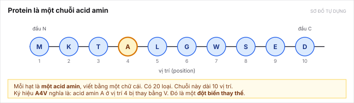
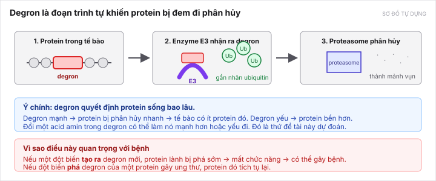

[← Về hub](README.md) · Bài 1/9 · [Bài sau: Người ta đo degron bằng cách nào →](02-how-degrons-are-measured.md)

# Bài 1 — Protein, degron và chuyện phân hủy

Bài này không cần biết gì về sinh học trước đó.

---

## 1. Protein là một chuỗi acid amin

Hãy coi protein như một **xâu chuỗi hạt**. Mỗi hạt là một **acid amin**. Có 20 loại acid amin, mỗi loại viết bằng một chữ cái: `A`, `V`, `L`, `K`, `D`…

*Sơ đồ tự dựng.*

Ba điều cần nhớ:

- **Thứ tự quan trọng.** `MKTA` và `ATKM` là hai protein khác nhau, dù dùng đúng các acid amin như nhau. Điều này nghe hiển nhiên, nhưng [bài 5](05-the-gap.md) sẽ cho thấy mô hình tốt nhất hiện có **lại không phân biệt được** hai thứ đó — và đó chính là chỗ đứng của đề tài.
- **Vị trí được đếm từ 1.** Vị trí 4 trong hình là acid amin `A`.
- **Ký hiệu đột biến.** `A4V` nghĩa là: acid amin `A` ở vị trí 4 bị thay bằng `V`. Đây gọi là **đột biến thay thế một acid amin** (missense). Đề tài chỉ làm loại này, không làm thêm/mất đoạn.

> **Từ cần quen:** *residue* là cách gọi khác của "một acid amin ở một vị trí cụ thể trong chuỗi". Khi tài liệu nói "mức residue" (residue-level), nghĩa là **tính cho từng vị trí một**, chứ không phải một con số cho cả chuỗi.

---

## 2. Tế bào liên tục phá protein, và nó cần biết phá cái nào

Protein không sống mãi. Tế bào có một hệ thống dọn dẹp: protein nào hỏng, hết việc, hoặc có quá nhiều thì bị đem đi phân hủy. Hệ thống đó gọi là **hệ ubiquitin–proteasome**.

Nhưng tế bào làm sao biết phá protein nào? Câu trả lời: nó **đọc chính trình tự của protein đó**. Một số đoạn trình tự là tín hiệu "hãy phá tôi". Đoạn đó gọi là **degron**.

*Sơ đồ tự dựng.*

Quy trình ba bước:

1. Protein mang trong mình một đoạn **degron**.
2. Một enzyme gọi là **E3 ubiquitin ligase** nhận ra degron đó, rồi gắn lên protein những nhãn nhỏ gọi là **ubiquitin** (viết tắt `Ub`).
3. **Proteasome** — cái máy xay của tế bào — thấy chuỗi nhãn ubiquitin, hút protein vào và cắt nó thành mảnh vụn.

> **Tương tự dễ nhớ:** degron là **nhãn "rác"** dán trên một thùng. E3 là **người đi thu rác**, chỉ lấy thùng có nhãn. Proteasome là **xe nghiền rác**.

---

## 3. Degron mạnh hay yếu — và đó là một con số

Không phải degron nào cũng như nhau. Một degron **mạnh** làm protein bị phá rất nhanh; một degron **yếu** thì protein sống lâu hơn.

Điều then chốt cho đề tài: **đổi một acid amin trong degron có thể làm nó mạnh lên hoặc yếu đi**. Và mức thay đổi đó **đo được bằng thí nghiệm** — [bài 2](02-how-degrons-are-measured.md) nói cách đo.

---

## 4. Vì sao điều này liên quan tới bệnh

Đây là phần trả lời câu "vì sao cần nghiên cứu", thứ GVHD đặc biệt nhấn mạnh (xem [course.md](../../project/course.md)).

**Trường hợp 1 — đột biến tạo ra degron mới.** Một protein bình thường vẫn làm việc tốt. Một đột biến vô tình biến một đoạn của nó thành degron. Giờ tế bào phá protein lành đó sớm → thiếu protein → mất chức năng → có thể gây bệnh. Bài [Voutsinos 2026](papers/voutsinos-2026.md) có ví dụ cụ thể: biến thể `D33V` của protein PNPO.

**Trường hợp 2 — đột biến phá degron sẵn có.** Một protein thúc đẩy tế bào phân chia, bình thường bị phá đều đặn để giữ cân bằng. Nếu đột biến làm hỏng degron của nó, protein đó **tích tụ lại** và tế bào phân chia mất kiểm soát. Bài [Tokheim 2021](papers/tokheim-2021.md) khảo sát đúng hiện tượng này trong ung thư.

**Trường hợp 3 — dùng degron làm thuốc.** Có một hướng thuốc mới (targeted protein degradation) cố tình **dán degron** vào một protein gây bệnh để tế bào tự phá nó. Hiểu residue nào làm degron mạnh là kiến thức nền cho việc thiết kế này.

> Nói cho đúng mức: đề tài này **không** dự đoán bệnh, và **không** thay thế các mô hình dự đoán độc tính biến thể như [AlphaMissense](papers/alphamissense-2023.md). Nó bổ sung **cơ chế** — giải thích *vì sao* một biến thể làm protein mất ổn định. Phạm vi chính thức ghi ở [topic-decision.md mục 3](../../topics/degron-footprint/research/topic-decision.md).

---

## 5. Những gì đề tài KHÔNG làm

Ghi sẵn ở đây để đừng hứa quá khi báo cáo:

| Không làm | Vì sao |
|---|---|
| Không dự đoán protein có thật sự bị phá nhanh trong một tế bào cụ thể | Còn phụ thuộc E3 nào đang được biểu hiện, chaperone, protein nằm ở đâu trong tế bào |
| **Không dự đoán E3 nào nhận ra degron** | Đếm từ dữ liệu thô: chỉ có **10 E3** có nhãn, và **6 trong số đó chỉ có đúng 1 peptide**. Không đủ để huấn luyện. Xem [bài 4](04-datasets.md) |
| Không thay thế mô hình dự đoán độc tính biến thể | Chỉ bổ sung cơ chế |
| Nhãn là peptide **tách rời**, không phải protein nguyên vẹn | Thí nghiệm cắt protein thành đoạn ngắn rồi đo riêng từng đoạn — xem [bài 2](02-how-degrons-are-measured.md) |

Cái cuối là một giới hạn thật và phải nói ra trong luận văn: một đoạn peptide bị cắt rời có thể hành xử khác với khi nó còn nằm trong protein nguyên vẹn, nơi nó có thể bị gập vào bên trong và không lộ ra cho E3 thấy.

---

[← Về hub](README.md) · [Bài sau: Người ta đo degron bằng cách nào →](02-how-degrons-are-measured.md)
