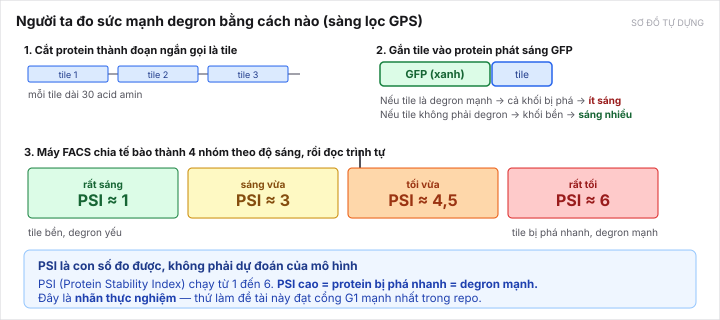
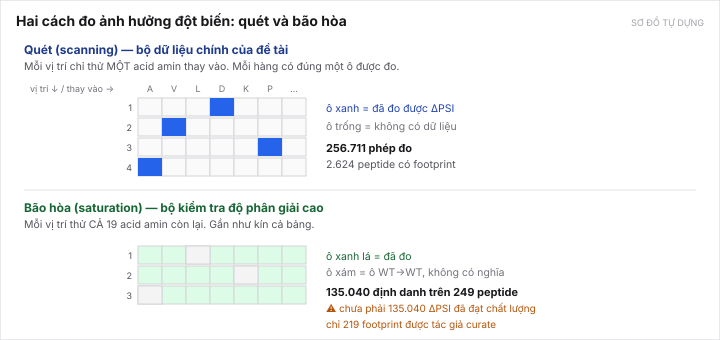
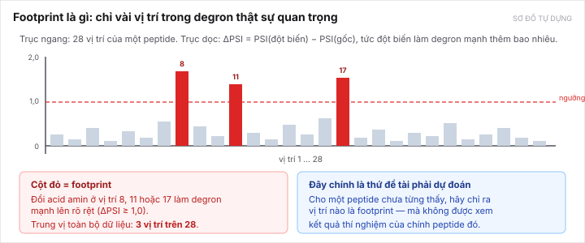

[← Bài trước](01-protein-and-degron.md) · Bài 2/9 · [Bài sau: Bài toán của đề tài →](03-the-problem.md)

# Bài 2 — Người ta đo degron bằng cách nào

Bài này giải thích nhãn của đề tài từ đâu ra. Quan trọng, vì **toàn bộ sức mạnh của đề tài nằm ở chất lượng nhãn** — đây là lý do degron đạt cổng G1 mạnh nhất trong repo.

---

## 1. Ý tưởng: dùng protein phát sáng làm cái cân

Không ai đo trực tiếp "degron này mạnh bao nhiêu". Người ta đo **gián tiếp**, bằng một mẹo rất gọn gàng gọi là sàng lọc **GPS** (Global Protein Stability).



*Sơ đồ tự dựng. Hình gốc của tác giả: Fig. 1 của [Voutsinos 2026](papers/voutsinos-2026.md).*

Ba bước:

**Bước 1 — cắt protein thành tile.** Lấy hàng nghìn protein người, cắt mỗi cái thành các đoạn ngắn **30 acid amin**, gọi là **tile**. Voutsinos 2026 cắt 5.672 protein thành 214.158 tile.

**Bước 2 — gắn tile vào GFP.** GFP là protein phát sáng xanh (lấy từ con sứa). Người ta tạo ra một protein ghép: `GFP + tile`. Logic:

- Nếu tile là **degron mạnh** → cả khối `GFP+tile` bị tế bào phá → **ít sáng**.
- Nếu tile **không phải degron** → khối bền → **sáng nhiều**.

Tức là **độ sáng trở thành thước đo độ bền**. Đây là mẹo chính của cả phương pháp.

**Bước 3 — chia nhóm theo độ sáng và đọc trình tự.** Máy FACS chia tế bào thành 4 nhóm từ sáng nhất đến tối nhất, rồi giải trình tự DNA để biết tile nào nằm ở nhóm nào.

---

## 2. PSI — con số then chốt

Từ việc tile nằm ở nhóm nào, người ta tính ra một con số gọi là **PSI** (Protein Stability Index), chạy từ **1 đến 6**.

| PSI | Nghĩa |
|---:|---|
| gần 1 | tile rất bền, **degron yếu** hoặc không phải degron |
| gần 6 | tile bị phá rất nhanh, **degron mạnh** |

**Hãy nhớ chiều này cho đúng: PSI cao = bị phá nhiều = degron mạnh.** Rất dễ nhớ ngược vì chữ "Stability" (độ bền) gợi ý chiều ngược lại.

> **Vì sao PSI là nhãn tốt:** nó là **số đo từ thí nghiệm thật**, không phải điểm do một mô hình máy tính sinh ra. Đây chính là điều kiện của cổng **G1** trong [khung đánh giá](../../project/course.md): nhãn phải độc lập với pipeline của đề tài. Một hướng đề tài cũ của repo (TME senescence) đã **bị loại** vì trượt đúng cổng này — nhãn của nó do chính pipeline sinh ra ([D-008](../../DECISIONS.md#d-008)).

---

## 3. ΔPSI — ảnh hưởng của một đột biến

Giờ đến phần đề tài thật sự dùng. Nhóm [Zhang 2023](papers/zhang-2023.md) làm thêm một bước: họ không chỉ đo peptide gốc, mà đo cả **các phiên bản đã đột biến** của nó.

Với mỗi đột biến, tính:

```
ΔPSI = PSI(phiên bản đột biến) − PSI(phiên bản gốc)
```

| ΔPSI | Nghĩa |
|---|---|
| **dương, lớn** (≥ 1,0) | đột biến làm degron **mạnh lên** rõ rệt → vị trí này **quan trọng** |
| gần 0 | đột biến gần như không ảnh hưởng → vị trí này **không quan trọng** |
| âm | đột biến làm degron yếu đi |

Ngưỡng **ΔPSI ≥ 1,0** là ngưỡng đang dùng để gọi một vị trí là "quan trọng". Ngưỡng đó cùng các ngưỡng lọc khác (reads ≥ 10, PSI của bản gốc ≤ 3,0, ít nhất 21 vị trí đo được) ghi ở [composition-context-audit.md mục 2](../../topics/degron-footprint/research/composition-context-audit.md).

---

## 4. Hai cách đo đột biến: quét và bão hòa

Zhang 2023 làm hai thí nghiệm khác nhau, và đề tài dùng cả hai theo hai vai trò khác nhau.



*Sơ đồ tự dựng.*

**Quét (scanning mutagenesis)** — mỗi vị trí chỉ thử **một** acid amin thay vào. Rẻ hơn, nên làm được trên rất nhiều peptide.

- **256.711** phép đo đạt lọc
- **2.624** peptide có footprint dùng được
- → **Đây là nguồn huấn luyện chính của đề tài**

**Bão hòa (saturation mutagenesis)** — mỗi vị trí thử **cả 19** acid amin còn lại. Đắt hơn nhiều, nên chỉ làm trên ít peptide.

- **135.040** định danh trên **249** peptide
- → Dùng để **kiểm tra ở độ phân giải cao**, không phải huấn luyện chính

> **Một cái bẫy phải nhớ:** 135.040 là **số định danh**, *không phải* 135.040 giá trị ΔPSI đã đạt chất lượng. Chỉ **219 footprint** được tác giả curate cẩn thận. Đừng bao giờ viết "135.040 phép đo bão hòa" như thể tất cả đều dùng được.

---

## 5. Footprint — khái niệm trung tâm của đề tài

Giờ ghép tất cả lại. Lấy một peptide, đo ΔPSI ở từng vị trí, vẽ thành biểu đồ:



*Sơ đồ tự dựng.*

Phát hiện quan trọng: **tín hiệu không dàn đều.** Trong 28 vị trí, thường chỉ **khoảng 3 vị trí** có ΔPSI ≥ 1,0. Những vị trí đó gọi là **footprint** của degron — như "dấu chân" cho thấy chỗ nào E3 thật sự quan tâm.

Con số tự đếm từ dữ liệu thô:

| | Số đếm |
|---|---:|
| Peptide có WT và đột biến đạt lọc | 8.831 |
| Peptide là degron | 3.439 |
| Đủ độ phủ vị trí | 3.415 |
| **Peptide có footprint** | **2.624** |
| Trong đó footprint **khu trú** | 2.402 |
| **Trung vị số vị trí quan trọng** | **3 trên 28** |

Nguồn: [composition-context-audit.md mục 2](../../topics/degron-footprint/research/composition-context-audit.md), tái lập được bằng script trong [e3-labels-audit/](../../topics/degron-footprint/research/e3-labels-audit/README.md).

---

## 6. Vì sao con số "3 trên 28" quan trọng đến thế

Vì nó nói rằng **bài toán là bài toán khu trú (localized)**, không phải bài toán trung bình.

Một mô hình cho ra "peptide này nói chung là degron mạnh" thì không trả lời được câu hỏi của nhà sinh học. Câu họ cần là: *"tôi nên đem vị trí nào đi làm thí nghiệm?"* — và họ chỉ làm được vài thí nghiệm.

Chính vì vậy thước đo chính của đề tài là **precision@3**: trong 3 vị trí mô hình tin nhất, bao nhiêu phần là footprint thật. Xem [bài 7](07-evaluation.md).

---

## 7. Giới hạn của nhãn — phải nói trong luận văn

Nhãn tốt, nhưng không hoàn hảo. Chép từ [composition-context-audit.md mục 4.2](../../topics/degron-footprint/research/composition-context-audit.md):

- Dữ liệu dùng **một replicate** (một lần lặp thí nghiệm), không phải trung bình nhiều lần.
- Ngưỡng reads tối thiểu **thấp** → nhiễu đo cao hơn mong muốn.
- Nhãn genotype BAG6 của replicate này **chưa rõ**.
- **Chưa tách được** phần "ngữ cảnh có thể học" khỏi phần "nhiễu thí nghiệm". Một phần tín hiệu mà đề tài hy vọng học được **có thể chỉ là nhiễu**.
- Tập 2.624 peptide **đã được chọn theo điều kiện có footprint**, nên chỉ số của nó không mô tả toàn bộ proteome. Khi đánh giá mô hình thật, cần đưa thêm cả peptide **không có** footprint để đo được tỉ lệ báo động sai.

Điều cuối là một thiết kế đánh giá chưa làm, và nó nằm trong [danh sách việc tiếp theo](../../topics/degron-footprint/README.md).

---

[← Bài trước](01-protein-and-degron.md) · [Bài sau: Bài toán của đề tài →](03-the-problem.md)
