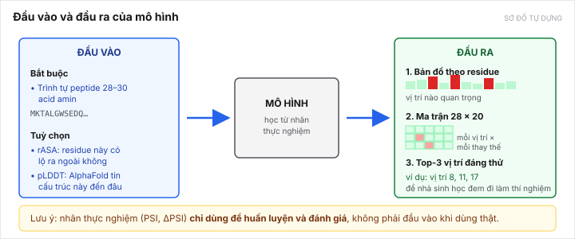

[← Bài trước](02-how-degrons-are-measured.md) · Bài 3/10 · [Bài sau: Bốn bộ dữ liệu →](04-datasets.md)

# Bài 3 — Bài toán của đề tài

Bài 1 và 2 là nền sinh học. Từ đây là đề tài.

---

## 1. Tên đề tài

> **Dự đoán footprint degron ở mức residue bằng học đa thể hiện với cổng phơi lộ cấu trúc, trên nhãn đột biến thực nghiệm.**

Dịch sang tiếng thường:

| Phần tên                                | Nghĩa                                                                                    |
| ----------------------------------------- | ----------------------------------------------------------------------------------------- |
| *dự đoán footprint degron*           | chỉ ra vị trí nào trong degron là quan trọng                                        |
| *ở mức residue*                       | cho ra một con số**cho từng vị trí**, không phải một con số cho cả đoạn |
| *học đa thể hiện* (MIL)             | kỹ thuật được đề xuất — xem[bài 6](06-proposed-solution.md)                      |
| *cổng phơi lộ cấu trúc*            | dùng thông tin "residue này có lộ ra ngoài không" để điều tiết mô hình      |
| *trên nhãn đột biến thực nghiệm* | huấn luyện bằng ΔPSI đo thật, không phải nhãn máy sinh                          |

**Tên cũ đã bỏ:** *"Dự đoán đặc hiệu E3–degron…"*. Bỏ ngày 11/10/2026 vì đếm từ dữ liệu thô cho thấy chỉ có **1 E3 duy nhất** đủ mẫu để huấn luyện. Lịch sử ở [topic-decision.md mục 1](../../topics/degron-footprint/research/topic-decision.md).

---

## 2. Câu hỏi nghiên cứu, viết cho rõ

> Cho một đoạn peptide mà mô hình **chưa từng thấy**, hãy chỉ ra residue nào quyết định độ bền của nó, và nếu đổi residue đó sang một acid amin khác thì độ bền thay đổi bao nhiêu.

Hai chữ then chốt:

- **"chưa từng thấy"** — mô hình không được xem kết quả thí nghiệm của chính peptide đang chấm. Và chặt hơn nữa: tập test phải chia **theo cụm protein đồng dạng**, không chỉ theo peptide, để mô hình không thể học thuộc một họ protein rồi ăn điểm. Lý do xem [bài giảng về rò rỉ dữ liệu](../09-leakage-and-homology.html).
- **"bao nhiêu"** — không chỉ phân loại quan trọng/không, mà dự đoán cả độ lớn.

---

## 3. Đầu vào và đầu ra

*Sơ đồ tự dựng.*

### Đầu vào

| Thành phần       | Nội dung                                                                               | Bắt buộc?          |
| ------------------ | --------------------------------------------------------------------------------------- | -------------------- |
| Trình tự peptide | 28–30 acid amin, ví dụ`MKTALGWSEDQ…`                                              | **Bắt buộc** |
| rASA               | mức độ residue đó lộ ra bề mặt protein (tính từ cấu trúc AlphaFold2 + DSSP) | Tuỳ chọn           |
| pLDDT              | AlphaFold tự tin đến đâu về cấu trúc ở chỗ đó                               | Tuỳ chọn           |

Hai thứ tuỳ chọn là để trả lời một vấn đề thật: khi peptide nằm **tách rời** (như trong thí nghiệm) thì nó lộ ra hoàn toàn, nhưng khi nó nằm **trong protein nguyên vẹn** thì có thể bị gập vào trong và E3 không thấy. [Bài 6](06-proposed-solution.md) nói cách xử lý điều này.

### Đầu ra

Ba thứ, từ đơn giản đến chi tiết:

1. **Bản đồ độ nhạy theo residue** — một vector 28 chiều, mỗi chiều là "đổi residue ở vị trí này thì ảnh hưởng bao nhiêu". **Đây là mục tiêu chính.**
2. **Ma trận 28 × 20** — chi tiết hơn: với mỗi vị trí, đổi sang từng acid amin cụ thể thì ảnh hưởng bao nhiêu. Đây là [đề xuất của Trọng](../../topics/degron-footprint/research/composition-context-audit.md) ngày 12/10, đang khảo sát.
3. **Top-3 vị trí đáng thử** — thứ nhà sinh học thật sự dùng.

> **Nhãn thực nghiệm (PSI, ΔPSI) chỉ dùng để huấn luyện và đánh giá.** Khi dùng mô hình thật, đầu vào chỉ có trình tự (và có thể cấu trúc). Đây là điểm dễ nhầm, và nhầm là mất tư cách zero-shot.

---

## 4. Vì sao bài toán này không tầm thường

Có bốn khó khăn thật, không phải khó khăn bày ra cho đẹp:

**Khó khăn 1 — tín hiệu rất thưa.** Chỉ 3 trên 28 vị trí là footprint. Đoán ngẫu nhiên 3 vị trí chỉ đúng được **0,1204** (precision@3). Nói cách khác, 89% việc đoán bừa là sai.

**Khó khăn 2 — mô hình tốt nhất hiện có bị chặn bởi toán học.** Đây là nội dung [bài 5](05-the-gap.md), và cũng là chỗ đứng của đề tài.

**Khó khăn 3 — nhãn có nhiễu.** Một replicate, reads thấp. Một phần tín hiệu có thể là nhiễu đo chứ không phải sinh học.

**Khó khăn 4 — tập test nhỏ.** Chia theo cụm protein thì chỉ còn **221–322 footprint** để test. Đây là **rủi ro số một** của đề tài, xem [bài 9](09-risks.md).

---

## 5. Sản phẩm phải có: ứng dụng web

Tiêu chí 5 của GVHD — ứng dụng hoặc website — **không thể thiếu**, vì đây là luận văn khoa Kỹ thuật phần mềm ([D-006](../../DECISIONS.md#d-006)).

Thiết kế dự kiến: người dùng dán một trình tự peptide → web trả về bản đồ residue, ma trận 28 × 20 dưới dạng heatmap, và top-3 vị trí đáng thử.

**Nhưng phải biết điều này:** đã có **ba** sản phẩm tương tự tồn tại rồi —

| Sản phẩm                                 | Là gì                                                                     |
| ------------------------------------------ | --------------------------------------------------------------------------- |
| [DEGRONOPEDIA](papers/degronopedia-2024.md) | cơ sở dữ liệu + web tra cứu degron                                     |
| [MetaDegron](papers/metadegron-2024.md)     | máy chủ web dự đoán degron theo từng E3                               |
| Colab của nhóm PAP                       | notebook chạy mô hình PAP, kèm[Voutsinos 2026](papers/voutsinos-2026.md) |

Nên ứng dụng của đề tài phải **khác biệt được**, không chỉ tồn tại. Chỗ khác biệt khả thi: **không sản phẩm nào trong ba cái trên xuất ra ma trận vị trí × acid amin thay vào, dựa trên nhãn đột biến thực nghiệm.** Đó là chỗ nên nhắm.

Đây là cổng **G3** và nó đang là **cổng yếu nhất** của đề tài — xem [thẻ đề tài](../../topics/degron-footprint/README.md).

---

[← Bài trước](02-how-degrons-are-measured.md) · [Bài sau: Bốn bộ dữ liệu →](04-datasets.md)
