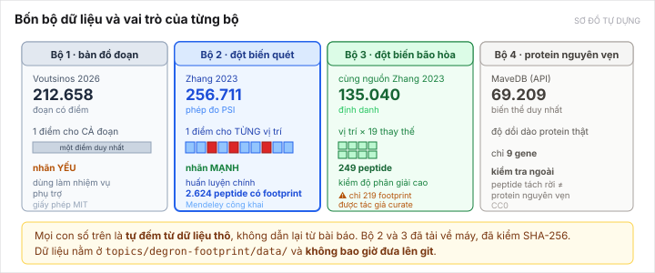

[← Bài trước](03-the-problem.md) · Bài 4/9 · [Bài sau: Khoảng trống →](05-the-gap.md)

# Bài 4 — Bốn bộ dữ liệu

> **Mọi con số trong bài này là tự đếm từ dữ liệu thô**, không dẫn lại từ bài báo. Đây là quy ước của repo và là lý do các con số ở đây đôi khi khác với con số in trong bài báo.

---

## 1. Toàn cảnh



*Sơ đồ tự dựng.*

|                           | Bộ 1                                     | Bộ 2                                        | Bộ 3                          | Bộ 4                     |
| ------------------------- | ----------------------------------------- | -------------------------------------------- | ------------------------------ | ------------------------- |
| **Tên**            | bản đồ đoạn bào tương             | đột biến**quét**                   | đột biến**bão hòa** | protein nguyên vẹn      |
| **Nguồn**          | [Voutsinos 2026](papers/voutsinos-2026.md) | [Zhang 2023](papers/zhang-2023.md)            | cùng Zhang 2023               | [MaveDB](papers/mavedb.md) |
| **Vai trò**        | nhãn**yếu**, nhiệm vụ phụ trợ | **nhãn mạnh — huấn luyện chính** | kiểm độ phân giải cao     | kiểm trên protein thật |
| **Số phép đo**   | 212.658 đoạn                            | **256.711**                            | 135.040 định danh            | 69.209 biến thể         |
| **Đơn vị nhãn** | 1 điểm cho cả đoạn                   | ΔPSI**từng vị trí**                | ΔPSI vị trí × 19 thay thế | độ dồi dào protein    |
| **Dùng được**   | 5.327 gene                                | **2.624 peptide có footprint**        | 249 peptide                    | chỉ 9 gene               |
| **Giấy phép**     | MIT                                       | Mendeley công khai                          | Mendeley công khai            | CC0                       |
| **Đã tải?**      | ✅                                        | ✅                                           | ✅                             | ❌ chưa                  |

---

## 2. Bộ 2 — nguồn huấn luyện chính

Đây là bộ quan trọng nhất, nên nói kỹ.

**Nguồn:** Mendeley Data [`10.17632/32h94v2yv2.2`](https://data.mendeley.com/datasets/32h94v2yv2/2), giấy phép CC BY 4.0. Đi kèm [Zhang 2023](papers/zhang-2023.md).

**File đã tải và kiểm:**

| File                                   | Kích thước | SHA-256                                                              |
| -------------------------------------- | ------------: | -------------------------------------------------------------------- |
| `I28 Scanning Mutagenesis.zip`       |  27.939.862 B | `a82bd1ee4bc7a2da69df06cb44dd34fe8480c6fd799340684f5058d02223df50` |
| `I28 CRL Saturation Mutagenesis.zip` |   5.224.902 B | `cbda58342265dd73b7946cd091c5b558eed6e615bbcb97921e37bd50fbb5ee60` |

File chính dùng: `Replicate 1 (BAG6 genotype unclear)/I28 Scanning Mutagenesis Replicate 1.csv`.

**Đường lọc, từ dòng thô đến peptide dùng được:**

```
283.880 dòng thô
   ↓ reads ≥ 10, PSI(gốc) ≤ 3,0
256.711 dòng đạt lọc
   ↓ gom theo peptide, cần ≥ 21 vị trí đo được
  8.831 peptide
   ↓ là degron
  3.439 peptide
   ↓ đủ độ phủ
  3.415 peptide
   ↓ có vị trí ΔPSI ≥ 1,0
  2.624 peptide có footprint   ← tập làm việc
   ↓ footprint khu trú
  2.402 peptide
```

**256.711 là số dòng đo, không phải số mẫu sinh học độc lập.** Nhiều dòng thuộc cùng một peptide, nên khi tính chỉ số phải lấy **trung bình macro theo peptide**, không coi các vị trí trong một peptide là mẫu độc lập. Đây là lỗi dễ mắc nhất khi báo kết quả.

Tái lập: script trong [e3-labels-audit/](../../topics/degron-footprint/research/e3-labels-audit/README.md), lệnh cụ thể ở [composition-context-audit.md mục 7](../../topics/degron-footprint/research/composition-context-audit.md).

---

## 3. Chia tập — chỗ dễ sai nhất

Không được chia ngẫu nhiên theo peptide. Lý do: hai peptide từ hai protein họ hàng gần có thể giống nhau, nên mô hình "học thuộc" một họ rồi ăn điểm ở tập test. Đó gọi là **rò rỉ do đồng dạng**.

Cách làm đúng: gom **protein nguyên vẹn** thành cụm bằng MMseqs2 (identity ≥ 30%, coverage hai chiều), rồi chia **theo cụm**.

Kết quả, và đây là con số đáng lo:

| Coverage hai chiều | Số cụm protein | **Footprint còn trong tập test** |
| ------------------- | ---------------: | ---------------------------------------: |
| ≥ 80%              |            5.088 |                       **271–322** |
| ≥ 50%              |            4.418 |                       **221–301** |

Chia 80/10/10 theo số cụm, thử 5 seed (`0, 42, 87, 1001, 12345`). Ở seed 42: 274 footprint (cov80), 221 footprint (cov50).

> **Đây là rủi ro số một của đề tài.** Tập test chỉ hơn 200 mẫu. Chưa biết n đó có đủ để chứng minh một cải thiện so với mốc 0,6045. Xem [bài 9](09-risks.md).

Điểm tốt: **footprint không dồn vào vài protein**. Trung vị 1 footprint/protein, nhiều nhất là 7, nên protein lớn nhất chỉ chiếm **0,267%** số footprint. Nghĩa là tập test nhỏ nhưng không bị một protein chi phối.

---

## 4. Bộ 3 — bẫy cần tránh

Bộ bão hòa nghe hấp dẫn: **135.040** phép đo, vị trí × 19 thay thế, gần kín cả bảng. Nhưng:

- 135.040 là **số định danh**, không phải 135.040 ΔPSI đã đạt chất lượng.
- Chỉ **219 footprint** được tác giả curate.
- **130 trên 248** peptide bão hòa cũng có mặt trong bộ quét → **trùng lặp**. Nếu dùng bộ bão hòa để train mà vẫn gọi cả 249 peptide là test độc lập thì đó là rò rỉ.
- Cần xử lý score và mask ô không hợp lệ (ô `WT → WT`, ô có ký hiệu stop `*`) trước khi dùng.

Có **813** peptide gốc (trong đó 336 footprint) kết thúc bằng ký hiệu stop `*`. **Không được coi `*` là một acid amin.** Đầu ra ma trận phải mask những vị trí đó.

---

## 5. Về nhãn E3 — vì sao trục đề tài phải đổi

Bộ dữ liệu có kèm 31 sàng lọc CRISPR, về nguyên tắc cho biết **E3 nào** phụ trách degron nào. Nghe như một trục đề tài hay. Nhưng đếm từ dữ liệu MAGeCK thô:

|                                   |                        Số đếm |
| --------------------------------- | -------------------------------: |
| Sàng lọc CRISPR                 |                               31 |
| Gán được adaptor              |                27 (gán rõ: 25) |
| **Số E3 khác nhau**       |                     **10** |
| **Số E3 có ≥ 5 peptide** | **1** (KLHL15, 13 peptide) |
| Số E3 có đúng 1 peptide       |                      **6** |

Bền với **36 tổ hợp ngưỡng** khác nhau: số E3 có ≥ 5 peptide **luôn đúng bằng 1**.

**Hệ quả:** không thể huấn luyện một mô hình dự đoán "E3 nào nhận ra degron này" — 6 trên 10 lớp chỉ có một mẫu. Trục "đặc hiệu E3" đã bị **bỏ khỏi đề tài** ngày 11/10/2026. E3 chỉ còn ở vai trò **ca nghiên cứu nhỏ** trên 23 peptide có cả nhãn E3 và bản đồ bão hòa.

Chi tiết và 7 script đếm: [e3-labels-audit/](../../topics/degron-footprint/research/e3-labels-audit/README.md).

> Giới hạn của kết luận này: chưa lấy được Table S5 (bảng gán E3 do tác giả curate), nên **10 E3 là giới hạn dưới**. Nhưng Table S5 chỉ thêm peptide, không đổi được việc 6 lớp có một mẫu. Và **không được nói "chỉ 16 E3 có nhãn CRISPR"** — con số đó sai, quy ước ngôn từ ở [thẻ đề tài](../../topics/degron-footprint/README.md).

---

## 6. Dữ liệu nằm ở đâu, và quy tắc không được phá

Dữ liệu ở `topics/degron-footprint/data/`:

| Thư mục      | Nội dung                                                                        |
| -------------- | -------------------------------------------------------------------------------- |
| `raw/`       | file gốc,**không sửa tay** — 2 ZIP, manifest SHA-256, snapshot UniProt |
| `interim/`   | cache — CSV quét đã giải nén, cụm MMseqs2                                 |
| `processed/` | đầu ra script — bảng audit theo peptide, FASTA protein                       |

**Hai quy tắc tuyệt đối** (từ [CLAUDE.md](../../CLAUDE.md)):

1. Thư mục `data/` bị `.gitignore` chặn. **Không bao giờ commit dữ liệu.**
2. Mọi file trong `processed/` phải **sinh lại được** bằng script trong `research/`. Nếu một file không sinh lại được thì nó là nợ kỹ thuật, không phải kết quả.

Chi tiết cách tải lại: [resources/README.md mục 4](../../resources/README.md).

---

[← Bài trước](03-the-problem.md) · [Bài sau: Khoảng trống →](05-the-gap.md)
