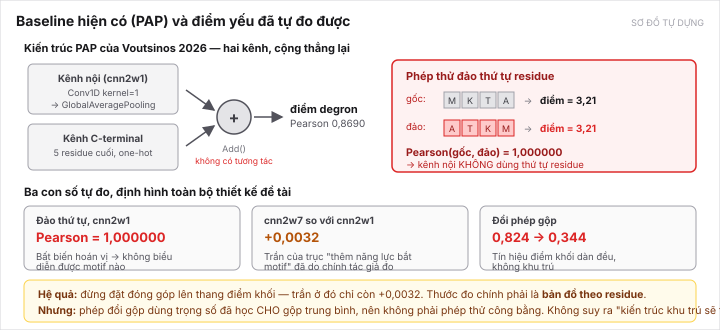
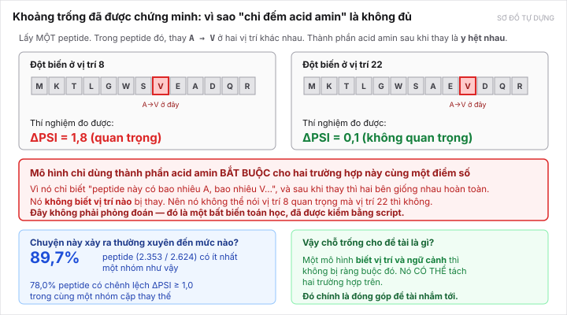
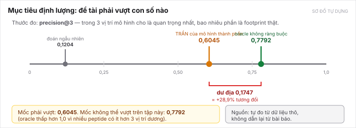

[← Bài trước](04-datasets.md) · Bài 5/10 · [Bài sau: Giải pháp đề xuất →](06-proposed-solution.md)

# Bài 5 — Khoảng trống: vì sao đề tài có chỗ đứng

> **Đây là bài quan trọng nhất của cả hub.** Nếu bạn chỉ có 10 phút trước buổi gặp GVHD, đọc bài này.
>
> Nó trả lời câu hỏi khó nhất mà GVHD sẽ hỏi: *"Đã có người làm rồi, vậy em làm thêm được gì?"*

---

## 1. Mô hình tốt nhất hiện có: PAP

Nhóm [Voutsinos 2026](papers/voutsinos-2026.md) đã công bố một mô hình dự đoán điểm degron, gọi là **PAP**. Nó khá tốt: Pearson **0,8690** trên tập holdout.

Mình đã **tự dựng lại PAP bằng numpy** và khớp đúng cả hai con số công bố:

| Cấu hình | Mình tái lập | Bài báo |
|---|---:|---:|
| Chỉ kênh nội | **0,8239** | 0,82 |
| Đầy đủ (cả kênh C-terminal) | **0,8690** | 0,87 |

Việc khớp cả hai con số xác nhận bản tái lập là đúng. Nguồn: [voutsinos-2026-audit/](../../topics/degron-footprint/research/voutsinos-2026-audit/README.md).



*Sơ đồ tự dựng. Hình gốc của tác giả: Fig. 4 của [Voutsinos 2026](papers/voutsinos-2026.md).*

Kiến trúc PAP, sau khi đọc hết mã nguồn:

- **Kênh nội:** `Conv1D(filters=25, kernel=1)` → `GlobalAveragePooling1D` → `Dense(50)` → `Dense(50)` → `Dense(1)`, trên 25 residue đầu.
- **Kênh C-terminal:** 5 residue cuối one-hot → `Dense(25)` → `Dense(50)` → `Dense(50)` → `Dense(1)`.
- **Đầu ra:** `Add()` — cộng thẳng hai kênh, **không có tương tác nào giữa chúng**.

Để ý `kernel=1`. Một convolution với kernel kích thước 1 chỉ xem **một residue mỗi lần**, không bao giờ xem hai residue cạnh nhau. Rồi `GlobalAveragePooling` lấy trung bình tất cả. Điều đó dẫn tới phát hiện sau.

---

## 2. Phép thử làm lộ điểm yếu: đảo thứ tự residue

Mình lấy peptide, **đảo ngược thứ tự toàn bộ residue**, rồi chạy lại PAP.

Kết quả:

| Phép thử | Kết quả |
|---|---|
| Đảo thứ tự, kênh nội `cnn2w1` | max \|Δ\| = 4,8 × 10⁻⁷ · **Pearson(gốc, đảo) = 1,000000** |
| Đảo thứ tự, bản `cnn2w7` (cửa sổ 7) | Pearson(gốc, đảo) = 0,9018 |

**Pearson = 1,000000 nghĩa là điểm không đổi một chút nào.** Kênh nội của PAP **bất biến hoán vị** — nó không dùng thứ tự residue, chỉ dùng **thành phần** acid amin ("peptide này có bao nhiêu A, bao nhiêu V…").

Một mô hình bất biến hoán vị thì **không thể biểu diễn được motif nào**. Motif là một mẫu *có thứ tự*, ví dụ "`D` rồi `S` rồi `G` liền nhau". PAP không thấy được điều đó.

---

## 3. Hệ quả: một ràng buộc toán học, không phải phỏng đoán

Đây là chỗ cần hiểu cho chắc, vì đó là nền của toàn bộ đóng góp.

Gọi `f` là mô hình chỉ dùng thành phần. Với peptide có thành phần `c`, đột biến ở vị trí `i` từ acid amin `a` sang `b` cho:

```
Δf_i(a→b) = f(c − e_a + e_b) − f(c)
```

Để ý: **công thức không có `i` ở bên phải.** Nghĩa là trong **cùng một peptide**, mọi vị trí có **cùng cặp (a, b)** buộc phải nhận **cùng một dự đoán**.

Nói bằng ví dụ:



*Sơ đồ tự dựng.*

Thay `A → V` ở vị trí 8 và thay `A → V` ở vị trí 22, trong cùng một peptide. Sau khi thay, thành phần acid amin của hai phiên bản **giống hệt nhau**. Nên PAP **buộc phải** cho hai điểm bằng nhau.

Nhưng thí nghiệm nói: vị trí 8 có ΔPSI = 1,8 (rất quan trọng), vị trí 22 có ΔPSI = 0,1 (không quan trọng).

**PAP không thể đúng cả hai.** Đây không phải "PAP chưa được huấn luyện tốt" — đây là giới hạn cứng của lớp mô hình đó.

> **Hai điều phải nói cho đúng mức, kẻo bị bắt lỗi:**
>
> 1. Ràng buộc này áp cho **mô hình thành phần thuần túy**, tức kênh nội `cnn2w1`. **PAP đầy đủ** còn có kênh C-terminal, nên không được gán cận này cho PAP đầy đủ.
> 2. **Không được nói "bản đồ của mô hình thành phần phải phẳng".** Nó không phẳng — các cặp thay thế khác nhau vẫn cho giá trị khác nhau. Ràng buộc đúng chỉ là: *cùng cặp thay thế trong cùng peptide → cùng điểm*.

---

## 4. Chuyện này xảy ra thường xuyên đến mức nào

Nếu ràng buộc đó chỉ ảnh hưởng vài peptide thì không thành đề tài. Mình đã đếm trên cả 2.624 peptide có footprint:

| Phép đo | Kết quả |
|---|---:|
| Peptide có cùng cặp thay thế nhưng chênh ΔPSI ≥ 1,0 | **2.046 / 2.624 = 78,0%** |
| **Peptide có một nhóm cùng cặp chứa cả vị trí dương và không dương** | **2.353 / 2.624 = 89,7%** |
| Trung vị khoảng chênh lớn nhất trong nhóm cùng cặp | **1,3068 PSI** |
| Phần phương sai ΔPSI còn lại sau oracle trung bình theo cặp | **35,0%** |

Dòng **89,7%** là dòng mạnh nhất: với gần chín phần mười peptide, có ít nhất một nhóm mà mô hình thành phần **bị chứng minh là không thể tách** vị trí quan trọng khỏi vị trí không quan trọng.

Nguồn: [composition-context-audit.md mục 4](../../topics/degron-footprint/research/composition-context-audit.md), số gốc ở [composition-audit.json](../../topics/degron-footprint/research/e3-labels-audit/composition-audit.json).

### Vì sao phải gom theo **cặp** thay thế, không chỉ theo acid amin gốc

Một chi tiết kỹ thuật nhưng quan trọng: có **242 trên 2.624** footprint có cùng residue gốc nhưng **nhiều acid amin khác nhau được thay vào**. Nếu gom chỉ theo residue gốc thì sẽ trộn lẫn ảnh hưởng của *đích thay thế* với ảnh hưởng của *vị trí* — và con số thu được sẽ sai.

Bản chẩn đoán gom chỉ theo residue gốc cho cận 0,6012, nhưng **không được dùng nó làm cận chung** khi acid amin thay vào khác nhau.

---

## 5. Con số đề tài phải vượt



*Sơ đồ tự dựng.*

| Mốc | precision@3 | Nghĩa |
|---|---:|---|
| Đoán ngẫu nhiên | **0,1204** | sàn |
| Oracle trung bình theo cặp | 0,5481 | oracle *đạt được*, chưa phải cận |
| **Cận trên chính xác của mô hình thành phần** | **0,6045** | **mốc phải vượt** |
| Oracle không ràng buộc theo nhóm | **0,7792** | mốc không thể vượt trên tập này |

**Dư địa = 0,7792 − 0,6045 = 0,1747**, tức **+28,9% tương đối** so với mốc 0,6045.

> **⚠ Cập nhật 13/10/2026 — đoạn trên đã lỗi.** Cả hai mốc 0,6045 và 0,7792 là **oracle chọn được nhờ nhìn nhãn test**, nên **không mô hình nào đạt được**, và hiệu của hai oracle **không phải dư địa**. Sau khi dựng được lần đo thứ hai, mốc đúng là: baseline thành phần ước lượng trung thực **0,4897**, trần nhãn thực nghiệm **0,6514**, dư địa thật **0,1617**. Lập luận về *cơ chế* của khoảng trống (89,7% peptide bị ràng buộc) **vẫn đúng** — chỉ phần quy ra con số dư địa là sai. Xem [bài 10](10-data-up-close.md) và [full-data-audit mục 4](../../topics/degron-footprint/research/full-data-audit/README.md).

Hai điều cần hiểu về hai mốc này:

**Vì sao oracle chỉ 0,7792 mà không phải 1,0?** Vì nhiều peptide có **ít hơn 3 vị trí dương**. Khi chỉ có 1 hoặc 2 footprint thật, không cách nào chọn được 3 vị trí mà cả 3 đều đúng. Nên **không lấy 1,0 làm mốc có thể đạt được**.

**Vì sao "cận trên chính xác" khác "oracle trung bình"?** Phép lấy trung bình theo nhóm tối ưu *squared error*, không tối ưu precision@3. Cận 0,6045 được tính riêng bằng quy hoạch động, xử lý tie bằng kỳ vọng chọn đều ngẫu nhiên (không được "nhìn nhãn" để chọn vị trí đúng trong một nhóm bằng điểm). Vì vậy **không gọi 0,5481 là trần** — nó chỉ là một oracle cụ thể.

---

## 6. Độ tin cậy của những con số này

Đây là chỗ degron khác mọi ứng viên khác trong repo. Khoảng trống không phải suy từ việc đọc tóm tắt bài báo — nó đã được **kiểm bằng script**:

| Phép kiểm | Số lượng |
|---|---|
| Checksum hai file ZIP gốc | ✅ khớp |
| Tái lập toàn bộ bảng đếm bằng script cũ | ✅ khớp chính xác |
| Đối chiếu oracle precision@3 exhaustive với nhóm kích thước thay đổi | **200** trường hợp |
| Kiểm cận rank | **4.000** phép kiểm |
| Đối chiếu Spearman với SciPy cho trường hợp có tie | **100** trường hợp |
| Phản ví dụ chứng minh ma trận ΔPAP có thể hạng 2 | ✅ có |

So sánh với các ứng viên khác ([khảo sát 7 ứng viên](../../surveys/seven-candidates-comparison-2026-10-12.md)):

| Ứng viên | Trạng thái khoảng trống |
|---|---|
| **degron-footprint** | **đã chứng minh và tự kiểm** |
| dark-kinome-zero-shot | đã sụp — bài DARKIN đã báo cả hai trục |
| A3 structure-sequence-leakage | đã phải thu hẹp vì Denger & Helms 2025 |
| A2, A4 | chưa kiểm — chưa đọc toàn văn nguồn nào |
| LC1, LC2 | 2 trong 4 hướng đã bị chiếm / hướng A đã nằm trong baseline |

---

## 7. Nhưng — ba điều làm lập luận này yếu đi

Phải tự nói ra, vì GVHD sẽ hỏi và vì đó là sự thật.

**1. ~~Chưa tách nhiễu khỏi tín hiệu.~~ Đã tách ngày 13/10, và kết quả xấu hơn lo ngại.** Dựng được lần đo thứ hai nên đo được trực tiếp: trong phần dư đó, **75,9% là nhiễu đo**; phần ngữ cảnh học được nhiều nhất chỉ **8,7%** phương sai, không phải 35,0%. Đã thử chữa bằng cách siết ngưỡng reads và **thất bại** — tỉ lệ nhiễu không đổi từ reads ≥ 10 đến ≥ 200. Chi tiết dễ hiểu ở [bài 10 mục 6](10-data-up-close.md).

**2. Dư địa 0,1747 không phải cải thiện đã hứa — và nay đã bị bác bỏ hẳn.** Nó là hiệu của *hai oracle được phép nhìn nhãn*, nên không phải dư địa của mô hình nào. Số đúng: **0,1617**, từ baseline trung thực 0,4897 lên trần nhãn 0,6514.

**3. Trần của thang điểm khối gần như đã cạn.** Chính tác giả đã đo: bản `cnn2w7` (có cửa sổ 7, tức *có* dùng thứ tự) chỉ hơn bản `cnn2w1` **+0,0032** Pearson. Nghĩa là **đừng đặt đóng góp lên thang điểm đoạn** — ở đó gần như không còn gì để ăn. Thước đo chính phải là **bản đồ theo residue**.

> Và một cảnh báo về phép thử đổi phép gộp: đổi `GlobalAveragePooling` sang max làm Pearson sụt **0,824 → 0,344**. Nhưng phép thử đó dùng **trọng số đã huấn luyện cho gộp trung bình**, nên **không phải** so sánh công bằng với một kiến trúc max pooling được huấn luyện lại từ đầu. **Không suy ra "kiến trúc khu trú sẽ thua".**
>
> Chi tiết thú vị: trong `train_cnn2w.py` của tác giả có một dòng `GlobalMaxPooling1D` **bị chú thích lại** — họ đã nghĩ tới, nhưng không nêu lý do bỏ.

---

## 8. Một lỗi trong mã công bố, đáng biết

Khi đọc mã nguồn của tác giả, mình phát hiện: `train_cnn2w.py` dùng `ci_aa = 1` để lấy cột acid amin. Nhưng header thật là `name, dna, aa, n, …` — **cột 1 là DNA, không phải acid amin**.

Vì A/C/G/T đều là ký hiệu acid amin hợp lệ, bộ lọc của script không loại chúng: cả 5.000 dòng thử đều lọt qua. Nghĩa là **chạy mã công bố trên dữ liệu công bố sẽ huấn luyện mô hình trên chuỗi DNA**.

Đây không phải đóng góp của đề tài, nhưng nó là lý do phải **tự tái lập** thay vì tin mã có sẵn. Và nó là một điểm đáng nhắc trong phần khảo sát nghiên cứu trước.

---

## 9. Tóm lại, chỗ đứng của đề tài là gì

> Mô hình hiện có **bị chứng minh** là không thể phân biệt vị trí quan trọng với vị trí không quan trọng, khi hai vị trí có cùng cặp thay thế. Điều đó xảy ra ở **89,7%** peptide. Trần của lớp mô hình đó là **precision@3 = 0,6045**, trong khi mức có thể đạt trên cùng dữ liệu là **0,7792**.
>
> Một mô hình **biết vị trí và ngữ cảnh** thì không bị ràng buộc đó. Việc xây mô hình như vậy và đo xem nó lấy được bao nhiêu trong khoảng 0,1747 — **đó là đóng góp của đề tài**.

[Bài 6](06-proposed-solution.md) nói cách xây mô hình đó.

---

[← Bài trước](04-datasets.md) · [Bài sau: Giải pháp đề xuất →](06-proposed-solution.md)
