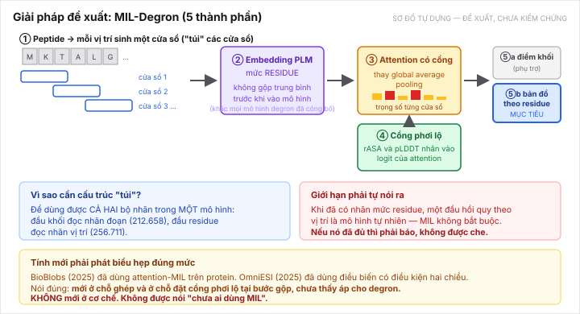

[← Bài trước](05-the-gap.md) · Bài 6/10 · [Bài sau: Đánh giá thế nào →](07-evaluation.md)

# Bài 6 — Giải pháp đề xuất: MIL-Degron

> **Đây là ĐỀ XUẤT, chưa kiểm chứng.** Chưa huấn luyện gì cả. Mọi câu trong bài này về hiệu quả của kiến trúc là giả thuyết, không phải kết quả. Nguồn: [topic-decision.md mục 5](../../topics/degron-footprint/research/topic-decision.md), kèm đính chính từ [audit 12/10](../../topics/degron-footprint/research/composition-context-audit.md).

---

## 1. Hai khái niệm cần biết trước

### MIL — học đa thể hiện (Multiple Instance Learning)

Tình huống thường gặp: bạn có nhãn cho **cả nhóm** nhưng muốn biết **phần tử nào** trong nhóm gây ra nhãn đó.

> **Ví dụ ngoài sinh học:** bạn có 100 bức ảnh chụp một bệnh viện, và nhãn duy nhất là "trong tập ảnh này có một con mèo". Bạn không biết ảnh nào có mèo. MIL là cách học để vừa đoán được nhãn của cả tập, vừa chỉ ra được **ảnh nào** đóng góp vào nhãn đó.

Thuật ngữ: tập gọi là **túi** (bag), từng phần tử gọi là **thể hiện** (instance).

Áp vào đề tài: **túi = một peptide**, **thể hiện = một cửa sổ quanh mỗi vị trí**. Nhãn đoạn (điểm degron) là nhãn của túi; nhãn vị trí (ΔPSI) là nhãn của từng thể hiện.

### Attention có cổng (gated attention)

Thay vì lấy **trung bình** mọi thể hiện (như PAP làm, và đó chính là chỗ nó mất thông tin vị trí), attention học một **trọng số** cho từng thể hiện rồi lấy trung bình có trọng số. Thể hiện nào quan trọng thì được trọng số cao.

Đây chính là chỗ chữa điểm yếu của PAP ở [bài 5](05-the-gap.md).

---

## 2. Năm thành phần



*Sơ đồ tự dựng. Nhãn trên hình ghi rõ: ĐỀ XUẤT, CHƯA KIỂM CHỨNG.*

| # | Thành phần | Phép đo nào buộc phải có nó |
|---|---|---|
| 1 | Mỗi vị trí sinh một cửa sổ ứng viên; peptide là một **túi** cửa sổ | Mô hình hiện có bất biến hoán vị (Pearson gốc–đảo = 1,000000), còn footprint thật khu trú ở trung vị **3/28** vị trí |
| 2 | Embedding PLM **mức residue**, không gộp trước | Mọi mô hình degron đã công bố đều gộp trung bình hoặc chỉ dùng thành phần |
| 3 | **Attention có cổng** thay cho global average pooling | Cấu trúc túi là chỗ nối nhãn **yếu** mức đoạn (212.658) với nhãn **mạnh** mức residue (256.711) trong **một** mô hình |
| 4 | **Cổng phơi lộ**: rASA và pLDDT nhân vào logit attention | Tác giả đo được điểm degron chỉ tương quan với độ dồi dào ở rASA > 0,7, nhưng họ chỉ dùng cấu trúc để **phân tích sau**, không đưa vào mô hình |
| 5 | **Hai đầu ra**, huấn luyện đa nhiệm: điểm khối (phụ) và **bản đồ theo residue** (mục tiêu) | Nhãn đoạn thì nhiều, nhãn residue là thứ cần đo |

Thành phần **điều kiện E3** của bản thiết kế trước **đã bỏ**, vì chỉ có 1 E3 đủ mẫu — xem [bài 4 mục 5](04-datasets.md).

---

## 3. Hai điểm mới — phát biểu hẹp đúng mức

Đây là phần phải nói thật cẩn thận trước GVHD. Nói quá là bị bắt lỗi ngay.

### Điểm mới 1 — cổng phơi lộ đặt ở chỗ **gộp**, không phải đầu vào

Mọi mô hình trước đưa đặc trưng cấu trúc vào **đầu vào** (ví dụ [MetaDegron](papers/metadegron-2024.md) có rASA và độ vô trật tự trong 10 đặc trưng XGBoost, nhưng ở đầu vào). Đề xuất ở đây là nhân nó vào **logit của attention**, tức dùng cấu trúc để điều tiết *mức chú ý*.

Cái hay: nó giải quyết được một vấn đề thật của bài toán.

- Dự đoán trên **peptide tách rời** (như thí nghiệm) → đặt cổng ở "phơi lộ hoàn toàn".
- Dự đoán trên **protein nguyên vẹn** → đặt rASA thật.

Cùng **một** mô hình giải thích được cả hai chế độ. Nghĩa là khoảng cách "peptide tách rời so với protein nguyên vẹn" — vốn là một giới hạn của dữ liệu ([bài 1 mục 5](01-protein-and-degron.md)) — trở thành **một tham số của mô hình**.

### Điểm mới 2 — attention có thể được giám sát bằng nhãn đột biến theo residue

Thường attention học gián tiếp. Ở đây ta **có** nhãn mức residue, nên có thể hướng dẫn nó trực tiếp.

> **Nhưng phải nói rõ:** trọng số attention và ảnh hưởng đột biến là **hai đối tượng khác nhau**. Không được gọi nhãn đột biến là ground truth trực tiếp của attention, và không được coi riêng cách nối hai thứ đó là một phương pháp mới. Cần đối chứng và kiểm giá trị của cách nối này.

---

## 4. Tính mới **không** nằm ở đâu

Ba điều đã có người làm. Phải nói trước, đừng để GVHD phát hiện:

| Việc | Ai đã làm | Hệ quả |
|---|---|---|
| Attention-MIL trên protein | [BioBlobs](papers/bioblobs-2025.md) (10/2025) — túi là protein, thể hiện là cấu trúc con học được, có cổng attention | **Không được nói "chưa ai dùng MIL cho protein"** |
| Điều biến có điều kiện hai chiều | [OmniESI](papers/omniesi-2025.md) (2025) — cùng ý tưởng với FiLM | Cơ chế không mới |
| Dùng cấu trúc + giải thích biến thể | [Larsen 2025](papers/larsen-2025.md) — đã tính rASA/pLDDT từ AlphaFold2 + DSSP, đã làm bản đồ thay thế *in silico* ΔPAP cho HSF1 | **"Dùng cấu trúc" và "giải thích biến thể" không còn là phần mới** |
| Dự đoán degron theo từng E3 | [MetaDegron](papers/metadegron-2024.md) (2024) — 21 E3, có máy chủ web | Chiếm cùng khung ứng dụng |

**Câu phát biểu đúng mức:**

> Mới ở **chỗ ghép** và ở **chỗ đặt cổng phơi lộ tại bước gộp**, chưa thấy áp dụng cho degron. **Không mới ở cơ chế.**

---

## 5. Giới hạn lớn nhất của lập luận MIL — phải tự nói ra

Đây là phản biện mạnh nhất chống lại kiến trúc này, và nó đến từ chính tài liệu của đề tài:

> Khi đã có nhãn ở **mức residue**, thì một **đầu hồi quy theo từng vị trí** là mô hình tự nhiên, và MIL **không còn bắt buộc**.

Nói cách khác: nếu đã biết ΔPSI của từng vị trí, tại sao phải vòng qua cơ chế "túi"? Cứ hồi quy trực tiếp từng vị trí là xong.

**Lý do giữ cấu trúc túi:** để dùng được **cả hai** bộ nhãn trong **một** mô hình. Đầu khối gộp các thể hiện (đọc nhãn đoạn, 212.658 mẫu), đầu residue đọc thẳng từng thể hiện (đọc nhãn vị trí, 256.711 mẫu). Nhãn đoạn nhiều hơn và phủ rộng hơn, nên nó có thể giúp mô hình học biểu diễn tốt hơn.

**Nhưng lợi ích đó chưa được chứng minh bằng thực nghiệm.** Và:

> Nếu phép thử cho thấy một **đầu hồi quy theo vị trí đơn thuần** đã đủ, thì **đó là kết quả phải báo, không phải thất bại cần che**.

Câu trên chép nguyên từ [topic-decision.md](../../topics/degron-footprint/research/topic-decision.md). Nó là một cam kết về tính trung thực, và nên giữ.

---

## 6. Hướng ma trận thay thế — đề xuất của Trọng, 12/10

Ngoài bản đồ 28 chiều, Trọng đề xuất đầu ra là **ma trận vị trí × acid amin thay vào**, học từ cả bộ quét và bộ bão hòa cùng lúc. Audit kết luận: **đáng khảo sát**, nhưng có **ba điều chỉnh bắt buộc**.

**1. Bộ quét là MỘT ô quan sát trên mỗi hàng, không phải marginal.**
Loss phải đọc đúng ô `M[i, b_i]` tương ứng với thay thế thực tế trong CSV. Các ô còn thiếu **không được gán 0** — thiếu dữ liệu khác với "ảnh hưởng bằng 0".

**2. ΔPAP không phải ma trận hạng 1.**
Ngay cả mô hình tuyến tính `f(c) = w·c` cũng cho `M[i,b] = w_b − w_{a(i)}`, là tổng hai outer product, nên hạng tối đa **2**. Có phản ví dụ cụ thể: `w(A,B,C,D) = (0,1,2,3)` cho ma trận con `[[2,3],[1,2]]` có định thức 1, tức hạng 2. Mô hình phi tuyến còn cho hạng cao hơn.

**Bất biến đúng là:** *các hàng cùng residue gốc có cùng đáp ứng khi so cùng cột thay vào* — **không phải** "mọi vị trí có độ nhạy hằng".

**3. Dùng nội bộ tối đa 28 × 20, có mask.**
Mask các ô `WT → WT`, ô stop `*`, và ô thiếu dữ liệu. Giao diện có thể hiển thị 19 thay thế thật trên mỗi residue, nhưng **không được xếp 19 cột khác nhau ở từng hàng rồi phân rã như thể chúng cùng identity**.

**Không gian thiết kế trung thực được đề xuất:**

```
M[i,b] = B(c, a_i, b)  +  Σ_q U[i,q](sequence) · V[b,q](sequence)
```

trong đó `B` là nhánh baseline chỉ dựa thành phần, phần sau là **hiệu chỉnh theo ngữ cảnh**.

**Thang ablation bắt buộc:** `B` → `B + hiệu chỉnh hạng 1` → `B + hạng r cao hơn`, với **cùng split và cùng ngân sách tính toán**. Giữ thêm đối chứng decoder theo vị trí/thay thế không phân rã.

> **Cảnh báo về khả năng nhận diện:** với chỉ một ô quan sát mỗi hàng, các nhân tố `U` và `V` **không tự nhận diện được**. Cần chia sẻ tham số giữa các peptide / loại acid amin, hoặc một prior, hoặc nhãn bão hòa đủ chất lượng để kiểm chứng.
>
> Và: **không nói "chưa ai làm ma trận thay thế cho degron"**. Dự đoán ô thay thế còn thiếu đã có tiền lệ ngoài degron, ví dụ [khung DMS targeted substitution profiling 2026](https://pubmed.ncbi.nlm.nih.gov/42157089/).

---

## 7. Đối chứng bắt buộc

Không được chỉ so với PAP. Ba đối chứng phải có:

1. **ΔPAP tính trên đúng thay thế thực nghiệm** — tức dùng PAP đúng cách cho bài toán này, không phải một phiên bản bị làm yếu đi.
2. **Mô hình thành phần** — mốc 0,6045.
3. **Đầu hồi quy theo vị trí, không MIL** — đối chứng quan trọng nhất, vì nó kiểm trực tiếp giới hạn ở mục 5.

> Lưu ý về các oracle và cận ở [bài 5](05-the-gap.md): chúng dùng **nhãn đánh giá**, nên **không phải** performance đã đo của các baseline này. Đừng trộn hai loại con số.

---

[← Bài trước](05-the-gap.md) · [Bài sau: Đánh giá thế nào →](07-evaluation.md)
