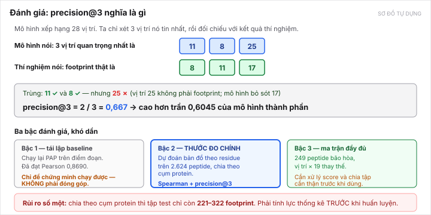

[← Bài trước](06-proposed-solution.md) · Bài 7/10 · [Bài sau: Đóng góp nếu thành công →](08-contribution.md)

# Bài 7 — Đánh giá thế nào

Bài này giải thích thước đo. Quan trọng vì **chọn sai thước đo là tự làm sụp đề tài** — trần của thang điểm đoạn gần như đã cạn (xem [bài 5 mục 7](05-the-gap.md)).

> **Sửa ngày 15/10/2026, hai chỗ.** **(1)** Mốc bậc 2 là **0,4897** và đối chứng ΔPAP là **0,4270** (đã chạy 14/10). **(2)** Bậc 3 nay là **bậc chính** theo [D-025](../../DECISIONS.md#d-025), thước đo là **AUROC mức ô** chứ không phải Spearman ([đề xuất C-9](../../DECISIONS.md)), và cỡ mẫu thật là **91 peptide**, không phải 249.

---

## 1. precision@3 — thước đo chính

*Sơ đồ tự dựng.*

Định nghĩa: **trong 3 vị trí mà mô hình tin là quan trọng nhất, bao nhiêu phần là footprint thật.**

Ví dụ trong hình:

- Mô hình nói: vị trí **11, 8, 25**
- Thí nghiệm nói: footprint thật là **8, 11, 17**
- Trùng 2 (là 11 và 8), sai 1 (25), bỏ sót 1 (17)
- → **precision@3 = 2/3 = 0,667**

**Vì sao chọn con số 3?** Vì trung vị số footprint thật là **3 trên 28** ([bài 2](02-how-degrons-are-measured.md)). Và vì đó là câu hỏi thật của nhà sinh học: *"tôi chỉ làm được vài thí nghiệm, nên thử vị trí nào?"*

**Thước đo phụ:** Spearman theo từng peptide, giữa vector 28 chiều dự đoán và vector đo được. Nó đo khả năng xếp hạng toàn bộ, không chỉ top-3.

> **Nhưng trên ma trận bão hòa thì đừng dùng Spearman làm chính.** Trần nhãn của Spearman mức ô chỉ **0,6989**, còn trần của **AUROC** đạt **0,9519** — xếp hạng *mọi* ô thì khó, nhưng *tách ô dương khỏi ô âm* thì nhãn làm rất tốt, và nhiệm vụ của đề tài là cái sau. Xem mục 2 bậc 3.

> **Một chi tiết kỹ thuật dễ sai:** chỉ số phải là **trung bình macro theo peptide**. Không được coi 28 vị trí trong một peptide là 28 mẫu độc lập, vì chúng không độc lập. Lỗi này sẽ làm khoảng tin cậy nhỏ giả tạo.

---

## 2. Ba bậc đánh giá, khó dần

### Bậc 1 — tái lập baseline (KHÔNG phải đóng góp)

Chạy lại PAP trên thang điểm đoạn: 428 gene holdout hiệu dụng / 15.820 tile. Đã làm, đạt Pearson **0,8690**.

Mục đích duy nhất: **chứng minh mình chạy lại được**. Đây *không* phải chỗ đặt đóng góp.

> Một chi tiết đáng nhắc trong luận văn: tập test này là **428 gene tính từ dữ liệu**, không dùng danh sách **527 gene** mà bài báo công bố — vì **96 gene** trong danh sách đó thực ra nằm hết trong tập huấn luyện. Tự kiểm mới phát hiện được.

### Bậc 2 — bản đồ theo residue (THƯỚC ĐO CHÍNH)

- Dữ liệu: 2.624 peptide có footprint
- Chia tập: **theo cụm protein** (MMseqs2, identity ≥ 30%, coverage hai chiều)
- Chỉ số: **precision@3** và Spearman theo peptide
- Mốc phải vượt: ~~**0,6045**~~ → **0,4897** (baseline thành phần ước lượng trung thực), và báo kèm **trần nhãn 0,6514**. Sửa 13/10: 0,6045 là oracle đọc nhãn test, xem [bài 10](10-data-up-close.md)
- **Đối chứng đã có số, chạy 14/10:** ΔPAP `cnn2w7` = **0,4270**, ΔPAP `cnn2w1` = 0,2959, ngẫu nhiên 0,1232. Mô hình công bố **thấp hơn** baseline thành phần (p ≈ 6 × 10⁻¹⁹) — xem [bài 5 mục 5.1](05-the-gap.md)

### Bậc 3 — ma trận thay thế đầy đủ · **nay là bậc CHÍNH**

[D-025](../../DECISIONS.md#d-025) đã chốt bộ bão hòa làm **nguồn nhãn chính**, nên bậc này đổi vai từ "bậc khó nhất" thành "bậc chính".

- Dữ liệu: 235 peptide dựng được ma trận → **chỉ 91 peptide** sau khi áp đúng ngưỡng peptide degron (PSI WT ≤ 3,0). **Con số 249 trong bản trước là số định danh thô, không phải cỡ mẫu dùng được.**
- Thước đo: **AUROC mức ô** (đề xuất [C-9](../../DECISIONS.md))

| Mốc trên ma trận | Spearman mức ô | **AUROC mức ô** |
|---|---:|---:|
| ΔPAP tốt nhất | 0,3553 | **0,7692** |
| **Trần nhãn** | 0,6989 | **0,9519** |
| Dư địa | 0,3436 | **0,1827** |

- **Dư địa 0,1827 lớn hơn bậc 2** (0,1617), trên nhãn **ít nhiễu hơn nhiều** (16,7% so với 75,9%). Đây là lý lẽ chính để theo D-025.
- Gộp 19 thay thế lên mức vị trí làm Spearman tăng 0,3553 → **0,4130**, đúng như kỳ vọng nếu nhiễu mức ô bị triệt tiêu khi gộp. Nên ứng dụng trình bày **cả hai tầng**.
- Vẫn cần xử lý score, mask ô không hợp lệ, và giữ **130/248 peptide trùng bộ quét** cùng một phía train/test.
- Nếu dùng một phần bão hòa để train thì **phải chốt protocol mới** và giữ riêng phần test.

---

## 3. Vì sao KHÔNG đặt đóng góp lên thang điểm đoạn

Ba con số tự đo, cả ba đều nói cùng một điều:

| Phép đo | Kết quả | Nghĩa |
|---|---|---|
| `cnn2w7` so với `cnn2w1`, **trên điểm đoạn** | **+0,0032** Pearson | Trên thang này, trục "thêm năng lực bắt motif" gần như cạn |
| `cnn2w7` so với `cnn2w1`, **trên precision@3 residue** | **+0,1311** | ⚠ **Gấp ~41 lần.** Trần +0,0032 **không chuyển sang** nhiệm vụ mức residue — đo 14/10 |
| Đổi phép gộp (trung bình → max) | 0,824 → **0,344** | Tín hiệu điểm khối **dàn đều**, không khu trú |
| Entropy theo vị trí | 3,294 / 3,401 | Gần tối đa → không có vị trí nào trội hẳn |

Nếu đặt đóng góp ở Pearson trên điểm đoạn, thì đóng góp tối đa khả dĩ là khoảng **+0,003**. Không ai gọi đó là đóng góp luận văn.

> **Nhưng chú ý dòng thứ hai của bảng, thêm ngày 14/10.** Kết luận "đừng đặt đóng góp lên thang điểm đoạn" **vẫn đúng**, nhưng lý do đã đổi: không phải vì "ngữ cảnh không giúp được gì", mà vì **thang điểm đoạn không phải thang của đề tài**. Trên thang đúng, cùng thay đổi kiến trúc đó cho **+0,1311**.

> **Nhưng phải nói kèm giới hạn:** phép đổi phép gộp dùng **trọng số đã huấn luyện cho gộp trung bình**, nên **không phải** so sánh công bằng với kiến trúc max pooling huấn luyện lại từ đầu. **Không được suy ra "kiến trúc khu trú sẽ thua"** hoặc "thang điểm khối đã bão hòa".

---

## 4. Rủi ro số một: lực thống kê

Đây là chỗ đề tài dễ chết nhất, và nó là một con số đơn giản.

Sau khi chia theo cụm protein, tập test chỉ còn:

| Coverage hai chiều | Footprint trong tập test |
|---|---:|
| ≥ 80% | **271–322** |
| ≥ 50% | **221–301** |

Với n ≈ 250, macro theo peptide, câu hỏi là: **có phát hiện được một cải thiện precision@3 so với mốc đã chọn không?**

Nếu mô hình đạt 0,70 thì chênh 0,10 — có thể phát hiện được. Nếu đạt 0,63 thì chênh 0,025 — rất có thể lọt vào khoảng nhiễu và không chứng minh được gì.

> **✅ Cập nhật 13/10/2026 — đã tính, và tập test ĐỦ LỰC.** Kiểm ghép cặp theo peptide với độ lệch chuẩn đo thật 0,2416:
>
> | So với mốc nào | Dư địa | n cần cho lực 0,80 | Lực ở n = 221–322 |
> |---|---:|---:|---|
> | Baseline thành phần trung thực (0,4897) | 0,1617 | **18** | ≈ 1,00 |
> | Cận oracle 0,6045 | 0,0469 | **209** | **0,82–0,94** |
>
> Mức cải thiện nhỏ nhất phát hiện được: **0,0455** ở n = 221, **0,0377** ở n = 322. Kết luận đứng vững ở cả ba cách xử lý tie.
>
> **Hệ quả thực hành:** dùng **split coverage 80%** (271–322 footprint, lực 0,92–0,94), **không** dùng cov50 (n = 221 chỉ cho lực 0,82). Khi có mô hình thật phải tính lại lực bằng độ lệch chuẩn của chính cặp đó. Nguồn: [full-data-audit mục 5](../../topics/degron-footprint/research/full-data-audit/README.md).
>
> Rủi ro số một của đề tài vì vậy **đã đổi** thành: nhãn mức residue chỉ lặp lại khoảng một nửa giữa hai lần đo (Jaccard 0,4965) — xem [bài 10 mục 6](10-data-up-close.md).

> ⚠ **Nhưng phép tính lực trên chỉ áp cho bậc 2 (bộ quét).** Sau khi [D-025](../../DECISIONS.md#d-025) chuyển nguồn nhãn chính sang **bộ bão hòa**, cỡ mẫu là **91 peptide**, và **lực cho cỡ đó chưa được tính**. Đây là **việc chặn duy nhất** còn lại trước khi huấn luyện. Nếu không đủ lực thì hai đường ra: nới ngưỡng PSI WT lên 3,5 (141 peptide, phải biện minh) hoặc chấm ở **mức ô** (91 × ~500 ô) kèm xử lý phụ thuộc trong peptide.

Điểm an ủi: footprint **không dồn vào vài protein** (trung vị 1/protein, tối đa 7, protein lớn nhất chiếm 0,267%). Nên tập test nhỏ nhưng không bị một protein chi phối.

---

## 5. Hai cạm bẫy đánh giá đã biết

**Bẫy 1 — tập 2.624 peptide đã bị chọn lọc.** Chúng được chọn *vì có footprint*. Nên chỉ số trên tập đó **không mô tả toàn bộ proteome**. Khi đánh giá mô hình thật, phải đưa thêm cả peptide **không có** footprint, để đo được tỉ lệ **báo động sai** (mô hình chỉ vị trí quan trọng ở nơi không có gì). Việc này **chưa làm**.

**Bẫy 2 — chưa kiểm rò rỉ ở cả hai mức.** Hiện chỉ gom cụm ở mức protein. Trước khi gọi là benchmark chính thức, cần:
- kiểm cross-split ở **cả** mức protein và mức peptide,
- giữ các peptide **trùng trình tự** cùng một phía,
- liên kết với dữ liệu bão hòa để không trùng.

Và: 9 accession chưa lấy được trình tự UniProt **bị loại khỏi phép chia cụm**, không được giả làm singleton độc lập. Có 19 footprint đã map accession nhưng chưa khớp peptide, cộng 3 footprint thiếu trình tự — **cần curate**.

---

## 6. Ca nghiên cứu E3 — không phải thước đo

Có 23 peptide có **cả** nhãn E3 **và** bản đồ bão hòa (trong đó cả 13 peptide KLHL15). Câu hỏi: footprint mà mô hình dự đoán có khớp motif của E3 đã biết không?

Đây là một **ca nghiên cứu định tính**, làm cho phần diễn giải sinh học hay hơn. **Không phải thước đo chính** — 23 mẫu là quá ít. Và vẫn cần lọc chất lượng nhãn và chia tập trước khi chấm.

---

## 7. Phải thống nhất thước đo với GVHD trước khi bắt đầu

Ghi rõ trong [topic-decision.md](../../topics/degron-footprint/research/topic-decision.md) và nên giữ: thước đo chính đề xuất là **bậc 2 và bậc 3**, vì chúng khớp câu hỏi footprint. Nhưng GVHD có thể quen nhìn Pearson trên thang điểm đoạn (vì đó là con số bài báo in ra).

Nếu không thống nhất trước, có nguy cơ làm xong rồi bị đánh giá bằng một thước đo mà ở đó trần chỉ còn +0,0032. Đây là một câu nên hỏi ở buổi gặp tuần 6.

---

[← Bài trước](06-proposed-solution.md) · [Bài sau: Đóng góp nếu thành công →](08-contribution.md)
