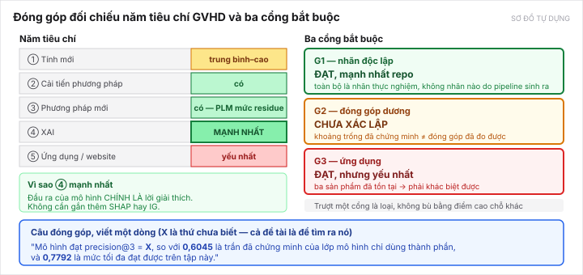

[← Bài trước](07-evaluation.md) · Bài 8/10 · [Bài sau: Rủi ro →](09-risks.md)

# Bài 8 — Đóng góp nếu nghiên cứu hoàn thiện thành công

> Bài này viết ở **thể điều kiện**: *nếu* làm xong thì đóng góp là gì. Hiện **chưa huấn luyện mô hình nào**, nên chưa có đóng góp nào đã xác lập. Cổng G2 vẫn ở trạng thái **chưa xác lập** ([thẻ đề tài](../../topics/degron-footprint/README.md)).

---

## 1. Câu đóng góp, viết một dòng

> **Viết lại ngày 15/10/2026.** Bản trước dùng mốc 0,6045 và 0,7792 (đều là oracle đọc nhãn test) và đặt
> tính mới ở **kiến trúc**. [Lập luận lại](../../topics/degron-footprint/research/topic-argument-2026-10-15.md)
> đề xuất chuyển chỗ đặt đóng góp — xem mục 1.2. Đề xuất đang chờ Trọng xác nhận: [C-7](../../DECISIONS.md).

### 1.1 Câu đóng góp

> Chưa có mô hình nào được huấn luyện cho nhiệm vụ **ảnh hưởng đột biến degron ở mức residue** — bốn sản
> phẩm đã có đều xuất điểm ở mức peptide hoặc motif. Em dựng **benchmark đầu tiên cho nhiệm vụ đó**, có trần
> nhãn đo được (precision@3 **0,6514**; AUROC mức ô **0,9519**), baseline trung thực (**0,4897**), đối chứng
> là mô hình degron công bố gần nhất (ΔPAP **0,4270**), split theo cụm protein và phân tích lực. Rồi em xây
> một mô hình **vượt baseline đó** — đạt **X** — và một ứng dụng xuất **ma trận 28×20** mà không sản phẩm nào
> trong bốn cái kia xuất.

Giá trị `X` là thứ chưa biết. Toàn bộ đề tài là để tìm ra nó.

Câu này tốt ở bốn điểm:

1. **Mốc so sánh đã đo, và nó nằm trên mô hình công bố.** ΔPAP chỉ đạt 0,4270, thấp hơn baseline thành phần
   0,4884 với p ≈ 6 × 10⁻¹⁹. Nên "vượt 0,4897" là mốc khó hơn state-of-the-art, không phải dễ hơn.
2. **Có trần nhãn**, nên không hứa quá — và chính việc *đo được trần* là một phần đóng góp.
3. **Nhãn là thực nghiệm**, nên không ai hỏi "nhãn ở đâu ra".
4. **Có một thứ cụ thể giao được**: ma trận 28×20, thứ đã kiểm là không sản phẩm nào trong bốn tiền lệ xuất.

### 1.2 Vì sao chuyển tính mới từ "kiến trúc" sang "benchmark + mô hình thắng trên nó"

Bốn lý do:

1. **[D-022](../../DECISIONS.md#d-022) đã gỡ rào.** GVHD **chấp nhận** đóng góp dạng công cụ, thước đo,
   benchmark. Trước 12/10 cách đặt này không hợp lệ; nay thì hợp lệ.
2. **Tính mới kiến trúc là chỗ yếu nhất.** Mọi cơ chế đều có tiền lệ (BioBlobs, OmniESI, Ilse 2018), và
   ngày 15/10 một trong hai "điểm mới" đã mất: cổng phơi lộ **không huấn luyện được** trên nhiệm vụ chính
   ([bài 6 mục 3.2](06-proposed-solution.md)).
3. **Benchmark là chỗ bằng chứng đã có sẵn.** Trần nhãn, baseline, đối chứng ΔPAP, phân tích lực, split
   cụm — **đã đo xong hết** và có file kết quả. Không bài nào trong sáu bài đã đọc có bộ này; không bài nào
   báo **trần nhãn**.
4. **Nó khớp sẵn tiêu chí 4 và 5** (XAI qua đầu ra theo residue; ứng dụng qua ma trận 28×20).

> **Rủi ro của cách đặt này, phải nhận:** [D-012](../../DECISIONS.md#d-012) vẫn đòi một **đóng góp dương đo
> được**. Benchmark một mình **không đủ**. Mô hình vượt 0,4897 (hoặc AUROC vượt 0,7692) **vẫn là điều kiện
> bắt buộc** — benchmark chỉ làm cho con số đó có nghĩa.
>
> Và GVHD từng nói kỳ vọng "một kiến trúc chưa ai dùng" (11/10). Nên **phải hỏi lại ở buổi gặp** cùng với
> câu hỏi ở [C-5](../../DECISIONS.md).

## 2. Đóng góp đối chiếu năm tiêu chí GVHD

Nguồn năm tiêu chí: [course.md](../../project/course.md).

| # | Tiêu chí | Đề tài đáp ứng thế nào | Mức |
|---|---|---|---|
| 1 | **Tính mới** | Khoảng trống **đã chứng minh**: 89,7% peptide mà mô hình thành phần không tách được. Tính mới đặt ở **nhiệm vụ và benchmark** (chưa tìm thấy tiền lệ), **không** ở kiến trúc (mọi cơ chế đều có tiền lệ) | Trung bình–cao |
| 2 | **Đề xuất / cải tiến phương pháp** | Ngữ cảnh vị trí thay global average pooling của PAP, có **+0,1311 làm bằng chứng rằng trục này chưa cạn**. ~~Cổng phơi lộ~~ đã hạ xuống cơ chế chuyển giao | **Có** |
| 3 | **Sử dụng phương pháp mới** | Embedding PLM **mức residue**, không gộp trước — khác mọi mô hình degron đã công bố | **Có** |
| 4 | **XAI** | **Thoả mãn bởi chính bài toán.** Đầu ra *là* điểm quan trọng theo residue. Không cần gắn thêm SHAP hay IG | **Mạnh nhất** |
| 5 | **Ứng dụng / website** | Web nhập peptide → bản đồ residue + ma trận 28×20 + top-3. **Không thể thiếu** | Yếu nhất, phải thiết kế |

*Sơ đồ tự dựng.*

**Tiêu chí 4 đáng nói riêng.** Ở các ứng viên khác trong repo, XAI phải gắn thêm như một phần phụ. Ở degron, **đầu ra của mô hình chính là lời giải thích** — "vị trí 8, 11, 17 là chỗ quyết định" vừa là dự đoán vừa là diễn giải. Đây là lợi thế thật, và nên nhấn mạnh khi báo cáo.

---

## 3. Ba cổng bắt buộc

| Cổng | Trạng thái | Căn cứ |
|---|---|---|
| **G1** nhãn độc lập | **ĐẠT, mạnh nhất repo** | Toàn bộ là nhãn thực nghiệm: điểm tile từ reporter assay, PSI từ sàng lọc, 219 footprint từ bão hòa. Không nhãn nào do pipeline của đề tài sinh ra |
| **G2** đóng góp dương | **CHƯA XÁC LẬP** | Chưa huấn luyện mô hình nào. Khoảng trống đã chứng minh, nhưng *khoảng trống* khác *đóng góp đã đo được* |
| **G3** ứng dụng | **ĐẠT, nhưng yếu nhất** | **Bốn** sản phẩm đã tồn tại (thêm SVM của chính nhóm Zhang, Pearson 0,8955 trên 260.989 peptide). Nhưng cả bốn đều xuất ở mức **peptide/motif**; chỗ khác biệt đã kiểm là **ma trận 28×20** |

Về G1, một so sánh đáng nhớ: hướng **TME senescence** của repo đã **bị đóng** vì trượt đúng cổng này — nhãn SenMayo của nó do chính pipeline sinh ra ([D-008](../../DECISIONS.md#d-008)). Degron không có vấn đề đó.

---

## 4. Đóng góp cho ai, dùng vào gì

### Cho nhà sinh học thực nghiệm

Họ chỉ làm được vài thí nghiệm trên mỗi peptide. Mô hình nói "thử vị trí 8, 11, 17" giúp họ **giảm số thí nghiệm phải làm**. Đây là giá trị trực tiếp nhất và cũng dễ giải thích nhất.

### Cho việc diễn giải biến thể gây bệnh

Các mô hình như [AlphaMissense](papers/alphamissense-2023.md) nói "biến thể này có hại" nhưng **không nói vì sao**. Nếu mô hình của đề tài chỉ ra rằng biến thể đó **tạo ra hoặc phá vỡ một degron**, thì đó là một **cơ chế cụ thể** — không chỉ một điểm số.

Đây là bổ sung, **không phải thay thế**. Phải nói rõ điều này.

### Cho hướng thuốc phân hủy protein đích

Có một hướng thuốc cố tình dán degron vào protein gây bệnh để tế bào tự phá nó. Hiểu residue nào làm degron mạnh là kiến thức nền cho việc thiết kế. Nhưng đây là **ý nghĩa xa**, không phải thứ luận văn chứng minh được — nên nhắc một câu, không hứa.

---

## 5. Sản phẩm cụ thể khi bảo vệ

| Sản phẩm | Nội dung |
|---|---|
| **Mô hình** | Trọng số + mã huấn luyện, chạy lại được |
| **Benchmark** | ⭐ **Theo [C-7](../../DECISIONS.md), đây là sản phẩm trung tâm.** Giao thức chia tập theo cụm protein cov80, **trần nhãn** (0,6514 precision@3; 0,9519 AUROC), baseline thành phần 0,4897, đối chứng ΔPAP 0,4270, phân tích lực. Không bài nào trong sáu bài đã đọc có bộ này |
| **Ứng dụng web** | Nhập peptide → bản đồ residue, heatmap 28×20, top-3 vị trí |
| **Báo cáo tái lập** | Script + config + seed cố định, mọi số trong luận văn trỏ được về một file kết quả |
| **Ca nghiên cứu E3** | 23 peptide, định tính |

Phần **benchmark** có giá trị riêng: hiện chưa tìm thấy giao thức chuẩn nào cho bài toán footprint degron có
kiểm soát đồng dạng **và có trần nhãn**. Kể cả khi mô hình không thắng nhiều, giao thức và các mốc
(0,1232 / 0,4270 / 0,4897 / 0,6514) vẫn là thứ dùng được cho người sau.

> **Nhưng benchmark một mình vẫn không đủ.** [D-012](../../DECISIONS.md#d-012) đòi đóng góp **dương** đo
> được, và [D-022](../../DECISIONS.md#d-022) chỉ nói GVHD **nhận dạng** công cụ — không nói nhận **kết quả
> âm**. Nên [C-7](../../DECISIONS.md) đề xuất đặt benchmark làm **trung tâm**, không phải làm **toàn bộ**:
> vẫn phải có một mô hình thắng trên nó.

---

## 6. Kết quả âm thì sao

Phải nghĩ trước, vì khả năng này thật.

**Nếu mô hình không vượt 0,4897:** đó là kết quả âm, và GVHD **không nhận kết quả âm làm đóng góp chính** ([D-012](../../DECISIONS.md#d-012)). Khi đó phải:

1. Kiểm xem lý do là **lực thống kê** (bộ bão hòa chỉ **91 peptide**, lực chưa tính) hay **tín hiệu không có** (75,9% phần dư của bộ quét là nhiễu; phần ngữ cảnh học được tối đa **8,7%** phương sai).
2. Nếu là nhiễu đo → chuyển sang bộ bão hòa chất lượng cao hơn, hoặc bộ nhân của [Larsen 2025](papers/larsen-2025.md) (58.781 đoạn / 1.626 TF, **chưa tải**, cần kiểm giấy phép CC BY-NC-ND trước).
3. ⚠ **Không còn đường lui đã chuẩn bị.** [D-026](../../DECISIONS.md#d-026) (14/10) đã bỏ đề tài dự phòng; `plm-calibration-audit` đã vào `archive/`. Nên **điểm kiểm G2 phải đặt sớm** — đề xuất cuối tuần 10 — chứ không phải phát hiện ở tuần 13.

**Nếu đầu hồi quy theo vị trí đơn thuần đã đủ tốt, không cần MIL:** đó vẫn là kết quả **phải báo**, không phải thất bại cần che. Khi đó đóng góp chuyển sang "mô hình đơn giản này đủ, và đây là mốc" — yếu hơn, nhưng trung thực và vẫn vượt 0,4897.

---

[← Bài trước](07-evaluation.md) · [Bài sau: Rủi ro →](09-risks.md)
