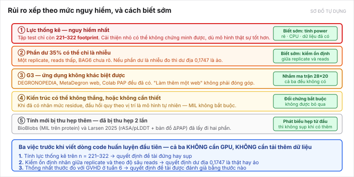

[← Bài trước](08-contribution.md) · Bài 9/9 · [Về hub](README.md)

# Bài 9 — Rủi ro và điều có thể làm đề tài sụp

Bài này tồn tại để bạn không bị bất ngờ. Xếp theo mức nguy hiểm.

---

*Sơ đồ tự dựng. Chi tiết từng rủi ro ở dưới.*

---

## Rủi ro 1 — lực thống kê (nguy hiểm nhất)

**Vấn đề:** chia test theo cụm protein chỉ còn **221–322 footprint**. Với n ≈ 250, một cải thiện nhỏ so với mốc 0,6045 có thể **không chứng minh được**, dù mô hình thật sự tốt hơn.

**Vì sao nguy hiểm:** nó không phụ thuộc vào việc bạn làm tốt đến đâu. Đây là giới hạn của dữ liệu.

**Cách biết sớm:** tính lực thống kê. **Dữ liệu đã nằm trên máy**, không cần tải gì, không cần GPU. Đây là [việc tiếp theo số 1](../../topics/degron-footprint/README.md).

**Nếu sụp:** giảm độ chặt của phép chia cụm (cov80 cho 271–322 thay vì 221–301), hoặc bổ sung bộ nhân của [Larsen 2025](papers/larsen-2025.md), hoặc kích hoạt dự phòng.

---

## Rủi ro 2 — phần dư 35% có thể chỉ là nhiễu

**Vấn đề:** đề tài trông cậy vào việc 35,0% phương sai ΔPSI còn lại sau oracle thành phần là **ngữ cảnh học được**. Nhưng:

- dữ liệu dùng **một replicate**, không phải trung bình nhiều lần
- ngưỡng reads tối thiểu **thấp**
- nhãn genotype BAG6 của replicate này **chưa rõ**
- **chưa ai tách** phần ngữ cảnh khỏi phần nhiễu đo

Nếu phần lớn 35% đó là nhiễu thí nghiệm, thì **không mô hình nào học được nó**, và dư địa 0,1747 là ảo.

**Cách biết sớm:** kiểm tính ổn định giữa các replicate và theo độ sâu reads, trước khi huấn luyện. Ghi ở [composition-context-audit.md mục 4.2](../../topics/degron-footprint/research/composition-context-audit.md).

---

## Rủi ro 3 — G3, ứng dụng không khác biệt được

**Vấn đề:** đã có **ba** sản phẩm — [DEGRONOPEDIA](papers/degronopedia-2024.md), máy chủ web [MetaDegron](papers/metadegron-2024.md), và Colab của nhóm PAP. Tiêu chí 5 của GVHD không thể thiếu, nhưng "làm thêm một web nữa" không phải đóng góp.

**Cách xử lý:** nhắm vào thứ cả ba đều không có — **ma trận vị trí × acid amin thay vào, dựa trên nhãn đột biến thực nghiệm**. Phải kiểm lại ba sản phẩm đó thật sự không xuất ra thứ này.

---

## Rủi ro 4 — kiến trúc có thể không thắng, hoặc không cần thiết

Hai nhánh:

**4a. MIL không cần thiết.** Khi đã có nhãn mức residue, một đầu hồi quy theo vị trí là mô hình tự nhiên. Nếu nó đã đủ thì cơ chế túi là phức tạp không cần thiết. Đây là **đối chứng bắt buộc**, không phải việc có thể bỏ qua.

**4b. Kiến trúc khu trú không thắng trên thang điểm đoạn.** Có dấu hiệu: đổi phép gộp làm Pearson sụt 0,824 → 0,344, entropy theo vị trí gần tối đa (3,294/3,401). Nhưng **phép thử đó không công bằng** (dùng trọng số huấn luyện cho gộp trung bình), nên chưa kết luận được.

**Cách xử lý:** không đặt đóng góp lên thang điểm đoạn. Dùng bậc 2 và 3 ([bài 7](07-evaluation.md)).

---

## Rủi ro 5 — tính mới bị thu hẹp thêm

Đã bị thu hẹp hai lần rồi:

| Lần | Phát hiện | Mất gì |
|---|---|---|
| 11/10 | [BioBlobs](papers/bioblobs-2025.md) đã dùng attention-MIL trên protein; [OmniESI](papers/omniesi-2025.md) đã dùng điều biến có điều kiện | Không được nói cơ chế là mới |
| 11/10 | [Larsen 2025](papers/larsen-2025.md) đã dùng rASA/pLDDT và đã làm bản đồ ΔPAP *in silico* | "Dùng cấu trúc" và "giải thích biến thể" không còn mới |

**Việc còn chưa làm:** tra danh sách trích dẫn của bài 2026 và tra nội bộ [MetaDegron](papers/metadegron-2024.md). Có thể còn phát hiện nữa.

**Cách xử lý:** phát biểu hẹp từ đầu — *mới ở chỗ ghép và ở chỗ đặt cổng phơi lộ tại bước gộp, chưa thấy áp cho degron*. Nếu nói hẹp sẵn thì một phát hiện mới không làm sụp tuyên bố.

---

## Rủi ro 6 — thước đo không thống nhất với GVHD

**Vấn đề:** GVHD có thể quen nhìn Pearson trên thang điểm đoạn, vì đó là con số bài báo in. Nhưng ở đó trần chỉ còn **+0,0032**.

**Cách xử lý:** hỏi và thống nhất **trước khi bắt đầu**, ở buổi gặp tuần 6. Đây là một câu cụ thể nên đưa vào bản chuẩn bị.

---

## Rủi ro 7 — nợ kỹ thuật nhỏ cần dọn

Không nguy hiểm nhưng sẽ gây rắc rối nếu để lâu:

| Việc | Chi tiết |
|---|---|
| 19 footprint đã map accession nhưng chưa khớp peptide, cộng 3 footprint thiếu trình tự | **cần curate** |
| 9 accession chưa lấy được trình tự UniProt | đã loại khỏi phép chia cụm, **không được giả làm singleton** |
| 813 peptide có stop `*` cuối (336 là footprint) | phải mask, **không coi `*` là acid amin** |
| Cụm MMseqs2 trong `interim/` ghi đường dẫn tuyệt đối cũ | chạy lại `prepare_protein_clusters.py` nếu cần ([resources](../../resources/README.md)) |
| Phép chia 80/10/10 qua 5 seed | là **phép thử đo quy mô**, **chưa phải benchmark chính thức được chốt** |

---

## Tóm lại: ba việc trước khi viết dòng code huấn luyện đầu tiên

1. **Tính lực thống kê** trên n = 221–322. Rẻ, dữ liệu đã có. Quyết định đề tài đứng hay sụp.
2. **Kiểm tính ổn định của nhãn** giữa replicate và theo độ sâu reads. Quyết định dư địa 0,1747 là thật hay ảo.
3. **Thống nhất thước đo với GVHD** ở tuần 6. Quyết định đề tài được đánh giá bằng thước nào.

Cả ba đều **không cần GPU** và **không cần tải thêm dữ liệu**.

---

[← Bài trước](08-contribution.md) · [Về hub](README.md)
