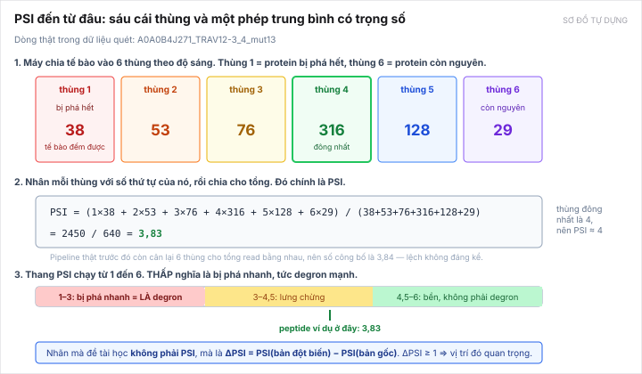
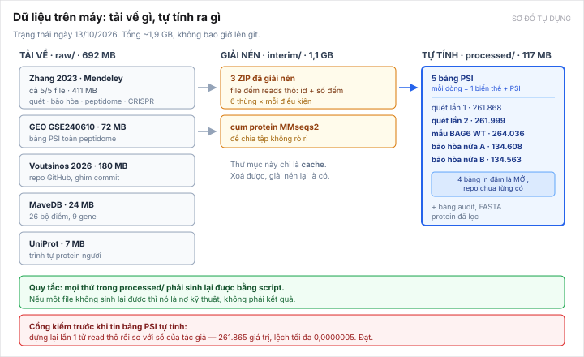

[← Bài trước](09-risks.md) · Bài 10/10 · [Về mục lục](README.md)

# Bài 10 — Dữ liệu thật trông như thế nào

> **Bài này khác bài 4 ở đâu.** [Bài 4](04-datasets.md) trả lời "có những bộ nào, bao nhiêu mẫu, giấy phép gì". Bài này mở file ra xem thật: một dòng dữ liệu gồm những gì, con số PSI từ đâu ra, và dữ liệu đó **tốt đến đâu**.
>
> Viết sau [audit đầy đủ ngày 13/10/2026](../../topics/degron-footprint/research/full-data-audit/README.md). Mọi số ở đây là **tự đo từ dữ liệu trên máy**, có file kết quả kèm theo.

---

## 1. Mở một file ra xem

Dữ liệu gốc không có gì huyền bí. Phần lớn là **file text hai cột**:

```
A0A0B4J1Y8_IGLV9-49_1_mut10	2
A0A0B4J1Y8_IGLV9-49_1_mut12	1
A0A0B4J1Y8_IGLV9-49_1_mut24	205
A0A0B4J1Y8_IGLV9-49_1_mut26	89
```

Cột trái là **tên một mẩu protein đã bị đột biến**. Cột phải là **đếm được bao nhiêu tế bào** mang mẩu đó trong một cái thùng. Hết. Một file như vậy có khoảng 200.000 dòng, và có **6 file cho mỗi thí nghiệm** — mỗi file một thùng.

### Tên định danh nói gì

```
A0A0B4J1Y8 _ IGLV9-49 _ 1 _ mut24
└────┬────┘  └───┬──┘   │   └─┬──┘
  mã protein   tên gene  │   đổi acid amin
  trên UniProt           │   ở vị trí 24
                    mẩu thứ 1 của protein này
```

Một protein dài hàng trăm acid amin, nên người ta **cắt nó thành nhiều mẩu 28 acid amin**, đánh số 1, 2, 3… Mẩu như vậy gọi là **tile**. Hai tile liền nhau gối lên nhau 5 acid amin, tức mỗi tile bắt đầu cách tile trước 23 acid amin.

`mut0` nghĩa là **bản gốc**, chưa đổi gì — đây là mốc để so. `mut24` là bản đã đổi acid amin ở vị trí 24.

Với dữ liệu bão hòa, tên có thêm **một chữ cái ở cuối**: `..._mut10a` nghĩa là đổi vị trí 10 thành `A` (alanine). Chữ cái đó là **acid amin được thay vào**.

---

## 2. PSI: con số trung tâm của cả đề tài



*Sơ đồ tự dựng.*

Thí nghiệm gắn mỗi mẩu protein vào một protein phát sáng, rồi cho máy **phân loại tế bào theo độ sáng vào 6 thùng**. Mẩu nào chứa degron mạnh thì protein bị phá nhanh, tế bào tối, rơi vào thùng 1–2. Mẩu nào vô hại thì protein còn nguyên, tế bào sáng, rơi vào thùng 5–6.

**PSI chỉ là trung bình có trọng số của số thùng.** Lấy một dòng thật:

| | thùng 1 | thùng 2 | thùng 3 | thùng 4 | thùng 5 | thùng 6 |
|---|---:|---:|---:|---:|---:|---:|
| tế bào đếm được | 38 | 53 | 76 | **316** | 128 | 29 |

```
PSI = (1×38 + 2×53 + 3×76 + 4×316 + 5×128 + 6×29) / (38+53+76+316+128+29)
    = 2450 / 640
    = 3,83
```

Đông nhất ở thùng 4, nên PSI ≈ 4. Thế thôi.

> **Một chi tiết nhỏ, nêu cho đủ.** Pipeline thật làm thêm một bước trước đó: **cân lại 6 thùng** cho tổng số read của chúng bằng nhau, vì mỗi thùng được giải trình tự ở độ sâu hơi khác nhau. Với dòng này, cân xong thì PSI = **3,84** thay vì 3,83 — lệch không đáng kể, nhưng công thức cân chính là thứ phải suy lại cho đúng mới dựng được PSI cho các điều kiện mà tác giả không tính sẵn (mục 4).

**Thang PSI: 1 đến 6, và THẤP là "bị phá nhanh".** Chỗ này dễ nhớ sai, nên nhắc lại: PSI thấp = degron mạnh = protein chết nhanh. Quy ước của đề tài: peptide được coi **là degron** nếu PSI bản gốc ≤ 3,0.

### Nhãn thật mà mô hình phải học không phải PSI

Mô hình không học PSI. Nó học **ΔPSI** (đọc là "delta PSI"):

> **ΔPSI = PSI(bản đột biến) − PSI(bản gốc)**

Nếu đổi một acid amin mà ΔPSI **dương và lớn**, nghĩa là phá degron làm protein **bền lên** → vị trí đó quan trọng. Quy ước: **ΔPSI ≥ 1,0** thì gọi là **vị trí dương**, tức một điểm trong footprint.

Nếu ΔPSI ≈ 0 thì đổi ở đó chẳng ảnh hưởng gì, vị trí đó không quan trọng.

---

## 3. Hai kiểu thí nghiệm, hai hình dạng dữ liệu

Cả hai đều từ [Zhang 2023](papers/zhang-2023.md), nhưng hình dạng rất khác nhau.


*Sơ đồ tự dựng, dùng lại từ bài 2.*

### Quét (scanning) — rộng mà thưa

Với mỗi vị trí, chỉ thử **một** acid amin thay thế. Kết quả là **một hàng số** cho mỗi peptide:

```
vị trí:   1    2    3    4    5   ...  28
ΔPSI:   0,1  0,0  1,8  0,2  0,0  ... 0,1
                   ↑
            vị trí dương
```

Được **2.624 peptide có footprint**. Rộng, nhưng mỗi vị trí chỉ biết một cách thay.

### Bão hòa (saturation) — hẹp mà dày

Với mỗi vị trí, thử **cả 20** acid amin. Kết quả là **một bảng** cho mỗi peptide, 28 hàng × 20 cột:

```
          A     C     D     E    ...   Y
vị trí 1  ·    0,2   1,1   0,9  ...  0,3
vị trí 2  0,1   ·    0,0   0,1  ...  0,0
   ...
vị trí 28 0,2  0,1   0,3    ·   ...  0,1
```

Chỉ khoảng **249 peptide**, nhưng mỗi vị trí biết rõ đổi sang chữ nào thì sao. Đây là nguồn duy nhất cho **ma trận 28×20** mà đề tài muốn xuất ra.

> **Ba con số gần nhau, đừng lẫn:** **249** là số peptide thư viện thiết kế; **248** là số thực sự có PSI dùng được (reads ≥ 10); **235** là số dựng được ma trận ΔPSI hoàn chỉnh, sau khi bỏ các peptide không suy được trình tự (xem mục 5). Khi báo kết quả thì dùng **235**.

---

## 4. Năm bảng PSI hiện có trên máy



*Sơ đồ tự dựng.*

Tác giả chỉ tính sẵn PSI cho **một** điều kiện. Nhưng trong ZIP còn read thô của nhiều điều kiện khác, nên ngày 13/10 mình tự tính PSI cho tất cả:

| Bảng | Số dòng | Là gì | Trước 13/10 |
|---|---:|---|---|
| `psi-rep1.tsv` | 261.868 | quét, lần đo 1 | tác giả có sẵn |
| `psi-rep2.tsv` | 261.999 | **quét, lần đo 2** | **chưa có** |
| `psi-wt.tsv` | 264.036 | **quét, mẫu BAG6 bình thường** | **chưa có** |
| `psi-sat_a.tsv` | 134.608 | **bão hòa, nửa A** | **chưa có** |
| `psi-sat_b.tsv` | 134.563 | **bão hòa, nửa B** | **chưa có** |

**Vì sao bốn bảng mới lại quan trọng:** có **hai lần đo độc lập** của cùng một thứ thì mới trả lời được câu "dữ liệu này đáng tin đến đâu". Một lần đo thì không bao giờ biết. Toàn bộ mục 6 dưới đây chỉ có được nhờ bốn bảng này.

> **Cổng kiểm trước khi tin.** Trước khi dùng công thức PSI tự suy ra, mình dựng lại PSI của lần đo 1 từ read thô rồi so với số của tác giả: **261.865 giá trị, lệch tối đa 0,0000005**. Đạt, nên công thức đúng, nên bốn bảng kia tin được. Nếu phép kiểm này trượt thì mọi thứ phía sau đổ.

---

## 5. Bộ bão hòa thiếu một thứ, và cách chữa

Khi tính ΔPSI cho bộ bão hòa thì gặp vấn đề: **ΔPSI cần PSI của bản gốc, mà bộ bão hòa không có bản gốc nào.** Đếm thật: **0 trên 134.608** định danh là `mut0`.

Cách chữa, và nó khá hay. Vì mỗi vị trí được thay bằng **cả 20** acid amin, nên ở mỗi vị trí có **một ô thay bằng đúng acid amin vốn đã ở đó**. Đổi mà như không đổi — protein y nguyên bản gốc. Những ô đó **chính là phép đo bản gốc**.

Mỗi peptide có 28 vị trí nên có **28 ô như vậy**. Kiểm thử trên một peptide thật:

| | |
|---|---|
| Số ô bản-gốc-ngụy-trang | 28 |
| Reads mỗi ô | ~1.600 |
| PSI của 28 ô đó | 4,0029 · 4,0016 · 4,0566 · … · 4,0162 |
| **Chênh nhau** | **SD 0,031** |

28 phép đo độc lập, lệch nhau 0,031. Rất khớp. Nên lấy **trung vị của 28 ô** làm PSI bản gốc là đáng tin.

Để biết **ô nào** là ô bản-gốc-ngụy-trang thì phải biết trình tự peptide. Suy từ quy tắc tile (28-mer, bước 23) rồi **kiểm lại**: khớp **128/130** peptide có trình tự thật. Hai ca lệch bị **loại bỏ, không đoán**.

Kết quả: dựng được ma trận ΔPSI cho **235 peptide**, phủ **97,9%** của bảng 28×19.

---

## 6. Dữ liệu này tốt đến đâu — phần quan trọng nhất

Đây là phần mà trước 13/10 repo không trả lời được, vì chỉ có một lần đo.

### Nhiễu đo: khoảng 0,3 trên thang PSI

Cùng một mẩu protein, đo hai lần, ra hai số khác nhau. Khác bao nhiêu?

| Đo ở đâu | Nhiễu một lần đo |
|---|---:|
| Bộ quét (lần 1 vs lần 2) | 0,2974 |
| Bộ bão hòa (nửa A vs nửa B) | 0,2645 |
| Sàng peptidome (lần 1 vs lần 2) | 0,3357 |
| Chính tác giả tự ghi trong dữ liệu | 0,239 |

Bốn con số độc lập đều quanh **0,24–0,34**. Kết luận: đây là **tính chất của thí nghiệm**, không phải lỗi xử lý của mình. Nhớ rằng ngưỡng để gọi một vị trí là "dương" là ΔPSI ≥ 1,0 — tức nhiễu bằng khoảng **một phần ba** ngưỡng đó. Không nhỏ.

### Nhãn mức vị trí chỉ lặp lại khoảng một nửa

Đây là con số đáng lo nhất, và nó đúng vào chỗ đề tài làm.

| Câu hỏi | Trả lời |
|---|---:|
| Peptide **có** footprint ở lần 1 thì lần 2 cũng có? | **89,3%** — tốt |
| Nhưng **đúng những vị trí nào**, có trùng nhau? | **Jaccard 0,4965** — khoảng một nửa |
| Trùng **giống hệt** nhau? | **16,0%** peptide |

Nói thẳng ra: hỏi "peptide này có degron không" thì dữ liệu trả lời ổn định. Hỏi "**residue nào** trong đó quan trọng" thì hai lần đo chỉ đồng ý khoảng một nửa. Mà câu thứ hai mới chính là câu đề tài đặt ra.

Hệ quả thực tế: **mô hình không thể chính xác hơn nhãn của chính nó**. Nếu nhãn tự mâu thuẫn một nửa thì có trần cứng cho mọi mô hình.

### Mình đã thử chữa bằng cách siết ngưỡng reads, và thất bại

Giả thuyết hợp lý: nhiễu lớn vì ngưỡng "reads ≥ 10" quá thoáng, đếm được 10 tế bào thì số nào cũng run. Siết lên là xong.

Đã thử. **Không xong.**

| reads ≥ | footprint còn lại | phần nhiễu trong phần dư |
|---:|---:|---:|
| 10 | 2.624 | 0,759 |
| 50 | 2.474 | 0,750 |
| 100 | 2.175 | 0,720 |
| 200 | 1.309 | 0,766 |
| 400 | 128 | 1,005 |

Siết từ 10 lên 200 thì tỉ lệ nhiễu gần như **không đổi**, mà mất một nửa dữ liệu. Lên 400 thì chỉ còn 128 footprint và nhiễu ăn hết. Ghi lại ở đây để **không ai thử lại hướng này nữa** — kể cả Claude ở phiên sau.

### Bộ bão hòa sạch hơn bộ quét rõ rệt

| | bộ quét | bộ bão hòa |
|---|---:|---:|
| Hai lần đo tương quan (ΔPSI) | 0,7229 | **0,8335** |
| Nhiễu chiếm bao nhiêu phần dư | 75,9% | **16,7%** |
| Nhãn lặp lại (Jaccard) | 0,4965 | **0,6596** |
| Số peptide | **2.624** | 235 |

Đánh đổi rất rõ: bộ bão hòa **sạch hơn nhiều** nhưng **nhỏ hơn 11 lần**. Chọn bên nào là một quyết định của đề tài, đang chờ Trọng xác nhận ở [DECISIONS.md phần C-6](../../DECISIONS.md).

---

## 7. Một lỗi trong dữ liệu đã công bố

Khi dựng lại PSI, có đúng **3 định danh** không khớp số của tác giả. Truy ra nguyên nhân: script gộp dữ liệu của tác giả đọc 6 file đếm với tuỳ chọn "dòng đầu là tiêu đề", nhưng các file đó **không có dòng tiêu đề**. Nên **dòng dữ liệu đầu tiên của mỗi file bị ăn mất**.

Dòng đầu của 6 file lần lượt là: `mut10`, `mut17`, rồi `mut24` bốn lần. Đúng ba cái tên bị lệch.

Ảnh hưởng thật sự **rất nhỏ** — 3 trên 261.868 dòng, và không cái nào là footprint. Nhưng:

- Phải biết mới **tái lập đúng** được số của tác giả.
- Lỗi còn lan vào hệ số chuẩn hóa, vì tác giả tính hệ số trên chính bảng đã thiếu dòng.
- Đây là **lỗi thứ hai** cùng loại tìm được trong mã của các nhóm này. Lỗi thứ nhất: mã của Voutsinos đọc nhầm cột DNA thành cột protein, nên **chạy mã công bố trên dữ liệu công bố sẽ huấn luyện trên chuỗi DNA** ([chi tiết](../../topics/degron-footprint/research/voutsinos-2026-audit/README.md)).

Bài học chung: **tự dựng lại từ dữ liệu thô, đừng tin bảng đã xử lý.** Hai lần kiểm, hai lần ra lỗi.

---

## 8. Toàn bộ dữ liệu đang ở đâu

| Thư mục | Dung lượng | Nội dung | Mất thì sao |
|---|---:|---|---|
| `raw/` | 692 MB | file tải về, **không sửa tay** | tải lại bằng `fetch_all.py` |
| `interim/` | 1,1 GB | cache: ZIP đã giải nén, cụm protein | giải nén lại |
| `processed/` | 117 MB | 5 bảng PSI, bảng audit, FASTA | chạy lại script |

Tổng ~1,9 GB. Toàn bộ bị `.gitignore` chặn, **không bao giờ lên git**.

Bốn nguồn đã tải đủ, kèm SHA-256 từng file trong `data/raw/full-download-manifest.json`:

| Nguồn | Trạng thái |
|---|---|
| Zhang 2023 (Mendeley) | **cả 5/5 file** — trước chỉ có 2 |
| GEO GSE240610 | đã tải |
| Voutsinos 2026 (GitHub) | đã tải, ghim commit — trước **đã mất khỏi máy** |
| MaveDB | 26 bộ điểm — trước chỉ có số từ metadata |

Zenodo chặn mạng này (lỗi 403), nên dùng repo GitHub của cùng tác giả thay thế.

Lệnh tải lại và chạy lại toàn bộ: [full-data-audit mục 10](../../topics/degron-footprint/research/full-data-audit/README.md).

---

## 9. Bốn câu dễ nói sai về dữ liệu

1. **Không nói "có 256.711 mẫu".** Đó là số **dòng đo**, và nhiều dòng thuộc cùng một peptide. Số đơn vị độc lập là **2.624 peptide có footprint**, và sau khi chia tập theo cụm protein thì tập test chỉ còn **221–322**. Mọi chỉ số phải tính **trung bình macro theo peptide**.

2. **Không nói "bão hòa có 135.040 phép đo ΔPSI".** 135.040 là số **định danh**. Số ô ΔPSI dựng được và đo ở cả hai nửa là **122.412**, trên **235** peptide.

3. **Không nói "PSI cao là degron mạnh".** Ngược lại. PSI **thấp** = bị phá nhanh = degron mạnh.

4. **Không nói "35% phương sai còn lại là tín hiệu ngữ cảnh chờ mô hình học".** Đã đo: **75,9%** phần dư đó là **nhiễu đo**. Phần có thể học thêm nhiều nhất là **8,7%** phương sai. Con số 35% cũ chưa tách nhiễu vì lúc đó chưa có lần đo thứ hai.

---

## 10. Đọc tiếp

| Muốn biết | Đọc |
|---|---|
| Thí nghiệm GPS hoạt động ra sao, tile và footprint là gì | [Bài 2](02-how-degrons-are-measured.md) |
| Bộ nào dùng làm gì, giấy phép, cách chia tập | [Bài 4](04-datasets.md) |
| Vì sao mô hình hiện có không đủ | [Bài 5](05-the-gap.md) |
| precision@3, các mốc phải vượt | [Bài 7](07-evaluation.md) |
| Chỗ nào dễ làm đề tài sụp | [Bài 9](09-risks.md) |
| Toàn bộ số liệu, script, cách chạy lại | [full-data-audit](../../topics/degron-footprint/research/full-data-audit/README.md) |

---

[← Bài trước](09-risks.md) · [Về mục lục](README.md)
