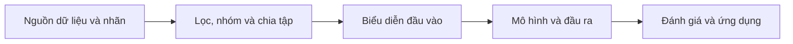

# Gợi ý trình bày slide và báo cáo từ sáu bài của nhóm GVHD

> Cập nhật **14/10/2026**. Đây là tài liệu tham khảo về cách trình bày, theo yêu cầu của Trọng; các mẫu quan sát được **không phải yêu cầu bắt buộc hay lời xác nhận của GVHD**. Quyết định và đề xuất thay đổi phạm vi nghiên cứu chỉ tra tại [DECISIONS.md](../DECISIONS.md); yêu cầu đã được ghi nhận tra tại [course.md](course.md) và [people.md](people.md).

Nguồn đầu vào là [bản phân tích Trọng gửi](../resources/papers/ho-quang-thai/advisor-presentation-analysis-2026-10-14.txt), được giữ nguyên để truy vết. Đã đối chiếu nội dung chọn lọc trong cả sáu PDF và xem trực tiếp ba trang workflow: mCNN-ETC tr. 8, mCNN-GenEfflux tr. 4, msCNN-PLM-FAD tr. 3. Phần dưới phân biệt **quan sát từ bài báo**, **gợi ý vận dụng** và **giới hạn bằng chứng**; chưa audit toàn bộ mã nguồn, phép chia dữ liệu hay mọi con số trong sáu bài.

## 1. Các mẫu trình bày có thể học

Số trang dưới đây tính từ trang đầu PDF, bắt đầu bằng 1. Có thể mở PDF rồi tìm tên hình/mục được chỉ ra.

| Bài báo | Điểm đã đối chiếu | Gợi ý khi soạn tài liệu |
|---|---|---|
| [GT-Finder (2021)](../resources/papers/ho-quang-thai/1-s2.0-S0010482521000536-main.pdf) | Fig. 1, tr. 2: glucose transporter trong màng tế bào; Fig. 2, tr. 4: workflow từ dữ liệu đến đánh giá | Giải thích đối tượng sinh học, rồi nối sang đầu vào và đầu ra tính toán |
| [mCNN-ETC (2022)](../resources/papers/ho-quang-thai/bbab352.pdf) | Tr. 3–4: ẩn dụ ma trận PSSM như ảnh nhiều kênh, chuỗi như ngôn ngữ; Fig. 7, tr. 8: workflow chia khung; Fig. 9, tr. 10: motif và vị trí trên chuỗi | Dùng một phép ví von có giới hạn; thể hiện kích thước tensor và vị trí tín hiệu |
| [BERT-Promoter (2022)](../resources/papers/ho-quang-thai/1-s2.0-S1476927122001128-main.pdf) | Fig. 1, tr. 2: workflow hai tầng; Fig. 2, tr. 3: xếp hạng đặc trưng bằng SHAP; Fig. 4, tr. 4: so sánh biểu diễn ở từng tầng | Tách rõ các nhiệm vụ và cho biết biểu diễn đóng góp gì vào mỗi nhiệm vụ |
| [mCNN-GenEfflux (2025)](../resources/papers/ho-quang-thai/1-s2.0-S1476927125002567-main.pdf) | Fig. 1, tr. 2: sinh học efflux; Fig. 2, tr. 4: workflow có số mẫu; tr. 9–10: mục 5 về giới hạn, UMAP và Grad-CAM | Đưa số mẫu vào luồng xử lý, nối đánh giá định lượng với ví dụ giải thích và giới hạn |
| [RAG-msCNN (2026)](../resources/papers/ho-quang-thai/1-s2.0-S1746809425019184-main.pdf) | Fig. 1, tr. 3: workflow PLM–RAG–msCNN; mục 4.5: t-SNE và SHAP | Với phương pháp nhiều thành phần, vẽ rõ đường đi của dữ liệu và tách câu hỏi đánh giá cho từng thành phần |
| [msCNN-PLM-FAD (2026)](../resources/papers/ho-quang-thai/1-s2.0-S0003269726000485-main.pdf) | Fig. 1, tr. 2: sinh học; Fig. 2, tr. 3: workflow; Fig. 4, tr. 5: CNN/mCNN/msCNN; mục 3.7: tách biểu diễn và kiến trúc; tr. 8: bootstrap, đánh giá theo protein | Kết quả đi theo chuỗi câu hỏi, báo cả hiệu năng, chi phí và độ bất định |

**Mẫu tổng hợp:** bối cảnh sinh học → bài toán cụ thể → giới hạn của cách hiện có → dữ liệu/nhãn → workflow → bằng chứng cho từng thành phần → so sánh → giải thích → giới hạn và công cụ sử dụng. Đây là cách đọc sáu bài trong mẫu khảo sát, chưa đủ để quy mọi lựa chọn trình bày cho cá nhân GVHD hoặc khẳng định một xu hướng thời gian áp dụng cho toàn bộ công bố.

## 2. Dẫn nhập và cách phát biểu đóng góp

**Quan sát:** nhiều tiêu đề dùng tên mô hình, bài toán và kỹ thuật chính; phần dẫn nhập kết nối ý nghĩa sinh học với nhu cầu dự đoán. mCNN-ETC dùng ví von để nối sinh học với xử lý ảnh/ngôn ngữ; msCNN-PLM-FAD dùng số liệu của phương pháp trước để làm rõ điểm cần cải thiện. Xem các PDF tương ứng ở mục 1.

**Gợi ý vận dụng:** viết dẫn nhập thành bốn đoạn hoặc bốn bước nói:

1. **Đối tượng và ý nghĩa:** phân tử/quá trình nào, có vai trò gì; định nghĩa thuật ngữ trước khi dùng tên mô hình.
2. **Bài toán:** đầu vào, đơn vị dự đoán, đầu ra và nhãn được đo bằng cách nào.
3. **Khoảng trống:** phương pháp gần nhất làm được gì, còn thiếu gì; dùng số liệu có nguồn và điều kiện đánh giá.
4. **Đóng góp dự kiến hoặc đã đo:** mỗi đóng góp gắn với một đối chứng và thước đo; ghi đúng trạng thái bằng chứng.

Mẫu câu để điền: “Trong [phạm vi], người dùng cần [đầu ra] để [mục đích]. Phương pháp [baseline] còn [giới hạn có nguồn]. Nghiên cứu này [đề xuất/đã thực hiện] [thay đổi], được đánh giá bằng [phép so sánh] trên [dữ liệu và split].”

Tiêu đề có thể dùng `[Tên ngắn]: [bài toán] bằng [ý tưởng chính]` khi tên ngắn giúp người đọc nhớ. Chỉ dùng “cải thiện”, “enhanced” hoặc “vượt trội” khi có kết quả so sánh phù hợp. Không cần đưa mọi kỹ thuật vào tiêu đề. Ý nghĩa y sinh nên nằm trong phạm vi dữ liệu; dự đoán trên peptide không tự chứng minh tác động trên protein nguyên vẹn hay hiệu quả điều trị.

## 3. Hình và sơ đồ

**Quan sát:** ba workflow đã xem có nền sáng, viền khung đậm, thanh tiêu đề tối/chữ sáng, nhiều thanh vát góc, mũi tên nối các giai đoạn và màu phân biệt luồng dữ liệu. Khối thu thập dữ liệu thường chứa nguồn và số lượng; khối mô hình thể hiện biểu diễn, các nhánh xử lý và đầu ra. Bố cục có cả khung ngang xếp dọc lẫn khung cạnh nhau, không phải một hàng ngang cố định. Nguồn: mCNN-ETC Fig. 7, mCNN-GenEfflux Fig. 2, msCNN-PLM-FAD Fig. 2.

**Gợi ý vận dụng:**

| Loại hình | Nội dung cần đọc được | Cách dùng trong slide/báo cáo |
|---|---|---|
| Bối cảnh sinh học | Đối tượng, tương tác/quá trình và vị trí của bài toán | Một hình đơn giản, nhãn tiếng Việt; chỉ giữ chi tiết phục vụ câu hỏi nghiên cứu |
| Workflow tổng thể | Nguồn → lọc/nhãn/split → biểu diễn → mô hình → đầu ra/đánh giá | Chia khoảng 4–5 khối nếu vừa nội dung; ghi số mẫu và nhánh train/validation/test |
| Kiến trúc chi tiết | Chiều dài `L`, số chiều `D`, kích thước cửa sổ và phép gộp | Dùng hình khối khi cần giải thích tensor; tách khỏi workflow nếu chữ quá nhỏ |
| Bảng/biểu đồ kết quả | Đơn vị, chiều tốt của metric, baseline, độ bất định | Một thông điệp chính mỗi hình; kèm bảng số hoặc nguồn kết quả |
| Ví dụ giải thích | Chuỗi/vị trí, nhãn đo, dự đoán và sai lệch | Heatmap có thang màu; chọn cả ca thành công và ca thất bại |
| Công cụ/ứng dụng | Người dùng nhập gì, nhận gì và dùng kết quả ra sao | Ví dụ sử dụng cụ thể, giới hạn đầu vào và xuất kết quả có nguồn gốc |

Một workflow tính toán có thể phác bằng sơ đồ sau rồi vẽ lại theo nội dung thật:

Đây là **sơ đồ khái niệm tự dựng**, chưa mô tả giao thức thí nghiệm cụ thể. Trong hình thực tế cần thể hiện nhánh lựa chọn mô hình trên train/validation, khóa cấu hình rồi mới đánh giá test.

Dùng màu nhất quán và ghi nhãn bằng chữ để đọc được khi in xám. Trong slide, trình bày workflow tổng thể trước, rồi phóng to phần đang giải thích. Trong báo cáo, caption nêu hình mô tả gì, ký hiệu và nguồn. Hình tự dựng ghi rõ “sơ đồ tự dựng”; hình kiến trúc chưa thử ghi “đề xuất, chưa kiểm chứng”. Hình lấy hoặc phỏng theo bài báo phải có trích dẫn và kiểm quyền sử dụng. Với HTML, có alt text, bố cục responsive và hỗ trợ giảm chuyển động khi thêm animation.

## 4. Kể câu chuyện thực nghiệm bằng bảng

**Quan sát:** mCNN-ETC và msCNN-PLM-FAD trình bày các khảo sát cửa sổ, tổ hợp cửa sổ, cấu hình mạng và biểu diễn. msCNN-PLM-FAD mục 3.7 tách vai trò biểu diễn/kiến trúc; phần đánh giá bổ sung khoảng tin cậy và kết quả theo protein. Có thể học cách mỗi bảng trả lời một câu hỏi, thay vì chỉ đưa cấu hình cuối.

**Gợi ý vận dụng:** chỉ tạo bảng tương ứng với câu hỏi nghiên cứu thật.

| Bảng | Câu hỏi | Các trường nên có |
|---|---|---|
| Dữ liệu sau từng bước lọc | Còn bao nhiêu mẫu, nhãn và nhóm độc lập? | Nguồn, đơn vị mẫu, tiêu chí lọc, số trước/sau, số nhóm, phân bố nhãn, split |
| Khảo sát cấu hình | Cấu hình nào được chọn và dựa trên bằng chứng nào? | Biến thay đổi, phần cố định, kết quả validation, seed/ngân sách |
| Đối chứng biểu diễn × mô hình | Cải thiện đến từ đặc trưng hay bộ dự đoán? | Cùng split, cùng metric, baseline đơn giản và mô hình đề xuất |
| Ablation — bỏ/thay từng thành phần | Thành phần nào đóng góp? | Thành phần thay đổi, chênh lệch metric, độ bất định và chi phí |
| So sánh cuối | Lợi ích có tồn tại trên tập test đã khóa? | Baseline mạnh, metric chính/phụ, chênh lệch ghép cặp, CI, tài nguyên |
| Phân tích lỗi/miền áp dụng | Mô hình yếu ở nhóm nào? | Số mẫu từng nhóm, sai lệch, ví dụ và giới hạn |

Với mỗi bảng, viết theo nhịp: **câu hỏi → điều kiện so sánh → kết quả → diễn giải có giới hạn**. Ví dụ: “Để kiểm vai trò của [thành phần], giữ cố định [split/biểu diễn/ngân sách]. Bảng X cho thấy [số đo thật]. Kết quả hỗ trợ [kết luận hẹp], còn [bất định/giới hạn].” Khi chưa chạy, dùng “bảng kế hoạch đánh giá” với ô “chưa đo”, không điền số minh họa như kết quả thật.

Việc lựa chọn cửa sổ, biểu diễn, ngưỡng hay kiến trúc phải dựa trên train/validation. Khảo sát tuần tự tiết kiệm chi phí nhưng có thể bỏ sót tương tác giữa siêu tham số; không gọi cấu hình đã chọn là tối ưu toàn cục. So với số trích từ bài khác phải ghi rõ khác dữ liệu/giao thức; chỉ kết luận thắng baseline khi phép so sánh đủ tương đương.

Metric theo bài toán: phân loại mất cân bằng có thể cần AUPRC và MCC với ngưỡng khóa trên validation; xếp hạng vị trí dùng metric như precision@k; hiệu ứng đột biến liên tục dùng thước đo hồi quy phù hợp. Không mang MCC hoặc một ngưỡng lọc đồng dạng cố định sang mọi bài toán. Bootstrap/kiểm định phải theo đơn vị độc lập và thiết kế ghép cặp; các residue cùng protein không mặc nhiên là mẫu độc lập. Số vòng 5.000 trong bài FAD là một lựa chọn của bài, không phải chuẩn bắt buộc.

## 5. Giải thích, giới hạn và tái lập

**Quan sát:** các bài dùng motif/heatmap, SHAP, Grad-CAM, t-SNE/UMAP và ví dụ cấu trúc ở các mức khác nhau. mCNN-GenEfflux có mục giới hạn riêng; msCNN-PLM-FAD báo độ bất định thay vì chỉ điểm hiệu năng. Xem các bài ở mục 1.

**Gợi ý vận dụng:** nối ba lớp bằng chứng: mô hình dự đoán gì → vùng/đặc trưng nào liên quan → có khớp nhãn độc lập hoặc bằng chứng sinh học nào không. SHAP trên chiều embedding như trong BERT-Promoter không tự trở thành lời giải thích theo nucleotide/residue. t-SNE/UMAP mô tả phép chiếu; heatmap, attention và ánh xạ lên cấu trúc hỗ trợ diễn giải nhưng chưa chứng minh cơ chế, quan hệ nhân quả hay độ đúng của dự đoán.

Phần thảo luận nêu cả nơi baseline còn tốt hơn, kết quả chưa rõ và nhóm ít mẫu. “Không có ý nghĩa thống kê” không đồng nghĩa “hai mô hình tương đương”. Cấu trúc 3D chỉ dùng khi có nguồn, chất lượng và cách căn chỉnh vị trí rõ ràng; ảnh đẹp không thay thế kiểm chứng thực nghiệm.

Phần công cụ/tái lập nên mô tả đầu vào hợp lệ, đầu ra có ích, phiên bản mô hình/dữ liệu, cách chạy lại, nguồn số liệu và giới hạn sử dụng. Liên kết web/GitHub được công bố là điểm để tham khảo; cần kiểm tra khả năng truy cập, giấy phép và mức tái lập trước khi khẳng định công cụ còn hoạt động hoặc mã/dữ liệu đầy đủ.

## 6. Khung slide và báo cáo để tham khảo

Khung dưới đây là **mẫu biên soạn theo yêu cầu này**, không chốt cấu trúc luận văn hay thiết kế thí nghiệm. Điều chỉnh theo thời lượng, mẫu học phần và mục đích buổi gặp.

| Trang slide | Thông điệp | Hình/bảng phù hợp |
|---|---|---|
| 1. Bài toán và mục tiêu | Nghiên cứu giải quyết câu hỏi gì? | Tiêu đề cụ thể, một câu mục tiêu |
| 2. Bối cảnh sinh học | Đối tượng có ý nghĩa gì? | Sơ đồ sinh học có ít nhãn |
| 3. Đầu vào, đầu ra, nhãn | Chính xác đang dự đoán thứ gì? | Một ví dụ mẫu dữ liệu |
| 4. Tiền lệ và khoảng trống | Còn thiếu gì, bằng chứng ở đâu? | Bảng ngắn phương pháp/phạm vi/giới hạn |
| 5. Dữ liệu và tính khả thi | Nhãn, quy mô, split và rủi ro ra sao? | Phễu dữ liệu và số nhóm độc lập |
| 6. Ý tưởng phương pháp | Thay đổi nào nhằm giải quyết giới hạn? | Workflow tổng thể; ghi trạng thái đề xuất |
| 7. Thành phần trọng tâm | Vì sao thành phần này cần thiết? | Kiến trúc phóng to hoặc ví dụ tính toán |
| 8. Đánh giá và ablation | Phép đo nào có thể bác bỏ giả thuyết? | Ma trận đối chứng và metric |
| 9. Bằng chứng hiện có | Đã đo gì và còn chưa đo gì? | Số audit/kết quả có nguồn, độ bất định |
| 10. Ứng dụng, giới hạn, bước tới | Ai dùng kết quả, còn điều kiện nào? | Luồng sử dụng và câu hỏi cần trao đổi |

Với buổi đề xuất đề tài, trang 8 trình bày **kế hoạch**, trang 9 chỉ dùng audit đã có. Với buổi báo cáo kết quả, tăng phần đối chứng, ablation và phân tích lỗi. Để bảng tinh chỉnh đầy đủ ở phụ lục slide; tiêu đề trang nên nêu kết luận có bằng chứng hoặc câu hỏi đang kiểm tra.

Báo cáo có thể đi theo: **đặt vấn đề → nghiên cứu liên quan → dữ liệu và giao thức → phương pháp → thực nghiệm/kết quả → thảo luận/giới hạn → ứng dụng và tái lập → kết luận**. Bảng tinh chỉnh dài, cấu hình, danh sách mẫu và hướng dẫn chạy đặt ở phụ lục; phần chính giữ mạch câu hỏi–bằng chứng. Tuân thủ mẫu báo cáo học phần trước khi dùng khung này.

## 7. Các điểm cần sửa hoặc giới hạn trong bản phân tích đầu vào

| Nhận xét trong bản paste | Kết quả đối chiếu/cách sử dụng |
|---|---|
| Figure 1 luôn là sinh học, Figure 2 là workflow | Đúng ở GT-Finder, GenEfflux và FAD trong mẫu; **BERT-Promoter Fig. 1 và RAG-msCNN Fig. 1 đã là workflow**. Dùng trật tự kể chuyện khi phù hợp, không áp số thứ tự hình cố định |
| Workflow là 4–5 khung ngang nối tiếp | Có ngôn ngữ đồ họa tương tự trong ba hình đã xem, nhưng bố cục khác nhau; ETC có khung cạnh nhau. Học phân nhóm và luồng dữ liệu thay vì sao chép bố cục |
| Quy dấu ấn viết/trực quan hóa của cả sáu bài cho GVHD | ETC tr. 10 xác nhận Q.T.H. viết bản thảo; GenEfflux tr. 11 ghi writing và visualization. **FAD tr. 13 ghi các vai trò đó cho Dinh-Quy Nguyen; Quang-Thai Ho được ghi supervision, software, resources, methodology, investigation.** Chỉ gọi đây là mẫu của nhóm bài có GVHD tham gia |
| Ánh xạ SHAP lên PDB kiểm chứng độ chính xác tiếp xúc ở cấp nguyên tử | Trực quan hóa và đối chiếu khoảng cách hỗ trợ một phân tích cấu trúc trong điều kiện cụ thể; chưa là xác nhận cơ chế/tiếp xúc bằng thực nghiệm |
| Lọc tương đồng 30% chứng minh không rò rỉ | Bài có mô tả lọc là bằng chứng về phương pháp tác giả báo cáo; vẫn cần kiểm train/test, coverage, nhóm protein và cách dựng đặc trưng khi áp dụng |
| Mọi bài đều công khai đầy đủ mã và dữ liệu, mọi Introduction “luôn” theo một mẫu | Giữ ở mức nhận xét trong mẫu bài; chưa kiểm khả năng chạy lại, độ đầy đủ của repository hay mọi trường hợp |
| Các số như 28,8 triệu tham số, 79,35%, 5.000 bootstrap và khoảng cách 4–10 Å | Không lấy làm mục tiêu cho luận văn. Khi cần trích phải đối chiếu đúng bảng, cấu hình, đơn vị và phạm vi; lần này không audit toàn bộ số liệu đầu vào |

## 8. Checklist khi dùng hướng dẫn

- [ ] Đọc trạng thái hiện hành và đề xuất chờ xác nhận trong [DECISIONS.md](../DECISIONS.md) trước khi lấy nội dung từ trang cũ.
- [ ] Thuật ngữ sinh học được định nghĩa; đầu vào/đầu ra/đơn vị nhãn rõ ràng.
- [ ] Khoảng trống và số liệu có nguồn; phân biệt số tác giả, audit tự đo, diễn giải và đề xuất.
- [ ] Workflow đọc được, có nguồn dữ liệu, số mẫu và nhánh lựa chọn mô hình/đánh giá test.
- [ ] Mỗi đóng góp có đối chứng và metric; bảng kế hoạch được phân biệt với kết quả.
- [ ] Hình có caption, ký hiệu, thang màu và nguồn; hình/heatmap không bị diễn giải vượt bằng chứng.
- [ ] Kết quả kèm điều kiện đánh giá, độ bất định và giới hạn; công cụ có luồng sử dụng cụ thể.
- [ ] Slide/báo cáo không biến cách trình bày thường gặp thành yêu cầu bắt buộc của GVHD.
