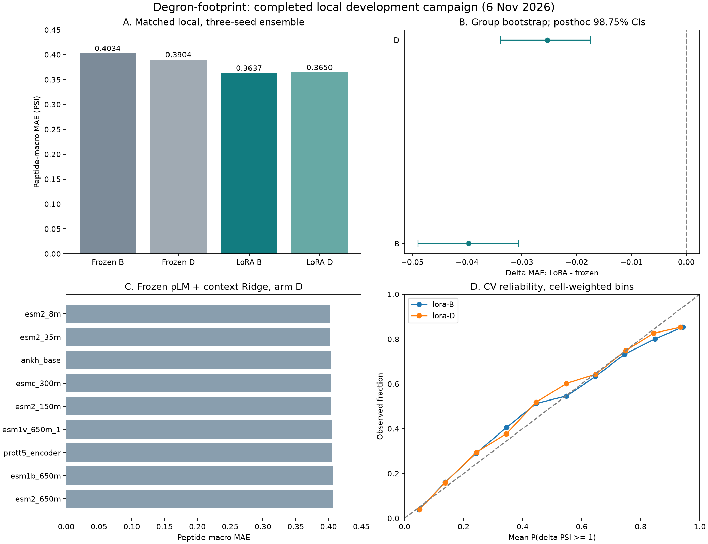

# Phân tích campaign local hoàn tất — 06/11/2026

**[ĐO đã lưu và tái tính]** Campaign `ef138c84579c842e` hoàn tất 633 job, còn `source_pending` và `structure_pending`. LoRA ESM2-35M cải thiện so với frozen trong phép so cùng runtime local; chưa có kiểm chứng T cho LoRA hoặc model LoRA cuối để phục vụ.

Nguồn số và phương pháp: [local-output-analysis.json](local-output-analysis.json); mã tái tạo: [analyze-local-output.py](analyze-local-output.py). Báo cáo chỉ đọc output/data, không huấn luyện lại hoặc sửa campaign. Các phép so mới mang vai trò development/hậu kiểm.

## 1. Kiểm tra tính toàn vẹn và độ đầy đủ

- [ĐO] Kiểm 4,278 artifact local và 2,986 file Kaggle hoàn tất bằng size/SHA-256: không sai lệch; trạng thái nguồn kế thừa giữ nguyên.
- [ĐO] 41 recipe local (36 pLM/Ridge + quy trình chọn nested + 4 frozen/LoRA), đủ seed 17/29/43. Mỗi seed có cùng 122.412 ô, 235 peptide, 221 nhóm; không trùng `(seed, cell_id)`, điểm hữu hạn, nhãn/fold khớp bundle. Metric ensemble được tái tính và khớp báo cáo gốc trong dung sai 1e-10.
- [ĐO] Bảng chung có 88 hàng: 41 local + 47 Kaggle. Nguồn/platform được giữ riêng. Một số hàng Kaggle stage11 chỉ có seed 17, không được so như ensemble ba seed.

## 2. Phép so frozen–LoRA cùng runtime

MAE macro theo peptide (thấp hơn tốt hơn); AUROC/AP dương dùng nhãn đo ΔPSI ≥ 1. MAE có 235 peptide, AUROC/AP dương có 184 peptide đủ điều kiện; AUROC âm có 110 peptide. B: train PSI≤4; D: train toàn dải; validation/test chung toàn dải.

| Recipe | MAE | AUROC + | AP + | AUROC − |
|---|---:|---:|---:|---:|
| esm2_35m-frozen-B | 0.403385 | 0.826268 | 0.455411 | 0.754078 |
| esm2_35m-frozen-D | 0.390382 | 0.824625 | 0.454438 | 0.766693 |
| esm2_35m-lora-B | 0.363669 | 0.855047 | 0.551682 | 0.792134 |
| esm2_35m-lora-D | 0.364996 | 0.853556 | 0.547416 | 0.802777 |

[ĐO] Chênh lệch **LoRA − frozen**, ensemble ba seed, bootstrap 5.000 lần theo nhóm protein. Dấu âm MAE và dấu dương AUROC là cải thiện. CI hiệu chỉnh 98,75% là Bonferroni hậu kiểm cho bốn phép so; CI gốc 95% được giữ riêng.

| Điều kiện/chỉ số | Δ và CI 95% | Δ và CI hiệu chỉnh |
|---|---|---|
| B / mae | -0.039716 [-0.047036; -0.032415] | -0.039716 [-0.048959; -0.030630] |
| B / auroc_plus | +0.028779 [+0.020856; +0.036623] | +0.028779 [+0.018798; +0.038893] |
| D / mae | -0.025386 [-0.031810; -0.019067] | -0.025386 [-0.033903; -0.017477] |
| D / auroc_plus | +0.028931 [+0.021161; +0.036333] | +0.028931 [+0.019177; +0.038686] |

[DIỄN GIẢI] Đây là bằng chứng development cho ích lợi của LoRA trong thiết kế đã thử. Mỗi seed cũng phải được đọc riêng; lợi ích ensemble không biến ba seed thành ba bộ dữ liệu độc lập.

| Recipe | MAE seed 17 | MAE seed 29 | MAE seed 43 | MAE ensemble |
|---|---:|---:|---:|---:|
| esm2_35m-frozen-B | 0.407303 | 0.403076 | 0.405934 | 0.403385 |
| esm2_35m-frozen-D | 0.391986 | 0.391815 | 0.393793 | 0.390382 |
| esm2_35m-lora-B | 0.379414 | 0.378558 | 0.377919 | 0.363669 |
| esm2_35m-lora-D | 0.379388 | 0.377775 | 0.378767 | 0.364996 |

[ĐO] LoRA D−B, MAE: +0.001328 [-0.002947; +0.005537]. Không chọn B chỉ từ vị trí đứng đầu bảng nếu CI ghép cặp chưa phân biệt được.

| Miền PSI(WT) test | n peptide | LoRA-B MAE | LoRA-D MAE |
|---|---:|---:|---:|
| le3 | 91 | 0.388442 | 0.400193 |
| gt3_le4 | 85 | 0.381162 | 0.381508 |
| gt4_le5 | 36 | 0.309171 | 0.303302 |
| gt5 | 23 | 0.286305 | 0.261280 |

[DIỄN GIẢI] B/D có đánh đổi theo miền PSI; miền >5 chỉ có 23 peptide và không có AUROC dương đủ điều kiện. MAE toàn W gần nhau không đồng nghĩa hành vi trên mọi miền giống nhau.

## 3. Khảo sát pLM và so với kết quả Kaggle

| pLM | MAE only-D | MAE context-D | AUROC + context-D |
|---|---:|---:|---:|
| esm2_8m | 0.399547 | 0.401826 | 0.843268 |
| esm2_35m | 0.400743 | 0.402238 | 0.844512 |
| ankh_base | 0.404825 | 0.403475 | 0.844029 |
| esmc_300m | 0.404625 | 0.403785 | 0.839145 |
| esm2_150m | 0.403119 | 0.404145 | 0.839021 |
| esm1v_650m_1 | 0.403195 | 0.405036 | 0.837758 |
| prott5_encoder | 0.405607 | 0.405550 | 0.842477 |
| esm1b_650m | 0.405361 | 0.406946 | 0.836003 |
| esm2_650m | 0.405644 | 0.407122 | 0.839382 |

[ĐO] Nested selection: MAE 0.394454, AUROC dương 0.840882. Cả 15 lựa chọn seed/fold khớp argmin inner MSE từ artifact gốc; số lần chọn từng recipe nằm trong JSON. Đây là điểm của quy trình chọn, không phải một model cố định.

[DIỄN GIẢI] Không có quan hệ đơn điệu giữa kích thước pLM và chất lượng trong bảng này. ProtT5/Ankh đã có kết quả thật; Ankh encoder FP32, feature lưu FP16, khác precision inference của các pLM FP16. Context/only có phép so ghép cặp ở JSON; không quy toàn bộ chênh lệch cho một cơ chế sinh học.

| Phép so MAE (hậu kiểm development) | Δ và CI 95% |
|---|---|
| local:nested-family-selection minus kaggle:ordered-w5-D | -0.013349 [-0.017194; -0.009669] |
| local:esm2_35m-lora-B minus kaggle:ordered-w5-D | -0.044134 [-0.052177; -0.036275] |
| local:esm2_35m-lora-B minus kaggle:esm2_35m-cnn-D | -0.020685 [-0.026589; -0.014885] |

Các hàng Kaggle/local dùng cùng cohort và nhãn/fold đã đối chiếu, nhưng khác runtime và có thể khác kiến trúc/ngân sách. Đây không phải phép tách nhân quả chỉ riêng LoRA so với CNN; không cộng hai platform thành mẫu độc lập.

## 4. Hiệu chuẩn xác suất

Brier dưới đây là **ba lớp** (Δ≤−1, trung tính, Δ≥1), không so trực tiếp với Brier nhị phân P6 lịch sử. Card gốc báo cell-micro; macro theo peptide được ghi riêng. Baseline hằng chỉ học tần suất lớp ở inner-validation của đúng fold, rồi ensemble ba seed; không học nhãn outer-test.

| Recipe | Brier cell-micro | Brier peptide-macro | Baseline inner-prior micro | ECE dương micro |
|---|---:|---:|---:|---:|
| esm2_35m-frozen-B | 0.178879 | 0.178744 | 0.200569 | 0.012913 |
| esm2_35m-frozen-D | 0.179495 | 0.179372 | 0.200569 | 0.011395 |
| esm2_35m-lora-B | 0.163071 | 0.163026 | 0.200569 | 0.016347 |
| esm2_35m-lora-D | 0.165899 | 0.165882 | 0.200569 | 0.016495 |

[DIỄN GIẢI] LoRA có Brier thấp hơn frozen, nhưng ECE dương theo cách chia bin này cao hơn frozen. Brier kết hợp chất lượng phân biệt và hiệu chuẩn; không kết luận mọi khía cạnh hiệu chuẩn của LoRA đều tốt hơn chỉ từ Brier.

[ĐO/giới hạn] Xác suất hữu hạn, tổng ba lớp bằng 1; card Brier tái tính khớp. Nhóm inner calibration không giao outer-test. Đây là calibration CV, chưa có final LoRA/CNN/family model phục vụ. `model_ids` trong các card hiện đang rỗng, cần hoàn thiện provenance khi đóng gói model.

## 5. Locked transfer W5-D trên scan_T

[ĐO] 39,234 ô / 1,410 peptide / 730 nhóm, chỉ phép thay R/A/S. Nhãn rep1; không giao group_id với W hoặc scan_dev. Recipe W5-D và input OOF khớp selection lock.

| Chỉ số | Kết quả |
|---|---:|
| MAE W5-D | 0.399147 |
| MAE dự đoán hằng 0 | 0.402403 |
| W5-D − zero, MAE và CI 95% | -0.003256 [-0.009249; +0.002760] |
| AUROC dương / peptide đủ điều kiện | 0.840546 / 338 |
| AUROC âm / peptide đủ điều kiện | 0.517600 / 85 |
| Brier ba lớp cell-micro trên T | 0.129119 |
| Tần suất dương đo / xác suất dương trung bình | 0.051155 / 0.089529 |

[DIỄN GIẢI] CI của ΔMAE so với zero cắt 0: chưa đủ bằng chứng W5-D giảm MAE trên T so với baseline này. AUROC âm gần 0,5 trên 85 peptide đủ điều kiện. Xác suất dương trung bình cũng cao hơn tần suất đo trên T, nên cần xem chuyển miền xác suất cùng khả năng xếp hạng.

T là scanning cùng phòng thí nghiệm, đã được khảo sát ở mức nguồn; khác thiết kế saturation 19 phép thay. Không gọi đây là external độc lập/kiểm chứng lâm sàng. **LoRA chưa được chấm trên T**; kết quả W5-D không chứng minh transfer của LoRA.

## 6. Việc còn lại

1. [ĐỀ XUẤT] Giữ LoRA-B và LoRA-D là ứng viên development; chốt mục tiêu/miền sử dụng và quy tắc lựa chọn trước đánh giá tiếp. Bảng OOF không tự chọn model sản phẩm.
2. [CHƯA LÀM] Final refit/export đúng kiến trúc cho model được chọn, đầy đủ revision/tokenizer/precision/calibrator/model card và kiểm suy luận độc lập.
3. [CHƯA LÀM] Protocol đánh giá tiếp cho LoRA; không dùng T đã xem để chọn nhiều model rồi gọi là kiểm chứng độc lập.
4. [PENDING] Nguồn ngoài và cấu trúc thật; không đổi nhãn hoặc giả dữ liệu để đóng hai trạng thái này.
5. [ĐỀ XUẤT] Đưa kết quả đã kiểm vào luận văn khi yêu cầu cập nhật nội dung; giữ giới hạn development và kết quả âm. App baseline chưa thay model, G2/G3 chưa tự đóng.



## Tái tạo

```powershell
.\.venv\Scripts\python.exe -I topics/degron-footprint/research/kaggle-roadmap-2026-10-31/analyze-local-output.py
```

Cần giữ output Kaggle, campaign local nguồn, successor và bundle dữ liệu. Script kiểm hash, đọc Parquet/JSON, ghi các file phân tích bên cạnh; không load checkpoint/model hoặc sửa output nguồn.
