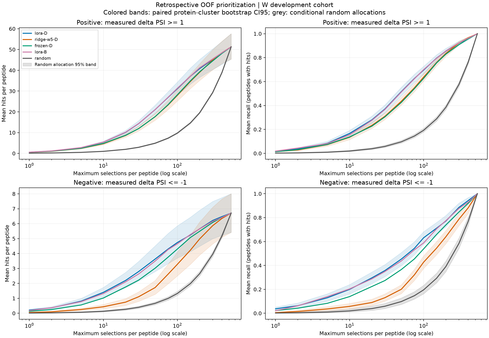

## Material Passport

- Origin Skill: academic-research-suite / experiment-agent
- Origin Mode: run, tiếp theo kiểm số học và tái lập
- Origin Date: 2026-11-07
- Verification Status: VERIFIED cho tính toán/input đã lưu, không phải wet-lab validation
- Version Label: oof_priority_result_v1

# Ưu tiên mutation với cùng ngân sách — đánh giá hồi cứu OOF

**[ĐO] LoRA-D tìm được 1.260 hit dương trong 2.350 lựa chọn, so với 1.087 của
Ridge W5-D và kỳ vọng random 229,86.** Precision@10 tương ứng 53,62%, 46,26%
và 9,78%. Cả 2/2 CI hiệu chỉnh của hai contrast chính đều nằm trên 0.
Nguồn số chuẩn: [results.json](results.json), [summary.csv](summary.csv).

**[DIỄN GIẢI] Kết quả hỗ trợ ưu tiên mutation tốt hơn hai đối chứng trong
replay development này.** Đã có bằng chứng định lượng hồi cứu của CT553H;
chưa có lượt wet lab mới, số giờ/tiền tiết kiệm đã đo, kiểm định độc lập ngoài
development hoặc quyết định nghiệm thu G2/G3. Mô hình phục vụ không thay đổi.

## Thiết kế và input

[Protocol đã khóa](PROTOCOL.md), [config.json](config.json) và [nhật ký bổ sung
độ bao phủ](AMENDMENTS.md) giữ thiết kế trước chấm và thay đổi triển khai sau
lượt đầu. Người dùng đã yêu cầu thực hiện `tmp.md`; không suy đây là tiền đăng
ký độc lập với dữ liệu development từng được khảo sát.

- W full-PSI: **235 peptide, 221 group, 122.412 mutation đơn không đồng nghĩa**.
- Ba seed 17/29/43, năm outer fold; rank bên trong peptide, không rank toàn
  proteome. Trung bình prediction ba seed rồi mới rank cho ensemble.
- Candidate/peptide: 216–532; tất cả đủ 10 lựa chọn. Ngân sách chính
  bằng 10/peptide, tổng 2.350 cho mọi policy; k=5,20 và top 5/10/20% là phụ.
- Hit dương: ΔPSI thực nghiệm >=1. Hit âm: ΔPSI <=-1, rank theo -prediction.
- Giữ **37 peptide không hit dương** và **84 không hit âm** trong Precision.
  Recall/enrichment/budget-to-recall dùng 198 peptide có hit dương hoặc 151 có
  hit âm; `null` có lý do trong [per-peptide.csv](per-peptide.csv).
- Random chọn đều không hoàn lại. Bảng chính dùng kỳ vọng giải tích, không
  lấy một lượt random thuận lợi. Có 2.000 random permutation/peptide để kiểm
  số học và vẽ dải dao động; prefix các ngân sách lồng nhau trong cùng lượt.
- Tie dùng hash SHA-256 của seed/peptide/cell, seed chính 1729; kiểm 100 seed
  0..99 ở cả sáu ngân sách, mọi policy/seed/hướng, không chọn seed tốt nhất.

[Input manifest](input-manifest.json) kiểm SHA-256/kích thước của
779 file dùng thực sự (109,392,159 byte), exact cohort mỗi seed,
metadata/nhãn, mode/recipe/identity và split. 45 OOF fold local khớp collection;
45 lựa chọn epoch được tính lại từ validation prediction đã lưu. Quần thể
calibration/selection của 60 fold loại outer-test. Không deserialize model.

Giới hạn audit: nhóm fit local được dựng lại từ split/arm và mã, không có
danh sách nhóm thực tế trong checkpoint; không tái chạy train. Không có prediction
từng alpha Ridge nên chưa tái chứng minh lựa chọn alpha; chỉ đối chiếu metadata,
nhóm fit và quần thể validation. Chi tiết ở `input-manifest.json.limitations`.

## Kết quả chính: hit dương, 10 lựa chọn/peptide

| Chính sách | Precision@10 | Hit / 2.350 lựa chọn | Recall@10 |
| --- | --- | --- | --- |
| lora-D | 53.62% | 1260 | 16.62% |
| ridge-w5-D | 46.26% | 1087 | 13.41% |
| random | 9.78% | 229.86 | 1.93% |
| frozen-D | 47.83% | 1124 | 13.71% |
| lora-B | 53.96% | 1268 | 15.56% |

Precision là peptide-macro trên 235 peptide; Recall là peptide-macro trên 198
peptide có hit dương. Số random là kỳ vọng, có thể không nguyên. Frozen-D và
LoRA-B là phân tích phụ đã chỉ định, không dùng để chọn lại recipe chính.

### Hai contrast chính

| LoRA-D trừ | Δ precision (điểm %) | CI95 mô tả | CI97,5 Bonferroni |
| --- | --- | --- | --- |
| ridge-w5-D | +7.36 | [+3.88; +10.88] | [+3.36; +11.39] |
| random | +43.84 | [+39.16; +48.24] | [+38.64; +48.83] |

Paired bootstrap 5.000 lần lấy mẫu **group_id**, mang toàn bộ peptide của mỗi
nhóm được lấy. Estimand vẫn là peptide-macro. CI97,5 dùng Bonferroni cho đúng
hai contrast chính; các CI95 khác là mô tả. So W5, LoRA-D có thêm **173 hit**
trên cùng 2.350 lựa chọn trong replay. So random kỳ vọng, chênh khoảng
**1.030,14 hit**; đây không phải số hit của một campaign random wet lab đã chạy.

### Từng seed

| Chính sách | Seed 17 | Seed 29 | Seed 43 | Ensemble |
| --- | --- | --- | --- | --- |
| lora-D | 51.91% | 50.13% | 52.77% | 53.62% |
| ridge-w5-D | 46.26% | 46.26% | 46.26% | 46.26% |
| frozen-D | 46.98% | 47.70% | 47.66% | 47.83% |
| lora-B | 51.32% | 51.62% | 51.19% | 53.96% |

Các seed dùng chung outer split và nhãn, không phải ba nghiên cứu độc lập.
LoRA-B ensemble cao hơn LoRA-D 0,34 điểm %, nhưng CI95 của D−B là
[-2,06; +1,34] điểm %: chưa phân giải, không đổi recipe chính sau xem utility.

## Ngân sách để thu hồi hit đã biết — phân tích phụ

| Chính sách | Lựa chọn để đạt 50% hit | Lựa chọn để đạt 80% hit |
| --- | --- | --- |
| lora-D | 71.32 | 154.36 |
| ridge-w5-D | 81.99 | 170.53 |
| random | 255.51 | 404.48 |

Các số là trung bình trên 198 peptide có hit dương; mục tiêu là ceil(r × tổng
hit của peptide). Chênh LoRA-D−W5 khi thu hồi 50% hit: -10,67 lựa chọn/peptide,
CI95 [-16,48; -4,96]; khi thu hồi 80%: -16,17, CI95 [-24,45; -7,64].
Các số giảm lựa chọn là **hồi cứu**, chưa phải số assay/giờ/tiền tránh được
trong thực tế. Tổng hit chỉ biết vì đã có nhãn, không dùng làm quy tắc dừng
khi triển khai wet lab.

## Chiều âm, phân tầng và độ nhạy

| Chính sách | Precision@10 âm | Hit âm / 2.350 |
| --- | --- | --- |
| lora-D | 14.00% | 329 |
| ridge-w5-D | 4.34% | 102 |
| random | 1.33% | 31.16 |
| frozen-D | 10.17% | 239 |
| lora-B | 13.19% | 310 |

Chiều âm là phụ; LoRA-D−W5 Precision@10 = +9,66 điểm %, CI95 [7,13; 12,35].
Không gộp hai chiều thành một điểm thành công.

| PSI(WT) | Peptide | LoRA-D P@10 | W5-D P@10 |
| --- | --- | --- | --- |
| le3 | 91 | 71.10% | 62.64% |
| gt3_le4 | 85 | 63.76% | 52.59% |
| gt4_le5 | 36 | 19.72% | 19.44% |
| gt5 | 23 | 0.00% | 0.00% |

Mức lợi ích thay đổi theo PSI(WT): miền (4,5] gần tương đương về point estimate;
miền >5 không có hit dương trong dữ liệu. [strata.csv](strata.csv) báo toàn bộ
fold, PSI và độ thưa hit, denominator cùng CI95 mô tả; không chọn subgroup tốt
để thay kết luận toàn W. Độ thưa hit là phân tầng nhãn, không phải thang đo độ
khó sinh học hay điều kiện chọn trước thí nghiệm.

| Chính sách | Peptide có tie ở ngưỡng k10 | P@10 thấp nhất–cao nhất, 100 seed |
| --- | --- | --- |
| frozen-D | 0 | 47.8298%–47.8298% |
| lora-B | 0 | 53.9574%–53.9574% |
| lora-D | 0 | 53.6170%–53.6170% |
| ridge-w5-D | 0 | 46.2553%–46.2553% |

Đối chiếu helper cũ: khi cùng thứ tự dòng/tie stable, top 5/10/20% khớp helper.
Đổi sang hash tie có 0 hàng peptide–policy–hướng–tỷ lệ khác precision;
mọi chênh đều nằm tại cutoff có tie. Đây là khác biệt có chủ đích, được báo
trong `results.json.legacy_helper_reconciliation`, không trộn với kết quả cũ.



Dải màu là CI95 bootstrap theo protein của **từng đường**, không phải CI của
chênh giữa hai đường; dùng bảng contrast để đánh giá chênh. Dải xám là 95%
dao động phân bổ random có điều kiện trên cohort cố định, không phải CI theo
protein. Trục ngân sách log; k thực tế bị chặn bởi số candidate của peptide.
[CSV đường cong](budget-curves.csv), [random reference](random-reference.csv).

## Ví dụ và kiểm chứng

[ranking-examples.csv](ranking-examples.csv) giữ top 10, vị trí, WT→mutant,
prediction, ΔPSI thực và hit cho peptide đầu tiên theo thứ tự từ điển trong
mỗi PSI stratum, mọi policy và hai hướng. Không chọn riêng case thuận lợi.

[validation.json](validation.json) kiểm công thức bằng liệt kê mọi permutation
với N=1..6; no/all hits, N<k, full tie, thiếu seed, duplicate/cell mismatch,
đảo thứ tự dòng, BTR và cluster không cùng kích thước. 2.000 lượt random khớp
kỳ vọng trong sai số Monte Carlo đã báo. [independent-validation.json](independent-validation.json)
tái tính primary/CI trực tiếp bằng một triển khai khác, kiểm bảng và input
không đổi; đây là kiểm số học độc lập, không phải một nghiên cứu độc lập.

[validation.md](validation.md) giữ kiểm 11 loại lỗi diễn giải thống kê và giới
hạn. Hai ngữ cảnh native hỗ trợ triển khai/audit; không có cross-model review,
không có xác nhận người dùng đã đọc toàn bộ nguồn.

## Tái tạo và runtime

Từ gốc repo, dùng môi trường phân tích có các phiên bản trong
[requirements-analysis.txt](requirements-analysis.txt):

```bash
.venv/bin/python -I research/oof-prioritization-2026-11-07/evaluate.py
.venv/bin/python -I research/oof-prioritization-2026-11-07/validate_outputs.py
python3 research/oof-prioritization-2026-11-07/write_report.py
```

Không cần GPU hoặc load model. Lượt cuối: 101.68 giây wall,
101.38 giây CPU, peak process RSS 1081.7 MiB
trên Linux/WSL, Python 3.12.3; [runtime.json](runtime.json).
Đây là tài nguyên tính toán chấm OOF, không phải chi phí/thời gian wet lab.

Artifact nhẹ gồm mã/config/protocol/manifest/JSON/CSV/PNG được giữ trong thư
mục này. Bảng toàn seed, curve từng peptide, log và bản lượt đầu ở `local/`,
được Git ignore. Không ghi đè campaign state/manifest, phân tích cũ, dữ liệu
gốc, hồ sơ wet lab, checkpoint hoặc mô hình phục vụ. Clone Git riêng không
đủ để tái chạy nếu thiếu các OOF và bundle dữ liệu đã pin.

**AI disclosure:** Codex hỗ trợ triển khai, kiểm input/số học và soạn báo cáo.
Phép đánh giá là hậu kiểm development, không sửa được lịch sử chọn model hoặc
bao gồm bất định do outer split/huấn luyện mới/assay mới. Các CI và hiệu chỉnh
hai contrast không biến kết quả thành prospective wet-lab validation.
