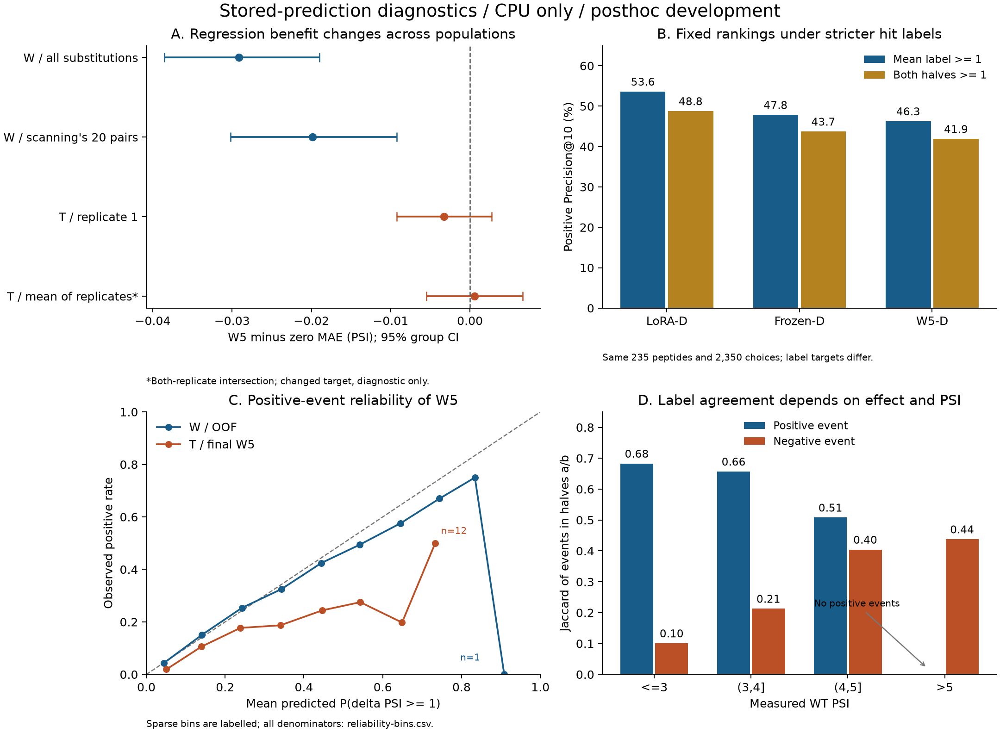

# Kiểm chứng độ tin cậy và giới hạn chuyển miền — đợt CPU 08/11/2026

## Material Passport

- Origin Skill: academic-research-suite / experiment-agent.
- Origin Mode: validate; phân tích chẩn đoán trên artifact đã lưu.
- Verification Status: **VERIFIED trong phạm vi số học/input đã kiểm**;
  không phải tái huấn luyện độc lập hoặc external biological validation.
- Version Label: reliability_transfer_cpu_v1.
- Commit nguồn: `788851c9b6bd53d75ee3f9793fa12d260237b1a0`. Thời điểm tính: `2026-11-08T02:06:30.623588+08:00`.

## Kết luận chính

**[ĐO] Đã thực hiện phân tích CPU, không train/refit/inference và không GPU.**
Matched LoRA–frozen được tái kiểm; diagnostic mới cho thấy bất đồng event giữa
hai nửa assay, lợi ích trên target consensus và giới hạn chuyển miền W5 vẫn
còn sau khi xét directed substitution design hoặc target trung bình replicate.

**[DIỄN GIẢI]** Kết quả hỗ trợ độ bền development trong các phép kiểm đã định;
không đủ để tuyên bố LoRA tổng quát hóa trên T, nguồn mới hoặc protein tự nhiên.
Chưa thay model phục vụ hoặc quyết định G2/G3. [Protocol](PROTOCOL.md),
[config](config.json), [kết quả JSON](results.json), [kiểm số học](validation.json).

## 1. Phạm vi và tính toàn vẹn

- W: 122.412 cell, 235 peptide, 221 nhóm; seed 17/29/43, năm outer fold.
- T rep1 đã lưu: 39.234 cell, 1.410 peptide, 730 nhóm; cùng nguồn Zhang.
- Kiểm SHA/kích thước **817 input**, 289,045,807 byte,
  trước và sau phân tích; 32 file của bundle cũng được kiểm theo manifest.
- Kiểm 15 assignment seed/fold; OOF phải đủ cohort, metadata, seed và nhãn.
- Hợp WT/mutant đo được của W và toàn scanning có **351,825
  sequence duy nhất, 0 exact sequence được gán vào hai group khác nhau**.
  Các observation lặp sequence trong cùng group được giữ nguyên.
- Hash chứng minh bytes/lineage đã lưu, không tái chứng minh training execution,
  checkpoint tensor, remote homology hoặc độc lập sinh học hoàn toàn.

[Input manifest](input-manifest.json) giữ từng nguồn và authority hash. Không
đụng vào manifest/state/checkpoint/dữ liệu gốc. [Nhật ký precision](AMENDMENTS.md)
giải thích float64 accumulation và chênh làm tròn với các báo cáo lịch sử.

## 2. Độ bền matched comparison

MAE là peptide-macro; dấu âm LoRA−frozen có lợi. B chỉ giới hạn train/refit
PSI≤4, validation/test vẫn full-range. Ensemble trung bình prediction ba seed.

| Arm | ΔMAE LoRA−frozen | CI98,75% đã đối chiếu |
| --- | --- | --- |
| B | -0.039716 | [-0.0490; -0.0306] |
| D | -0.025386 | [-0.0339; -0.0175] |

**[ĐO]** CI family gốc được tái tạo trong sai số precision input float32.
Đây là family bốn contrast hậu kiểm gốc, không hiệu chỉnh toàn bộ lịch sử thử
model. Các bảng [performance](performance.csv), [per-peptide](per-peptide.csv)
và [seed contrasts](seed-contrasts.csv) giữ mọi seed/fold/subset đã chỉ định.
Ba seed dùng chung outer partition và nhãn, không là ba nghiên cứu độc lập.

## 3. Replicate và độ nhạy định nghĩa hit

Pearson ΔPSI a/b = **0.8335**; bất đồng tuyệt đối
trung bình **0.2744 PSI**.
Đây là hai nửa assay theo pipeline nguồn, chưa xác nhận hai biological
replicate độc lập. Count support tối thiểu a/b =
10.0000/10.0117;
đơn vị là **tổng count đã chuẩn hóa**, không phải raw sequencing reads.

Với threshold ±1, các tỷ lệ dưới là **cell-micro**:

| Event | Prevalence nhãn mean | Hai nửa khác nhãn | Jaccard a/b |
| --- | --- | --- | --- |
| plus | 9.85% | 4.26% | 0.6596 |
| minus | 1.29% | 1.88% | 0.3040 |

**[DIỄN GIẢI]** Event âm hiếm và độ trùng event thấp hơn chiều dương. Jaccard
không tách được measurement noise, shared-reference uncertainty hoặc biology.
Miền PSI>5 không có event dương ở threshold 1 trong cả hai nửa; Jaccard ghi
null có lý do, không điền 0.

Giữ score và top10 cố định; thay **target chấm**, không re-rank theo nhãn:

| Policy | Mean≥1 | Nửa a≥1 | Nửa b≥1 | Cả a và b≥1 |
| --- | --- | --- | --- | --- |
| LoRA-D | 53.62% | 53.57% | 54.81% | 48.77% |
| Frozen-D | 47.83% | 48.26% | 48.77% | 43.70% |
| W5-D | 46.26% | 46.55% | 47.19% | 41.87% |
| LoRA-B | 53.96% | 54.30% | 54.38% | 49.32% |
| Frozen-B | 47.66% | 47.96% | 48.38% | 43.11% |

**[ĐO]** Với target consensus dương, LoRA-D−W5-D =
**+6.89 điểm %**, CI95 mô tả **[+3.5316; +10.2954] điểm %**.
Đây là target chặt hơn, không phải lower confidence bound cho hit thật.
Giữ cả peptide không hit trong precision, cùng 2.350 lựa chọn mỗi policy.
Không thay kết quả primary replay 07/11 hoặc chọn threshold tốt nhất.

Toàn bộ threshold .75/1/1.25, hai chiều, bốn target và các baseline được báo tại
[threshold sensitivity](threshold-sensitivity.csv), [paired contrasts](threshold-contrasts.csv).
CI mới là mô tả, không globally-adjusted. [Disagreement errors](disagreement-errors.csv)
và [bounds](prediction-bounds.csv) là hậu kiểm nhãn/WT PSI, không feature/gate deploy.

## 4. Tương đồng peptide với tập refit

Identity là phần residue **đúng cùng vị trí trên 28 AA**, không sequence alignment;
5-mer coverage là proxy local-motif. Reference W loại outer-test group, áp arm
B/D đúng population; reference T là toàn W của final W5.

| Arm | Bin identity | Peptide | Group | ΔMAE LoRA−frozen | CI95 mô tả |
| --- | --- | --- | --- | --- | --- |
| B | [0.0, 0.25) | 196 | 185 | -0.040191 | [-0.0487; -0.0326] |
| B | [0.25, 0.5) | 39 | 38 | -0.037333 | [-0.0541; -0.0211] |
| D | [0.0, 0.25) | 184 | 174 | -0.026673 | [-0.0337; -0.0201] |
| D | [0.25, 0.5) | 51 | 50 | -0.020744 | [-0.0361; -0.0056] |

Max aligned identity ở W là **0.2857**,
ở T→W **0.3571**.
Bins từ .5 trở lên không có quan sát W; không suy độ bền ở miền không được đo.
Lợi ích matched vẫn hiện trong các bin có dữ liệu, nhưng hai proxy này không
phát hiện mọi alignment lệch vị trí/remote homology/PLM pretraining exposure.
Không thay grouping/split và không gọi kiểm này là retraining với split chặt hơn.

[Similarity từng peptide](similarity.csv), [contrast theo bin](similarity-contrasts.csv).

## 5. Chuyển miền: substitution design và target replicate

Scanning có 20 directed WT→mutant pairs. W-mutant-RAS giữ mọi replacement vào
R/A/S; W-scanning-pairs chỉ giữ đúng 20 pairs. Các mask chỉ dùng để chấm score
đã lưu, không train lại hoặc match đầy đủ protein/assay/target.

| Cohort/target | Cell | Peptide | MAE W5 | MAE zero | W5−zero | CI95 mô tả |
| --- | --- | --- | --- | --- | --- | --- |
| W-full | 122,412 | 235 | 0.407803 | 0.436916 | -0.029113 | [-0.0386; -0.0190] |
| W-mutant-RAS | 17,935 | 235 | 0.397753 | 0.423159 | -0.025406 | [-0.0357; -0.0145] |
| W-scanning-pairs | 6,433 | 235 | 0.412625 | 0.432459 | -0.019834 | [-0.0302; -0.0093] |
| T-rep1-full | 39,234 | 1410 | 0.399147 | 0.402403 | -0.003256 | [-0.0092; +0.0028] |
| T-intersection-rep1 | 39,112 | 1407 | 0.398764 | 0.402011 | -0.003247 | [-0.0092; +0.0027] |
| T-intersection-rep2 | 39,112 | 1407 | 0.418756 | 0.419984 | -0.001228 | [-0.0074; +0.0048] |
| T-intersection-mean12 | 39,112 | 1407 | 0.373021 | 0.372469 | +0.000551 | [-0.0055; +0.0066] |

**[ĐO]** Trên W-scanning-pairs, lợi thế W5 so zero còn có CI phía âm; trên T
rep1 full CI chứa 0. Khi đổi target trên cùng intersection 39.112 cell/1.407
peptide/730 nhóm sang mean12, CI vẫn chứa 0 và point estimate đổi phía.

**[DIỄN GIẢI]** Khác substitution design hoặc chỉ dùng rep1 chưa đủ giải thích
hay khắc phục giới hạn hồi quy quan sát được. Không coi đây là phân rã nhân
quả hoặc kết luận model tuyệt đối không thể transfer. T và W khác protein,
sampling, prevalence và design; so W OOF với final T còn khác fit procedure.
P@10 trên candidate pool T/W khác kích thước cũng không cùng tỷ lệ sàng lọc.

Theo miền PSI trên T rep1:

| WT PSI | Peptide | W5−zero MAE | CI95 mô tả |
| --- | --- | --- | --- |
| gt3_le4 | 323 | -0.024045 | [-0.0342; -0.0136] |
| gt4_le5 | 306 | +0.015572 | [+0.0042; +0.0274] |
| gt5 | 257 | +0.095819 | [+0.0849; +0.1066] |
| le3 | 524 | -0.050028 | [-0.0580; -0.0420] |

**[ĐO]** Miền WT PSI cao có sai số W5 cao hơn zero trong các CI mô tả được
báo; miền thấp có lợi ích. Không chọn lại recipe hoặc tạo gate bằng test PSI.
LoRA vẫn **chưa có prediction trên T**. Không đánh đồng diagnostic này với
independent external validation.

## 6. Calibration đã lưu

Brier dưới đây là ba lớp, cell-micro; bảng CSV có thêm peptide-macro. ECE dùng
10 bin equal-width. Bias xác suất = mean predicted probability−observed rate.

| Model | Cohort | Brier3 | ECE+ | ECE− | Bias P+ |
| --- | --- | --- | --- | --- | --- |
| Frozen-B | W-full | 0.178879 | 0.012913 | 0.000602 | +0.002292 |
| Frozen-D | W-full | 0.179495 | 0.011395 | 0.000697 | +0.000288 |
| LoRA-B | W-full | 0.163071 | 0.016347 | 0.002387 | +0.001147 |
| LoRA-D | W-full | 0.165899 | 0.016495 | 0.001159 | +0.000947 |
| W5-D | W-full | 0.180955 | 0.004945 | 0.000316 | -0.000241 |
| W5-D | T-rep1-full | 0.129119 | 0.038375 | 0.006803 | +0.038375 |

**[ĐO]** W5 có probability bias dương trên T; reliability/ECE xấu hơn W ở
endpoint dương dù Brier T thấp hơn. Brier giữa hai population khác prevalence
không chứng minh calibration T tốt hơn. Calibration trung bình toàn W cũng
có thể che bias theo PSI. LoRA Brier thấp hơn frozen nhưng ECE+ cao hơn.

Không fit/recalibrate trên T. Fold calibrator, refit score distribution và
final serving calibration vẫn phải phân biệt. [Calibration table](calibration.csv),
[reliability bins và denominator](reliability-bins.csv).
Bin W5 P+ cao nhất trên W chỉ có một cell/một nhóm; không diễn giải điểm đó
như một ước lượng reliability chính xác. Hình đánh dấu các bin dưới 20 cell.



Hình A: CI ghép cặp W5−zero; hình B: point estimate cho các target khác nhau;
hình C: reliability bins, không phải CI; hình D: event overlap hai nửa assay.
Không có prospective wet-lab result trong hình.

## 7. Bằng chứng còn thiếu và quyết định tiếp

1. **Chưa đo:** LoRA/frozen trên T, nguồn mới độc lập, repeated grouped
   repartition/retraining, remote-homology sensitivity đầy đủ.
2. **Không tự chuyển sang train mới:** trước hết khóa use case/endpoint,
   compute budget và practical threshold; giữ các outcome chưa phân giải.
3. [NEXT-EVALUATION.md](NEXT-EVALUATION.md) là thiết kế chưa chạy cho LoRA-D,
   frozen-D, W5, zero; giữ T là nguồn đã xem và tách nguồn mới độc lập.
4. Final refit/export, serving policy và G2/G3 là bước riêng. Không dùng audit
   này để tự đóng gate hoặc thay model sản phẩm.

## 8. Tái tạo, kiểm chứng và tài nguyên

Từ gốc repo với môi trường phân tích CPU có phiên bản ở
[requirements-analysis.txt](requirements-analysis.txt):

```bash
.venv/bin/python -I research/reliability-transfer-2026-11-08/analyze.py
.venv/bin/python -I research/reliability-transfer-2026-11-08/validate.py
.venv/bin/python -I research/reliability-transfer-2026-11-08/plot.py
.venv/bin/python -I research/reliability-transfer-2026-11-08/write_report.py
.venv/bin/python -I research/reliability-transfer-2026-11-08/check_delivery.py
```

Không cài đè requirements này lên môi trường CUDA Windows. Cần bundle/OOF/
calibration local đã pin; clone Git riêng không đủ để tái tạo.

Lượt phân tích cuối: **112.67 giây wall**, 111.42
giây CPU, peak RSS **957.4 MiB**, cấu hình hai CPU thread.
Không import torch/transformers/cupy/tensorflow/jax; CUDA_VISIBLE_DEVICES rỗng;
không load model. Đây là tài nguyên phân tích, không training hoặc wet-lab cost.

Validator có **9 nhóm kiểm**, gồm tính trực tiếp từ OOF,
mean/consensus P@10, T target/zero và CI bằng triển khai resampling khác;
edge cases macro/cluster không đều, no class, N<k, tie permutation, bins 0/1.
Kiểm hash input lại sau cùng. Không phải phản biện mù hoặc một nghiên cứu độc lập.
[Biên bản bàn giao](delivery-validation.json) và [manifest artifact](artifact-manifest.json)
giữ phạm vi kiểm, liên kết, hash mã/kết quả và xác nhận kiểm hình trực quan.

## 9. Fallacy scan — 11/11 nhóm được xét

| Loại | Đánh giá trong phạm vi này |
|---|---|
| Simpson | Báo PSI strata; không dùng trung bình toàn W/T để khẳng định mọi miền tốt. |
| Ecological fallacy | Peptide-macro không thành kết luận từng mutation/protein. |
| Berkson/selection | W/T đã QC/chọn nguồn; không đại diện proteome ngẫu nhiên. |
| Collider | Strata nhãn/noise là hậu kiểm; không suy causal mechanism hoặc dùng để deploy. |
| Base-rate neglect | Báo prevalence, zero baseline, no-hit và denominator metric. |
| Regression to mean | Không có prospective pre/post; label agreement không là cải thiện assay. |
| Survivorship | Giữ đủ cohort từng metric; intersection replicate được báo tách riêng. |
| Look elsewhere | Mọi grid đã định được báo; CI phụ mô tả, không correction toàn lịch sử. |
| Forking paths | Dữ liệu/metric đã xem; protocol này không phải preregistration độc lập. |
| Correlation/causation | Không quy lỗi cho duy nhất noise/design hoặc tuyên bố savings. |
| Reverse causality | Prediction lưu trước diagnostic; không xác nhận E3/clinical mechanism. |

**AI disclosure:** Codex hỗ trợ mã, kiểm số học và tổng hợp. Một session cùng
ngữ cảnh, không subagent/cross-model review. Giới hạn đầy đủ ở
`results.json.limitations`; tệp theo peptide lớn của threshold ở `local/` bị
Git ignore. Không commit/push, sửa report/proposal/data/campaign/serving.
