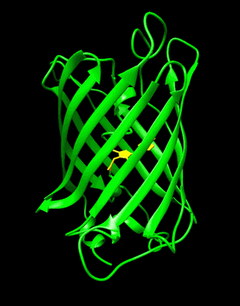
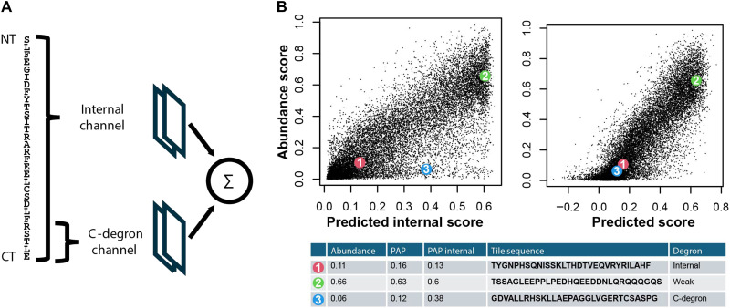
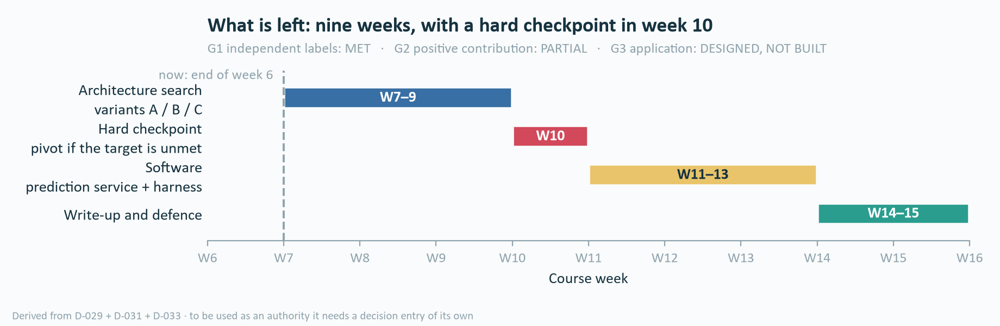

# Residue-Level Prediction of Degron Mutation Effects

> Source copy of the Notion summary page created on 16 Oct 2026. Image paths here are
> repo-relative; in Notion each one is an uploaded file. Mapping, licences and the
> regeneration command are in [README.md](README.md). This file records no decision —
> see [DECISIONS.md](../../../../DECISIONS.md).

<callout icon="🧬" color="blue_bg">
**One sentence.** Given a 28-residue degron peptide, predict how every single amino-acid
substitution changes its stability — at residue resolution, trained and scored on
*measured* experimental labels.

**Status, week 6.** Gap proven · first positive result measured · the matrix target and
the software are the work ahead.
</callout>

---

## 1 · The biology, in three pictures

<columns>
<column>

</column>
<column>

</column>
<column>

</column>
</columns>

> A **degron** is the short segment an E3 ligase recognises — the address label for
> degradation. Over **600** human E3 ligases exist, and only a small number of degron
> instances are characterised. **The question one level finer:** within a degron,
> *which individual residues* set its strength, and by how much does strength change
> when one of them is substituted?

<callout icon="📐" color="gray_bg">
**Scope, stated up front.** Labels are measured on **isolated 28-residue peptides** fused
to a reporter, so the assay sees **autonomous degrons** only. Degrons that need priming
(for example phosphorylation) are outside its reach. Predictions describe peptide-level
stability — they do not by themselves establish an effect on the intact protein, nor any
therapeutic effect.
</callout>

---

## 2 · What the model has to produce

| | |
|---|---|
| **Input** | a 28-residue peptide sequence (optionally rASA and pLDDT as structural context) |
| **Output 1** | a **28 × 20 matrix** of predicted ΔPSI — one value per (position, amino-acid type) |
| **Output 2** | a **per-position importance map** — the 19 substitutions at each position, aggregated |
| **Label** | **ΔPSI = PSI(substituted) − PSI(wild type)**, both *measured* in the GPS assay |

---

## 3 · Why the question is worth asking

<callout icon="⚠️" color="yellow_bg">
**Three limits that must travel with the number 2.148.**

1. It is a **region-level** association. At **residue level** the link is **not established**:
three independent tests are all consistent with null (best-powered stratum AUC **0.5166**,
CI [0.479, 0.554]).
2. Degrons are **not** mutation hotspots — 33.4% of variants fall in degrons against a
32.4% tile background.
3. **Conservation and disorder are not yet controlled for.**

⇒ ClinVar is the **motivation** for this work, never a validation target. The model is
judged against its own experimental labels.
</callout>

**What is motivating:** **530,412 variants of uncertain significance** sit inside measured
degron regions, and no current tool assigns any of them a mechanism.

---

## 4 · The gap is provable, not merely unexplored

<columns>
<column ratio="55">
The closest published model for degron strength, **PAP**, uses `Conv1D(kernel=1)` →
`GlobalAveragePooling`. Its score is therefore a function of **amino-acid composition
only**, and the predicted effect of substituting `a → b` contains **no position index**.

**Consequence:** for any set of substitutions sharing the same amino-acid pair, the model
must return **identical** effects, whatever the positions.

**How often that breaks the task:** of 2,624 peptides with a measured footprint,
**2,353 — 89.7%** contain a same-substitution-pair group holding both a positive and a
non-positive position. On those, a composition-only model is *provably* unable to
separate the residues that matter from the ones that do not.

Verified by 200 exhaustive comparisons, 4,000 rank-bound checks, an explicit rank-2
counterexample, and a permutation test on PAP itself: Pearson(original, shuffled) =
**1.000000**.

> PAP is not a bad model — it was built for a segment-level score. Using it for
> residue-level effects is using it outside its design.
</column>
<column ratio="45">

</column>
</columns>

---

## 5 · Where the predictive signal actually sits

<callout icon="🎯" color="blue_bg">
The right question is **not** "composition or position?" but **"composition at which
scale?"** — a ±3 neighbourhood beats the whole peptide. A literature search run on
15 Oct 2026 did not find this breakdown published for degrons.
</callout>

---

## 6 · Five contributions, three pillars

<table fit-page-width="true" header-row="true">
<tr><td>#</td><td>Pillar</td><td>Contribution</td><td>Status</td></tr>
<tr><td>**C1**</td><td>Method</td><td>Proof that the current model class **cannot localise** degron residues — 89.7% of footprint peptides, rank-2 counterexample, permutation test on PAP</td><td>✅ measured</td></tr>
<tr><td>**C2**</td><td>Method</td><td>An **evaluation protocol** for the residue-level task: two label sources with distinct roles, measured ceilings 0.9458 / 0.9519, honest composition baseline, published-model control, protein-cluster split, detection threshold 0.0123 committed in advance</td><td>✅ measured</td></tr>
<tr><td>**C3**</td><td>Method</td><td>A **decomposition of where the signal sits**, and a model beating the closest published control on the context axis: **+0.0300** over ΔPAP `cnn2w7`, CI [0.0234, 0.0366]</td><td>✅ first positive result</td></tr>
<tr><td>**C4**</td><td>Method</td><td>An **architecture** closing the remaining gap on the substitution matrix — currently 0.0420 behind, target 0.7693</td><td>⬜ open — the work ahead</td></tr>
<tr><td>**C5**</td><td>Software</td><td>A **prediction service** whose uncertainty is anchored to the measured ceiling (28×20 matrix, per-position map, arbitrary-mutation scoring, API, out-of-distribution and compartment flags, label provenance) plus an **evaluation harness** that re-runs prior models under the same cluster split</td><td>⬜ designed, not built</td></tr>
<tr><td>**—**</td><td>Urgency</td><td>Why the question is worth asking at all: OR 2.148 at region level</td><td>✅ measured</td></tr>
</table>

---

## 7 · Where the thesis stands

<callout icon="⚖️" color="gray_bg">
**Said at the right strength.** Beating ΔPAP is *not* beating a model trained for this
task — the composition-only baseline already **ties** `cnn2w7` (+0.0008, CI [−0.0057,
0.0074]). And the ceiling is a **measurement** ceiling of the assay, not a learnable
limit: replicate agreement on *which* residues form the footprint is Jaccard **0.4965**,
and 75.9% of the residual after a composition oracle is measurement noise. That is
exactly why the deliverable reports **uncertainty**, not one confident answer.
</callout>

---

## 8 · Data — all downloaded, all licence-checked

≈ 2.3 GB on disk, SHA-256 recorded for every file.

<table fit-page-width="true" header-row="true">
<tr><td>Source</td><td>Pinned</td><td>Licence</td><td>Role</td></tr>
<tr><td>**Zhang 2023** — scanning + saturation mutagenesis</td><td>Mendeley `10.17632/32h94v2yv2.2`</td><td>CC BY 4.0</td><td>**primary labels** — measured mutation effects</td></tr>
<tr><td>**Zhang 2023** — GPS peptidome PSI table</td><td>GEO `GSE240610`</td><td>GEO terms</td><td>peptide context; **application domain**, 116,702 degron tiles</td></tr>
<tr><td>**Voutsinos 2026** — cytosolic tile library + PAP</td><td>GitHub @ `9b3eafa6`</td><td>MIT</td><td>**baseline model** + benchmark population</td></tr>
<tr><td>**Larsen 2025** — transcription-factor tiles</td><td>GitHub @ `v1.0`</td><td>MIT (data file)</td><td>cross-assay / cross-compartment test</td></tr>
<tr><td>**MaveDB** — 26 score sets, 9 genes</td><td>API, URNs recorded</td><td>CC0</td><td>intact-protein transfer check</td></tr>
<tr><td>UniProtKB/Swiss-Prot `2026_03` · AlphaFold DB v6</td><td>REST snapshot</td><td>CC BY 4.0</td><td>wild-type sequences; structural context</td></tr>
<tr><td>**ClinVar** `variant_summary`, 2.56 M missense</td><td>NCBI FTP, file of 12 Oct 2026</td><td>attribution required; not for diagnostic use</td><td>**motivation only** — not a validation target</td></tr>
</table>

*Paper licence and data licence can differ: Larsen et al. is CC BY-NC-ND as a preprint
while its tile-level data file is MIT in the authors' GitHub repository.*

---

## 9 · What is left

**The week-10 checkpoint is deliberate:** if the matrix target is not met by then, the
result is reported as a **bounded negative** and weight shifts to the benchmark and the
application. Fixed seeds; configuration and results written to files; every number
traceable to a result file; all derived data regenerable by script from checksummed raw
data.

---

## 10 · What this work does **not** claim

<callout icon="🚫" color="red_bg">
- ❌ "the residues we predict are the ones carrying disease signal" — tested three ways, not seen
- ❌ "validated against ClinVar" / "ClinVar confirms the model"
- ❌ "pathogenic because it breaks a degron" — 2.148 is an association, conservation and disorder not yet controlled
- ❌ "degrons are mutation hotspots" — variant density in degrons equals background
- ❌ "position beats composition" — the decomposition says ±3 *composition* does
- ❌ "no tool outputs a 28×20 matrix" — Degformer does, and is the official baseline to beat
- ❌ any "nobody has done X" claim — only "a query run on 15 Oct 2026 returned no…"
</callout>

---

Image sources and licences

| Image | Source | Licence |
|---|---|---|
| Translation GIF | [File:Protein synthesis (Translation).gif](https://commons.wikimedia.org/wiki/File:Protein_synthesis_(Translation).gif), Tekksavvy | CC BY-SA 3.0 |
| Ubiquitin-fold GIF | [File:2qjl animated.gif](https://commons.wikimedia.org/wiki/File:2qjl_animated.gif), Hsp90 — URM1, PDB 2QJL | CC BY-SA 3.0 |
| GFP GIF | [File:GFP Fluorescent Protein Movie.gif](https://commons.wikimedia.org/wiki/File:GFP_Fluorescent_Protein_Movie.gif), Erik A. Rodriguez — resized, frame-reduced | CC BY-SA 4.0 |
| PAP architecture | Voutsinos et al., *Sci Adv* 2026, [10.1126/sciadv.adz3483](https://doi.org/10.1126/sciadv.adz3483), Fig. 4 | CC BY-NC 4.0 |
| ΔPSI heatmap, four charts | Own figures, generated from result files | — |

ClinVar: Landrum MJ et al., *Nucleic Acids Res* 2018, PMID 29165669. ClinVar
classifications are not for diagnostic use; this work does not predict disease or claim
any therapeutic effect.

