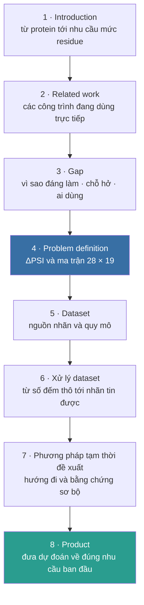
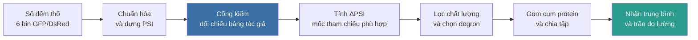

# Degron ở mức residue — bản trình bày tám mục (TRANG CHÍNH)

> Bản nguồn trong repo của **trang chính**:
> <https://app.notion.com/p/3fe486d98ebc8164b0e8de199d371f76>. Trang chính là **khung trình bày ở
> mức ý tưởng**; chi tiết nằm trong **bảy trang con** (xem [README.md](README.md) để biết URL và
> bản nguồn từng trang con). Đường dẫn ảnh ở đây là **đường dẫn repo**; trên Notion mỗi ảnh là một
> file đã tải lên. File này **không ghi quyết định** — xem [DECISIONS.md](../../../../DECISIONS.md).

---

🎯 **Một câu.** Cho một peptide degron dài 28 residue, dự đoán **mỗi phép thay thế amino acid đơn**
làm độ bền của nó thay đổi bao nhiêu — ở **mức residue**, học và chấm trên **nhãn thực nghiệm đo
được**.

**Cách dùng trang này.** Đây là **khung trình bày ở mức ý tưởng**: tám mục lớn, mỗi mục một thông
điệp và một câu bắc cầu sang mục sau. Công thức, bảng số, cấu hình và thực nghiệm đầy đủ nằm trong
**bảy trang con** — chỉ mở khi cần trao đổi sâu.

⚠ Trạng thái chính thức của đề tài nằm ở `DECISIONS.md` trong repo CT553H. Cập nhật 19/10/2026.

## Mạch tám mục

---

# 1 · Introduction — từ protein tới nhu cầu dự đoán ở mức residue

**Thông điệp:** muốn hiểu ảnh hưởng của thay đổi trình tự lên hoạt tính degron, phải đi từ nhận
diện cả đoạn đến hiệu ứng của **từng phép thay thế**.

Protein là chuỗi amino acid; một amino acid trong chuỗi gọi là **residue**. Lượng protein trong tế
bào do **cả tổng hợp và phân hủy** quyết định, nên muốn hiểu cách lượng protein được điều chỉnh thì
phải hiểu cả nhánh phân hủy. Nhánh đó có địa chỉ: hệ **ubiquitin–proteasome** phân hủy có chọn lọc,
và **degron** là tín hiệu khiến một protein bị đưa tới đó.

*(Trên Notion hai hình trên nằm trong một khối hai cột.)*

Nhưng kết luận **"đoạn này là degron"** chưa cho biết thay residue nào, thay bằng gì thì tín hiệu
mạnh lên hay yếu đi. Ba mức câu hỏi tách biệt: *cả đoạn có hoạt tính?* → *vị trí nào nhạy?* → *từng
phép thay thế gây hiệu ứng gì?* **Đề tài nhắm mức cuối.**

> → *Mức cuối này là chỗ các công cụ hiện có dừng lại — nên trước khi nói đề tài làm gì, cần xem
> chúng đã làm được tới đâu.*

→ Trang con: **1 · Nền sinh học và ba mức câu hỏi**

---

# 2 · Related work — những nghiên cứu được dùng trực tiếp

**Thông điệp:** đề tài kế thừa dữ liệu thực nghiệm và đối chứng hiện có, rồi kiểm tra **giá trị
tăng thêm** trên bài toán hiệu ứng đột biến. Mỗi công trình có mặt vì **một vai cụ thể**.

| Nghiên cứu | Nội dung liên quan trực tiếp | Vai trong đề tài |
|---|---|---|
| [Zhang và cs. 2023](https://doi.org/10.1016/j.molcel.2023.08.022) | Đo hoạt tính degron và hiệu ứng thay thế amino acid bằng assay GPS | **Nguồn nhãn chính**: scanning và saturation |
| [Voutsinos và cs. 2026 — PAP](https://doi.org/10.1126/sciadv.adz3483) | Dự đoán điểm degron cho **cả peptide** | Chênh lệch điểm mutant–reference (**ΔPAP**) làm **đối chứng phải vượt** |
| [Degformer](https://github.com/Alpine2048/Degformer) | Dự đoán PSI từ trình tự; **đã xuất ma trận 28×20** | **Tiền lệ gần nhất** và baseline; đồng thời là ca phải kiểm chồng lặp dữ liệu |
| [Larsen và cs. 2025](https://doi.org/10.5281/zenodo.20490355) | Đo các tile protein trong bối cảnh nhân tế bào | Đánh giá **chuyển assay ở mức tile**; **không** thay thế nhãn residue |
| [LeBlanc và cs. 2026](https://doi.org/10.1016/j.cels.2026.101701) · [Schulze & Lindorff-Larsen 2026](https://doi.org/10.7554/eLife.103721) | Quy ước đánh giá và baseline cấu trúc đơn giản | Đề tài **vay quy ước và phải ghi công**; rASA một mình đã cho Spearman 0,45 |

Nhóm công cụ **định vị** degron (Degpred · DegronMD · DEGRONOPEDIA · MetaDegron) là state of the
art cho câu hỏi *"degron nằm ở đâu"*, nhưng đơn vị dự đoán là **motif hoặc vùng** nên không xếp
hạng được residue bên trong.

> → *Nhiệm vụ không còn trống — Degformer đã làm. Chỗ trống là điều kiện để tin một con số mức
> residue.*

→ Trang con: **2 · Nghiên cứu liên quan — chi tiết từng công trình**

---

# 3 · Gap — vì sao cần thực hiện đề tài

**Thông điệp:** người làm thí nghiệm phải chọn **một phép thay thế cụ thể**, trong khi điểm số cho
cả đoạn chưa đủ để đưa ra lựa chọn đó.

**Vì sao đáng làm.** Vùng protein mà thực nghiệm đo được là degron **giàu biến thể gây bệnh 2,148
lần** so với lành tính (Mantel–Haenszel phân tầng theo protein), và **530.412 VUS** nằm trong các
vùng đó chưa ai gán cơ chế.

⚠ Đây là tuyên bố **ở mức VÙNG**. Ở **mức residue** thì **chưa thiết lập được** (ba phép kiểm độc
lập nhất quán với rỗng; AUC 0,5166). Không nói "degron là điểm nóng biến thể", và **không** dùng
ClinVar làm đích xác nhận mô hình — nó chỉ là **động lực**.

**Chỗ hở là chứng minh được, không chỉ là "chưa ai làm":** mô hình degron đã công bố học trên điểm
**cả đoạn**; lớp mô hình hiện tại **không định vị được** (kênh trong của PAP bất biến hoán vị,
Pearson 1,000000 khi xáo trộn thứ tự residue); tiền lệ gần nhất dùng split có rò rỉ đo được và
không báo trần nhãn.

**Ai dùng.** Nhóm chính là **nhà sinh học thực nghiệm** cần chọn đột biến để kiểm chứng — một
peptide 28 residue có **532** phép thay thế đơn. Bổ trợ: người **diễn giải biến thể** (một giả
thuyết cơ chế) và **nghiên cứu tính toán** (một nhiệm vụ tham chiếu có trần đo và split kiểm soát).

> → *Ba điều trên định nghĩa một bài toán cụ thể — giờ phát biểu nó chính xác.*

→ Trang con: **3 · Tính cấp thiết, chỗ hở và nhóm người dùng**

---

# 4 · Problem definition — bài toán cụ thể

**Câu hỏi dễ hiểu:** với một peptide degron, nếu đổi một amino acid tại một vị trí xác định,
reporter mang peptide đó sẽ **bền hơn hay kém bền hơn**, và thay đổi **bao nhiêu**?

- **Đầu vào:** peptide tham chiếu (28 residue) + một phép thay thế gồm vị trí, amino acid gốc,
  amino acid mới.
- **Đầu ra:** hiệu ứng dự đoán của phép thay thế đó, đo bằng **ΔPSI**.

$$
\Delta PSI = PSI_{\text{đột biến}} - PSI_{\text{tham chiếu}}
$$

**PSI** là điểm độ bền của reporter — peptide được gắn vào một protein phát huỳnh quang để theo dõi
độ bền. **PSI cao = reporter bền hơn**; **ΔPSI dương** = đột biến làm reporter bền hơn, phù hợp với
việc **làm yếu** hoạt tính degron trong assay.

Chấm toàn bộ thay thế ⇒ **ma trận 28 vị trí × 19 amino acid thay thế**. Mỗi ô nối trực tiếp với
**một đột biến có thể dựng mẫu và đo** — đó là điều làm đầu ra này khác một điểm số cả đoạn.

📏 **Phạm vi.** Đích dự đoán là **độ bền reporter trong assay** — chưa trực tiếp là thời gian bán
hủy, cơ chế nhận diện E3, hay tác động trên protein nguyên vẹn. ΔPSI **không** phải xác suất gây
bệnh.

> → *Dữ liệu nào cho phép học và kiểm chứng ma trận đó?*

→ Trang con: **4 · Bài toán, PSI và ΔPSI**

---

# 5 · Dataset — dữ liệu hiện có và tình trạng sử dụng

**Thông điệp:** đã có dữ liệu và pipeline dùng được; hạn chế chính là **số peptide bão hòa độc lập
còn nhỏ**.

| Bộ sau xử lý | Peptide degron | Cụm protein | Phép thay thế được chấm | Vai |
|---|---|---|---|---|
| **Scanning** | 2.994 | 1.985 | 83.446 | Khảo sát trên nhiều peptide, phân tích giá trị ngữ cảnh |
| **Saturation** | 91 | 89 | 47.847 | Học và đánh giá ma trận hiệu ứng thay thế |

Đã tải dữ liệu nguồn (≈2,3 GB, SHA-256 cho mọi file, giấy phép đã kiểm), dựng PSI, tính ΔPSI và
chạy benchmark; đã có các lần lặp để kiểm độ nhất quán. Các ô thiếu hoặc không đạt chất lượng bị
loại.

⚠ Hai rủi ro phải nói trước: **cả hai nguồn nhãn mức residue đều của một nhóm tác giả** (Zhang
2023), chưa tìm được ứng viên thay thế; và dữ liệu Larsen chỉ phục vụ **chuyển assay mức tile**,
**không** bổ sung nhãn thay thế amino acid. Nhưng **n = 91 không phải cỡ mẫu của cả phần mức
residue** — bộ quét cũng là nhãn hiệu ứng đột biến và lớn hơn nhiều.

> → *Từ số đếm thô tới nhãn dùng được là một chuỗi bước; bước nào quyết định độ tin cậy?*

→ Trang con: **5 · Dữ liệu và quá trình xử lý**

---

# 6 · Quá trình xử lý dataset — lý do và kết quả từng bước

**Thông điệp:** nhãn **được dựng lại từ số đếm thô**, không nhận nguyên từ bảng tác giả — và việc
dựng lại đã **qua một cổng kiểm có số**.

Ba kết quả đáng nêu ở mức ý tưởng:

- **Cổng kiểm:** PSI dựng lại lệch lớn nhất **5,0 × 10⁻⁷** trên **261.865** giá trị ⇒ pipeline tái
  tạo đúng cách tính của tác giả, nhờ đó dựng được **lần lặp thứ hai** mà tác giả không công bố
  bảng PSI — và vì vậy **trần nhiễu mới tính được**.
- **Chia tập theo cụm protein**, không theo ô: toàn bộ peptide và đột biến cùng cụm nằm cùng một
  phía, kể cả chồng lặp với dữ liệu huấn luyện của baseline.
- **Nhãn là trung bình hai lần lặp**, và chính chênh lệch giữa chúng cho **trần đo lường** — mọi
  điểm mô hình đọc cùng giới hạn của dữ liệu.

> → *Trong điều kiện đánh giá đó, thông tin nào thực sự giúp dự đoán?*

*(Mục này dùng chung trang con với mục 5.)*

---

# 7 · Phương pháp tạm thời đề xuất — động lực, hướng đi, mục tiêu

🚧 Mục này là **hướng đang theo và bằng chứng sơ bộ**, không phải phương pháp đã chốt.

**Động lực.** Hiệu ứng của một đột biến phụ thuộc vào amino acid bị thay, amino acid mới **và ngữ
cảnh xung quanh**. Câu hỏi hướng dẫn thiết kế không phải *"thành phần hay vị trí"* mà ***"thành
phần ở thang nào"*** — đã phân rã bằng đo: thành phần ở **thang lân cận ±3** chiếm **80%** mức
tăng, còn **vị trí tuyệt đối** gần như không đóng góp.

**Hướng đi, ba việc theo thứ tự:** (1) biểu diễn phép thay thế · thành phần **lân cận ±3** · thành
phần **toàn peptide**, rồi dùng **ablation** xác định khối nào thực sự có ích; (2) tìm một **thành
phần kiến trúc có lợi ổn định** — đây là chỗ của tính mới và là ô còn mở chính; (3) xem xét khai
thác thêm **nhãn cả peptide** để hỗ trợ đầu ra residue, vẫn là hướng **cần kiểm nghiệm**.

![AUROC mức ô trên ma trận bão hòa, trung bình macro theo peptide. Ridge M3 học trực tiếp đạt 0,8082 so với ΔPAP 0,7693 (+0,0389; CI 95% [0,0216; 0,0571]). Trần 0,9519 là **trần đo lường** của phép đo. Trục bắt đầu ở 0,70. Tự đo.](../notion-2026-10-19/png/fig-benchmark.png)

**Cơ sở hiện có.** Ridge học trực tiếp trên bão hòa đạt **0,8082** so với **0,7693** của ΔPAP
(AUROC mức ô, macro theo peptide; +0,0389, CI 95% [0,0216; 0,0571]). Nhưng **năm** kiến trúc sức
chứa lớn hơn đã thử **đều thua, cùng một chiều** ⇒ cách đọc hiện tại là nút thắt ở **lượng nhãn**,
không ở sức chứa.

📊 **Mục tiêu hướng đến:** dự đoán tốt **trên peptide chưa thấy** · có thành phần phương pháp cho
**cải thiện ổn định** (kiểm bằng ablation, nhiều seed, khoảng bất định) · cung cấp **bất định** để
người dùng đánh giá dự đoán. ⚠ **G2 chưa hoàn tất:** mốc số đã vượt và vững, điều kiện kiến trúc
thì **xa hơn chứ không gần hơn**.

> → *Khi dự đoán đủ tin cậy, người nghiên cứu sẽ sử dụng nó như thế nào?*

→ Trang con: **6 · Phương pháp, đối chứng và kết quả hiện tại**

---

# 8 · Product — chức năng cốt lõi và người sử dụng

**Thông điệp:** đưa dự đoán vào một công cụ giúp nhà nghiên cứu **xem xét và lựa chọn** đột biến.

Nút cổ chai của bài toán không phải độ chính xác mà là **nhiễu đo** (đồng thuận hai lần lặp về tập
residue chỉ Jaccard 0,4965) ⇒ một công cụ trả về **một câu trả lời chắc chắn** là trình bày sai dữ
liệu. Vì vậy sản phẩm gồm hai phần: **dịch vụ dự đoán có bất định** (trụ) và **harness đánh giá tái
lập** (biến bảng so sánh thành một lệnh chạy lại được).

| Chức năng dự kiến | Phục vụ nhu cầu nào |
|---|---|
| Nhập peptide và phép thay thế | Khảo sát một đột biến cụ thể, hoặc chấm toàn bộ ứng viên |
| Hiển thị **ma trận hiệu ứng** | So sánh các amino acid thay thế tại cùng vị trí và giữa các vị trí |
| Lọc và **xếp hạng ứng viên** | Chọn đột biến hiệu ứng mạnh và trường hợp ít ảnh hưởng làm **đối chứng** |
| **Bất định** và **phạm vi áp dụng** | Biết mức chắc chắn và giới hạn khi diễn giải; cờ cảnh báo khi ra ngoài miền nhãn |
| Xuất danh sách và **xuất xứ** kết quả | Chuẩn bị thí nghiệm, lưu và đối chiếu dự đoán; phân biệt "đã đo" với "dự đoán" |
| **API** và **harness** đánh giá | Tích hợp vào pipeline và so sánh mô hình trong cùng điều kiện |

**Luồng sử dụng:** nhập peptide → xem ma trận → xem từng ứng viên → chọn đột biến và đối chứng →
xuất danh sách để kiểm chứng.

🚧 **Trạng thái:** sản phẩm ở mức **dự kiến, chưa được xây dựng**; hiệu quả hỗ trợ lựa chọn thí
nghiệm **cần được đánh giá riêng** khi triển khai. Hồ sơ ghi nhận GVHD đã chấp nhận trụ phần mềm về
nguyên tắc qua trao đổi do Trọng truyền đạt; khung đề tài tổng thể **chưa được duyệt chính thức**.

→ Trang con: **7 · Sản phẩm — chức năng, so sánh và miền áp dụng**

---

# Bốn câu không được nói, áp cho cả tám mục

Các ranh giới này đến từ quyết định, không phải sở thích trình bày:

- **Không** nói "residue mà đề tài dự đoán là residue mang tín hiệu bệnh" — 2,148 là tuyên bố **mức
  vùng**; mức residue đã đo ba lần và **chưa thiết lập được**.
- **Không** nói "đề tài dự đoán đột biến lái ung thư" — phạm vi là **degron tự trị** + biến thể
  **dòng mầm**; 7/8 degron lái ung thư kinh điển **ngoài tầm assay** (đã đo).
- **Không** nói "chưa ai làm" — Degformer **đã** xuất ma trận 28×20. Dạng câu đúng: *"phép tra ngày
  15/10/2026 không tìm thấy…"*.
- **Không** nói "ClinVar xác nhận mô hình đúng" — ClinVar là **động lực**, không phải đích xác nhận.
- **Không** lấy khoảng tới trần đo lường làm dư địa cải thiện; **không** coi một kết quả dương cục
  bộ là hoàn tất G2.

Số thực nghiệm nội bộ (18/10/2026) được đối soát từ `research/g2-saturation-2026-10-18/` và
`research/g2-extension-2026-10-18/` trong repo CT553H; trạng thái chính thức theo `DECISIONS.md`.
