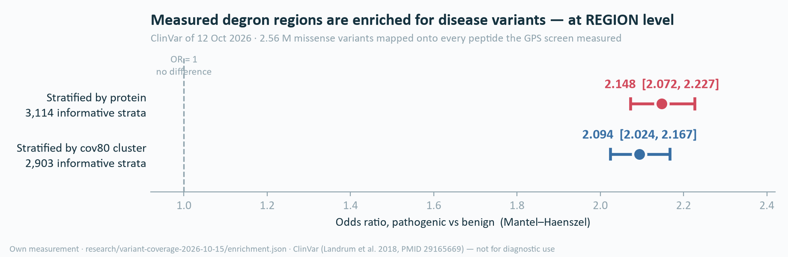
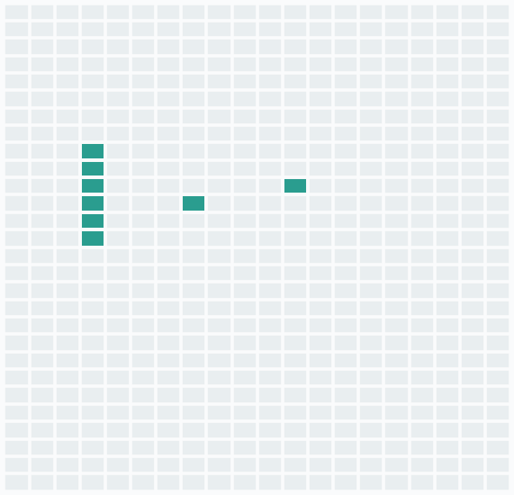
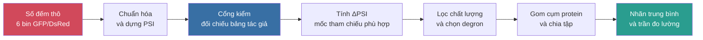
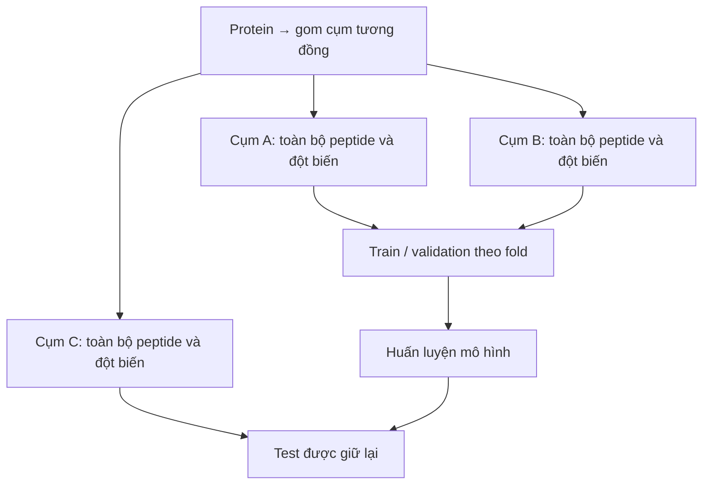
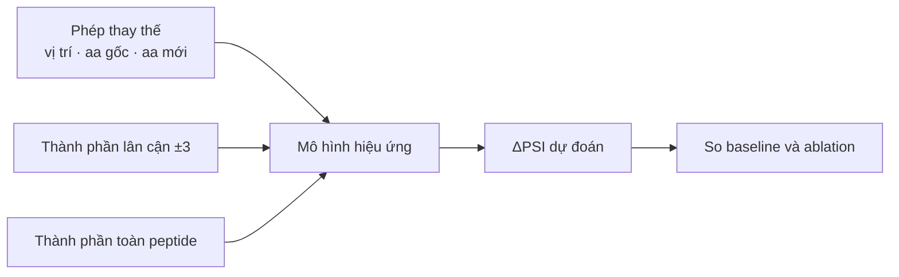
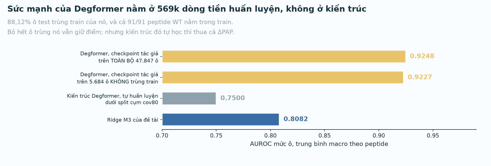
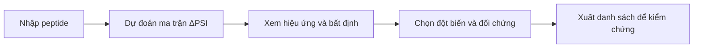

# Bảy trang con của trang chính — bản nguồn

> Bản nguồn trong repo của **bảy trang con** thuộc
> [trang chính](https://app.notion.com/p/3fe486d98ebc8164b0e8de199d371f76). URL từng trang: xem
> [README.md](README.md). Đường dẫn ảnh là **đường dẫn repo**. File này **không ghi quyết định** —
> xem [DECISIONS.md](../../../../DECISIONS.md).

---
---

# TRANG CON 1 — Nền sinh học và ba mức câu hỏi

🧫 Đỡ cho **mục 1**: đủ nền sinh học để người nghe chưa biết ngành vẫn theo được bài toán tính toán,
và lý do bài toán phải xuống **mức residue**.

## Protein, residue và một đột biến điểm

**Protein** là chuỗi amino acid, tham gia cấu trúc, xúc tác và điều hòa hoạt động tế bào. Một amino
acid khi đã nằm trong chuỗi gọi là **residue**. Đổi một residue là đổi một chữ trong chuỗi đó — đó
chính là **đột biến thay thế amino acid đơn** mà đề tài dự đoán hiệu ứng.

## Lượng protein là một cân bằng, không phải một chiều

Lượng protein trong tế bào do **cả tổng hợp và phân hủy** quyết định. Muốn hiểu cách tế bào điều
chỉnh lượng protein thì phải hiểu cả nhánh phân hủy — nhánh thường bị bỏ qua khi chỉ nhìn biểu hiện
gene.

## Nhánh phân hủy có địa chỉ: hệ ubiquitin–proteasome

Phân hủy có chọn lọc: **E3 ligase** nhận diện protein đích → gắn **ubiquitin** → **proteasome** phân
hủy. Người có **hơn 600** E3 ligase, trong khi số degron đã được mô tả còn rất ít — đó là lý do sàng
lọc thông lượng cao vẫn đang mở rộng danh mục degron.

**Degron** là đoạn trình tự khiến protein bị đưa tới phân hủy. Câu hỏi tự nhiên tiếp theo: trong đoạn
đó, **residue nào mang tín hiệu**?

## Ba mức câu hỏi, tách biệt

| Mức câu hỏi | Điều cần biết | Trạng thái công cụ hiện có |
|---|---|---|
| **Cả đoạn** | Đoạn peptide này có thúc đẩy phân hủy không? | Đã có công cụ dùng được ở quy mô proteome |
| **Vị trí** | Những vị trí nào trong đoạn nhạy với thay đổi? | Suy ra gián tiếp, không phải đích huấn luyện |
| **Phép thay thế** | Tại vị trí đó, thay amino acid hiện tại bằng amino acid nào sẽ tạo hiệu ứng gì? | **Mức đề tài nhắm tới** |

Kết luận "đoạn này là degron" **chưa** cho biết thay residue nào, thay bằng gì thì tín hiệu mạnh lên
hay yếu đi. Vì vậy xác định vùng degron là **điểm xuất phát**, không phải điểm đến.

## Vì sao không đo hết cho xong

Một peptide dài 28 residue có $28 \times 19 = 532$ phép thay thế amino acid đơn. Mỗi peptide mới lại
sinh thêm một tập ứng viên như vậy. Mô hình có ích **nếu** xếp hạng được các trường hợp chưa đo để
người nghiên cứu chọn phép kiểm chứng trước.

Ví dụ minh hoạ — giả định, không phải số đo

Một peptide 28 residue đã được xác định có hoạt tính degron; người nghiên cứu muốn tạo một phiên bản
**yếu hơn** để kiểm tra vai trò của tín hiệu.

- Thay đổi ở **vị trí 7** có thể làm reporter bền hơn.
- Thay đổi ở **vị trí 19** có thể gần như không ảnh hưởng.
- Ngay tại vị trí 7, **hai amino acid thay thế khác nhau** cũng có thể tạo hiệu ứng khác nhau.

➡️ Đơn vị mà người nghiên cứu thực sự phải chọn là **một phép thay thế cụ thể**: vị trí nào, từ amino
acid nào sang amino acid nào.

## Hai hướng tổng quan 2025, trích cả hai cho trung thực

- [Zhang và cs. 2025, *Nat Rev Mol Cell Biol*](https://doi.org/10.1038/s41580-025-00870-z) · sàng
  thông lượng cao đang mở rộng số degron được định nghĩa ở độ phân giải cao.
- [Wang & Zheng 2025, *Nat Chem Biol*](https://doi.org/10.1038/s41589-025-02056-2) · nhiều degron
  **không** phải motif tuyến tính ngắn ⇒ cửa sổ 28-mer có giới hạn phạm vi, và giới hạn đó **chia sẻ
  với chính assay nguồn nhãn**.

📏 **Phạm vi.** Đề tài nói về **degron tự trị** trong assay reporter và biến thể **dòng mầm**. Degron
cần mồi (ví dụ phosphoryl hóa) hoặc cần nhiều motif **ngoài tầm assay** — đã đo, không phải giả
định. Không dùng ví dụ ung thư để dẫn nhập.

---
---

# TRANG CON 2 — Nghiên cứu liên quan, chi tiết từng công trình

📚 Đỡ cho **mục 2**. Nguyên tắc chọn: mỗi công trình có mặt vì **một vai cụ thể** — nguồn nhãn,
baseline, tiền lệ, hoặc quy ước đánh giá. Công trình chỉ "liên quan chủ đề" thì không đưa vào.

## 2.1 · Nguồn nhãn — dữ liệu đề tài thực sự học trên đó

| Công trình | Vai trong đề tài | Điều cần nói |
|---|---|---|
| **Koren và cs. 2018** (*Cell*) | Nền của phép đo | Lập ra sàng lọc **GPS peptidome**: peptide gắn reporter, phân loại theo độ bền. Mọi nhãn sau này đều từ thiết kế này |
| [**Zhang và cs. 2023** (*Mol Cell*)](https://doi.org/10.1016/j.molcel.2023.08.022) | **Nguồn nhãn chính** | Thêm **đột biến** lên sàng lọc: bộ **scanning** (một thay thế mỗi vị trí) và bộ **saturation** (đủ 20 amino acid mỗi vị trí). Là tập nhãn hiệu ứng đột biến đo được ở quy mô lớn đầu tiên ⇒ bài toán chỉ trả lời được **sau 2023** |
| [**Voutsinos và cs. 2026 — PAP** (*Sci Adv*)](https://doi.org/10.1126/sciadv.adz3483) | **Baseline chính** + quần thể benchmark | Bản đồ gần đủ degron bào tương: **>200.000** tile 30 residue từ **>5.000** protein; PAP (CNN hai kênh) đạt Pearson 0,82/0,87 trên tile holdout. Đề tài lấy **ΔPAP** = chênh điểm trước/sau đột biến làm đối chứng |
| [**Larsen và cs. 2025**](https://doi.org/10.5281/zenodo.20490355) (**preprint**) | Test chuyển assay mức tile | Mở rộng sang **1.626** yếu tố phiên mã, có PAP/rASA/pLDDT tính trước. ⚠ **Không** gọi là test trình tự chưa thấy: **1.583/1.626 (97,4%)** TF đã có trong peptidome GPS |

## 2.2 · Tiền lệ gần nhất — phải đối chiếu

| Công trình | Điều cần nói |
|---|---|
| [**Degformer**](https://github.com/Alpine2048/Degformer) (GitHub, **không có bài báo**) | Transformer học trên bảng của Zhang, **đã xuất ma trận ΔPSI 28×20** — tiền lệ trực tiếp nhất. Tương quan tự báo 0,9162–0,9463 (**self-reported**). Ba điều đã tự đo: split ngẫu nhiên có **4,09%** rò rỉ trình tự y hệt; đầu dự đoán chỉ đọc **token CLS**, ma trận ghép từ 532 lượt forward chứ không phải một đầu mức residue; **tập blind vắng mặt khỏi repo** nên con số headline không tái lập được |
| **Zhang SVM 2023** | Mô hình của chính tác giả, dự đoán PSI **mức peptide**, Pearson **0,8955** trên 260.989 peptide ⇒ mức peptide đã khá tốt, nên chỗ còn hở là **mức residue** |

## 2.3 · Quy ước đánh giá — đề tài vay và phải ghi công

| Công trình | Đề tài dùng gì |
|---|---|
| [**LeBlanc và cs. 2026** (*Cell Systems*)](https://doi.org/10.1016/j.cels.2026.101701) | Ba cách làm: báo **độ ổn định hệ số** qua seed/bootstrap · so với **trần nhiễu lặp lại** · **chia tập theo cụm protein**. Dùng thì phải ghi "theo LeBlanc và cs. 2026", **không** trình bày như lựa chọn riêng |
| [**Schulze & Lindorff-Larsen 2026** (*eLife*)](https://doi.org/10.7554/eLife.103721) | Baseline cấu trúc đơn giản mạnh đến đâu: ma trận thay thế chỉ cần điều kiện **vùi/lộ** đã dự đoán tốt độ dồi dào; **rASA một mình cho Spearman 0,45** ⇒ mọi tuyên bố mức residue phải vượt một baseline đơn giản |
| **AlphaMissense 2023** (*Science*) | Câu hỏi **khác**: biến thể có gây bệnh không. Đề tài **bổ sung cơ chế**, không thay thế |

## 2.4 · Nhóm công cụ định vị degron — nêu gọn

**Degpred 2022 · DegronMD 2023 · DEGRONOPEDIA 2024 · MetaDegron 2024.** Đã đưa việc nhận diện degron
lên quy mô proteome và có web tool dùng được — đây là state of the art cho câu hỏi *"degron nằm ở đâu
trong protein của tôi"*. Nhưng nhãn là **motif được curate** (vài trăm instance, nhãn âm thường là
peptide ngẫu nhiên), và đơn vị dự đoán là **motif hoặc vùng** ⇒ không xếp hạng được residue bên
trong.

🏷️ **Mức bằng chứng.** Degpred là **[CHƯA KIỂM]** (chỉ qua tóm tắt); DEGRONOPEDIA, MetaDegron,
DegronMD là **[NGUỒN]** (đọc trang gốc). Vì vậy viết *"không báo cáo"* / *"thường là peptide ngẫu
nhiên"*, **không** viết "họ rò rỉ dữ liệu" hay "số của họ bị thổi".

🚫 **Không nói "chưa ai làm".** Degformer **đã** xuất ma trận 28×20. Dạng câu đúng: *"phép tra PubMed
và Europe PMC ngày 15/10/2026 không tìm thấy công cụ dự đoán degron 2025–2026 nào ngoài danh sách
trên; trong 19 bài trích dẫn Larsen 2025 và Voutsinos 2026, không bài nào là mô hình footprint mức
residue."*

---
---

# TRANG CON 3 — Tính cấp thiết, chỗ hở và nhóm người dùng

🎯 Đỡ cho **mục 3**, theo đúng ba câu: **vì sao đáng làm** → **vì sao chỗ hở là thật** → **ai dùng**.

## 3.1 · Vì sao đáng làm — một con số, không phải một khẳng định

- Vùng protein mà thực nghiệm đo được là degron **giàu biến thể gây bệnh 2,148 lần** so với lành
  tính (CI 95% [2,072; 2,227]), Mantel–Haenszel **phân tầng theo protein**, 3.114 tầng có thông tin
  ⇒ **không** phải tạo tác của việc ClinVar dồn vào gene bệnh.
- **530.412 biến thể chưa rõ ý nghĩa (VUS)** nằm trong vùng degron đã đo — không ai gán cơ chế cho
  chúng.

⚠ **Ba điều phải đi kèm con số 2,148**

1. Đây là tuyên bố **ở mức VÙNG**. Ở **mức residue** thì **chưa thiết lập được**: ba phép kiểm độc
   lập đều nhất quán với rỗng (tầng có lực nhất AUC **0,5166**, CI [0,479; 0,554]).
2. **Không** có giàu lên theo *vị trí* (33,4% so 32,4% ở ngưỡng PSI ≤ 3,0) ⇒ **không** được gọi
   degron là "điểm nóng biến thể". Thêm nữa, ngưỡng PSI ≤ 3,0 cho **32,4% tile toàn proteome** là
   degron, nên "biến thể nằm trong một degron" gần như không mang thông tin.
3. **Chưa khử bảo tồn và độ vô trật tự.** Nếu 2,148 biến mất sau khi khử thì nó chỉ nói "degron nằm
   trong vùng chức năng".

[ClinVar](https://www.ncbi.nlm.nih.gov/clinvar/) · ghi công PMID 29165669 · **không dùng để chẩn
đoán**, và **không** làm đích xác nhận mô hình.

## 3.2 · Vì sao chỗ hở là chứng minh được

| Chỗ thiếu | Trạng thái hiện tại |
|---|---|
| Mô hình **huấn luyện trên mục tiêu mức residue** | Mô hình degron đã công bố học trên điểm cả đoạn; áp per-residue là **dùng ngoài thiết kế** |
| **Lớp mô hình hiện tại không định vị được** | Tự đo: kênh trong của PAP dùng `Conv1D(kernel=1)` + global average pooling ⇒ **bất biến hoán vị**: xáo trộn thứ tự residue mà điểm **không đổi** (Pearson **1,000000**) |
| **Điều kiện đánh giá** cho tuyên bố mức residue | Tiền lệ gần nhất (Degformer) dùng split ngẫu nhiên có rò rỉ đo được, **không** báo trần nhãn, **không** báo bất định từng dự đoán |
| **Trần nhiễu đo** gắn kèm mỗi con số | Tự đo: trần đo lường mức ô **0,9458** (quét) / **0,9519** (bão hòa); đồng thuận giữa hai lần lặp về *tập residue* tạo footprint chỉ Jaccard **0,4965** |

## 3.3 · Nhóm người dùng — ba nhóm, mỗi nhóm một thứ cụ thể

| Nhóm | Họ nhận được gì | Giới hạn phải nói kèm |
|---|---|---|
| **Nhà sinh học thực nghiệm** thiết kế đột biến degron (nhóm chính) | Công cụ **xếp ưu tiên**: "thử ba residue này trước", kèm bất định; và chọn sẵn ô ít ảnh hưởng làm **đối chứng** | Gọi đúng là **prioritisation tool**, không phải công cụ quyết định — Jaccard 0,4965 ở mức residue. **Hiệu quả tiết kiệm thí nghiệm chưa được kiểm chứng trực tiếp** |
| **Diễn giải biến thể** (530.412 VUS trong vùng degron) | Một **giả thuyết cơ chế** bổ sung cho điểm gây bệnh: phép thay thế này làm peptide bền lên hay kém bền, khoảng bao nhiêu | Là **giả thuyết cơ chế**, **không** phải lời giải thích "vì sao biến thể gây bệnh" — mắt nối residue → bệnh chưa thiết lập |
| **Nghiên cứu tin sinh / ML** | Một **nhiệm vụ tham chiếu** có trần đo lường, baseline trung thực và split kiểm soát tương đồng | — |

🚫 Nhóm PROTAC / molecular glue **đã bị gỡ** khỏi danh sách người dùng; đừng thêm lại. Và **không**
lấy việc "xuất ma trận" làm tuyên bố tính mới — chỗ trống là **điều kiện đánh giá**, không phải nhiệm
vụ.

---
---

# TRANG CON 4 — Bài toán, PSI và ΔPSI

📐 Đỡ cho **mục 4**: phát biểu đầu vào/đầu ra, hai định nghĩa phải nói trước khi dùng, và hình dạng
đầy đủ của đầu ra.

## Một câu

> Cho một peptide có hoạt tính degron và một phép thay thế amino acid, **dự đoán phép thay thế đó làm
> độ bền của reporter thay đổi bao nhiêu.**

## Đầu vào và đầu ra

- **Đầu vào:** peptide tham chiếu (28 residue) + một phép thay thế gồm **vị trí**, **amino acid
  gốc**, **amino acid mới**.
- **Đầu ra:** hiệu ứng dự đoán của phép thay thế đó, đo bằng **ΔPSI**.

## Hai định nghĩa phải giải thích trước khi dùng

- **Reporter:** peptide được gắn vào một protein phát huỳnh quang để **theo dõi độ bền**. Thí nghiệm
  đo độ bền của tổ hợp reporter + peptide, **không** đo protein nguyên vẹn.
- **PSI (Protein Stability Index):** điểm độ bền của reporter, thang **1…6**, tính từ số đếm read
  trong 6 bin độ bền:

$$
PSI=\frac{\sum_{i=1}^{6} i \times nb_i}{\sum_{i=1}^{6} nb_i}
$$

🔄 **PSI thấp = bị phân hủy nhanh = degron mạnh.** Đây là chiều dễ hiểu ngược nhất, phải nói rõ một
lần rồi mới dùng.

## Nhãn

$$
\Delta PSI = PSI_{\text{đột biến}} - PSI_{\text{tham chiếu}}
$$

**ΔPSI dương** = reporter mang đột biến **bền hơn**, phù hợp với việc đột biến **làm yếu** hoạt tính
degron trong điều kiện assay. ΔPSI âm = ngược lại.

⚠ ΔPSI **không** phải xác suất gây bệnh, **không** phải mức đổi thời gian bán hủy của protein nguyên
vẹn.

## Hình dạng đầu ra đầy đủ

Chấm toàn bộ thay thế của một peptide ⇒ **ma trận 28 vị trí × 19 amino acid thay thế**. Mỗi ô nối
trực tiếp với **một đột biến có thể dựng mẫu và đo**. Gộp theo cột ⇒ **bản đồ độ nhạy theo vị trí**
(footprint), nhưng **cách gộp phải nêu rõ** và bản đồ vị trí **không thay thế** cho hiệu ứng của một
phép thay thế cụ thể.

Đọc một ô như thế nào?

Ma trận 28 × 19 gồm các thay thế **thực sự**; nếu giao diện giữ cả amino acid tham chiếu thì hiển thị
28 × 20, nhưng ô giữ nguyên **không phải** một đột biến mới.

**Ví dụ giả định:** tại cùng vị trí 7, thay bằng A cho ΔPSI = +1,0 còn thay bằng G cho +0,1 — hai mức
ưu tiên khác nhau, nhưng phải đọc cùng độ bất định. ΔPSI = +1,0 chỉ nghĩa là điểm PSI tăng một đơn vị
so với tham chiếu.

## Nói rõ cái gì **không** thuộc bài toán

Không dự đoán: **E3 ligase nào** nhận diện · ảnh hưởng trên **protein nguyên vẹn** trong tế bào ·
**tính gây bệnh** · degron **có điều kiện** (cần phosphoryl hóa hay nhiều motif) — loại này **ngoài
tầm assay**, đã đo chứ không phải giả định.

---
---

# TRANG CON 5 — Dữ liệu và quá trình xử lý

🧪 Đỡ cho **mục 5 và 6**. Hai thông điệp: dữ liệu **đã tải đủ, đã kiểm checksum và giấy phép**
(~2,3 GB, SHA-256 cho mọi file); và nhãn được **dựng lại từ số đếm thô** qua một **cổng kiểm có số**,
không nhận nguyên từ bảng tác giả.

## 5.1 · Bảy nguồn và vai của từng nguồn

| Nguồn | Ghim | Giấy phép | Vai |
|---|---|---|---|
| [**Zhang 2023** — scanning + saturation](https://data.mendeley.com/datasets/32h94v2yv2/2) | Mendeley `10.17632/32h94v2yv2.2` (v2), đủ 5 file | **CC BY 4.0** | **Nhãn chính** — hiệu ứng đột biến đo được |
| [**Zhang 2023** — bảng PSI peptidome GPS](https://www.ncbi.nlm.nih.gov/geo/query/acc.cgi?acc=GSE240610) | GEO `GSE240610` | Điều khoản GEO | Ngữ cảnh mức peptide; **miền áp dụng** (116.702 tile degron) |
| [**Voutsinos 2026** — thư viện tile + PAP](https://doi.org/10.1126/sciadv.adz3483) | GitHub `KULL-Centre/_2025_Voutsinos_degron_cytosol` @ `9b3eafa6` | **MIT** | **Baseline** + quần thể benchmark |
| **MaveDB** — 26 score set, 9 gene | API, URN ghi lại | **CC0** | Kiểm chuyển sang protein nguyên vẹn |
| [**Larsen 2025** — thư viện tile TF](https://doi.org/10.5281/zenodo.20490355) | GitHub `KULL-Centre/_2025_Larsen_…` @ tag `v1.0` | **MIT** (file dữ liệu) | Test chuyển assay / chuyển ngăn ở **mức tile** |
| [UniProtKB/Swiss-Prot](https://www.uniprot.org/) human `2026_03` · AlphaFold DB v6 (8 cấu trúc) | REST, snapshot ghim | CC BY 4.0 | Trình tự hoang dã; ngữ cảnh cấu trúc |
| [**ClinVar** `variant_summary`](https://www.ncbi.nlm.nih.gov/clinvar/) (2,56 M missense) | NCBI FTP, file 12/10/2026, SHA-256 ghi lại | **Yêu cầu ghi công** (PMID 29165669); không dùng cho chẩn đoán | **Chỉ là động lực** — không phải đích xác nhận |

⚖️ **Giấy phép bài báo và giấy phép dữ liệu có thể khác nhau:** Larsen 2025 là CC BY-NC-ND ở dạng
preprint, nhưng file dữ liệu mức tile là MIT trong repo GitHub của tác giả. ⚠ **MIT trên danh nghĩa
là giấy phép phần mềm**; email xin xác nhận MIT phủ cả file dữ liệu **đã gửi, đang chờ trả lời**
([C-11a](../../../../DECISIONS.md#c-11a)).

## 5.2 · Hai bộ nhãn — hai vai khác nhau, không thay nhau được

| | **Scanning (quét)** | **Saturation (bão hòa)** |
|---|---|---|
| Thiết kế | **Một** thay thế mỗi vị trí, gần như tất cả **→R** | **Đủ 20** amino acid tại mỗi vị trí trong 28 — ma trận đầy |
| Peptide degron (PSI_WT ≤ 3,0) | **2.994** | **91** |
| Cụm protein | **1.985** | **89** |
| Ô được chấm | **83.446** | **47.847** |
| Trần đo lường (AUROC mức ô) | **0,9458** | **0,9519** |
| Đồng thuận hai lần lặp | Tập residue, Jaccard **0,4965** | PSI **0,9544**; ΔPSI **0,8335**; nhiễu **16,7%** phương sai |
| Vai | **Cỡ mẫu và trục ngữ cảnh** | **Ma trận 19 thay thế**, và xác nhận chuyển giữa nguồn nhãn |

⚠ **Câu phải bỏ:** *"n = 91 là cỡ mẫu của phần mức residue"* — **sai**. Bộ quét **cũng** là nhãn hiệu
ứng đột biến và lớn hơn nhiều (1.985 cụm so với 89). n = 91 chỉ là cỡ mẫu của **phần ma trận 19 thay
thế**. Phần vẫn đúng: nhãn mức **tile** (Voutsinos, Larsen) **không** đỡ được tuyên bố mức residue —
nhưng **bộ quét thì đỡ được**.

## 5.3 · Rủi ro của bộ dữ liệu — nói trước khi bị hỏi

- **Cả hai nguồn nhãn mức residue đều của một nhóm tác giả (Zhang 2023).** Rủi ro **đang mở** và hiện
  **không có ứng viên thay thế**: ứng viên phải có readout là **độ bền**, trên **degron tự trị**, từ
  **nhóm tác giả khác**, nhãn **mức residue**. Chưa tìm thấy ⇒ phải nằm trong phần giới hạn của đề
  cương.
- Bộ bão hòa **không có phép đo hoang dã riêng**: ô đồng nghĩa (đổi codon, giữ protein) làm **WT nội
  tại**, 28 ô mỗi peptide, SD PSI trong peptide trung vị 0,0576.
- Điều kiện **BAG6-WT là một điều kiện khác**, không phải lần lặp thứ ba ⇒ **không bao giờ gộp**.

## 6 · Quá trình xử lý — mỗi bước một lý do và một kết quả đo được

Ba tầng: `raw/` (không bao giờ sửa, có checksum) → `interim/` (giải nén, phân cụm) → `processed/`
(đầu ra của script). Mọi file dẫn xuất **sinh lại được bằng script**.

| Bước | Vì sao | Kết quả đo được |
|---|---|---|
| 1 · Đọc số đếm read theo bin (6 bin, mỗi điều kiện một bộ file) | Bảng PSI công bố chỉ có cho **một** lần lặp ⇒ muốn có trần nhiễu thì phải tự dựng | Đọc đủ **5 điều kiện** |
| 2 · Chuẩn hóa `nbᵢ = bᵢ × factorᵢ`, bin 1 làm tham chiếu | Độ sâu đọc khác nhau giữa các bin | Hệ số từng điều kiện ghi ra file |
| 3 · Tính PSI cho mọi construct | Đây là định nghĩa nhãn | PSI dựng cho **261.868 / 261.999 / 264.036 / 134.608 / 134.563** id |
| 4 · **Cổng kiểm:** so PSI lần lặp 1 dựng lại với bảng của tác giả | Dựng sai thì mọi thứ sau đó sai; cổng chặn trước khi ghi | **Lệch lớn nhất 5,0 × 10⁻⁷ trên 261.865 giá trị** ⇒ dùng chính code đó dựng được các điều kiện tác giả **không** công bố bảng PSI, trong đó có **lần lặp thứ hai** — nhờ vậy trần nhiễu mới tính được |
| 5 · Tính ΔPSI theo mốc tham chiếu | PSI của một biến thể chưa thể hiện riêng hiệu ứng đột biến | Quét dùng `mut0`; bão hòa dùng **trung vị các ô giữ nguyên amino acid tham chiếu** |
| 6 · Lọc chất lượng và lọc degron | Không phải peptide nào cũng là degron; ô đọc nông thì nhiễu | Phễu: **8.831** peptide quét → degron `PSI_WT ≤ 3,0`: **3.439** → có footprint: **2.624**; bão hòa **235** ma trận → **91**. Lọc độ sâu scanning `sum ≥ 10` |
| 7 · Giải mã định danh → trình tự hoang dã | Cần trình tự WT mới tính được ΔPSI và mới embed được | Quy tắc tile (tile *n* bắt đầu ở residue (*n*−1)×23 + 1, dài 28) **kiểm trên 128/130** peptide có trình tự đã biết; **2** chỗ lệch bị loại |
| 8 · Phân cụm **MMseqs2** (≥30% identity, 80% coverage) và chia tập **theo cụm** | Peptide tương đồng ở cả train và test thì điểm bị thổi; bỏ qua lồng nhau thì sai số dương vượt **45%** ở mức danh nghĩa 5% | **5.088 cụm** trên 6.573 protein. **130** peptide có ở cả hai bộ ⇒ ép về **cùng phía**. **61/89** cụm bão hòa cũng có trong bộ quét ⇒ cụm chồng bị **bỏ khỏi train** trong mọi phép đánh giá chuyển nguồn |
| 9 · Nhãn = **trung bình hai lần lặp**, và tính trần nhãn | Nhãn không tuyệt đối chính xác; kết quả phải đọc cùng bất định của dữ liệu | Trần đo lường **0,9458** / **0,9519**; nhiễu chiếm **16,7%** phương sai ΔPSI |

*Ví dụ minh hoạ một fold: không tách các ô của cùng cụm sang hai phía. Các cụm A/B/C chỉ là nhãn minh
hoạ.*

Hai phát hiện phụ — chứng minh đã đọc dữ liệu đến từng dòng

- **Ba construct bị chấm sai trong bảng công bố của tác giả** do lỗi header: hai cái
  `Sum = 0 / PSI = NA` dù có read, một cái PSI lệch 0,62. Đã sửa.
- Ký tự `*` ở cuối trình tự (**813** peptide 27 aa, tile chạm đầu C) **phải được mask**, không đưa vào
  embedding như token thứ 21 — đây là một điểm yếu đã đo được của Degformer.

Định dạng bản ghi

`processed/psi-*.tsv`, một dòng một construct: `id` (dạng `⟨ACCESSION⟩_⟨GENE⟩_⟨tile⟩_mut⟨pos⟩⟨aa⟩`,
ví dụ `A2RUQ5_C17orf102_2_mut10a`) · `psi` (float 1…6, **thấp = degron mạnh**) · `sum` (độ sâu đã
chuẩn hóa, dùng để lọc) · `nb1…nb6` (read đã chuẩn hóa trong 6 bin).

Vì sao nhiều ô nhưng vẫn ít mẫu độc lập?

Các phép thay thế của cùng peptide chia sẻ trình tự tham chiếu và nhiều điều kiện đo. Bộ bão hòa có
47.847 ô nhưng chỉ **91 peptide thuộc 89 cụm** — phải đọc cả hai quy mô. Sai số ở mốc tham chiếu còn
ảnh hưởng **nhiều ô cùng peptide**, nên suy luận thống kê phải tính đến cấu trúc nhóm, không chỉ tổng
số ô.

---
---

# TRANG CON 6 — Phương pháp, đối chứng và kết quả hiện tại

📊 Đỡ cho **mục 7**. Mọi con số đều **tự đo**, đối soát từ `research/g2-saturation-2026-10-18/` và
`research/g2-extension-2026-10-18/`. ⚠ Đây là **benchmark phát triển**, không phải validation ngoài.

## 6.1 · Động lực — thông tin dự đoán nằm ở thang nào?

Câu hỏi hướng dẫn thiết kế **không** phải *"thành phần hay vị trí?"* mà ***"thành phần ở thang
nào?"*** Đã phân rã bằng đo:

| Thông tin nằm ở đâu | Đóng góp vào mức tăng +0,0289 |
|---|---|
| Thành phần cả peptide | *baseline* |
| **Thành phần lân cận ±3** | **+0,0232 — 80% của mức tăng** |
| Thứ tự trong lân cận đó | +0,0057 |
| **Vị trí tuyệt đối trong peptide** | **+0,0002 — gần như không** |

⚠ Phát biểu đúng: *"thành phần ở **thang lân cận ±3** thắng thành phần ở **thang cả peptide**"*.
**Không** nói "vị trí thắng thành phần".

*Sơ đồ các nguồn thông tin được kiểm tra; không mô tả một kiến trúc mới đã đạt yêu cầu.*

## 6.2 · Ba việc của hướng tiếp cận, theo thứ tự

1. **Tách thông tin thành ba khối rồi dùng ablation** xác định khối nào thực sự có ích: phép thay thế
   · thành phần **lân cận ±3** · thành phần **toàn peptide**.
2. **Tìm một thành phần kiến trúc có lợi ổn định** — kiểm trên baseline mạnh, bằng ablation, qua
   nhiều seed. Đây là chỗ của **tính mới**, và là **ô còn mở chính**.
3. **Khai thác nhãn mức túi (giám sát yếu)** — dùng nhãn cho **cả peptide** (260k peptide / 212k
   tile) để hỗ trợ học đầu ra theo **residue**. Nhãn cả đoạn không trực tiếp chỉ vị trí quan trọng,
   nên khả năng định vị **vẫn phải kiểm trên nhãn mức residue**. ⚠ Chưa có thiết kế cụ thể được chứng
   minh thành công.

## 6.3 · Thiết kế đánh giá — phần không thương lượng

| | |
|---|---|
| **Thước đo** | AUROC **mức ô**, macro **theo peptide** |
| **Thiết kế** | 5 fold ngoài theo cụm **cov80**, validation trong cũng theo cov80; **3 seed** |
| **Quy mô** | 91 peptide / 89 cụm / 47.847 ô |
| **Thống kê** | Ghép cặp **theo peptide**, bootstrap **theo cụm**; mọi số in kèm **trần đo lường** |
| **Ngưỡng phát hiện** | MDE **0,0123** cho cặp M3 − M0 ở thiết kế ghép cặp hiện có — ⚠ **không** phải ngưỡng nghiệm thu chung cho mọi ablation tương lai |
| **Ghi công** | Ba quy ước vay của **LeBlanc và cs. 2026**: độ ổn định hệ số qua seed · so với trần nhiễu · chia theo cụm |

## 6.4 · Bảng kết quả hiện tại

![AUROC mức ô trên ma trận bão hòa, trung bình macro theo peptide. Ridge M3 học trực tiếp đạt 0,8082 so với ΔPAP 0,7693 (+0,0389; CI 95% [0,0216; 0,0571]). Trần 0,9519 là **trần đo lường** của phép đo. Trục bắt đầu ở 0,70. Tự đo.](../notion-2026-10-19/png/fig-benchmark.png)

| Mô hình | AUROC mức ô | Ghi chú | Tiền đăng ký? |
|---|---|---|---|
| Trần đo lường của assay | **0,9519** | Một nửa replicate chấm trên nửa kia — **không phải** mức học được từ trình tự | — |
| **Ridge M3 (hiện tại)** | **0,8082** | Học trực tiếp trên bão hòa; vượt ΔPAP +0,0389, CI 95% [0,0216; 0,0571]. Vẫn dương trên tập con không chồng Degformer (+0,0509) | — |
| Cổng sigmoid | −0,0080 so ridge | Thua | — |
| FiLM | 0,8028 | Thua ridge ở cả ba seed | Có |
| Bilinear | 0,7933 | Thua ridge ở cả ba seed | Có |
| Ridge tích chéo | 0,7924 | Thua ridge ở cả ba seed | Có |
| **ΔPAP cnn2w1 — đích phải vượt** | **0,7693** | Đối chứng công bố | — |
| Chuyển giao từ nguồn nhãn khác (M3) | 0,7273 | Trình bày **riêng** vì khác ngân sách nhãn | — |
| Kiến trúc Degformer huấn luyện lại dưới cov80 | 0,7500 | Thua ridge −0,0582 và thua **cả ΔPAP** −0,0193; 5/5 fold đạt đỉnh ở epoch 2 nên không phải huấn luyện thiếu; một seed | — |

⚠ **Một câu rào bắt buộc khi nêu con số thắng ΔPAP:** ΔPAP được huấn luyện cho **độ dồi dào của tile
30-mer**, nên thắng nó **không** phải thắng một mô hình huấn luyện cho nhiệm vụ này. Bằng chứng rào
này thấp: mốc M0 chỉ-thành-phần **hoà** ΔPAP `cnn2w7` (+0,0008, CI [−0,0057; 0,0074]).

## 6.5 · Degformer: vì sao điểm của nó không đọc thẳng được

- **88,12%** ô test trùng dữ liệu huấn luyện của Degformer, và cả **91/91 peptide WT** nằm trong train
  ⇒ rò rỉ nằm ở **mức peptide**.
- Bỏ hết ô trùng, nó **vẫn đạt 0,9227** ⇒ chồng khít ô **không** giải thích được khoảng cách.
- Nhưng kiến trúc đó **tự học** dưới cov80 chỉ **0,7500** ⇒ sức mạnh nằm ở **569.270 dòng tiền huấn
  luyện**, không ở kiến trúc. Đây chính là chỗ tựa cho hướng khai thác thêm nhãn.

🔒 ⚠ **An toàn khi chạy Degformer.** Checkpoint của repo là **pickle**
(`torch.load(..., weights_only=False)` kèm một `StandardScaler`) ⇒ nạp nó **thực thi mã tuỳ ý**. Để
trong thư mục riêng và trống, script của mình để chỗ khác, chạy `python3 -I`.

## 6.6 · Trạng thái thật và ba cách đọc sai

| Đã đạt | Còn mở |
|---|---|
| Học trực tiếp trên bão hòa: ridge M3 **0,8082** so ΔPAP **0,7693** ⇒ **+0,0389**, CI 95% [0,0216; 0,0571] | **Thành phần kiến trúc mới có lợi ổn định.** Đã loại **năm** mô hình có sức chứa lớn hơn ridge M3, ba trong số đó có **tiền đăng ký** trước khi chạy |

🚫 **Ba cách đọc sai phải tránh.**

1. **Không** lấy khoảng từ 0,8082 tới 0,9519 làm "dư địa cải thiện" — 0,9519 là **trần đo lường của
   phép đo**.
2. **Không** coi một kết quả dương cục bộ là **hoàn tất G2** — điều kiện kiến trúc vẫn mở.
3. **Không** so Degformer với ridge như hai số cùng điều kiện — chúng khác **ngân sách nhãn**.

**Nói thẳng:** năm mô hình sức chứa lớn hơn đều thua, **cùng một chiều** ⇒ cách đọc hiện tại là nút
thắt ở **lượng nhãn**, không ở sức chứa; nhưng nguyên nhân này **chưa** được tách riêng bằng một thí
nghiệm kiểm soát. **G2 chưa hoàn tất**: mốc số đã vượt và vững, điều kiện kiến trúc thì **xa hơn chứ
không gần hơn**. Đề xuất đổi trọng tâm sang "đo lượng nhãn trước" đang **chờ xác nhận**
([C-20](../../../../DECISIONS.md#c-20)), chưa phải hướng đã chốt.

## 6.7 · Một thành phần phương pháp phải vượt qua bốn kiểm tra

1. So với **ridge M3** và **ΔPAP** trong cùng chế độ nhãn và cách chia tập.
2. Bỏ hoặc thay thành phần bằng **ablation** để đo lợi ích riêng.
3. Kiểm **ổn định giữa các seed**, báo chênh lệch ghép cặp cùng khoảng bất định theo cụm.
4. Đối chiếu tiền lệ để xác định phần nào **thực sự mới**.

---
---

# TRANG CON 7 — Sản phẩm: chức năng, so sánh và miền áp dụng

🛠️ Đỡ cho **mục 8**. ⚠ **Trạng thái: phần mềm chưa xây.** Mọi ô dưới đây là **thiết kế**; khi lên
slide phải ghi nhãn `[đề xuất, chưa xây]`.

## 7.1 · Vì sao phần mềm là một đóng góp, không phải vỏ ngoài

Nút cổ chai của bài toán **không** phải độ chính xác, mà là **nhiễu đo** — ba số tự đo:

- **75,9%** phần dư sau một oracle thành phần là **nhiễu đo**;
- đồng thuận giữa hai lần lặp về *tập residue* tạo footprint: Jaccard **0,4965**;
- trần đo lường **0,9458** (quét) · **0,9519** (bão hòa).

⇒ Một công cụ trả về **một câu trả lời chắc chắn** là trình bày sai dữ liệu. Đầu ra có ích là dự đoán
**kèm bất định, phát biểu so với chính cái mà assay phân giải được**.

## 7.2 · Hai thành phần

**(a) Dịch vụ dự đoán có bất định** — là **trụ**. **(b) Harness đánh giá tái lập** — biến so sánh ở
mục 7 thành một **lệnh chạy lại được** thay vì một bảng phải tin.

## 7.3 · Chức năng cốt lõi, và mỗi chức năng phục vụ ai

| Chức năng | Nội dung | Phục vụ nhóm nào |
|---|---|---|
| **Ma trận ΔPSI 28 × 19 + bản đồ theo vị trí** | Cho một peptide 28 residue hoặc một cửa sổ trên protein | Nhà sinh học thực nghiệm: thấy toàn cảnh 532 phương án trong một hình |
| **Bất định từng ô**, đặt **cạnh trần đo lường** | Hiệu chỉnh; hiển thị kèm trần | Cả ba nhóm — chỗ khác biệt lớn nhất so với công cụ hiện có |
| **Chấm đột biến tuỳ ý** | Người dùng nhập một phép thay thế cụ thể, không chỉ tra bảng tính trước | Diễn giải biến thể: họ đến với **một** biến thể, không phải một peptide |
| **Xuất danh sách ưu tiên + đối chứng** | Ô hiệu ứng mạnh để thử trước; ô ít ảnh hưởng làm đối chứng âm | Nhà sinh học thực nghiệm — **lý do sử dụng** chính |
| **API** | Truy cập lập trình, song song với giao diện web | Nghiên cứu tin sinh / ML: chấm hàng loạt |
| **Cờ ngoài phân phối (OOD)** | Cảnh báo khi truy vấn rơi vào **cụm protein chưa thấy trong train** | Mọi nhóm — có số đỡ ở 7.5 |
| **Cờ ngăn tế bào** | Nhãn là **bào tương**; ngữ cảnh nhân hoặc tiết được gắn cờ | Diễn giải biến thể, để không áp dụng ra ngoài miền nhãn |
| **Xuất xứ nhãn** | Mỗi ô **đã đo** hiện kèm nguồn và giá trị từng lần lặp | Mọi nhóm — phân biệt "đã đo" với "dự đoán" |

⚠ Dịch vụ **không** phát ra phân loại gây bệnh. Nếu hiển thị phân loại ClinVar thì **ghi công (PMID
29165669) và câu phủ nhận chẩn đoán phải đi theo đầu ra**. Bất định "đã hiệu chỉnh" là **mục tiêu
thiết kế, chưa có phương pháp chốt**: hướng là ensemble theo seed, hoặc conformal trên tập hiệu chỉnh
tách theo cụm — **chưa chọn**. Đừng hứa con số độ phủ khoảng tin cậy.

## 7.4 · Khác gì công cụ hiện có — đã kiểm từng công cụ

| | DEGRONOPEDIA | MetaDegron | PAP Colab | Zhang SVM | Degformer | **Dịch vụ này** |
|---|:-:|:-:|:-:|:-:|:-:|:-:|
| Đơn vị đầu ra | motif | peptide | tile | peptide | **28×20** | **28×19 + bản đồ** |
| API | – | – | – | – | – | **✓** |
| Chấm đột biến tuỳ ý trên web | – | – | – | – | – | **✓** |
| Bất định từng dự đoán, neo vào trần đo | – | – | – | – | – | **✓** |
| Xuất xứ nhãn đo được · cờ ngăn tế bào | – | – | – | – | – | **✓** |

⚠ Dòng "đơn vị đầu ra" của **Degformer là tương đương** — nó **có** xuất ma trận. Khác biệt nằm ở
**bốn dòng dưới**. **Không** thêm dòng "batch submission": MetaDegron và DegronMD đều có. Ô nào chưa
kiểm được thì ghi "chưa kiểm", **không** ghi "–".

## 7.5 · Miền áp dụng — vì sao cờ OOD là phần của sản phẩm

| | Số |
|---|---|
| Tile degron trong peptidome GPS (PSI ≤ 3,0) | **116.702** |
| …trên số protein | **17.287** |
| …thuộc cụm protein **chưa thấy** trong train | **87,3%** |
| VUS của ClinVar nằm trong các vùng đó | **530.412** |

⇒ **Phần lớn truy vấn sẽ nằm ngoài cụm huấn luyện** — nên cờ OOD và việc đánh giá theo split cụm là
bộ phận của sản phẩm. *(87,3% là theo cụm cov80 = 13.814/15.819 cụm; theo protein thì 67,9% tile nằm
trên protein chưa thấy. Dùng một con số trên slide, giữ con số kia để trả lời.)*

## 7.6 · Harness đánh giá — bốn thành phần

| Thành phần | Làm gì |
|---|---|
| Bộ nạp mô hình | Baseline thành phần · ΔPAP (`cnn2w1`, `cnn2w7`) · checkpoint Degformer (**chạy biệt lập**) · mô hình của đề tài |
| **Một split cho tất cả** | Cụm protein MMseqs2 ≥30% identity / 80% coverage; cụm chồng bỏ ra khi test chuyển nguồn |
| **Một định dạng báo cáo** | Delta ghép cặp + CI bootstrap theo cụm, **trần đo lường** và **MDE** in cạnh mọi con số |
| Tái lập | Seed cố định, file config, JSON kết quả; mọi con số truy được về một file |

⚠ **Không** đưa con số ≈1.600 biến thể "chấm được bằng đúng ô đã đo" vào phần này. Nó chỉ là **độ
phủ**; đặt cạnh harness dễ bị đọc thành một phép kiểm.
