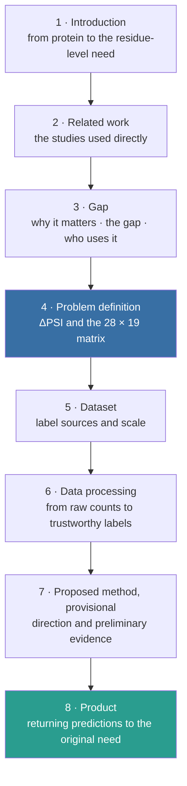

# Residue-Level Degron Mutation Effects: Eight-Section Overview (MAIN PAGE)

> Repository source for the **English main page**:
> <https://app.notion.com/p/3fe486d98ebc811eba29eb9e0987a0e1>. The main page is an **idea-level
> framing**; the detail lives in **seven subpages** (see [README.md](README.md) for URLs). Image
> paths here are **repository paths**; on Notion each image is an uploaded file. This file records
> **no decisions** — see [DECISIONS.md](../../../../../DECISIONS.md).
>
> English counterpart of [../content-main.md](../content-main.md). The two do not sync
> automatically; a change on one side must be mirrored by hand.

---

🎯 **In one sentence.** Given a 28-residue degron peptide, predict how much **each single amino acid
substitution** changes its stability — at the **residue level**, trained and scored on **measured
experimental labels**.

This page is an **idea-level framing**: eight sections written as continuous prose, each opening
with the point it has to make and closing with a bridging question to the next. Formulas, result
tables, configurations and the full experiments live in **seven detail pages** — open them only for
a deeper discussion.

⚠ The project's official status lives in `DECISIONS.md` in the CT553H repository, **not** on this
page. Updated 19 Oct 2026.

## The eight-section thread

---

# 1 · Introduction — from protein to the need for residue-level prediction

To understand how a sequence change affects degron activity, one has to move from recognising the
whole segment to the effect of **each individual substitution**, and the reason that move is
necessary starts with what a protein is and how its level is set. A protein is a chain of amino
acids; an amino acid inside the chain is a **residue**. Protein level is set by **both synthesis
and degradation**, so understanding how the cell adjusts protein level requires the degradation
branch as well. That branch is addressed: the **ubiquitin–proteasome system** degrades
selectively, and a **degron** is the signal that sends a protein there.

*(On Notion these two images sit in a two-column block.)*

But the conclusion **"this segment is a degron"** does not say which residue to change, or to what,
for the signal to get stronger or weaker. Three distinct levels of question: *does the whole segment
have activity?* → *which positions are sensitive?* → *what effect does each substitution have?*
**This thesis targets the last level.**

> → *That last level is where existing tools stop — so before stating what the thesis does, it is
> worth seeing how far they already go.*

→ Subpage: **1 · Biological background and the three levels of question**

---

# 2 · Related work — the studies used directly

The thesis does not begin on empty ground: it inherits existing experimental data and published
controls, and then has to show what it **adds** on the mutation-effect task. Each study below is
therefore present for **one concrete role** rather than as general background, which is why the
table names that role next to the content it supplies.

| Study | Directly relevant content | Role in the thesis |
|---|---|---|
| [Zhang et al. 2023](https://doi.org/10.1016/j.molcel.2023.08.022) | Measures degron activity and amino acid substitution effects with the GPS assay | **Primary label source**: scanning and saturation |
| [Voutsinos et al. 2026 — PAP](https://doi.org/10.1126/sciadv.adz3483) | Predicts a degron score for the **whole peptide** | The mutant–reference score difference (**ΔPAP**) is the **published control to beat** |
| [Degformer](https://github.com/Alpine2048/Degformer) | Predicts PSI from sequence; **already outputs a 28×20 matrix** | **Closest precedent** and baseline; also the case requiring a data-overlap audit |
| [Larsen et al. 2025](https://doi.org/10.5281/zenodo.20490355) | Measures protein tiles in a nuclear context | **Tile-level assay-transfer** evaluation; **not** a substitute for residue labels |
| [LeBlanc et al. 2026](https://doi.org/10.1016/j.cels.2026.101701) · [Schulze & Lindorff-Larsen 2026](https://doi.org/10.7554/eLife.103721) | Evaluation conventions, and a simple structural baseline | The thesis **borrows the conventions and must credit them**; rASA alone already gives Spearman 0.45 |

The degron **locating** tools (Degpred · DegronMD · DEGRONOPEDIA · MetaDegron) are the state of the
art for *"where is the degron"*, but their prediction unit is a **motif or region**, so they cannot
rank the residues inside it.

> → *The task is no longer vacant — Degformer has done it. What is missing are the conditions under
> which a residue-level number can be believed.*

→ Subpage: **2 · Related work, study by study**

---

# 3 · Gap — why this work is needed

The work is needed because an experimentalist eventually has to choose **one specific
substitution**, and a score for the whole segment does not say which one. The question is worth
asking in the first place because protein regions measured to be degrons are **2.148× enriched for
pathogenic over benign variants** (Mantel–Haenszel, stratified by protein), while **530,412 VUS**
sit inside those regions with no mechanism assigned.

⚠ This is a **REGION-level** claim. At the **residue level** it is **not established** (three
independent tests consistent with the null; AUC 0.5166). Degrons must not be called "variant
hotspots", and ClinVar is **not** a validation target for the model — it is **motivation** only.

**The gap can be demonstrated rather than merely asserted:** published degron models are trained on
**whole-segment** scores; the current model class **cannot localise** (PAP's inner channel is
permutation invariant — Pearson 1.000000 when residue order is shuffled); and the closest precedent
uses a split with measurable leakage and reports no label ceiling.

The primary users are **experimental biologists** choosing mutations to test, who face **532**
single substitutions in a single 28-residue peptide. Two secondary groups follow from the same
output: **variant interpretation**, which gains a mechanistic hypothesis, and **computational
research**, which gains a reference task with a measurement ceiling and controlled splits.

> → *Those three points define a concrete task — now state it precisely.*

→ Subpage: **3 · Urgency, the demonstrable gap, and the user groups**

---

# 4 · Problem definition — the concrete task

Stated plainly, the task asks a single question: for a degron peptide, if one amino acid at a
given position is replaced, will the reporter carrying that peptide be **more or less stable**,
and **by how much**? Fixing that question gives a fixed input and output.

- **Input:** the reference peptide (28 residues) plus a substitution specified by position, original
  amino acid and new amino acid.
- **Output:** the predicted effect of that substitution, expressed as **ΔPSI**.

$$
\Delta PSI = PSI_{\text{mutant}} - PSI_{\text{reference}}
$$

**PSI** is the reporter's stability score — the peptide is fused to a fluorescent protein in order to
track stability. **High PSI = a more stable reporter**; **positive ΔPSI** = the mutation makes the
reporter more stable, consistent with **weakening** degron activity in the assay.

Scoring every substitution gives a **28 positions × 19 replacement amino acids** matrix. Each cell
maps directly to **one mutation that can be built and measured** — that is what distinguishes this
output from a whole-segment score.

📏 **Scope.** The prediction target is **reporter stability in the assay** — not directly a half-life,
an E3 recognition mechanism, or an effect on the intact protein. ΔPSI is **not** a pathogenicity
probability.

> → *Which data makes it possible to learn and validate that matrix?*

→ Subpage: **4 · The task, PSI and ΔPSI**

---

# 5 · Dataset — what exists and how far it is used

The data and the processing pipeline are already in place, so the limitation that matters is not
availability but scale: there are only a **small number of independent saturation peptides**. Two
processed label sets carry the task, and they are not interchangeable.

| Processed set | Degron peptides | Protein clusters | Scored substitutions | Role |
|---|---|---|---|---|
| **Scanning** | 2,994 | 1,985 | 83,446 | Effects across many peptides; analysis of the value of context |
| **Saturation** | 91 | 89 | 47,847 | Training and evaluation of the substitution-effect matrix |

The source data is downloaded (≈2.3 GB, SHA-256 for every file, licences checked), PSI has been
rebuilt, ΔPSI computed and the benchmark run; replicate information is available for consistency
checks. Missing or sub-threshold cells are excluded.

⚠ Two risks to state up front: **both residue-level label sources come from one author group**
(Zhang 2023), with no replacement candidate found; and the Larsen data only supports **tile-level
assay transfer**, adding **no** amino acid substitution labels. But **n = 91 is not the sample size
of the residue-level work as a whole** — the scanning set is also measured mutation-effect data and
is far larger.

> → *Turning raw counts into usable labels is a chain of steps; which step decides how far they can
> be trusted?*

→ Subpage: **5 · Data and processing pipeline**

---

# 6 · Data processing — the reason and the result for each step

Rather than taking the labels from the authors' published tables, the pipeline **rebuilds them
from the raw read counts**, and that rebuild had to pass a **numeric verification gate** before
anything downstream was trusted. Each step below exists for a reason and leaves a measured result
behind.

Three results of that chain are worth stating even at idea level.

- **The verification gate:** the rebuilt PSI deviates by at most **5.0 × 10⁻⁷** across **261,865**
  values ⇒ the pipeline reproduces the authors' computation, which is what allowed the **second
  replicate** — for which no PSI table was published — to be rebuilt, and therefore the **noise
  ceiling** to be computed at all.
- **Splitting by protein cluster**, not by cell: all peptides and mutations of a cluster stay on one
  side, including overlap with a baseline's own training data.
- **Labels are the mean of two replicates**, and the difference between them is what yields the
  **measurement ceiling** — so every model score is read together with the limits of the data.

> → *Under those evaluation conditions, which information actually helps prediction?*

*(This section shares a subpage with Section 5.)*

---

# 7 · Proposed method, provisional — motivation, direction, goals

🚧 This section is a **direction under way with preliminary evidence**, not a settled method.

The motivation for the approach is that a mutation's effect depends on the amino acid removed, the
one introduced **and the surrounding context**. The design question is not *"composition or
position"* but ***"composition at which scale"*** — measured by decomposition: composition at the
**±3 neighbourhood scale** accounts for **80%** of the gain, while **absolute position**
contributes almost nothing.

The direction currently being followed has three pieces, taken in order: (1) represent the
substitution · **±3 neighbourhood** composition · **whole-peptide** composition, then use
**ablation** to identify which block actually helps; (2) find an **architectural component with a
stable benefit** — this is where novelty would live and is the main open cell; (3) consider
exploiting **whole-peptide labels** to support the residue-level output, still a direction
**requiring testing**.

![Cell-level AUROC on the saturation matrix, macro-averaged by peptide. Ridge M3 trained directly reaches 0.8082 against ΔPAP 0.7693 (+0.0389; 95% CI [0.0216, 0.0571]). The 0.9519 line is the **measurement ceiling** of the assay. The axis starts at 0.70. Measured here.](../../notion-2026-10-19/png/fig-benchmark.png)

What exists so far is deliberately modest. A ridge model trained directly on saturation reaches
**0.8082** against **0.7693** for ΔPAP (cell-level AUROC, macro by peptide; +0.0389, 95% CI
[0.0216, 0.0571]). But **five** higher-capacity architectures tried so far **all lose, in the same
direction** ⇒ the current reading is that the bottleneck is **label quantity**, not model
capacity.

📊 **Goals:** good prediction **on unseen peptides** · a method component delivering a **stable
improvement** (checked by ablation, across seeds, with uncertainty intervals) · **uncertainty** so
that users can judge a prediction. ⚠ **G2 is not complete:** the numeric target has been passed and
holds, while the architectural condition is **further away rather than closer**.

> → *Once predictions are trustworthy enough, how would a researcher actually use them?*

→ Subpage: **6 · Method, controls and current results**

---

# 8 · Product — core features and who uses them

The product exists to put the predictions into a tool that helps a researcher **inspect and
choose** mutations, and its shape follows from a property of the data rather than from a feature
wish-list. The bottleneck of this problem is not accuracy but **measurement noise** (replicate
agreement on the footprint residue set is only Jaccard 0.4965) ⇒ a tool returning **one confident
answer** misrepresents the data. The product therefore has two parts: a **prediction service with
uncertainty** (the pillar) and a **reproducible evaluation harness** (turning a comparison table
into a command that can be re-run).

| Planned feature | Which need it serves |
|---|---|
| Enter a peptide and a substitution | Examine one specific mutation, or score all candidates |
| Display the **effect matrix** | Compare replacement amino acids at one position and across positions |
| Filter and **rank candidates** | Pick high-effect mutations and low-effect cases as **controls** |
| **Uncertainty** and **application domain** | Know the confidence and the limits of an interpretation; flags when a query leaves the label domain |
| Export the list and its **provenance** | Prepare experiments, store and revisit predictions; separate "measured" from "predicted" |
| **API** and the evaluation **harness** | Integrate into a pipeline and compare models under identical conditions |

In use, the flow runs from end to end: enter a peptide → view the matrix → inspect individual
candidates → pick mutations and controls → export a list to test.

🚧 **Status:** the product is **planned, not built**; its usefulness for experiment selection **must
be evaluated separately** once implemented. The record notes that the supervisor accepted the
software pillar in principle, as relayed by the student; the overall project framing has **not been
formally approved**.

→ Subpage: **7 · Product — features, comparison and application domain**

---

# Four things never to claim, across all eight sections

These boundaries come from recorded decisions, not from presentation taste:

- **Never** say "the residues this thesis predicts are the residues carrying a disease signal" —
  2.148 is a **region-level** claim; at the residue level it has been measured three times and is
  **not established**.
- **Never** say "this thesis predicts cancer driver mutations" — the scope is **autonomous degrons**
  plus **germline** variants; 7 of 8 classical cancer-driver degrons are **outside the assay's
  reach** (measured).
- **Never** say "nobody has done this" — Degformer **has** produced the 28×20 matrix. The correct
  form is *"a search on 15 Oct 2026 did not find…"*.
- **Never** say "ClinVar validates the model" — ClinVar is **motivation**, not a validation target.
- **Never** treat the span up to the measurement ceiling as promised headroom, and never treat one
  local positive result as completing G2.

Internal experimental numbers (18 Oct 2026) are reconciled from
`research/g2-saturation-2026-10-18/` and `research/g2-extension-2026-10-18/` in the CT553H
repository; the official status follows `DECISIONS.md`.

