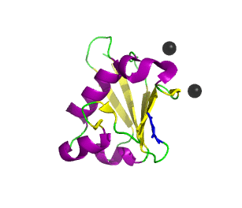
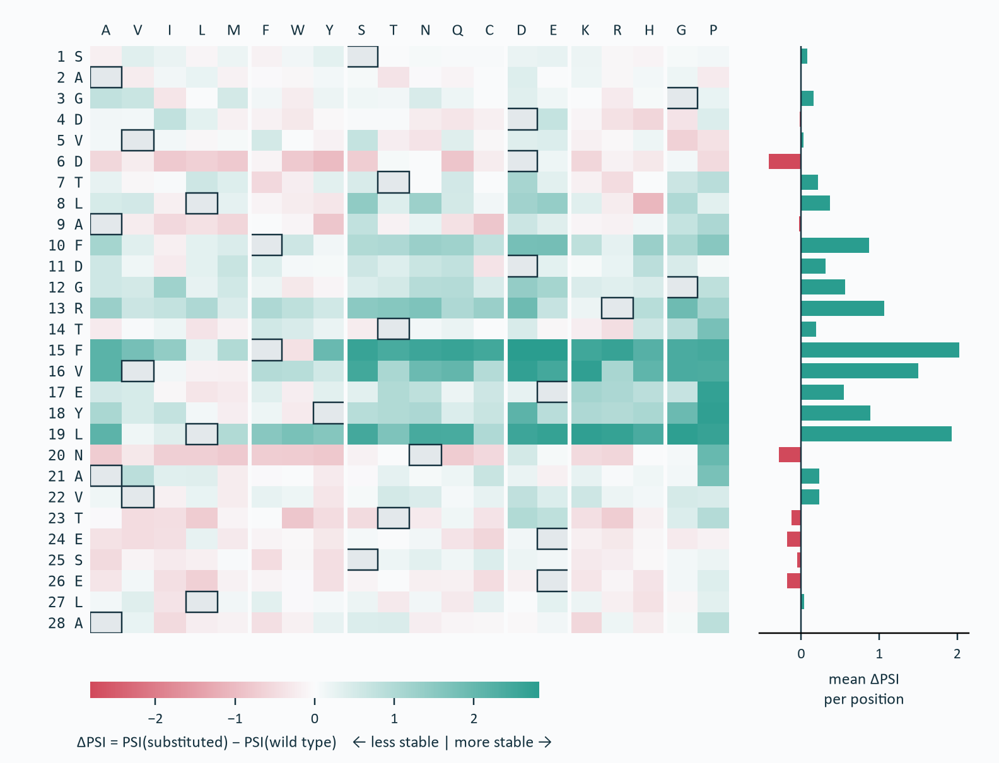
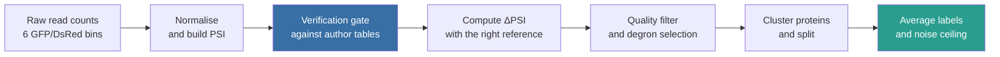
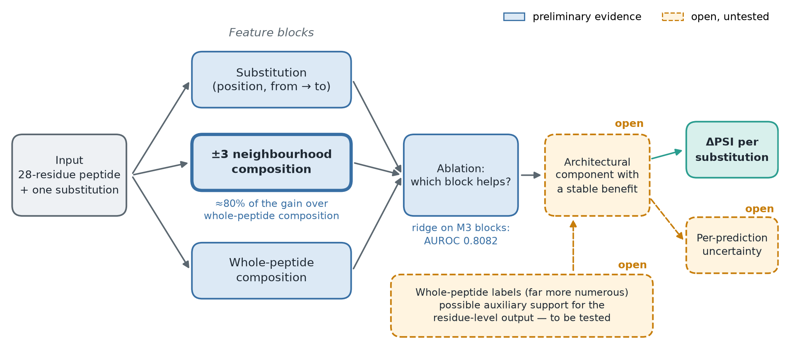
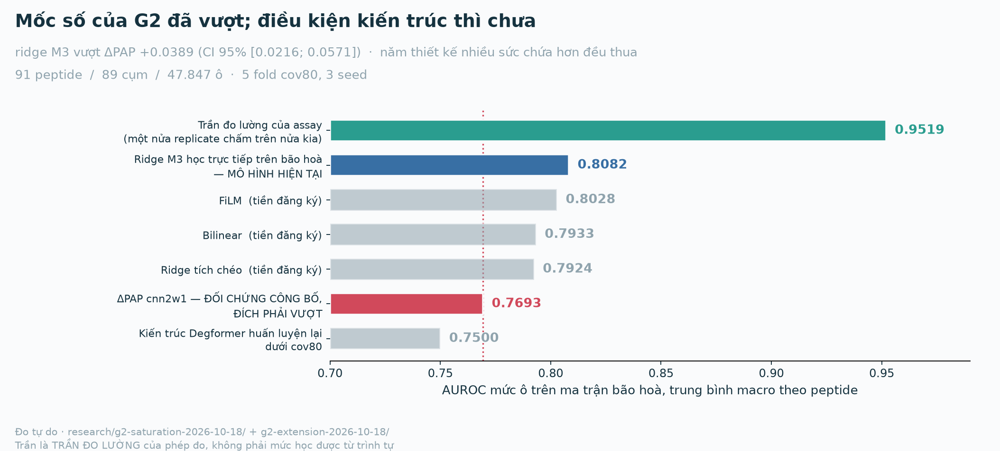

# Residue-Level Degron Mutation Effects: Project Overview (MAIN PAGE)

> Repository source for the **English main page**:
> <https://app.notion.com/p/3fe486d98ebc811eba29eb9e0987a0e1>. The main page is an **idea-level
> framing** in **nine sections**, condensed on 19/10/2026 (second pass): one short paragraph per
> section, no "Next:" bridge lines — each section opens by picking up the point the previous one
> ended on. The detail lives in **seven subpages**, each named after the section it serves (see
> [README.md](README.md) for titles and URLs). Image paths here are **repository paths**; on Notion
> each image is an uploaded file. On Notion there are **no emoji**: page icons and callout icons use
> Notion icon identifiers (`icons/dna_blue`, `icons/ruler_gray`, `icons/warning_yellow`,
> `icons/clock_blue`). This file records **no decisions** — see
> [DECISIONS.md](../../../../../DECISIONS.md).
>
> English counterpart of [../content-main.md](../content-main.md). The two do not sync
> automatically; the Vietnamese pages still carry the old eight-section structure, so the two
> languages **differ in structure**, not only in wording.

---

**In one sentence.** Given a 28-residue degron peptide, predict how much **each single amino acid
substitution** changes its stability — at the **residue level**, trained and scored on **measured
experimental labels**. *(Notion: callout, `icons/dna_blue`; a table of contents block follows.)*

Abbreviations, metrics and model names used throughout (Notion: toggle)

- **Residue** — one amino acid position inside a protein chain. **Cell** — one entry of the output
  matrix, that is one specific substitution at one position.
- **PSI** (Protein Stability Index) — the reporter's stability score on a 1…6 scale, computed from
  read counts in 6 sorting bins. **Low PSI = degraded quickly = strong degron.**
- **ΔPSI** — the label of this work: the change in PSI caused by one substitution, relative to the
  reference peptide.
- **GPS** — Global Protein Stability, the reporter assay all labels come from. **Scanning** /
  **saturation** — the two measured mutation sets, one substitution per position and all 19
  replacements per position respectively.
- **PAP** — the published degron predictor of Voutsinos et al. 2026, which scores a whole tile.
  **ΔPAP** — the PAP score difference between mutant and reference, used here as the published
  control.
- **M0 / M3** — the feature blocks of the linear baselines: **M0** uses whole-peptide composition
  only; **M3** adds the substitution itself and the composition of the **±3 neighbourhood**.
- **AUROC** — area under the ROC curve. Reported **cell-level and macro-averaged by peptide**, so
  each peptide counts once regardless of how many cells it contributes.
- **cov80** — protein clusters built with MMseqs2 at ≥30% sequence identity and 80% coverage; splits
  are made by cluster, never by peptide.
- **rASA** — relative accessible surface area. **VUS** — variant of uncertain significance.

---

# 1 · Introduction — from protein to the need for residue-level prediction

A protein is a chain of amino acids, and each amino acid in the chain is a **residue**. How much of a
protein the cell holds is set by **both synthesis and degradation**, and degradation is selective:
the **ubiquitin–proteasome system** destroys a protein that carries a **degron**, the signal that
sends it there.

*(On Notion these two images sit in a two-column block.)*

Knowing that a segment is a degron does not say which residue to change, or to what, to make the
signal stronger or weaker. Three questions follow in order — *does the whole segment have activity?*,
*which positions are sensitive?*, *what does each substitution do?* — and this thesis targets the
last.

→ Subpage: **Section 1 · Biological background and the three levels of question**

---

# 2 · Related work — the studies used directly

The first two questions already have published answers; the third is where the thesis must show what
it **adds**. Table 1 lists the studies it builds on, each included for one concrete role.

**Table 1.** The studies this work depends on, and the role each one plays.

| Study | Directly relevant content | Role in the thesis |
|---|---|---|
| [Zhang et al. 2023](https://doi.org/10.1016/j.molcel.2023.08.022) (*Mol Cell*) | Measures degron activity and substitution effects with the GPS assay introduced by Koren et al. 2018 (*Cell*) | **Primary label source**: the scanning and saturation sets |
| [Voutsinos et al. 2026 — PAP](https://doi.org/10.1126/sciadv.adz3483) (*Sci Adv*) | Predicts a degron score for the **whole peptide** | The mutant–reference score difference (**ΔPAP**) is the **published control to beat** |
| [Degformer](https://github.com/Alpine2048/Degformer) (GitHub, no paper) | Predicts PSI from sequence and **already outputs a 28×20 matrix** | **Closest precedent** and baseline; also the case requiring a data-overlap audit |
| [Larsen et al. 2025](https://doi.org/10.5281/zenodo.20490355) (preprint) | Measures protein tiles in a nuclear context | **Tile-level assay-transfer** evaluation; **not** a substitute for residue labels |
| [LeBlanc et al. 2026](https://doi.org/10.1016/j.cels.2026.101701) (*Cell Systems*) · [Schulze & Lindorff-Larsen 2026](https://doi.org/10.7554/eLife.103721) (*eLife*) | Evaluation conventions, and how strong a simple structural baseline already is | The thesis **borrows the conventions and credits them**; rASA alone already gives Spearman 0.45 |

The degron **locating** tools (Degpred, DegronMD, DEGRONOPEDIA, MetaDegron) answer *where is the
degron in my protein*, but their unit is a **motif or region**, so they cannot rank the residues
inside it. The closest precedent, Degformer, does output a 28×20 matrix; what is missing is the set
of conditions under which such a residue-level number can be believed.

→ Subpage: **Section 2 · Related work, study by study**

---

# 3 · Why the work is needed

Those conditions matter because an experimentalist eventually has to choose **one specific
substitution**, and a score for the whole segment does not say which. The question is worth asking
because protein regions measured to be degrons are **2.148× enriched for pathogenic over benign
variants** (Mantel–Haenszel, stratified by protein), while **530,412 variants of uncertain
significance** sit inside those regions with no mechanism assigned.

**That enrichment is a region-level result.** At the **residue level** it is **not established**:
three independent tests are consistent with the null (strongest stratum AUC 0.5166). ClinVar
therefore serves as **motivation only**, never as a validation target. *(Notion: limitation callout,
`icons/warning_yellow`.)*

The gap can be demonstrated. Published models are trained on **whole-segment** scores and **cannot
localise**: the inner channel of PAP is permutation invariant, returning Pearson 1.000000 against
itself when residue order is shuffled. Degformer, for its part, uses a split with measurable leakage
and reports no label ceiling, so its residue-level numbers cannot be read at face value.

The primary users are **experimental biologists** choosing which mutations to test among the **532**
single substitutions of one 28-residue peptide. **Variant interpretation** (a mechanistic hypothesis)
and **computational research** (a reference task with a measurement ceiling and homology-controlled
splits) benefit from the same output.

→ Subpage: **Section 3 · Why the work is needed**

---

# 4 · Problem definition — the concrete task

The task asks one question of each of those substitutions: if a single amino acid of a degron peptide
is replaced, will the reporter carrying that peptide be **more or less stable**, and **by how much**?
The input is the 28-residue reference peptide plus a substitution (position, original and new amino
acid); the output is its effect, expressed as **ΔPSI**:

$$
\Delta PSI = PSI_{\text{mutant}} - PSI_{\text{ref}}
$$

**PSI** is the reporter's stability score — the peptide is fused to a fluorescent protein, and **high
PSI means a more stable reporter** — so a **positive ΔPSI** means the mutation **weakens** degron
activity in the assay. The reference is the **directly measured wild-type peptide** for the scanning
set, and the **median of the synonymous cells** for the saturation set, which has no separate
wild-type measurement.

Scoring every substitution of a peptide gives a **28 positions × 19 replacement amino acids** matrix
whose entries are called **cells**; each cell is one mutation that can be built and measured. The
literature, Degformer included, quotes 28×20 because the 20th column keeps the original amino acid,
which is not a mutation.

**Scope.** The target is **reporter stability in the assay** — not a half-life, an E3 recognition
mechanism, an effect on the intact protein, or a pathogenicity probability. *(Notion: scope callout,
`icons/ruler_gray`.)*

→ Subpage: **Section 4 · The task, PSI and ΔPSI**

---

# 5 · Data and processing — from raw counts to trustworthy labels

Learning and validating that matrix needs measured labels, and two processed sets carry the task
(Table 2). What limits the work is not availability but scale: there are few independent
**saturation** peptides.

**Table 2.** The two measured label sets after processing.

| Processed set | Degron peptides | Protein clusters | Scored cells | Role |
|---|---|---|---|---|
| **Scanning** — one substitution per position | 2,994 | 1,985 | 83,446 | Sample size and the context axis |
| **Saturation** — all 19 replacements per position | 91 | 89 | 47,847 | Training and evaluation of the substitution-effect matrix |

The source data is downloaded and pinned (about 2.3 GB, SHA-256 for every file, licences checked).
Rather than taking labels from the authors' tables, the pipeline **rebuilds them from raw read
counts** (Figure 4), and the rebuild must pass a **numeric verification gate** before anything
downstream is written.

*Figure 4. From raw read counts to averaged labels split by protein cluster; the verification gate
and the label averaging decide how far the labels can be trusted. **On Notion
this diagram is an uploaded PNG, with this text as an italic caption line below it.***

The gate shows rebuilt PSI deviating by at most **5.0 × 10⁻⁷** across **261,865** values, which is
also what allowed the **second replicate**, with no published PSI table, to be rebuilt. Splits are
made **by protein cluster**, so a cluster never straddles training and test. Labels are the mean of
two replicates, and the difference between them gives the **measurement ceiling** against which every
model score is read.

**Both residue-level label sources come from the same author group** (Zhang et al. 2023) and no
replacement has been found; the Larsen data supports only **tile-level assay transfer**. Note that
**n = 91 is the saturation set, not the sample size of the residue-level work as a whole**: the
scanning set is far larger. *(Notion: limitation callout, `icons/warning_yellow`.)*

→ Subpage: **Section 5 · Data and processing pipeline**

---

# 6 · Proposed method — motivation, direction and goals

A **direction under way with preliminary evidence**, not a settled method. *(Notion: status callout,
`icons/clock_blue`.)*

With labels, ceiling and splits in place, the question is which information in the sequence actually
predicts a substitution's effect. That effect depends on the amino acid removed, the one introduced
**and the surrounding context**, so the design question is **composition at which scale**.
Decomposition settled it: composition at the **±3 neighbourhood scale** accounts for **80%** of the
gain over whole-peptide composition, while **absolute position** contributes almost nothing.

The direction has three pieces, taken in order: represent the substitution, the **±3 neighbourhood**
and the **whole-peptide** composition as separate blocks and use **ablation** to see which helps; find
an **architectural component with a stable benefit**, where novelty would live and the main open
item; and test whether the far more numerous **whole-peptide labels** can support the residue-level
output. Figure 5 sketches how the pieces fit.

*(On Notion the image is an uploaded PNG with this text as an italic caption line below it. Script: [fig_method.py](fig_method.py).)*

The method is held to three goals: good prediction **on peptides not seen in training**, a **stable
improvement** checked by ablation across seeds with uncertainty intervals, and **per-prediction
uncertainty**, so a user can judge a prediction rather than trust it.

---

# 7 · Current results — what holds and what does not

The first piece already gives a measurable result. Scores are **cell-level AUROC, macro-averaged by
peptide**, over 5 outer cov80 folds and 3 seeds, with differences paired by peptide and bootstrapped
by cluster. A ridge model with the M3 blocks, trained directly on the saturation set, reaches
**0.8082** against **0.7693** for the published ΔPAP control (**+0.0389**, 95% CI [0.0216, 0.0571]);
Figure 6 places both against the measurement ceiling.

The negative result is just as informative: **five** higher-capacity architectures **all lose to the
ridge model, in the same direction**. The current reading is that **label quantity**, not model
capacity, is the bottleneck, though no controlled experiment has isolated it.

**Second project gate.** The numeric target is passed and holds; the architectural condition is
**further away rather than closer**, so the gate is **not complete**. The span from 0.8082 to the
ceiling 0.9519 is **not headroom**, because the ceiling is what the assay itself can resolve.
*(Notion: status callout, `icons/clock_blue`.)*

→ Subpage: **Sections 6–7 · Method, controls and current results**

---

# 8 · Product — core features and who uses them

A tool built on these predictions has to respect what dominates the data, which is **measurement
noise** rather than accuracy: replicate agreement on the footprint residue set is only Jaccard
0.4965, so a tool returning **one confident answer** would misrepresent it. The product therefore has
two parts: a **prediction service with uncertainty** as the pillar, and a **reproducible evaluation
harness** that turns a comparison table into a re-runnable command.

**Table 3.** Planned features and the need each one serves.

| Planned feature | Which need it serves |
|---|---|
| Enter a peptide and a substitution | Examine one specific mutation, or score all candidates |
| Display the **effect matrix**; filter and **rank candidates** | Compare replacements across positions; pick high-effect mutations, and low-effect cells as **controls** |
| **Uncertainty** and **application domain** | Know the confidence and the limits of an interpretation; flag when a query leaves the label domain |
| Export with **provenance**; **API** and evaluation **harness** | Separate measured from predicted; integrate into a pipeline and compare models under identical conditions |

End to end: enter a peptide, view the matrix, pick mutations together with their controls, and export
a list to test.

→ Subpage: **Section 8 · Product, comparison and application domain**

---

# 9 · Plan, open items and limitations

The product is planned rather than built, and it is one of several items still open; the limits of
what the work can claim belong beside them.

**Open items, in the order they block the work.**

1. An architectural component with a stable benefit: five higher-capacity models, three
   pre-registered, already lose to ridge M3.
2. Whether label quantity really is the bottleneck: measuring the label-quantity curve first is a
   proposal awaiting confirmation.
3. A **calibrated** uncertainty method: seed ensembling and conformal prediction on a
   cluster-separated calibration set are candidates, neither chosen.
4. The product: planned, not built, and whether it saves experimental effort must be evaluated once
   it exists.

**Limitations carried by the work as a whole.**

- **One label source.** Both residue-level label sets come from one author group (Zhang et al. 2023);
  a replacement would need residue-level stability labels on autonomous degrons from another group,
  and none has been found.
- **Narrow coverage.** Labels cover **cytosolic, autonomous** degrons in a 28-residue window;
  conditional or non-linear-motif degrons are outside the assay's reach (seven of eight classical
  cancer-driver degrons). The target is reporter stability, not half-life, E3 recognition or
  pathogenicity.
- **Region versus residue.** The 2.148× enrichment is region-level; at the residue level three tests
  are consistent with the null, and conservation and disorder are not controlled for.
- **Ceiling.** Model quality is bounded by the measurement ceiling (0.9519 on saturation); the span
  below it is not headroom.
- **Novelty and approval.** Novelty is a dated search result, not an absolute: a search on 15 Oct
  2026 found no model with a residue-level objective, a label ceiling and controlled splits, although
  Degformer already outputs a 28×20 matrix. The supervisor accepted the software pillar in principle,
  as relayed by the student; the overall framing is not formally approved.

Internal experimental numbers (18 Oct 2026) are reconciled from
[`research/g2-saturation-2026-10-18/`](../../../research/g2-saturation-2026-10-18/README.md) and
[`research/g2-extension-2026-10-18/`](../../../research/g2-extension-2026-10-18/README.md) in the
CT553H repository; the official status follows [DECISIONS.md](../../../../../DECISIONS.md).
