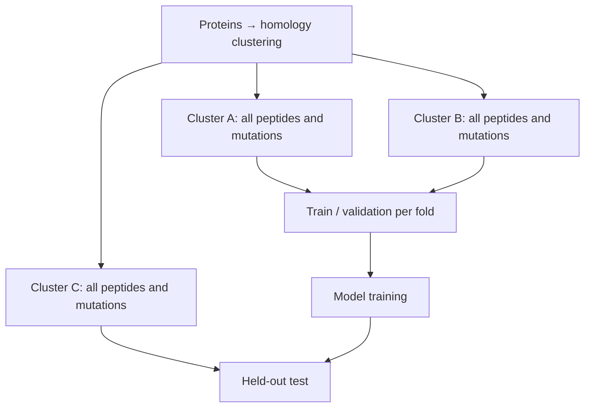
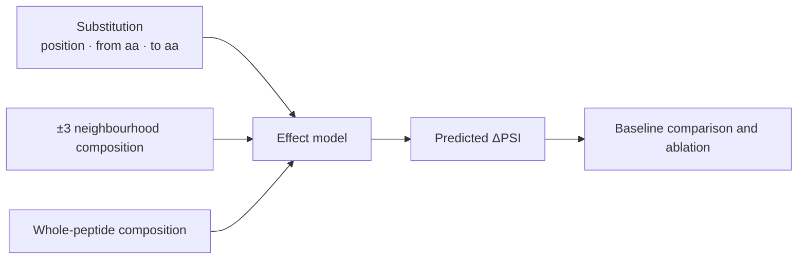

# The seven English subpages — repository source

> Repository source for the **seven English detail pages**. Each one is now named after the **section
> of the main page it serves**, so the subpage numbering and the main-page numbering are one system:
> Sections 1–5 and 8 have one page each, and Sections 6–7 share one. URLs are in
> [README.md](README.md). Image paths are **repository paths**; on Notion each image is an uploaded
> file, and the diagrams kept here as `mermaid` blocks are uploaded PNGs on Notion. There are **no
> emoji** on Notion: page icons and callout icons use Notion icon identifiers, and callouts are
> reduced to four roles — orientation (`icons/document_gray`), scope (`icons/ruler_gray`), limitation
> (`icons/warning_yellow`) and status (`icons/clock_blue`). This file records **no decisions** — see
> [DECISIONS.md](../../../../../DECISIONS.md).
>
> English counterpart of [../content-subpages.md](../content-subpages.md). The two do not sync
> automatically. ⚠ The Vietnamese subpages still use the old numbering (`1 ·` … `7 ·`) and the
> "Message:" style.

---
---

# SUBPAGE for Section 1 — Biological background and the three levels of question

*Notion title: “Section 1 · Biological background and the three levels of question”, icon
`icons/microscope_gray`.*

Detail page for **Section 1** of the overview: enough biology for a reader outside the field to
follow the computational problem, and the reason the problem has to go down to the **residue level**.
*(Notion: orientation callout.)*

## 1.1 · Protein, residue and a point mutation

A **protein** is a chain of amino acids that contributes to structure, catalysis and regulation in the
cell. An amino acid inside the chain is called a **residue**. Changing one residue means changing one
letter of the chain, which is exactly the **single amino acid substitution** whose effect this thesis
predicts.

## 1.2 · Protein level is a balance of synthesis and degradation

Protein level is set by **both synthesis and degradation**. Understanding how a cell adjusts the level
of a protein therefore requires the degradation branch as well — the branch usually skipped when only
gene expression is considered.

## 1.3 · The ubiquitin–proteasome system, and what a degron is

Degradation is selective: an **E3 ligase** recognises the target protein, **ubiquitin** is attached,
and the **proteasome** degrades it. Humans encode **more than 600** E3 ligases while the number of
characterised degrons remains small, which is why high-throughput screens keep expanding the degron
catalogue.

A **degron** is a sequence element that sends a protein for degradation. The natural next question is
which residue inside that element carries the signal.

## 1.4 · Three distinct levels of question

The three levels differ in what they answer and in how well existing tools cover them.

**Table 1.1.** The three levels of question, and where existing tools stand.

| Level | What it answers | State of existing tools |
|---|---|---|
| **Whole segment** | Does this peptide promote degradation? | Usable tools exist at proteome scale |
| **Position** | Which positions in the segment are sensitive to change? | Inferred indirectly; not a training target |
| **Substitution** | At that position, which replacement amino acid produces which effect? | **The level this thesis targets** |

Concluding that a segment is a degron does not say which residue to change, or to what, for the signal
to get stronger or weaker. Locating a degron is therefore a **starting point rather than a
destination**.

## 1.5 · Why not simply measure everything

A 28-residue peptide has

$$
28 \times 19 = 532
$$

single substitutions, and every new peptide creates another candidate set of the same size. A model
earns its place if it ranks the unmeasured cases well enough that a researcher can decide what to test
first.

An illustrative case — hypothetical values, not measurements

A 28-residue peptide has been shown to have degron activity, and the researcher wants a **weaker**
version in order to test the role of the signal.

- A change at **position 7** might make the reporter more stable.
- A change at **position 19** might have almost no effect.
- Even at position 7, **two different replacement amino acids** can produce different effects.

The unit the researcher actually has to choose is therefore **one specific substitution**: which
position, from which amino acid to which.

## 1.6 · Two 2025 reviews that point in different directions

The two reviews disagree about how far short linear motifs can carry the field, so both are cited
rather than only the convenient one.

- [Zhang et al. 2025](https://doi.org/10.1038/s41580-025-00870-z) (*Nat Rev Mol Cell Biol*; a review,
  not the 2023 label source) — high-throughput screening keeps increasing the number of degrons
  defined at high resolution.
- [Wang & Zheng 2025](https://doi.org/10.1038/s41589-025-02056-2) (*Nat Chem Biol*) — many degrons are
  **not** short linear motifs, so a 28-mer window has limited scope. That limitation is **shared with
  the assay the labels come from**, and is stated as a limitation of this work in Section 9.

**Scope.** The thesis concerns **autonomous degrons** in a reporter assay and **germline** variants.
Degrons that need priming, for example by phosphorylation, or that require several motifs are
**outside the assay's reach** — measured, not assumed. Cancer examples are not used as the entry
point. *(Notion: scope callout.)*

---
---

# SUBPAGE for Section 2 — Related work, study by study

*Notion title: “Section 2 · Related work, study by study”, icon `icons/book_gray`.*

Detail page for **Section 2** of the overview. The selection rule is that every study appears because
of **one concrete role** — label source, baseline, precedent, or evaluation convention. Work that is
merely topically related is left out. *(Notion: orientation callout.)*

## 2.1 · Label sources — the data the thesis learns from

All labels used here trace back to a single assay design, extended in 2023 to cover mutations. Table
2.1 lists the sources in the order they build on one another.

**Table 2.1.** Sources of measured labels.

| Study | Role | Contribution used here |
|---|---|---|
| **Koren et al. 2018** (*Cell*) | Foundation of the measurement | Established the **GPS peptidome** screen: peptides fused to a reporter, sorted by stability. Every later label comes from this design |
| [**Zhang et al. 2023**](https://doi.org/10.1016/j.molcel.2023.08.022) (*Mol Cell*) | **Primary label source** | Added **mutations** on top of the screen: a **scanning** set with one substitution per position, and a **saturation** set with all 20 amino acids per position. This is the first large-scale measured mutation-effect label set, so the problem only became answerable after 2023 |
| [**Voutsinos et al. 2026 — PAP**](https://doi.org/10.1126/sciadv.adz3483) (*Sci Adv*) | **Main baseline** and benchmark population | A near-complete map of cytosolic degrons: more than 200,000 tiles of 30 residues from more than 5,000 proteins, with PAP (a two-channel CNN) reaching Pearson 0.82 and 0.87 on held-out tiles. The thesis uses **ΔPAP**, the score difference before and after mutation, as its control |
| [**Larsen et al. 2025**](https://doi.org/10.5281/zenodo.20490355) (preprint) | Assay-transfer test at tile level | Extends coverage to **1,626** transcription factors in the published catalogue, with precomputed PAP, rASA and pLDDT; the annotation file itself spans 1,627 genes, which is a different denominator and is not merged with the catalogue count. This is **not** an unseen-sequence test: **1,583 of the 1,626 (97.4%)** already appear in the GPS peptidome |

## 2.2 · The closest precedent

Two models already predict in this neighbourhood, and the thesis has to say exactly how it differs
from each.

**Table 2.2.** Precedents at the residue and peptide level.

| Work | What it does, and what was measured about it here |
|---|---|
| [**Degformer**](https://github.com/Alpine2048/Degformer) (GitHub, **no paper**) | A transformer trained on Zhang's tables that **already outputs a 28×20 ΔPSI matrix**, making it the most direct precedent; its self-reported correlation is 0.9162 to 0.9463. Three things were measured here. Its random split contains **4.09%** exact sequence leakage. Its prediction head reads only the **CLS token**, so the matrix is assembled from 532 forward passes rather than produced by a residue-level head. And its **blind set is absent from the repository**, so the headline number cannot be reproduced |
| **Zhang SVM 2023** (the authors' own model) | Predicts **peptide-level** PSI with Pearson **0.8955** across 260,989 peptides. The peptide level is therefore already strong, which is what leaves the **residue level** as the open gap |

## 2.3 · Evaluation conventions borrowed from others, and credited

Three of the evaluation practices used in this work are not original to it, and are cited as such
wherever they appear.

**Table 2.3.** Borrowed conventions and baselines.

| Work | What is borrowed |
|---|---|
| [**LeBlanc et al. 2026**](https://doi.org/10.1016/j.cels.2026.101701) (*Cell Systems*) | Three practices: reporting **coefficient stability** across seeds and bootstraps, comparing against a **replicate noise ceiling**, and **splitting by protein cluster**. Each is cited as following LeBlanc et al. 2026 rather than presented as a design choice of this thesis |
| [**Schulze & Lindorff-Larsen 2026**](https://doi.org/10.7554/eLife.103721) (*eLife*) | A demonstration of how strong a simple structural baseline already is: a substitution matrix conditioned only on **buried or exposed** state predicts abundance well, and **rASA alone gives Spearman 0.45**. Any residue-level claim here must therefore beat a simple baseline, not only a null |
| **AlphaMissense 2023** (*Science*) | Answers a **different** question, namely whether a variant is pathogenic. This thesis **adds mechanism** to such a score; it does not replace it |

## 2.4 · Degron-locating tools

**Degpred 2022, DegronMD 2023, DEGRONOPEDIA 2024 and MetaDegron 2024** brought degron recognition to
proteome scale with working web tools, and they are the state of the art for the question *where is
the degron in my protein*. Their labels, however, are **curated motifs** — a few hundred instances,
with negatives often drawn from random peptides — and their prediction unit is a **motif or region**,
so they cannot rank the residues inside it.

---
---

# SUBPAGE for Section 3 — Why the work is needed

*Notion title: “Section 3 · Why the work is needed”, icon `icons/target_gray`.*

Detail page for **Section 3** of the overview, in three steps: how large the clinical signal in degron
regions is, why the gap is demonstrable, and who uses the result. Section 3.4 maps every number on
this page to its source. *(Notion: orientation callout.)*

## 3.1 · How strong the clinical signal in degron regions is

The motivation for the work is a measured enrichment rather than an assertion, and it comes with
qualifications that are as important as the number itself.

- Protein regions measured to be degrons are **2.148× enriched for pathogenic over benign variants**,
  95% CI [2.072, 2.227], by Mantel–Haenszel **stratified by protein** over 3,114 informative strata.
  Stratifying by protein is what rules out the enrichment being an artefact of ClinVar concentrating
  on disease genes.
- **530,412 variants of uncertain significance** fall inside measured degron regions with no mechanism
  assigned to them, specifically inside the **116,702** degron tiles of the GPS peptidome.

Both figures are measured on [ClinVar](https://www.ncbi.nlm.nih.gov/clinvar/) (**2,564,486**
deduplicated missense variants, of which **2,349,511**, or **93.0%**, match the UniProt wild-type
amino acid), intersected with the degron regions of
[Zhang et al. 2023](https://doi.org/10.1016/j.molcel.2023.08.022) measured in the
[GPS peptidome, GEO GSE240610](https://www.ncbi.nlm.nih.gov/geo/query/acc.cgi?acc=GSE240610).

**Three qualifications belong with the figure 2.148 wherever it is quoted.** *(Notion: limitation
callout.)*

1. It is a **region-level** result. At the **residue level** the effect is **not established**: three
   independent tests are all consistent with the null, the strongest stratum giving AUC **0.5166**,
   CI [0.479, 0.554], on 695 pathogenic and 929 benign variants across 620 clusters.
2. There is **no positional** enrichment (33.4% against 32.4% at the PSI ≤ 3.0 threshold), so degron
   regions are not variant hotspots. That same threshold labels **32.4% of all proteome tiles** as
   degrons, so the statement that a variant lies in a degron carries almost no information on its own.
3. **Conservation and disorder have not been controlled for.** If the enrichment disappears after
   controlling for them, it says only that degrons sit in functional regions.

Attribution: [ClinVar](https://www.ncbi.nlm.nih.gov/clinvar/), citing PMID 29165669. The data is
**not for diagnostic use** and is **not** a validation target for the model.

## 3.2 · Why the gap is demonstrable

Four things are missing from the published state of the art, and each absence has been checked rather
than assumed.

**Table 3.1.** What is missing, and the measurement that establishes it.

| What is missing | Current status |
|---|---|
| A model **trained on a residue-level objective** | Published degron models are trained on whole-segment scores, so applying them per residue is **use outside their design** |
| **A model class that can localise at all** | Measured here on the published [PAP](https://doi.org/10.1126/sciadv.adz3483): the `cnn2w1` inner channel pools globally after a width-1 convolution, which makes it **permutation invariant** — reversing residue order leaves the score unchanged, with maximum absolute difference 4.8 × 10⁻⁷ and Pearson **1.000000** |
| **Evaluation conditions** under which a residue-level claim can be believed | The closest precedent, [Degformer](https://github.com/Alpine2048/Degformer) (Apache-2.0, no paper), uses a random split with measurable leakage — **4.09%** exact sequence duplication, plus **88.12%** of our test cells and **91 of 91** wild-type peptides inside its training data — and reports **no** label ceiling and **no** per-prediction uncertainty |
| A **measurement noise ceiling** attached to every number | Measured here from the two [Zhang et al. 2023](https://data.mendeley.com/datasets/32h94v2yv2/2) replicates: a cell-level ceiling of **0.9458** on scanning (replicate 1 scoring replicate 2) and **0.9519** on saturation (half A scoring half B). Agreement between replicates on the *residue set* forming the footprint is only Jaccard **0.4965** |

## 3.3 · User groups, and the limit stated to each

Three groups would use the output, and each is offered something concrete together with the limit that
applies to it.

**Table 3.2.** Who uses the result.

| Group | What they get | The limit stated alongside |
|---|---|---|
| **Experimental biologists** designing degron mutations (primary) | A ranked shortlist — which residues to try first, with uncertainty — plus ready-made low-effect cells to use as **controls** | The output **ranks candidates and does not decide** them: residue-level replicate agreement is Jaccard 0.4965, and the saving in experimental effort **has not been validated directly** |
| **Variant interpretation** (530,412 VUS in degron regions) | A **mechanistic hypothesis** complementing pathogenicity scores such as [AlphaMissense 2023](https://doi.org/10.1126/science.adg7492): does this substitution make the peptide more or less stable, and roughly by how much | It is a **hypothesis**, not an explanation of why a variant is pathogenic. The link from residue to disease is not established |
| **Computational and machine-learning research** | A **reference task** with a measurement ceiling, honest baselines and homology-controlled splits — clusters built with [MMseqs2](https://doi.org/10.1038/nbt.3988) at ≥30% identity and 80% coverage, following the conventions of [LeBlanc et al. 2026](https://doi.org/10.1016/j.cels.2026.101701) | Development benchmark only; it is not an external validation of any model |

---

## 3.4 · Sources behind every number on this page

**Table 3.3.** Each claim mapped to the external source and the internal report it comes from.

| Claim on this page | Source |
|---|---|
| Odds ratio **2.148** [2.072, 2.227], Mantel–Haenszel by protein, 3,114 of 13,561 strata; cluster-stratified **2.094** [2.024, 2.167] | [ClinVar](https://www.ncbi.nlm.nih.gov/clinvar/), release of 12 Oct 2026 (NCBI FTP, SHA-256 recorded) crossed with the degron regions of [Zhang et al. 2023](https://doi.org/10.1016/j.molcel.2023.08.022) / [GEO GSE240610](https://www.ncbi.nlm.nih.gov/geo/query/acc.cgi?acc=GSE240610) · internal: [variant-coverage-2026-10-15](../../../research/variant-coverage-2026-10-15/README.md) |
| **2,564,486** missense variants and the **93.0%** UniProt wild-type match | The same ClinVar release; reference sequences from [UniProtKB/Swiss-Prot](https://www.uniprot.org/) human `2026_03` · [SOURCE.md](../../../data/raw/clinvar/SOURCE.md) |
| **530,412** VUS inside **116,702** degron tiles across **17,287** proteins | ClinVar crossed with the GPS peptidome ([GEO GSE240610](https://www.ncbi.nlm.nih.gov/geo/query/acc.cgi?acc=GSE240610)) at the PSI ≤ 3.0 threshold |
| Residue level **not established**: AUC **0.5166** [0.479, 0.554] on 695 and 929 variants over 620 clusters, with two further strata also null | ClinVar crossed with the mutation sets of [Zhang et al. 2023](https://data.mendeley.com/datasets/32h94v2yv2/2) (Mendeley `10.17632/32h94v2yv2.2`, CC BY 4.0) |
| No positional enrichment, **33.4%** against **32.4%**; the PSI ≤ 3.0 threshold calls **32.4%** of proteome tiles degrons | GPS peptidome tiles ([GEO GSE240610](https://www.ncbi.nlm.nih.gov/geo/query/acc.cgi?acc=GSE240610)) |
| PAP is **permutation invariant** (Pearson **1.000000**, maximum absolute difference 4.8 × 10⁻⁷) | [Voutsinos et al. 2026](https://doi.org/10.1126/sciadv.adz3483) (*Sci Adv*), checkpoint pinned at `9b3eafa6` · internal: [voutsinos-2026-audit](../../../research/voutsinos-2026-audit/README.md) |
| Degformer: **4.09%** exact sequence leakage, **88.12%** test-cell overlap, **91 of 91** wild-type peptides in its training data, blind set absent | [Degformer](https://github.com/Alpine2048/Degformer) (Apache-2.0, no paper; checkpoints shipped as pickle files and run in isolation) · internal: [g2-saturation-2026-10-18](../../../research/g2-saturation-2026-10-18/README.md) |
| Measurement ceilings **0.9458** and **0.9519**, and footprint Jaccard **0.4965** | The two replicates of [Zhang et al. 2023](https://data.mendeley.com/datasets/32h94v2yv2/2), rebuilt from the raw counts in [GEO GSE240610](https://www.ncbi.nlm.nih.gov/geo/query/acc.cgi?acc=GSE240610) · internal: [residue-task-derisk-2026-10-15](../../../research/residue-task-derisk-2026-10-15/README.md) |
| Published degron models are trained on whole-segment scores | [PAP](https://doi.org/10.1126/sciadv.adz3483), Zhang SVM 2023, [DEGRONOPEDIA](https://degronopedia.com/), MetaDegron, DegronMD, Degpred |
| Cluster-controlled splits and the noise-ceiling convention | [LeBlanc et al. 2026](https://doi.org/10.1016/j.cels.2026.101701) (*Cell Systems*), [MMseqs2](https://doi.org/10.1038/nbt.3988), and the simple-baseline warning from [Schulze & Lindorff-Larsen 2026](https://doi.org/10.7554/eLife.103721) (*eLife*) |

---
---

# SUBPAGE for Section 4 — The task, PSI and ΔPSI

*Notion title: “Section 4 · The task, PSI and ΔPSI”, icon `icons/ruler_gray`.*

Detail page for **Section 4** of the overview: the input and output statement, the two definitions
that have to be given before they are used, and the full shape of the output. *(Notion: orientation
callout.)*

## 4.1 · The task in one sentence

> Given a peptide with degron activity and one amino acid substitution, **predict how much that
> substitution changes the stability of the reporter.**

## 4.2 · Input and output

- **Input:** the reference peptide (28 residues) plus a substitution specified by **position**,
  **original amino acid** and **new amino acid**.
- **Output:** the predicted effect of that substitution, expressed as **ΔPSI**.

## 4.3 · Two definitions stated before they are used

Both terms appear in every later section, so they are fixed here.

- **Reporter.** The peptide is fused to a fluorescent protein so that stability can be **tracked**.
  The experiment measures the stability of the reporter-plus-peptide construct, **not** of the intact
  protein.
- **PSI (Protein Stability Index).** The reporter's stability score on a **1…6** scale, computed from
  read counts across the 6 stability bins:

$$
PSI=\frac{\sum_{i=1}^{6} i \times nb_i}{\sum_{i=1}^{6} nb_i}
$$

The direction of the scale is the single easiest thing to read backwards, so it is stated once,
explicitly: **low PSI means degraded quickly, which means a strong degron.** *(Notion: limitation
callout.)*

## 4.4 · The label

$$
\Delta PSI = PSI_{\text{mutant}} - PSI_{\text{ref}}
$$

A **positive ΔPSI** means the mutant reporter is **more stable**, consistent with the mutation
**weakening** degron activity under assay conditions; a negative ΔPSI is the opposite. The reference
differs between the two label sets, and the difference is not cosmetic: the **scanning** set has a
directly measured wild-type peptide, whereas the **saturation** set has no separate wild-type
measurement and uses the **median of the synonymous cells** of the same peptide as its internal
reference (28 such cells per peptide, median within-peptide PSI standard deviation 0.0576). For that
reason the symbol is written as the reference, not as the wild type.

ΔPSI is **not** a pathogenicity probability and **not** a change in the half-life of the intact
protein.

## 4.5 · The full shape of the output

Scoring every substitution of a peptide gives a **28 positions × 19 replacement amino acids** matrix,
and one entry of that matrix is called a **cell**. Each cell maps directly to **one mutation that can
be built and measured**, which is what distinguishes this output from a whole-segment score.
Aggregating down the columns gives a **positional sensitivity map**, the footprint, but the
aggregation rule has to be stated with it, and a positional map is **no substitute** for the effect of
a specific substitution.

How a single cell is read, and why the matrix is 19 columns rather than 20

The 28 × 19 matrix holds the **actual** substitutions. An interface that also shows the original amino
acid displays 28 × 20, and published counts of 28 × 20 — Degformer among them — include that column;
an unchanged cell is **not** a new mutation, which is why the task here is 19 columns wide.

A hypothetical example: at position 7, replacing with A gives ΔPSI = +1.0 while replacing with G gives
+0.1. Those are two different priorities, but both have to be read together with their uncertainty,
and ΔPSI = +1.0 means only that the PSI score rises by one unit relative to the reference.

## 4.6 · What is explicitly not part of the task

The task does not predict **which E3 ligase** recognises the degron, the effect on the **intact
protein** in cells, **pathogenicity**, or **conditional** degrons that require phosphorylation or
several motifs. Those last ones are **outside the assay's reach**, which is a measured statement
rather than an assumption.

---
---

# SUBPAGE for Section 5 — Data and processing pipeline

*Notion title: “Section 5 · Data and processing pipeline”, icon `icons/database_gray`.*

Detail page for **Section 5** of the overview. Two things are established here: the data is
**downloaded, checksummed and licence-checked** (about 2.3 GB, SHA-256 for every file), and the labels
are **rebuilt from raw read counts** through a numeric verification gate rather than taken from the
published tables. *(Notion: orientation callout.)*

## 5.1 · Seven sources and the role of each

Each source is pinned to a version or commit so that the dataset can be rebuilt exactly, and each is
used for one purpose only.

**Table 5.1.** Data sources, pinned versions and licences.

| Source | Pinned at | Licence | Role |
|---|---|---|---|
| [**Zhang 2023** — scanning and saturation](https://data.mendeley.com/datasets/32h94v2yv2/2) | Mendeley `10.17632/32h94v2yv2.2` (v2), all 5 files | **CC BY 4.0** | **Primary labels** — measured mutation effects |
| [**Zhang 2023** — GPS peptidome PSI tables](https://www.ncbi.nlm.nih.gov/geo/query/acc.cgi?acc=GSE240610) | GEO `GSE240610` | GEO terms | Peptide-level context; the **application domain** of 116,702 degron tiles |
| [**Voutsinos 2026** — tile library and PAP](https://doi.org/10.1126/sciadv.adz3483) | GitHub `KULL-Centre/_2025_Voutsinos_degron_cytosol` at `9b3eafa6` | **MIT** | **Baseline** and benchmark population |
| **MaveDB** — 26 score sets over 9 genes | API, URNs recorded | **CC0** | Transfer check towards intact proteins |
| [**Larsen 2025** — transcription-factor tile library](https://doi.org/10.5281/zenodo.20490355) | GitHub `KULL-Centre/_2025_Larsen_…` at tag `v1.0` | **MIT** (data files) | Assay and compartment transfer test at **tile level** |
| [UniProtKB/Swiss-Prot](https://www.uniprot.org/) human `2026_03`; AlphaFold DB v6 (8 structures) | REST, pinned snapshot | CC BY 4.0 | Wild-type sequences; structural context |
| [**ClinVar** `variant_summary`](https://www.ncbi.nlm.nih.gov/clinvar/) (2.56 M missense) | NCBI FTP, file of 12 Oct 2026, SHA-256 recorded | **Attribution required** (PMID 29165669); not for diagnostic use | **Motivation only** — not a validation target |

## 5.2 · Two label sets with two different roles

Both sets come from the same reporter assay, sketched in Figure 5.1, but their designs answer
different questions and they are not interchangeable.

**Table 5.2.** The scanning and saturation sets compared.

| | **Scanning** | **Saturation** |
|---|---|---|
| Design | **One** substitution per position, nearly all **to R** | **All 20** amino acids at each of the 28 positions — a full matrix |
| Reference for ΔPSI | The directly measured wild-type peptide | The median of the synonymous cells of the same peptide, in two independent halves |
| Degron peptides (PSI of the reference ≤ 3.0) | **2,994** | **91** |
| Protein clusters (cov80) | **1,985** | **89** |
| Scored cells | **83,446** | **47,847** |
| Measurement ceiling (cell-level AUROC) | **0.9458** | **0.9519** |
| Replicate agreement | Residue set, Jaccard **0.4965** | PSI **0.9544**; ΔPSI **0.8335**; noise **16.7%** of variance |
| Role | **Sample size and the context axis** | **The 19-substitution matrix**, and cross-label-source checks |

The sample size of the residue-level work as a whole is therefore **not** n = 91. The scanning set is
measured mutation-effect data too and is far larger, at 1,985 clusters against 89; n = 91 is the
sample size of the **19-substitution matrix** alone. What does remain true is that **tile-level**
labels (Voutsinos, Larsen) cannot support a residue-level claim, while the scanning set can.

## 5.3 · Dataset risks, stated before they are asked about

- **Both residue-level label sources come from one author group** (Zhang et al. 2023). The risk is
  **open** and there is currently **no replacement candidate**: a candidate would need a **stability**
  readout, on **autonomous degrons**, from a **different author group**, with **residue-level**
  labels. None was found, so this belongs in the limitations section of the proposal.
- The saturation set has **no separate wild-type measurement**; synonymous cells, where the codon
  changes but the protein does not, serve as the internal reference — 28 cells per peptide, median
  within-peptide PSI standard deviation 0.0576.
- The **BAG6 wild-type** condition is a **different condition**, not a third replicate, and is never
  pooled with the two replicates.

## 5.4 · Processing — one reason and one measured result per step

Files are kept in three tiers: `raw/` is never edited and is checksummed, `interim/` holds unpacked
and clustered intermediates, and `processed/` holds script output. Every derived file is regenerable
by script. Figure 5.2 shows the chain, and Table 5.3 gives the reason and the measured outcome of each
step.

*Figure 5.2. The processing chain from raw per-bin read counts to averaged labels split by protein
cluster. The verification gate at step 4 and the label averaging at step 9 are the two steps that
decide how far the labels can be trusted. **On Notion this diagram is an uploaded PNG with this text
as an italic caption below it.***

**Table 5.3.** The nine processing steps, each with its reason and its measured outcome.

| Step | Why | Measured result |
|---|---|---|
| 1 · Read per-bin counts (6 bins, one file set per condition) | Published PSI tables exist for **one** replicate only, so a noise ceiling requires rebuilding them | All **5 conditions** read |
| 2 · Normalise `nbᵢ = bᵢ × factorᵢ`, with bin 1 as reference | Sequencing depth differs between bins | Per-condition factors written to file |
| 3 · Compute PSI for every construct | This is the label definition | PSI built for **261,868 / 261,999 / 264,036 / 134,608 / 134,563** identifiers |
| 4 · **Verification gate:** compare the rebuilt replicate-1 PSI with the authors' table | A wrong rebuild would corrupt everything downstream, so the gate blocks before anything is written | **Maximum deviation 5.0 × 10⁻⁷ across 261,865 values**, which licenses rebuilding the conditions for which the authors published **no** PSI table, the **second replicate** among them — and that is what makes the noise ceiling computable |
| 5 · Compute ΔPSI against the appropriate reference | A variant's PSI does not by itself isolate the effect of the mutation | Scanning uses `mut0`; saturation uses the **median of the cells retaining the reference amino acid** |
| 6 · Quality filter and degron selection | Not every peptide is a degron, and shallow cells are noisy | Funnel: **8,831** scanning peptides with both a reference and mutant measurement, of which **3,439** are degrons at PSI ≤ 3.0, leaving **2,994** after requiring depth of at least 10 reads and at least 21 measured positions. Saturation: **235** matrices, leaving **91** |
| 7 · Decode identifiers into the wild-type sequence | The wild-type sequence is needed both to compute ΔPSI and to build features | The tile rule (tile *n* starts at residue (*n*−1)×23 + 1, length 28) **verified on 128 of 130** peptides with known sequence; the **2** mismatches were dropped |
| 8 · Cluster with **MMseqs2** (≥30% identity, 80% coverage) and split **by cluster** | Homologous peptides on both sides inflate scores, and ignoring the nesting pushes the false-positive rate above **45%** at a nominal 5% | **5,088 clusters** over 6,573 proteins. **130** peptides occur in both sets and are forced to the **same side**; **61 of 89** saturation clusters also occur in the scanning set, so overlapping clusters are **removed from training** in every cross-source evaluation |
| 9 · Average the two replicates into the label, and compute the ceiling | Labels are not exact, so results have to be read with the uncertainty of the data itself | Measurement ceiling **0.9458** on scanning and **0.9519** on saturation; noise accounts for **16.7%** of ΔPSI variance |

*Figure 5.3. One fold of the split: cells from the same cluster are never divided across sides.
Clusters A, B and C are illustrative labels. **On Notion this is an uploaded PNG.***

A note on the funnel in step 6: an earlier selection of the same scanning data additionally required a
**measurable footprint** and kept **2,624** peptides. That stricter set belongs to the earlier
footprint audit and is **not** the label table used here, so the two counts should not be compared
directly.

Two side findings from reading the data line by line

- **Three constructs are mis-scored in the authors' published table** because of a header error: two
  show `Sum = 0` and `PSI = NA` despite having reads, and one has a PSI off by 0.62. All three are
  fixed here.
- The trailing `*` character — **813** peptides of 27 amino acids, tiles reaching the C-terminus —
  **has to be masked** rather than embedded as a 21st token, which is a measured weakness of
  Degformer.

Record format of the processed tables

`processed/psi-*.tsv`, one row per construct: `id` of the form
`⟨ACCESSION⟩_⟨GENE⟩_⟨tile⟩_mut⟨pos⟩⟨aa⟩`, for example `A2RUQ5_C17orf102_2_mut10a`; `psi`, a float in
1…6 where **low means a strong degron**; `sum`, the normalised depth used for filtering; and
`nb1…nb6`, the normalised reads in the 6 bins.

Why many cells still mean few independent samples

Substitutions of the same peptide share the reference sequence and many measurement conditions. The
saturation set has 47,847 cells but only **91 peptides in 89 clusters**, and both scales have to be
read together. Error at the reference baseline also propagates to **many cells of the same peptide**,
so inference has to account for that group structure rather than for the total cell count.

Full provenance: [full-data-audit](../../../research/full-data-audit/README.md) ·
[residue-task-derisk-2026-10-15](../../../research/residue-task-derisk-2026-10-15/README.md).

---
---

# SUBPAGE for Sections 6–7 — Method, controls and current results

*Notion title: “Sections 6–7 · Method, controls and current results”, icon `icons/chart_gray`.*

Detail page for **Sections 6 and 7** of the overview: the motivation and direction of the method
(numbered 6.x), then the results obtained so far (numbered 7.x). Everything reported here is a
**development benchmark**, not an external validation. *(Notion: orientation callout.)*

## 6.1 · Motivation — at which scale does the predictive information sit?

The question guiding the design is not whether composition or position matters, but **at which scale
composition matters**, and the answer was obtained by decomposing the gain rather than argued. The
gain being decomposed is **+0.0289** in cell-level AUROC over a model using whole-peptide composition
alone.

**Table 6.1.** Where the predictive information sits.

| Where the information sits | Contribution to the +0.0289 gain |
|---|---|
| Whole-peptide composition (**M0**) | *baseline* |
| **Composition in the ±3 neighbourhood** | **+0.0232 — 80% of the gain** |
| Order within that neighbourhood | +0.0057 |
| **Absolute position in the peptide** | **+0.0002 — essentially nothing** |

The conclusion this supports is that **composition at the ±3 neighbourhood scale beats composition at
the whole-peptide scale**. It does not support the shorter claim that position beats composition,
which the +0.0002 row contradicts directly.

*Figure 6.1. The information sources under test, and how they combine into the feature blocks M0 to
M3. This shows the sources of information, not a new architecture that has met the bar. **On Notion
this is an uploaded PNG.***

## 6.2 · Three pieces of the approach, in order

1. **Separate the information into three blocks and use ablation** to identify which block actually
   helps: the substitution itself, the **±3 neighbourhood** composition, and the **whole-peptide**
   composition. The named baselines follow from this: **M0** uses whole-peptide composition only, and
   **M3** adds the substitution and the ±3 neighbourhood.
2. **Find an architectural component with a stable benefit**, tested against a strong baseline, by
   ablation, across seeds. This is where **novelty** would live, and it is the **main open item**.
3. **Exploit bag-level labels through weak supervision**, using the far more plentiful
   **whole-peptide** labels (260k peptides over 212k tiles) to support a residue-level output.
   Segment-level labels do not point at the important position by themselves, so localisation still
   has to be checked on residue-level labels. No concrete design has been shown to work yet.

## 6.3 · Evaluation design

The evaluation conditions are fixed in advance and apply identically to every model compared here.

**Table 6.2.** The evaluation protocol.

| | |
|---|---|
| Metric | **Cell-level** AUROC, macro-averaged **by peptide**, so each peptide counts once |
| Design | 5 outer folds by **cov80** cluster, inner validation also by cov80, and **3 seeds** |
| Scale | 91 peptides, 89 clusters, 47,847 cells |
| Statistics | Differences paired **by peptide** and bootstrapped **by cluster**; every number printed with the **measurement ceiling** |
| Detection threshold | A minimum detectable effect of **0.0123** for the M3 against M0 pair under this paired design. This is specific to that comparison and is **not** a general acceptance threshold for future ablations |
| Credit | Three conventions borrowed from **LeBlanc et al. 2026**: coefficient stability across seeds, comparison with the noise ceiling, and cluster-based splits |

---

## 7.1 · Current results

One model beats the published control, and every higher-capacity model tried so far does not. Figure
7.1 shows the comparison against the measurement ceiling, and Table 7.1 lists every model run under
the protocol of 6.3.

![**Figure 7.1.** Cell-level AUROC on the saturation matrix, macro-averaged by peptide. Ridge M3 trained directly reaches 0.8082 against ΔPAP 0.7693 (+0.0389; 95% CI [0.0216, 0.0571]). The 0.9519 line is the **measurement ceiling** of the assay. The axis starts at 0.70. Measured here.](../../notion-2026-10-19/png/fig-benchmark.png)

**Table 7.1.** Every model scored under the same split and label budget, unless the note says
otherwise.

| Model | Cell-level AUROC | Notes | Pre-registered? |
|---|---|---|---|
| Assay measurement ceiling | **0.9519** | One replicate half scoring the other — **not** a level learnable from sequence | — |
| **Ridge M3 (current)** | **0.8082** | Trained directly on saturation; beats ΔPAP by +0.0389, 95% CI [0.0216, 0.0571]. Still positive on the Degformer non-overlapping subset (+0.0509) | — |
| Sigmoid gate | −0.0080 against ridge | Loses | — |
| FiLM | 0.8028 | Loses to ridge on all three seeds | Yes |
| Bilinear | 0.7933 | Loses to ridge on all three seeds | Yes |
| Cross-product ridge | 0.7924 | Loses to ridge on all three seeds | Yes |
| **ΔPAP `cnn2w1` — the target to beat** | **0.7693** | Published control | — |
| Transfer from the other label source (M3) | 0.7273 | Reported **separately**, because the label budget differs | — |
| Degformer architecture retrained under cov80 | 0.7500 | −0.0582 against ridge and −0.0193 against **ΔPAP**; all 5 folds peak at epoch 2, so this is not undertraining; one seed | — |

**A caveat belongs with every quotation of the win over ΔPAP.** ΔPAP was trained for **30-mer tile
abundance**, so beating it is not the same as beating a model trained for this task. The evidence that
the bar is low is direct: the composition-only **M0** baseline **ties** ΔPAP `cnn2w7`, at +0.0008 with
CI [−0.0057, 0.0074]. *(Notion: limitation callout.)*

## 7.2 · Degformer — why its score cannot be read at face value

The closest precedent reports much higher numbers than anything here, and three measurements explain
why the comparison is not like for like.

- **88.12%** of test cells overlap Degformer's training data, and **91 of 91** wild-type peptides are
  in its training set, so the leakage is at the **peptide level** rather than the cell level.
- After removing every overlapping cell it **still reaches 0.9227**, so exact cell overlap does **not**
  explain the gap.
- The same architecture **trained from scratch** under cov80 reaches only **0.7500**, which locates
  its strength in **569,270 rows of pre-training** rather than in the architecture. This is the
  evidence behind the label-quantity reading.

## 7.3 · Status of the gate, and the three readings to avoid

Five higher-capacity models all lose, and all in the same direction, so the current reading is that
the bottleneck is **label quantity** rather than model capacity — a reading, not a finding, because no
controlled experiment has isolated the cause. The second project gate is therefore **not complete**:
the numeric target has been passed and holds, while the architectural condition is further away rather
than closer. The proposal to measure the label-quantity curve first is **awaiting confirmation**, not
a settled direction.

**Table 7.2.** What has been achieved, against what remains open.

| Achieved | Still open |
|---|---|
| Trained directly on saturation, ridge M3 reaches **0.8082** against ΔPAP **0.7693**, a difference of **+0.0389** with 95% CI [0.0216, 0.0571] | **An architectural component with a stable benefit.** **Five** higher-capacity models have been ruled out against ridge M3, three of them **pre-registered** before the run |

**Three readings the numbers do not support.** First, the span from 0.8082 to 0.9519 is not headroom
for improvement, because 0.9519 is the **measurement ceiling of the assay**. Second, one local
positive result does not complete the gate, since the architectural condition is still open. Third,
Degformer and the ridge model cannot be compared as if the two numbers came from the same conditions,
because their **label budgets differ**. *(Notion: limitation callout.)*

## 7.4 · Four checks any method component must pass

1. Comparison with **ridge M3** and with **ΔPAP** under the same label regime and split.
2. Removal or replacement of the component by **ablation**, to measure its own contribution.
3. **Stability across seeds**, reporting paired differences with cluster-level uncertainty.
4. Comparison with the precedent, to establish what is **genuinely new**.

Reports behind this page: [g2-saturation-2026-10-18](../../../research/g2-saturation-2026-10-18/README.md) ·
[g2-extension-2026-10-18](../../../research/g2-extension-2026-10-18/README.md) ·
[pap-baseline](../../../research/pap-baseline/README.md).

---
---

# SUBPAGE for Section 8 — Product, comparison and application domain

*Notion title: “Section 8 · Product, comparison and application domain”, icon `icons/wrench_gray`.*

Detail page for **Section 8** of the overview: why the software counts as a contribution, the two
components it consists of, the features and the users each one serves, and the application domain
that the out-of-distribution flag exists to police. The product is **planned and not built**; the
features below are a specification, not a description of something running. *(Notion: orientation
callout.)*

## 8.1 · Why the software is a contribution rather than a wrapper

The bottleneck of this problem is not accuracy but **measurement noise**, and three measured numbers
set the design.

- **75.9%** of the residual left after a composition oracle is **measurement noise**.
- Replicate agreement on the *residue set* forming the footprint is only Jaccard **0.4965**.
- The measurement ceiling is **0.9458** on scanning and **0.9519** on saturation.

A tool that returned **one confident answer** would therefore misrepresent the data. The useful output
is a prediction **with uncertainty, stated relative to what the assay itself can resolve**, and that
is a property of the interface as much as of the model.

## 8.2 · Two components

The first component is **a prediction service with uncertainty**, which is the pillar. The second is
**a reproducible evaluation harness**, which turns the model comparison of Table 7.1 on the method and
results page into **a command that can be re-run** rather than a table that has to be trusted.

*Figure 8.1. The two components of the product: a prediction service that returns a matrix with
per-cell uncertainty, and an evaluation harness that reproduces the model comparison under one fixed
split. **On Notion this is an uploaded PNG.***

## 8.3 · Core features, and who each one serves

Every feature is listed against the group that asked for it, so that none of them is present only
because it is easy to build.

**Table 8.1.** Planned features and their users.

| Feature | Content | Which group it serves |
|---|---|---|
| **The 28 × 19 ΔPSI matrix and the positional map** | For a 28-residue peptide, or for a window on a protein | Experimental biologists: all 532 options in one figure |
| **Per-cell uncertainty**, shown **next to the measurement ceiling** | Calibrated, and displayed together with the ceiling | All three groups, and the largest difference from existing tools |
| **Scoring of arbitrary mutations** | The user enters a specific substitution instead of looking one up in a precomputed table | Variant interpretation, which arrives with **one** variant rather than a peptide |
| **Export of a prioritised list with controls** | High-effect cells to test first, low-effect cells as negative controls | Experimental biologists, and the primary **reason to use the tool** |
| **API** | Programmatic access alongside the web interface | Computational and machine-learning research: batch scoring |
| **Out-of-distribution flag** | Warns when a query falls into a **protein cluster unseen in training** | All groups; the numbers in 8.5 are what justify it |
| **Compartment flag** | The labels are **cytosolic**, so nuclear and secreted contexts are flagged | Variant interpretation, to avoid use outside the label domain |
| **Label provenance** | Every **measured** cell shows its source and its per-replicate values | All groups, separating measured from predicted |

Two constraints on this specification. The service does **not** emit pathogenicity classifications,
and if ClinVar classifications are displayed, the attribution (PMID 29165669) and the diagnostic
disclaimer have to travel with the output. And **calibrated** uncertainty is a design goal with no
method chosen yet: seed ensembling and conformal prediction on a cluster-separated calibration set are
the candidate directions, so no coverage number is promised. *(Notion: limitation callout.)*

## 8.4 · How it differs from existing tools

Each tool was checked individually rather than summarised, and the comparison is deliberately narrow.

**Table 8.2.** Feature comparison. A dash means the feature is absent; a cell that could not be
verified is marked *not checked* rather than given a dash.

| | DEGRONOPEDIA | MetaDegron | PAP Colab | Zhang SVM | Degformer | **This service** |
|---|---|---|---|---|---|---|
| Output unit | motif | peptide | tile | peptide | **28×20** | **28×19 and map** |
| API | – | – | – | – | – | **yes** |
| Arbitrary mutation scoring on the web | – | – | – | – | – | **yes** |
| Per-prediction uncertainty anchored to the measurement ceiling | – | – | – | – | – | **yes** |
| Measured-label provenance and compartment flag | – | – | – | – | – | **yes** |

On the output-unit row **Degformer is equivalent**, because it does produce the matrix. The difference
between it and this service lies entirely in the four rows below that one.

## 8.5 · Application domain, and why the flag is part of the product

The size of the domain the tool would be used on, measured against the domain it is trained on, is
what makes the flag a feature rather than a precaution.

**Table 8.3.** The application domain in numbers.

| | |
|---|---|
| Degron tiles in the GPS peptidome at PSI ≤ 3.0 | **116,702** |
| Spread across proteins | **17,287** |
| Of which, in protein clusters **unseen** in training | **87.3%** |
| ClinVar variants of uncertain significance inside those regions | **530,412** |

Most queries will therefore fall outside the training clusters, which is why the out-of-distribution
flag and cluster-based evaluation are parts of the product rather than refinements of it. The 87.3%
figure is by cov80 cluster, 13,814 of 15,819 clusters; measured by protein instead, 67.9% of tiles sit
on proteins unseen in training.

## 8.6 · The evaluation harness

The harness has four components, and its purpose is that any number quoted about a model can be
regenerated by someone else.

**Table 8.4.** Components of the harness.

| Component | What it does |
|---|---|
| Model loaders | The composition baseline, ΔPAP (`cnn2w1` and `cnn2w7`), the Degformer checkpoint (**run in isolation**, since it is shipped as a pickle), and this thesis's own models |
| **One split for everything** | MMseqs2 protein clusters at ≥30% identity and 80% coverage, with overlapping clusters removed for cross-source tests |
| **One report format** | Paired deltas with cluster bootstrap intervals, and the **measurement ceiling** and **minimum detectable effect** printed beside every number |
| Reproducibility | Fixed seeds, configuration files and result JSON, with every number traceable to one file |
