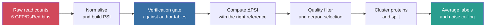
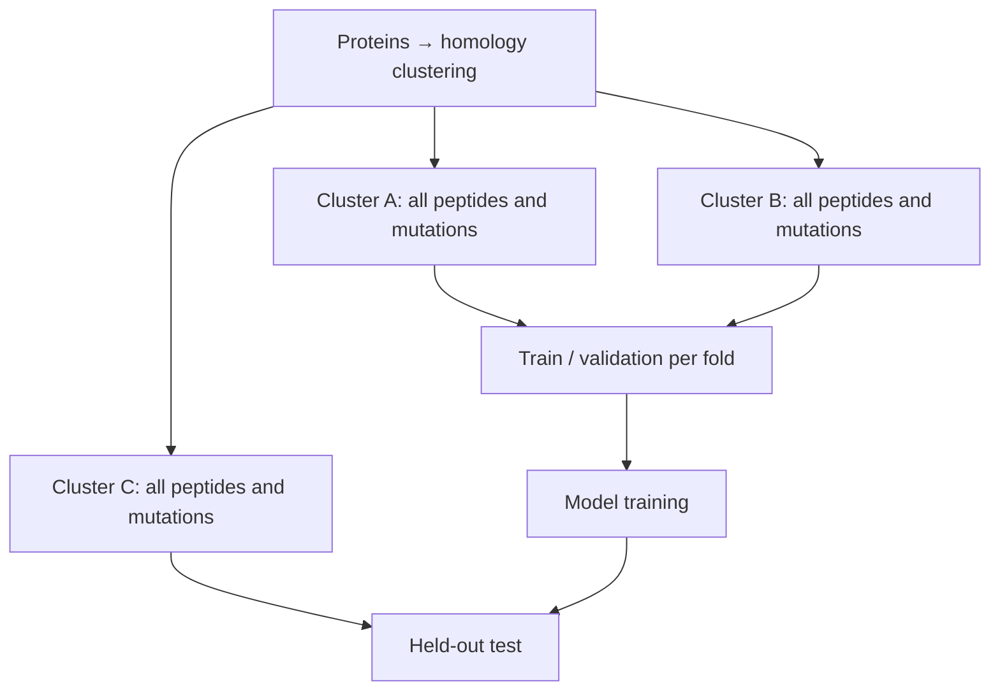
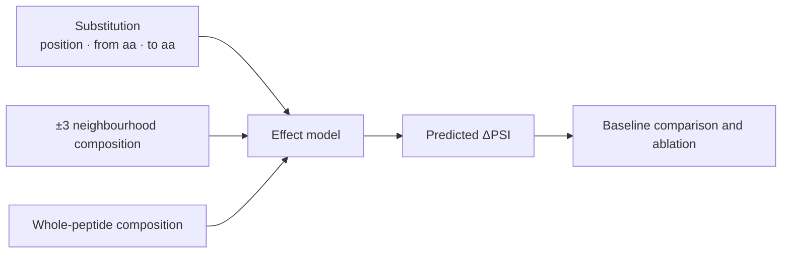
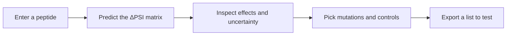

# The seven English subpages — repository source

> Repository source for the **seven subpages** of the
> [English main page](https://app.notion.com/p/3fe486d98ebc811eba29eb9e0987a0e1). URLs: see
> [README.md](README.md). Image paths are **repository paths**. This file records **no decisions** —
> see [DECISIONS.md](../../../../../DECISIONS.md).
>
> English counterpart of [../content-subpages.md](../content-subpages.md). The two do not sync
> automatically.

---
---

# SUBPAGE 1 — Biological background and the three levels of question

🧫 Detail page for **Section 1**: enough biology for a listener outside the field to follow the
computational problem, and the reason the problem must go down to the **residue level**.

## Protein, residue, and a point mutation

A **protein** is a chain of amino acids that contributes to structure, catalysis and regulation in
the cell. An amino acid inside the chain is called a **residue**. Changing one residue means changing
one letter of the chain — that is exactly the **single amino acid substitution** whose effect this
thesis predicts.

## Protein level is a balance, not a one-way street

Protein level is set by **both synthesis and degradation**. To understand how a cell adjusts protein
level, the degradation branch has to be understood as well — the branch usually skipped when only
gene expression is considered.

## The degradation branch is addressed: the ubiquitin–proteasome system

Degradation is selective: an **E3 ligase** recognises the target protein → **ubiquitin** is attached
→ the **proteasome** degrades it. Humans encode **more than 600** E3 ligases, while the number of
characterised degrons is still small — which is why high-throughput screens keep expanding the
degron catalogue.

A **degron** is a sequence element that sends a protein for degradation. The natural next question:
inside that element, **which residue carries the signal**?

## Three distinct levels of question

| Level | What it answers | State of existing tools |
|---|---|---|
| **Whole segment** | Does this peptide promote degradation? | Usable tools exist at proteome scale |
| **Position** | Which positions in the segment are sensitive to change? | Inferred indirectly; not a training target |
| **Substitution** | At that position, which replacement amino acid produces which effect? | **The level this thesis targets** |

Concluding "this segment is a degron" does **not** say which residue to change, or to what, for the
signal to get stronger or weaker. Locating a degron is therefore a **starting point, not a
destination**.

## Why not simply measure everything

A 28-residue peptide has $28 \times 19 = 532$ single substitutions, and every new peptide creates
another such candidate set. A model is useful **if** it ranks the unmeasured cases so that the
researcher can pick what to test first.

Illustrative example — hypothetical, not measured values

A 28-residue peptide has been shown to have degron activity; the researcher wants a **weaker**
version to test the role of the signal.

- A change at **position 7** might make the reporter more stable.
- A change at **position 19** might have almost no effect.
- Even at position 7, **two different replacement amino acids** can produce different effects.

➡️ The unit the researcher actually has to choose is **one specific substitution**: which position,
from which amino acid to which.

## Two 2025 reviews that point in slightly different directions

Citing both is the honest option:

- [Zhang et al. 2025, *Nat Rev Mol Cell Biol*](https://doi.org/10.1038/s41580-025-00870-z) ·
  high-throughput screening keeps increasing the number of degrons defined at high resolution.
- [Wang & Zheng 2025, *Nat Chem Biol*](https://doi.org/10.1038/s41589-025-02056-2) · many degrons
  are **not** short linear motifs ⇒ a 28-mer window has limited scope, and that limitation is
  **shared with the assay the labels come from**.

📏 **Scope.** The thesis concerns **autonomous degrons** in a reporter assay and **germline**
variants. Degrons that need priming (for example phosphorylation) or several motifs are **outside the
assay's reach** — measured, not assumed. Cancer examples are not used as the entry point.

---
---

# SUBPAGE 2 — Related work, study by study

📚 Detail page for **Section 2**. Selection rule: every study is here because of **one concrete
role** — label source, baseline, precedent, or evaluation convention. Work that is merely topically
related is left out.

## 2.1 · Label sources — the data the thesis actually learns from

| Study | Role | What to say |
|---|---|---|
| **Koren et al. 2018** (*Cell*) | Foundation of the measurement | Established the **GPS peptidome** screen: peptides fused to a reporter, sorted by stability. Every later label comes from this design |
| [**Zhang et al. 2023** (*Mol Cell*)](https://doi.org/10.1016/j.molcel.2023.08.022) | **Primary label source** | Added **mutations** on top of the screen: a **scanning** set (one substitution per position) and a **saturation** set (all 20 amino acids per position). First large-scale measured mutation-effect label set ⇒ the problem only became answerable **after 2023** |
| [**Voutsinos et al. 2026 — PAP** (*Sci Adv*)](https://doi.org/10.1126/sciadv.adz3483) | **Main baseline** + benchmark population | Near-complete map of cytosolic degrons: **>200,000** 30-residue tiles from **>5,000** proteins; PAP (a two-channel CNN) reaches Pearson 0.82/0.87 on held-out tiles. The thesis uses **ΔPAP** — the score difference before/after mutation — as the control |
| [**Larsen et al. 2025**](https://doi.org/10.5281/zenodo.20490355) (**preprint**) | Assay-transfer test at tile level | Extends to **1,626** transcription factors with precomputed PAP/rASA/pLDDT. ⚠ **Not** an unseen-sequence test: **1,583/1,626 (97.4%)** of those TFs already appear in the GPS peptidome |

## 2.2 · The closest precedent — must be addressed directly

| Work | What to say |
|---|---|
| [**Degformer**](https://github.com/Alpine2048/Degformer) (GitHub, **no paper**) | A transformer trained on Zhang's tables that **already outputs a 28×20 ΔPSI matrix** — the most direct precedent. Self-reported correlation 0.9162–0.9463 (**self-reported**). Three things measured here: its random split contains **4.09%** exact sequence leakage; the prediction head reads only the **CLS token**, so the matrix is assembled from 532 forward passes rather than produced by a residue-level head; and the **blind set is absent from the repository**, so the headline number cannot be reproduced |
| **Zhang SVM 2023** | The authors' own model, predicting **peptide-level** PSI with Pearson **0.8955** across 260,989 peptides ⇒ the peptide level is already strong, so the open gap is the **residue level** |

## 2.3 · Evaluation conventions the thesis borrows — and must credit

| Work | What is borrowed |
|---|---|
| [**LeBlanc et al. 2026** (*Cell Systems*)](https://doi.org/10.1016/j.cels.2026.101701) | Three practices: reporting **coefficient stability** across seeds/bootstraps · comparing against a **replicate noise ceiling** · **splitting by protein cluster**. When used they must be cited as "following LeBlanc et al. 2026", **not** presented as this thesis's own design choice |
| [**Schulze & Lindorff-Larsen 2026** (*eLife*)](https://doi.org/10.7554/eLife.103721) | How strong a simple structural baseline already is: a substitution matrix conditioned only on **buried/exposed** state predicts abundance well; **rASA alone gives Spearman 0.45** ⇒ any residue-level claim must beat a simple baseline |
| **AlphaMissense 2023** (*Science*) | A **different** question: is a variant pathogenic. This thesis **adds mechanism**, it does not replace that |

## 2.4 · Degron-locating tools — stated briefly

**Degpred 2022 · DegronMD 2023 · DEGRONOPEDIA 2024 · MetaDegron 2024.** These brought degron
recognition to proteome scale with working web tools — they are the state of the art for *"where is
the degron in my protein"*. But their labels are **curated motifs** (a few hundred instances, with
negatives often drawn from random peptides), and the prediction unit is a **motif or region** ⇒ they
cannot rank residues inside it.

🏷️ **Evidence level.** Degpred is **[UNVERIFIED]** (search summaries only); DEGRONOPEDIA,
MetaDegron and DegronMD are **[SOURCE]** (original pages read). So the wording is *"does not
report…"* / *"negatives are typically random peptides"*, **never** "they leak data" or "their numbers
are inflated".

🚫 **Do not say "nobody has done this".** Degformer **has** produced the 28×20 matrix. The correct
form is: *"a PubMed and Europe PMC search on 15 Oct 2026 found no 2025–2026 degron prediction tool
beyond the list above; among the 19 papers citing Larsen 2025 and Voutsinos 2026, none is a
residue-level footprint model."*

---
---

# SUBPAGE 3 — Urgency, the demonstrable gap, and the user groups

🎯 Detail page for **Section 3**, in three steps: **why it is worth doing** → **why the gap is real**
→ **who uses the result**.

## 3.1 · Why it is worth doing — a number, not an assertion

- Protein regions measured to be degrons are **2.148× enriched for pathogenic over benign variants**
  (95% CI [2.072, 2.227]), Mantel–Haenszel **stratified by protein**, 3,114 informative strata ⇒
  **not** an artefact of ClinVar concentrating on disease genes.
- **530,412 variants of uncertain significance (VUS)** fall inside measured degron regions, with no
  mechanism assigned to them — specifically inside the **116,702** degron tiles of the GPS peptidome.

Both figures are measured on the [ClinVar](https://www.ncbi.nlm.nih.gov/clinvar/) `variant_summary`
release of 12 Oct 2026 (**2,564,486** deduplicated missense variants, of which **2,349,511 — 93.0%**
match the UniProt wild-type amino acid), intersected with the degron regions of
[Zhang et al. 2023](https://doi.org/10.1016/j.molcel.2023.08.022) measured in the
[GPS peptidome, GEO GSE240610](https://www.ncbi.nlm.nih.gov/geo/query/acc.cgi?acc=GSE240610). Full
numbers and method: `research/variant-coverage-2026-10-15/` in the CT553H repository.

⚠ **Three qualifications that must travel with 2.148**

1. This is a **REGION-level** claim. At the **residue level** it is **not established**: three
   independent tests are all consistent with the null (strongest stratum `scan_pos`, 695 pathogenic
   / 929 benign variants across 620 clusters, AUC **0.5166**, CI [0.479, 0.554];
   `research/variant-coverage-2026-10-15/`).
2. There is **no positional** enrichment (33.4% vs 32.4% at the PSI ≤ 3.0 threshold) ⇒ degrons must
   **not** be called "variant hotspots". Moreover, the PSI ≤ 3.0 threshold labels **32.4% of all
   proteome tiles** as degrons, so "the variant lies in a degron" carries almost no information.
3. **Conservation and disorder have not been controlled for.** If 2.148 disappears after
   controlling, it only says "degrons sit in functional regions".

[ClinVar](https://www.ncbi.nlm.nih.gov/clinvar/) · cite PMID 29165669 · **not for diagnostic use**,
and **not** a validation target for the model.

## 3.2 · Why the gap is demonstrable

| What is missing | Current status |
|---|---|
| A model **trained on a residue-level objective** | Published degron models are trained on whole-segment scores; applying them per residue is **use outside their design** |
| **The current model class cannot localise** | Measured here on the published [PAP](https://doi.org/10.1126/sciadv.adz3483) code (`KULL-Centre/_2025_Voutsinos_degron_cytosol` @ `9b3eafa6`, MIT): the `cnn2w1` inner channel pools globally after a width-1 convolution ⇒ **permutation invariant** — reversing residue order leaves the score unchanged (max absolute difference 4.8 × 10⁻⁷, Pearson **1.000000**). Audit: `research/voutsinos-2026-audit/` |
| **Evaluation conditions** for a residue-level claim | The closest precedent ([Degformer](https://github.com/Alpine2048/Degformer), Apache-2.0, no paper) uses a random split with measurable leakage — **4.09%** exact sequence duplication, and **88.12%** of our test cells plus **91/91** WT peptides inside its training data — and reports **no** label ceiling and **no** per-prediction uncertainty. Measured in `research/g2-extension-2026-10-18/` |
| A **measurement noise ceiling** attached to every number | Measured here from the two [Zhang et al. 2023](https://data.mendeley.com/datasets/32h94v2yv2/2) replicates: cell-level ceiling **0.9458** (scanning, replicate 1 scoring replicate 2) / **0.9519** (saturation, half A scoring half B); agreement between replicates on the *residue set* forming the footprint is only Jaccard **0.4965**. Report: `research/residue-task-derisk-2026-10-15/` |

## 3.3 · User groups — three groups, one concrete thing each

| Group | What they get | The limit stated alongside |
|---|---|---|
| **Experimental biologists** designing degron mutations (primary) | A **prioritisation tool**: "try these three residues first", with uncertainty; plus ready-made low-effect cells as **controls** | Call it a **prioritisation tool**, not a decision tool — residue-level Jaccard is 0.4965. **Experiment savings have not been directly validated** |
| **Variant interpretation** (530,412 VUS in degron regions) | A **mechanistic hypothesis** complementing pathogenicity scores such as [AlphaMissense 2023](https://doi.org/10.1126/science.adg7492): does this substitution make the peptide more or less stable, and roughly by how much | It is a **hypothesis**, **not** an explanation of "why the variant is pathogenic" — the residue → disease link is not established |
| **Computational / ML research** | A **reference task** with a measurement ceiling, honest baselines and homology-controlled splits — clusters built with [MMseqs2](https://doi.org/10.1038/nbt.3988) at ≥30% identity / 80% coverage, following the conventions of [LeBlanc et al. 2026](https://doi.org/10.1016/j.cels.2026.101701) | — |

🚫 PROTAC / molecular glue has been **removed** from the user list; do not add it back. And do not
treat "we output a matrix" as the novelty claim — the gap is in the **evaluation conditions**, not in
the task.

## 3.4 · Sources behind every number on this page

Each row gives the **external source** (study, dataset, release) and the **internal report** in the
CT553H repository that holds the computation and the reproduction command. Numbers marked *measured
here* are our own measurements on the external data, not values quoted from the papers.

| Claim on this page | External source | Internal report |
|---|---|---|
| Odds ratio **2.148** [2.072, 2.227], MH by protein, 3,114 / 13,561 strata · cluster-stratified **2.094** [2.024, 2.167] | [ClinVar](https://www.ncbi.nlm.nih.gov/clinvar/) `variant_summary`, release of 12 Oct 2026 (NCBI FTP, SHA-256 recorded) × degron regions of [Zhang et al. 2023](https://doi.org/10.1016/j.molcel.2023.08.022) / [GEO GSE240610](https://www.ncbi.nlm.nih.gov/geo/query/acc.cgi?acc=GSE240610) | [variant-coverage-2026-10-15](../../../research/variant-coverage-2026-10-15/README.md) · provenance in [data/raw/clinvar/SOURCE.md](../../../data/raw/clinvar/SOURCE.md) |
| **2,564,486** missense variants · **93.0%** UniProt wild-type match | Same ClinVar release; reference sequences from [UniProtKB/Swiss-Prot](https://www.uniprot.org/) human `2026_03` | [variant-coverage-2026-10-15](../../../research/variant-coverage-2026-10-15/README.md) |
| **530,412** VUS inside **116,702** degron tiles across **17,287** proteins | ClinVar × GPS peptidome ([GEO GSE240610](https://www.ncbi.nlm.nih.gov/geo/query/acc.cgi?acc=GSE240610)) at the PSI ≤ 3.0 threshold | [variant-coverage-2026-10-15](../../../research/variant-coverage-2026-10-15/README.md) |
| Residue level **not established**: AUC **0.5166** [0.479, 0.554] on `scan_pos` (695 / 929 variants, 620 clusters); two further strata also null | ClinVar × the mutation sets of [Zhang et al. 2023](https://data.mendeley.com/datasets/32h94v2yv2/2) (Mendeley `10.17632/32h94v2yv2.2`, CC BY 4.0) | [variant-coverage-2026-10-15](../../../research/variant-coverage-2026-10-15/README.md) |
| No positional enrichment: **33.4%** vs **32.4%**; PSI ≤ 3.0 calls **32.4%** of proteome tiles degrons | GPS peptidome tiles ([GEO GSE240610](https://www.ncbi.nlm.nih.gov/geo/query/acc.cgi?acc=GSE240610)) | [variant-coverage-2026-10-15](../../../research/variant-coverage-2026-10-15/README.md) |
| PAP is **permutation invariant** (Pearson **1.000000**, max absolute difference 4.8 × 10⁻⁷) | [Voutsinos et al. 2026, *Sci Adv*](https://doi.org/10.1126/sciadv.adz3483); code and weights `KULL-Centre/_2025_Voutsinos_degron_cytosol` @ `9b3eafa6` (MIT) | [voutsinos-2026-audit](../../../research/voutsinos-2026-audit/README.md) |
| Degformer: **4.09%** exact sequence leakage in its own split; **88.12%** test-cell overlap; **91/91** WT peptides in its training data; blind set absent from the repository | [Degformer](https://github.com/Alpine2048/Degformer) (Apache-2.0, no paper; checkpoints shipped as pickles) | [g2-extension-2026-10-18](../../../research/g2-extension-2026-10-18/README.md) · [g2-saturation-2026-10-18](../../../research/g2-saturation-2026-10-18/README.md) |
| Measurement ceilings **0.9458** / **0.9519** and footprint Jaccard **0.4965** | The two replicates of [Zhang et al. 2023](https://data.mendeley.com/datasets/32h94v2yv2/2), rebuilt from the raw counts in [GEO GSE240610](https://www.ncbi.nlm.nih.gov/geo/query/acc.cgi?acc=GSE240610) | [residue-task-derisk-2026-10-15](../../../research/residue-task-derisk-2026-10-15/README.md) (`ceiling.json`) · [pap-baseline](../../../research/pap-baseline/README.md) |
| Published degron models are trained on whole-segment scores | [PAP](https://doi.org/10.1126/sciadv.adz3483) · Zhang SVM 2023 · [DEGRONOPEDIA](https://degronopedia.com/) · MetaDegron · DegronMD · Degpred | [topic-report](../../../research/topic-report/) · [prior art notes](../../../research/larsen-nuclear-and-risks-2026-10-15/notes/04-prior-art-and-novelty.md) |
| Cluster-controlled splits and the noise-ceiling convention | [LeBlanc et al. 2026, *Cell Systems*](https://doi.org/10.1016/j.cels.2026.101701) · [MMseqs2](https://doi.org/10.1038/nbt.3988) · simple-baseline warning from [Schulze & Lindorff-Larsen 2026, *eLife*](https://doi.org/10.7554/eLife.103721) | [residue-task-derisk-2026-10-15](../../../research/residue-task-derisk-2026-10-15/README.md) · [full-data-audit](../../../research/full-data-audit/README.md) |

⚖️ **Attribution and licence notes.** ClinVar requires attribution (PMID **29165669**) and its data
must **not** be used for diagnostic purposes — that disclaimer travels with any output derived from
it. Zhang et al. 2023 data is **CC BY 4.0** (Mendeley) under GEO terms for the raw counts; the
Voutsinos and Larsen repositories are **MIT**, while the Voutsinos paper is **CC BY-NC 4.0** and the
Larsen preprint **CC BY-NC-ND**; Degformer is **Apache-2.0**. ⚠ Its checkpoints are **pickles** —
loading one executes arbitrary code, so it runs in an isolated directory with `python3 -I`.

---
---

# SUBPAGE 4 — The task, PSI and ΔPSI

📐 Detail page for **Section 4**: the input/output statement, the two definitions that must be given
before they are used, and the full shape of the output.

## In one sentence

> Given a peptide with degron activity and one amino acid substitution, **predict how much that
> substitution changes the stability of the reporter.**

## Input and output

- **Input:** the reference peptide (28 residues) plus a substitution specified by **position**,
  **original amino acid** and **new amino acid**.
- **Output:** the predicted effect of that substitution, expressed as **ΔPSI**.

## Two definitions to state before use

- **Reporter:** the peptide is fused to a fluorescent protein in order to **track stability**. The
  experiment measures the stability of the reporter + peptide construct, **not** of the intact
  protein.
- **PSI (Protein Stability Index):** the reporter's stability score on a **1…6** scale, computed from
  read counts across 6 stability bins:

$$
PSI=\frac{\sum_{i=1}^{6} i \times nb_i}{\sum_{i=1}^{6} nb_i}
$$

🔄 **Low PSI = degraded quickly = strong degron.** This is the direction most easily read backwards,
so state it once explicitly before using it.

## The label

$$
\Delta PSI = PSI_{\text{mutant}} - PSI_{\text{reference}}
$$

**Positive ΔPSI** = the mutant reporter is **more stable**, consistent with the mutation
**weakening** degron activity under assay conditions. Negative ΔPSI is the opposite.

⚠ ΔPSI is **not** a pathogenicity probability and **not** a change in the half-life of the intact
protein.

## The full shape of the output

Scoring every substitution of a peptide gives a **28 positions × 19 replacement amino acids** matrix.
Each cell maps directly to **one mutation that can be built and measured**. Aggregating down columns
gives a **positional sensitivity map** (footprint), but **the aggregation rule must be stated**, and
a positional map is **no substitute** for the effect of a specific substitution.

How is a single cell read?

The 28 × 19 matrix holds the **actual** substitutions; an interface that also keeps the reference
amino acid displays 28 × 20, but an unchanged cell is **not** a new mutation.

**Hypothetical example:** at position 7, replacing with A gives ΔPSI = +1.0 while replacing with G
gives +0.1 — two different priorities, but both must be read together with their uncertainty.
ΔPSI = +1.0 only means the PSI score rises by one unit relative to the reference.

## What is explicitly **not** part of the task

No prediction of: **which E3 ligase** recognises the degron · the effect on the **intact protein** in
cells · **pathogenicity** · **conditional** degrons (requiring phosphorylation or several motifs) —
these are **outside the assay's reach**, which is measured rather than assumed.

---
---

# SUBPAGE 5 — Data and processing pipeline

🧪 Detail page for **Sections 5 and 6**. Two messages: the data is **downloaded, checksummed and
licence-checked** (~2.3 GB, SHA-256 for every file); and the labels are **rebuilt from raw read
counts** through a **numeric verification gate**, not taken as published tables.

## 5.1 · Seven sources and the role of each

| Source | Pinned at | Licence | Role |
|---|---|---|---|
| [**Zhang 2023** — scanning + saturation](https://data.mendeley.com/datasets/32h94v2yv2/2) | Mendeley `10.17632/32h94v2yv2.2` (v2), all 5 files | **CC BY 4.0** | **Primary labels** — measured mutation effects |
| [**Zhang 2023** — GPS peptidome PSI tables](https://www.ncbi.nlm.nih.gov/geo/query/acc.cgi?acc=GSE240610) | GEO `GSE240610` | GEO terms | Peptide-level context; **application domain** (116,702 degron tiles) |
| [**Voutsinos 2026** — tile library + PAP](https://doi.org/10.1126/sciadv.adz3483) | GitHub `KULL-Centre/_2025_Voutsinos_degron_cytosol` @ `9b3eafa6` | **MIT** | **Baseline** + benchmark population |
| **MaveDB** — 26 score sets, 9 genes | API, URNs recorded | **CC0** | Transfer check towards intact proteins |
| [**Larsen 2025** — TF tile library](https://doi.org/10.5281/zenodo.20490355) | GitHub `KULL-Centre/_2025_Larsen_…` @ tag `v1.0` | **MIT** (data files) | Assay / compartment transfer test at **tile level** |
| [UniProtKB/Swiss-Prot](https://www.uniprot.org/) human `2026_03` · AlphaFold DB v6 (8 structures) | REST, pinned snapshot | CC BY 4.0 | Wild-type sequences; structural context |
| [**ClinVar** `variant_summary`](https://www.ncbi.nlm.nih.gov/clinvar/) (2.56 M missense) | NCBI FTP, 12 Oct 2026 file, SHA-256 recorded | **Attribution required** (PMID 29165669); not for diagnostic use | **Motivation only** — not a validation target |

⚖️ **A paper's licence and its data's licence can differ:** Larsen 2025 is CC BY-NC-ND as a preprint,
while the tile-level data files are MIT in the authors' GitHub repository. ⚠ **MIT is nominally a
software licence**; an email asking the authors to confirm that MIT covers the data files **has been
sent and is awaiting reply** ([C-11a](../../../../../DECISIONS.md#c-11a)).

## 5.2 · Two label sets — two different roles, not interchangeable

| | **Scanning** | **Saturation** |
|---|---|---|
| Design | **One** substitution per position, nearly all **→R** | **All 20** amino acids at each of the 28 positions — a full matrix |
| Degron peptides (PSI_WT ≤ 3.0) | **2,994** | **91** |
| Protein clusters | **1,985** | **89** |
| Scored cells | **83,446** | **47,847** |
| Measurement ceiling (cell-level AUROC) | **0.9458** | **0.9519** |
| Replicate agreement | Residue set, Jaccard **0.4965** | PSI **0.9544**; ΔPSI **0.8335**; noise **16.7%** of variance |
| Role | **Sample size and the context axis** | **The 19-substitution matrix**, and cross-label-source checks |

⚠ **A sentence to drop:** *"n = 91 is the sample size of the residue-level work"* — **wrong**. The
scanning set is **also** measured mutation-effect data and is much larger (1,985 clusters vs 89).
n = 91 is only the sample size of the **19-substitution matrix** part. What remains true: **tile-level**
labels (Voutsinos, Larsen) **cannot** support a residue-level claim — but the **scanning set can**.

## 5.3 · Dataset risks — stated before being asked

- **Both residue-level label sources come from one author group (Zhang 2023).** The risk is **open**
  and there is currently **no replacement candidate**: a candidate would need a **stability**
  readout, on **autonomous degrons**, from a **different author group**, with **residue-level**
  labels. None found ⇒ this belongs in the limitations section of the proposal.
- The saturation set has **no separate wild-type measurement**: synonymous cells (codon changed,
  protein unchanged) serve as the **internal WT**, 28 cells per peptide, median within-peptide PSI SD
  0.0576.
- The **BAG6-WT** condition is a **different condition**, not a third replicate ⇒ **never pooled**.

## 6 · Processing — one reason and one measured result per step

Three tiers: `raw/` (never edited, checksummed) → `interim/` (unpacked, clustered) → `processed/`
(script output). Every derived file is **regenerable by script**.

| Step | Why | Measured result |
|---|---|---|
| 1 · Read per-bin counts (6 bins, one file set per condition) | Published PSI tables exist for **one** replicate only ⇒ a noise ceiling requires rebuilding them | All **5 conditions** read |
| 2 · Normalise `nbᵢ = bᵢ × factorᵢ`, bin 1 as reference | Sequencing depth differs between bins | Per-condition factors written to file |
| 3 · Compute PSI for every construct | This is the label definition | PSI built for **261,868 / 261,999 / 264,036 / 134,608 / 134,563** ids |
| 4 · **Verification gate:** compare rebuilt replicate-1 PSI with the authors' table | A wrong rebuild corrupts everything downstream; the gate blocks before anything is written | **Maximum deviation 5.0 × 10⁻⁷ across 261,865 values** ⇒ the same code can rebuild the conditions for which the authors published **no** PSI table, including the **second replicate** — which is what makes the noise ceiling computable |
| 5 · Compute ΔPSI against the appropriate reference | A variant's PSI does not by itself isolate the mutation's effect | Scanning uses `mut0`; saturation uses the **median of cells retaining the reference amino acid** |
| 6 · Quality filter and degron selection | Not every peptide is a degron, and shallow cells are noisy | Funnel: **8,831** scanning peptides → degrons at `PSI_WT ≤ 3.0`: **3,439** → with a footprint: **2,624**; saturation **235** matrices → **91**. Scanning depth filter `sum ≥ 10` |
| 7 · Decode identifiers → wild-type sequence | The WT sequence is needed both to compute ΔPSI and to embed | The tile rule (tile *n* starts at residue (*n*−1)×23 + 1, length 28) **verified on 128/130** peptides with known sequence; the **2** mismatches were dropped |
| 8 · Cluster with **MMseqs2** (≥30% identity, 80% coverage) and split **by cluster** | Homologous peptides on both sides inflate scores; ignoring nesting pushes the false-positive rate above **45%** at a nominal 5% | **5,088 clusters** over 6,573 proteins. **130** peptides occur in both sets ⇒ forced to the **same side**. **61/89** saturation clusters also occur in the scanning set ⇒ overlapping clusters are **removed from training** in every cross-source evaluation |
| 9 · Labels = **mean of two replicates**, plus the label ceiling | Labels are not exact; results must be read with the data's own uncertainty | Measurement ceiling **0.9458** / **0.9519**; noise accounts for **16.7%** of ΔPSI variance |

*One fold, illustrated: cells from the same cluster are never split across sides. Clusters A/B/C are
illustrative labels.*

Two side findings — evidence the data was read line by line

- **Three constructs are mis-scored in the authors' published table** because of a header error: two
  with `Sum = 0 / PSI = NA` despite having reads, one with PSI off by 0.62. Fixed.
- The trailing `*` character (**813** 27-aa peptides, tiles reaching the C-terminus) **must be
  masked**, not embedded as a 21st token — a measured weakness of Degformer.

Record format

`processed/psi-*.tsv`, one row per construct: `id` (of the form
`⟨ACCESSION⟩_⟨GENE⟩_⟨tile⟩_mut⟨pos⟩⟨aa⟩`, e.g. `A2RUQ5_C17orf102_2_mut10a`) · `psi` (float 1…6,
**low = strong degron**) · `sum` (normalised depth, used for filtering) · `nb1…nb6` (normalised reads
in the 6 bins).

Why many cells still mean few independent samples

Substitutions of the same peptide share the reference sequence and many measurement conditions. The
saturation set has 47,847 cells but only **91 peptides in 89 clusters** — both scales must be read.
Error at the reference baseline also propagates to **many cells of the same peptide**, so inference
has to account for the group structure, not just the total cell count.

---
---

# SUBPAGE 6 — Method, controls and current results

📊 Detail page for **Section 7**. Every number is **measured here**, reconciled against
`research/g2-saturation-2026-10-18/` and `research/g2-extension-2026-10-18/`. ⚠ This is a
**development benchmark**, not an external validation.

## 6.1 · Motivation — at which scale does the predictive information sit?

The question guiding the design is **not** *"composition or position?"* but ***"composition at which
scale?"*** The decomposition was measured:

| Where the information sits | Contribution to the +0.0289 gain |
|---|---|
| Whole-peptide composition | *baseline* |
| **Composition in the ±3 neighbourhood** | **+0.0232 — 80% of the gain** |
| Order within that neighbourhood | +0.0057 |
| **Absolute position in the peptide** | **+0.0002 — essentially nothing** |

⚠ The correct statement is: *"composition at the **±3 neighbourhood scale** beats composition at the
**whole-peptide scale**"*. **Do not** say "position beats composition".

*The information sources under test; this does not describe a new architecture that has met the bar.*

## 6.2 · Three pieces of the approach, in order

1. **Separate the information into three blocks and use ablation** to identify which block actually
   helps: the substitution · **±3 neighbourhood** composition · **whole-peptide** composition.
2. **Find an architectural component with a stable benefit** — tested against a strong baseline, by
   ablation, across seeds. This is where **novelty** would live, and it is the **main open cell**.
3. **Exploit bag-level labels (weak supervision)** — use **whole-peptide** labels (260k peptides /
   212k tiles) to support a residue-level output. Segment-level labels do not directly point at the
   important position, so localisation **must still be checked on residue-level labels**. ⚠ No
   concrete design has been shown to work yet.

## 6.3 · Evaluation design — the non-negotiable part

| | |
|---|---|
| **Metric** | **Cell-level** AUROC, macro-averaged **by peptide** |
| **Design** | 5 outer folds by **cov80** cluster, inner validation also by cov80; **3 seeds** |
| **Scale** | 91 peptides / 89 clusters / 47,847 cells |
| **Statistics** | Paired **by peptide**, bootstrapped **by cluster**; every number printed with the **measurement ceiling** |
| **Detection threshold** | MDE **0.0123** for the M3 − M0 pair under the current paired design — ⚠ **not** a general acceptance threshold for future ablations |
| **Credit** | Three conventions borrowed from **LeBlanc et al. 2026**: coefficient stability across seeds · comparison with the noise ceiling · cluster-based splits |

## 6.4 · Current results

![Cell-level AUROC on the saturation matrix, macro-averaged by peptide. Ridge M3 trained directly reaches 0.8082 against ΔPAP 0.7693 (+0.0389; 95% CI [0.0216, 0.0571]). The 0.9519 line is the **measurement ceiling** of the assay. The axis starts at 0.70. Measured here.](../../notion-2026-10-19/png/fig-benchmark.png)

| Model | Cell-level AUROC | Notes | Pre-registered? |
|---|---|---|---|
| Assay measurement ceiling | **0.9519** | One replicate half scoring the other — **not** a level learnable from sequence | — |
| **Ridge M3 (current)** | **0.8082** | Trained directly on saturation; beats ΔPAP by +0.0389, 95% CI [0.0216, 0.0571]. Still positive on the Degformer non-overlapping subset (+0.0509) | — |
| Sigmoid gate | −0.0080 vs ridge | Loses | — |
| FiLM | 0.8028 | Loses to ridge on all three seeds | Yes |
| Bilinear | 0.7933 | Loses to ridge on all three seeds | Yes |
| Cross-product ridge | 0.7924 | Loses to ridge on all three seeds | Yes |
| **ΔPAP cnn2w1 — the target to beat** | **0.7693** | Published control | — |
| Transfer from the other label source (M3) | 0.7273 | Reported **separately** because the label budget differs | — |
| Degformer architecture retrained under cov80 | 0.7500 | −0.0582 vs ridge and −0.0193 vs **ΔPAP**; 5/5 folds peak at epoch 2, so this is not undertraining; one seed | — |

⚠ **A mandatory caveat whenever the win over ΔPAP is quoted:** ΔPAP was trained for **30-mer tile
abundance**, so beating it is **not** beating a model trained for this task. The evidence for this
caveat is weak: the composition-only M0 baseline **ties** ΔPAP `cnn2w7` (+0.0008, CI
[−0.0057, 0.0074]).

## 6.5 · Degformer: why its score cannot be read at face value

- **88.12%** of test cells overlap Degformer's training data, and **91/91 WT peptides** are in its
  training set ⇒ the leakage is at the **peptide level**.
- Removing every overlapping cell, it **still reaches 0.9227** ⇒ exact cell overlap **does not**
  explain the gap.
- But that architecture **trained from scratch** under cov80 reaches only **0.7500** ⇒ its strength
  lies in **569,270 rows of pre-training**, not in the architecture. This is what supports the "more
  labels" direction.

🔒 ⚠ **Safety when running Degformer.** The repository checkpoint is a **pickle**
(`torch.load(..., weights_only=False)` with a `StandardScaler`) ⇒ loading it **executes arbitrary
code**. Keep it in its own empty directory, keep your own scripts elsewhere, run with `python3 -I`.

## 6.6 · Honest status, and three misreadings

| Achieved | Still open |
|---|---|
| Trained directly on saturation: ridge M3 **0.8082** vs ΔPAP **0.7693** ⇒ **+0.0389**, 95% CI [0.0216, 0.0571] | **An architectural component with a stable benefit.** **Five** higher-capacity models have been ruled out against ridge M3, three of them **pre-registered** before the run |

🚫 **Three misreadings to avoid.**

1. **Do not** treat the span from 0.8082 to 0.9519 as "headroom for improvement" — 0.9519 is the
   **measurement ceiling of the assay**.
2. **Do not** treat one local positive result as **completing G2** — the architectural condition is
   still open.
3. **Do not** compare Degformer with ridge as if the two numbers were obtained under the same
   conditions — their **label budgets differ**.

**Stated plainly:** five higher-capacity models all lose, **all in the same direction** ⇒ the current
reading is that the bottleneck is **label quantity**, not model capacity; but that cause has **not**
been isolated by a controlled experiment. **G2 is not complete**: the numeric target has been passed
and holds, while the architectural condition is **further away rather than closer**. The proposal to
shift focus to "measure the label-quantity curve first" is **awaiting confirmation**
([C-20](../../../../../DECISIONS.md#c-20)), not a settled direction.

## 6.7 · Four checks any method component must pass

1. Comparison with **ridge M3** and **ΔPAP** under the same label regime and split.
2. Removal or replacement of the component by **ablation**, to measure its own contribution.
3. **Stability across seeds**, reporting paired differences with cluster-level uncertainty.
4. Comparison with precedent, to establish what is **genuinely new**.

---
---

# SUBPAGE 7 — Product: features, comparison and application domain

🛠️ Detail page for **Section 8**. ⚠ **Status: the software has not been built.** Everything below is
**design**; on a slide it must carry the label `[proposed, not built]`.

## 7.1 · Why the software is a contribution rather than a wrapper

The bottleneck of this problem is **not** accuracy but **measurement noise** — three numbers measured
here:

- **75.9%** of the residual after a composition oracle is **measurement noise**;
- replicate agreement on the *residue set* forming the footprint: Jaccard **0.4965**;
- measurement ceiling **0.9458** (scanning) · **0.9519** (saturation).

⇒ A tool that returns **one confident answer** misrepresents the data. The useful output is a
prediction **with uncertainty, stated relative to what the assay itself can resolve**.

## 7.2 · Two components

**(a) A prediction service with uncertainty** — the **pillar**. **(b) A reproducible evaluation
harness** — turning the comparison in Section 7 into a **command that can be re-run** instead of a
table that has to be trusted.

## 7.3 · Core features, and who each one serves

| Feature | Content | Which group it serves |
|---|---|---|
| **28 × 19 ΔPSI matrix + positional map** | For a 28-residue peptide or a window on a protein | Experimental biologists: all 532 options in one figure |
| **Per-cell uncertainty**, shown **next to the measurement ceiling** | Calibrated; displayed together with the ceiling | All three groups — the largest difference from existing tools |
| **Scoring of arbitrary mutations** | The user enters a specific substitution rather than looking up a precomputed table | Variant interpretation: they arrive with **one** variant, not a peptide |
| **Export of a prioritised list + controls** | High-effect cells to test first; low-effect cells as negative controls | Experimental biologists — the primary **reason to use it** |
| **API** | Programmatic access alongside the web interface | Computational / ML research: batch scoring |
| **Out-of-distribution (OOD) flag** | Warns when a query falls into a **protein cluster unseen in training** | All groups — supported by the numbers in 7.5 |
| **Compartment flag** | Labels are **cytosolic**; nuclear or secreted contexts are flagged | Variant interpretation, to avoid use outside the label domain |
| **Label provenance** | Every **measured** cell shows its source and per-replicate values | All groups — separating "measured" from "predicted" |

⚠ The service does **not** emit pathogenicity classifications. If ClinVar classifications are
displayed, the **attribution (PMID 29165669) and the diagnostic disclaimer must travel with the
output**. "Calibrated" uncertainty is a **design goal with no method settled yet**: candidate
directions are seed ensembling, or conformal prediction on a cluster-separated calibration set —
**not chosen**. Do not promise coverage numbers.

## 7.4 · How it differs from existing tools — each tool checked individually

| | DEGRONOPEDIA | MetaDegron | PAP Colab | Zhang SVM | Degformer | **This service** |
|---|:-:|:-:|:-:|:-:|:-:|:-:|
| Output unit | motif | peptide | tile | peptide | **28×20** | **28×19 + map** |
| API | – | – | – | – | – | **✓** |
| Arbitrary mutation scoring on the web | – | – | – | – | – | **✓** |
| Per-prediction uncertainty anchored to the measurement ceiling | – | – | – | – | – | **✓** |
| Measured-label provenance · compartment flag | – | – | – | – | – | **✓** |

⚠ On the "output unit" row **Degformer is equivalent** — it **does** output the matrix. The
difference lies in the **four rows below it**. Do **not** add a "batch submission" row: MetaDegron
and DegronMD both have it. Any cell that could not be verified is written "not checked", **not**
"–".

## 7.5 · Application domain — why the OOD flag is part of the product

| | Number |
|---|---|
| Degron tiles in the GPS peptidome (PSI ≤ 3.0) | **116,702** |
| …across proteins | **17,287** |
| …in protein clusters **unseen** in training | **87.3%** |
| ClinVar VUS inside those regions | **530,412** |

⇒ **Most queries will fall outside the training clusters** — which is why the OOD flag and
cluster-based evaluation are parts of the product. *(87.3% is by cov80 cluster = 13,814/15,819
clusters; by protein, 67.9% of tiles sit on unseen proteins. Use one number on a slide and keep the
other for questions.)*

## 7.6 · The evaluation harness — four components

| Component | What it does |
|---|---|
| Model loaders | Composition baseline · ΔPAP (`cnn2w1`, `cnn2w7`) · the Degformer checkpoint (**run in isolation**) · this thesis's models |
| **One split for everything** | MMseqs2 protein clusters at ≥30% identity / 80% coverage; overlapping clusters removed for cross-source tests |
| **One report format** | Paired deltas + cluster bootstrap CIs, with the **measurement ceiling** and **MDE** printed beside every number |
| Reproducibility | Fixed seeds, config files, result JSON; every number traceable to one file |

⚠ Do **not** put the ≈1,600 variants "scorable by an exactly measured cell" into this section. It is
a **coverage** figure; placed next to the harness it reads as a validation test.
