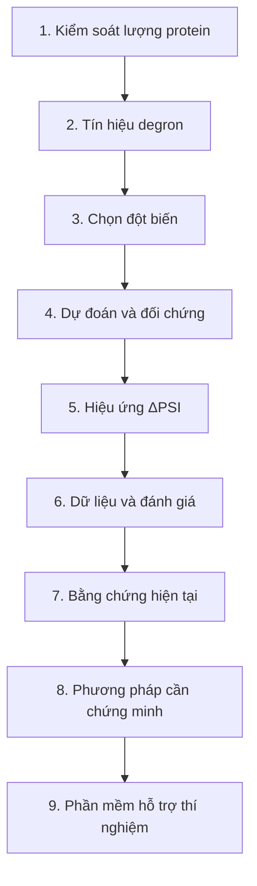

# Degron — Lộ trình dự đoán hiệu ứng đột biến

> Bản soạn rút gọn theo brief của Trọng, ngày 19/10/2026. Đã tạo [trang Notion mới](https://app.notion.com/p/3fe4c97ef69581ed968df52b445de084) và ba trang con; bản chính xác đã gửi nằm trong [published-concise.md](published-concise.md). Các URL cũ trong bản soạn bên dưới chỉ giữ làm lịch sử, không dùng điều hướng. Trang cũ trả NOT_FOUND ở kết nối hiện tại. Trạng thái chính thức: [DECISIONS.md](../../../../DECISIONS.md#hien-hanh).

**Mục tiêu:** dự đoán một phép thay thế amino acid làm thay đổi độ bền reporter mang peptide degron bao nhiêu, để ưu tiên đột biến cần kiểm chứng.

**Cách đọc:** theo chín bước dưới đây; mở trang con khi cần công thức, dữ liệu hoặc kết quả chi tiết.

## 1 · Vì sao nghiên cứu phân hủy protein?

Lượng protein phụ thuộc vào cả tổng hợp và phân hủy. Hiểu tín hiệu phân hủy giúp giải thích cách tế bào kiểm soát lượng protein.

## 2 · Degron cho biết điều gì?

Degron là tín hiệu liên quan đến phân hủy. Biết một đoạn có hoạt tính degron vẫn chưa cho biết từng **residue** — một đơn vị amino acid — đóng góp ra sao.

## 3 · Vì sao cần tới từng phép thay thế?

Thí nghiệm phải chọn **vị trí nào, thay bằng amino acid nào**. Peptide 28 residue có **532** phép thay thế đơn; mô hình giúp ưu tiên trước khi đo hết.

→ [Giải thích: Vì sao cần mức residue?](https://app.notion.com/p/3fe486d98ebc815e9314c3076cd76ff2)

## 4 · Dự đoán cần được so với ai?

Đối chiếu công cụ motif, điểm cả đoạn **PAP/ΔPAP**, và mô hình **Degformer**, đồng thời kiểm soát dữ liệu huấn luyện chồng lặp.

→ [Nghiên cứu PAP](https://doi.org/10.1126/sciadv.adz3483) · [Mã nguồn Degformer](https://github.com/Alpine2048/Degformer)

## 5 · Đầu vào và đầu ra là gì?

**Peptide tham chiếu + phép thay thế → ΔPSI dự đoán.**

**ΔPSI = PSI(đột biến) − PSI(tham chiếu).** Giá trị dương: reporter bền hơn, phù hợp với khả năng làm yếu degron trong assay. Chấm mọi thay thế tạo ma trận **28 × 19**; có thể hiển thị 28 × 20 nếu giữ thêm ô tham chiếu.

## 6 · Dữ liệu được xử lý thế nào?

**Số đếm → chuẩn hóa → PSI → ΔPSI → lọc chất lượng → chia cụm protein → đánh giá kèm bất định.**

| Bộ Zhang 2023 | Peptide | Phép thay thế được chấm |
|---|---:|---:|
| Scanning — quét | 2.994 | 83.446 |
| Saturation — bão hòa | 91 | 47.847 |

Chia tập theo cụm protein để hạn chế chồng lặp; dùng các lần lặp thực nghiệm để ước lượng nhiễu đo.

→ [Dataset và quá trình xử lý](https://app.notion.com/p/3fe486d98ebc8139819dd8682a49c8ef) · [Dữ liệu gốc Zhang 2023](https://data.mendeley.com/datasets/32h94v2yv2/2)

## 7 · Hiện đã biết gì?

Học trực tiếp trên saturation, **ridge M3 đạt 0,8082**, vượt **ΔPAP 0,7693** về AUROC mức ô, macro theo peptide: **+0,0389**, CI 95% **[0,0216; 0,0571]**. Năm mô hình có sức chứa lớn hơn đã thử đều thua ridge. Kết quả chuyển giao phải trình bày riêng vì khác ngân sách nhãn.

## 8 · Phương pháp còn phải chứng minh gì?

**G2 chưa hoàn tất:** còn cần thành phần kiến trúc mới có lợi ổn định, được kiểm bằng ablation và khoảng bất định. Khai thác nhãn mức túi là hướng cần kiểm nghiệm.

→ [Kết quả, đối chứng và phần còn mở](https://app.notion.com/p/3fe486d98ebc81b18331cf1c39b852b4)

## 9 · Phần mềm giúp người dùng làm gì?

**Nhập peptide → xem ma trận hiệu ứng → chọn đột biến ưu tiên và đối chứng → kiểm chứng thực nghiệm.** Dịch vụ dự kiến cung cấp bất định, nguồn dữ liệu và phạm vi áp dụng; harness giúp đánh giá lại các mô hình trong cùng điều kiện. **Phần mềm chưa được xây dựng.**

---

**Phạm vi:** degron tự trị trong assay reporter. Kết quả chưa đủ để kết luận về protein nguyên vẹn, cơ chế nhận diện E3 hoặc tính gây bệnh; ClinVar chỉ bổ sung động lực nghiên cứu. Đề tài chưa được GVHD duyệt khung chính thức theo hồ sơ hiện tại.

**Hình/GIF:** hồ sơ bản Notion hiện có ghi nhận hình ma trận và GIF có nguồn. Bản Markdown rút gọn này không nhúng lại các ảnh chưa có URL truy cập được; chưa xác minh hiển thị trên Notion trong phiên này.
