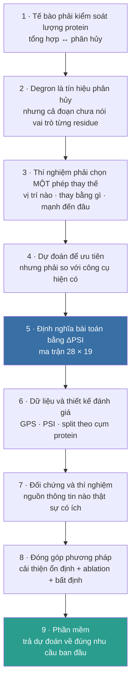

# Lộ trình đề tài — Dự đoán hiệu ứng đột biến degron ở mức residue

> Bản nguồn trong repo của **bốn trang Notion** dựng ngày 19/10/2026 (một trang chính + ba trang
> con). Đường dẫn ảnh ở đây là **đường dẫn repo**; trên Notion mỗi ảnh là một file đã tải lên.
> Bảng ánh xạ, giấy phép và lệnh dựng lại: [README.md](README.md). File này **không ghi quyết
> định** — xem [DECISIONS.md](../../../../DECISIONS.md).

---
---

# TRANG CHÍNH — Lộ trình đề tài

🧬 **Một câu.** Cho một peptide degron dài 28 residue, dự đoán **mỗi phép thay thế amino acid
đơn** làm độ bền của nó đổi bao nhiêu — ở **mức residue**, học và chấm trên **nhãn thực nghiệm
đo được**.

> **Cách dùng trang này.** Chín mục dưới đây là **lộ trình** theo đúng thứ tự lập luận của đề
> tài: mỗi mục nói một ý, kết bằng câu hỏi bắc cầu sang mục sau. Chi tiết nằm trong các **trang
> con** — chỉ nhấn vào khi cần. ⚠ Trạng thái chính thức của đề tài nằm ở `DECISIONS.md` trong
> repo, **không** nằm ở trang này. Cập nhật 19/10/2026.

## Sơ đồ lộ trình

## 1 · Tế bào cần kiểm soát lượng protein, nên phân hủy protein là một quá trình cần nghiên cứu

Lượng protein phụ thuộc vào **cả tổng hợp và phân hủy**. Muốn hiểu cách lượng protein được điều
chỉnh, cần tìm hiểu những tín hiệu khiến một protein được đưa tới hệ thống phân hủy.

Đọc thêm — hai tổng quan 2025 đi hai hướng hơi trái nhau, nên trích cả hai là cách trung thực:

- [Zhang và cs. 2025, *Nat Rev Mol Cell Biol* — “Degrons: defining the rules of protein degradation”](https://doi.org/10.1038/s41580-025-00870-z) · sàng thông lượng cao đang mở rộng số degron được định nghĩa ở độ phân giải cao.
- [Wang & Zheng 2025, *Nat Chem Biol* — “Degrons and degradation signals beyond short linear motifs”](https://doi.org/10.1038/s41589-025-02056-2) · nhiều degron **không** phải motif tuyến tính ngắn ⇒ một cửa sổ 28-mer có giới hạn phạm vi, và giới hạn đó **chia sẻ với chính assay nguồn nhãn**.

> → *Tín hiệu nào tham gia vào quá trình đó?*

## 2 · Degron là tín hiệu liên quan đến phân hủy, nhưng nhận diện được cả đoạn chưa chỉ ra vai trò của từng amino acid

Một đoạn peptide có thể mang hoạt tính degron, trong khi **các residue bên trong đóng góp khác
nhau**. Vì vậy, xác định vùng degron là **điểm xuất phát**, không phải điểm đến: từ đó mới
nghiên cứu sâu hơn ảnh hưởng của từng thay đổi trình tự.

🔍 Giải thích chi tiết ba mức câu hỏi (cả đoạn · vị trí · phép thay thế) — *liên kết tới trang
con 1*.

> → *Khi muốn kiểm tra hoạt tính của degron, người nghiên cứu phải thay đổi cụ thể chỗ nào?*

## 3 · Nhu cầu chọn một đột biến để làm thí nghiệm đòi hỏi câu trả lời ở mức phép thay thế

Người nghiên cứu cần biết: **thay residue nào**, **bằng amino acid nào**, và **dự kiến tạo hiệu
ứng mạnh đến đâu**. Một điểm số cho cả đoạn chưa đủ để lựa chọn giữa các đột biến nằm trong cùng
đoạn.

🎯 **Động lực trực tiếp của bài toán:** dự đoán hiệu ứng **từng phép thay thế** để hỗ trợ lựa
chọn thí nghiệm.

Các biến thể xuất hiện trong vùng degron bổ sung **một hướng khảo sát** — nhưng mối liên hệ giữa
hiệu ứng đo được và tính gây bệnh **vẫn cần được xác lập riêng**:

⚠ **Ba giới hạn phải đi kèm con số 2,148 — không được tách rời.**

1. Đây là liên hệ **ở mức VÙNG**. Ở **mức residue** thì **chưa thiết lập được**: ba phép kiểm độc lập đều nhất quán với rỗng (tầng có lực nhất AUC **0,5166**, CI [0,479; 0,554]).
2. **Không** có hiện tượng giàu lên theo *vị trí* — tỉ lệ biến thể trong degron bằng đúng tỉ lệ nền, nên **không được nói “degron là điểm nóng biến thể”**.
3. Chưa khử **bảo tồn** và **độ vô trật tự**. Nếu khử xong mà 2,148 biến mất thì nó chỉ nói “degron nằm trong vùng chức năng”.

[ClinVar](https://www.ncbi.nlm.nih.gov/clinvar/) · ghi công PMID 29165669 · dữ liệu ClinVar
**không dùng để chẩn đoán**, và **không** được dùng làm đích xác nhận mô hình trong đề tài này.

> → *Có hàng trăm phép thay thế cho một peptide; làm sao lựa chọn trước khi đo hết?*

## 4 · Dự đoán giúp ưu tiên các trường hợp chưa đo, nhưng phải được kiểm tra so với công cụ hiện có

Mô hình có thể **xếp hạng** các đột biến theo hiệu ứng dự kiến. Để biết cách làm này có giá trị,
cần đối chiếu với ba loại tiền lệ: công cụ motif, mô hình chấm điểm **cả đoạn**, và mô hình
**hiệu ứng biến thể**.

| Tiền lệ | Đích dự đoán của nó | Vai trong đề tài |
|---|---|---|
| [Voutsinos và cs. 2026, *Sci Adv* — PAP](https://doi.org/10.1126/sciadv.adz3483) | Điểm degron cho **cả tile** | **ΔPAP** là đối chứng công bố phải vượt |
| [Degformer](https://github.com/Alpine2048/Degformer) | PSI tuyệt đối của trình tự | Baseline bắt buộc; ⚠ checkpoint là pickle, chạy biệt lập |
| [Schulze & Lindorff-Larsen 2026, *eLife*](https://doi.org/10.7554/eLife.103721) | Ma trận thay thế theo lớp phơi lộ (VAMP-seq) | Tiền lệ phương pháp sát nhất; rASA một mình cho Spearman 0,45 |
| [LeBlanc và cs. 2026, *Cell Systems*](https://doi.org/10.1016/j.cels.2026.101701) | Scalar cho từng tile (activation domain) | Split theo cụm và trần replicate là **thực hành chuẩn**, không phải đóng góp |

> → *Muốn so sánh công bằng, trước hết phải định nghĩa chính xác hiệu ứng cần dự đoán.*

## 5 · Bài toán được định nghĩa bằng thay đổi độ bền đo trong assay: ΔPSI

| | |
|---|---|
| **Đầu vào** | Một peptide tham chiếu dài 28 residue + một phép thay thế amino acid |
| **Đầu ra 1** | **Ma trận 28 × 19** giá trị ΔPSI dự đoán — một ô cho mỗi (vị trí, amino acid thay thế) |
| **Đầu ra 2** | **Bản đồ tầm quan trọng theo vị trí** — gộp 19 phép thay thế tại mỗi vị trí |
| **Nhãn** | ΔPSI = PSI(đột biến) − PSI(tham chiếu), **cả hai đều đo** trong assay GPS |

Chấm toàn bộ thay thế tạo thành một ma trận hiệu ứng theo **vị trí** và **amino acid thay thế**.
Ví dụ HIF1A giúp nối một ô trong ma trận với một đột biến cụ thể và phép đo tương ứng.

> → *Dữ liệu nào cho phép học và kiểm chứng ma trận đó?*

## 6 · Dữ liệu đột biến cung cấp nhãn, còn thiết kế đánh giá quyết định kết quả đáng tin đến đâu

Nguồn nhãn chính là thí nghiệm đột biến của
[Zhang và cs. 2023, *Mol Cell*](https://doi.org/10.1016/j.molcel.2023.08.022) — hai bộ bổ sung
cho nhau (**quét** và **bão hòa**), đọc ra bằng assay **GPS**. Chuỗi xử lý từ số đếm thô tới
nhãn, cách chia tập theo **cụm protein**, và cách đo độ nhất quán giữa các lần lặp nằm ở trang
con.

🧪 Từng bước một, kèm công thức PSI và ΔPSI — *liên kết tới trang con 2*.

| Bộ | Peptide degron | Cụm protein | Phép thay thế được chấm |
|---|---|---|---|
| Quét | 2.994 | 1.985 | 83.446 |
| Bão hòa | 91 | 89 | 47.847 |

Những bước này giúp đánh giá khả năng dự đoán **trên peptide chưa thấy**, đồng thời cho biết
**giới hạn do nhiễu thực nghiệm**.

> → *Trong điều kiện đánh giá đó, thông tin nào thực sự giúp dự đoán?*

## 7 · Các đối chứng và thí nghiệm xác định nguồn thông tin hữu ích, rồi mới định hướng phương pháp

So sánh thông tin của **phép thay thế**, **thành phần lân cận** và **toàn peptide** để tìm thành
phần có lợi. Kết quả **chuyển giao** và kết quả **học trực tiếp trên bão hòa** được trình bày
riêng vì chúng dùng **ngân sách nhãn khác nhau**.

📊 **Bằng chứng hiện tại.** Ridge học trực tiếp đạt **0,8082** AUROC mức ô, vượt ΔPAP **0,7693**
(+0,0389; CI 95% [0,0216; 0,0571]). Các kiến trúc phức tạp hơn đã thử **chưa vượt ridge một cách
ổn định** — đã loại năm thiết kế, cùng một chiều.
**Phát biểu đúng câu chữ:** thành phần ở **thang lân cận ±3** thắng thành phần ở **thang cả
peptide** — không nói “vị trí thắng thành phần”.

📊 Bảng đầy đủ các mô hình, cách đọc số và chỗ còn hở — *liên kết tới trang con 3*.

> → *Vì vậy, phần phương pháp còn phải chứng minh được điều gì?*

## 8 · Đóng góp phương pháp phải thể hiện bằng cải thiện ổn định và thành phần có ích được kiểm chứng

Tách rõ **kết quả đã đạt** khỏi **giả thuyết còn mở**. Một thiết kế mới cần được so với
**baseline mạnh**, kiểm bằng **ablation** và **báo khoảng bất định**. Các hướng khai thác **nhãn
mức túi** cho đầu ra **mức residue** được trình bày như hướng **cần kiểm nghiệm**, không phải
kết quả.

🚧 **Mốc số đã vượt và vững; điều kiện kiến trúc thì chưa.** Đây là chỗ đề tài đang đứng, không
phải chỗ đã xong.

> → *Khi dự đoán đủ tin cậy, người nghiên cứu sẽ sử dụng nó như thế nào?*

## 9 · Phần mềm đưa dự đoán trở lại nhu cầu ban đầu: chọn đột biến để kiểm chứng

Người dùng nhập peptide, xem **ma trận hiệu ứng**, rồi chọn các đột biến **ưu tiên** cùng **đối
chứng**. Dịch vụ cần cung cấp:

- **bất định** neo vào trần đo lường của assay;
- **nguồn dữ liệu** (xuất xứ nhãn) và **phạm vi áp dụng**;
- cờ cảnh báo khi vượt ra ngoài phạm vi assay.

**Harness đánh giá** cho phép kiểm tra lại các mô hình **trong cùng điều kiện** — cùng split
cụm, cùng cách báo delta kèm trần đo lường.

## Đề tài không tuyên bố điều gì

🚫

- **Không** nói “residue mà đề tài dự đoán là residue mang tín hiệu bệnh” — đã đo ba lần và chưa thấy.
- **Không** dùng ClinVar làm đích xác nhận mô hình; ClinVar chỉ là **động lực**.
- **Không** nói “degron là điểm nóng biến thể”.
- **Không** lấy chênh lệch tới trần đo lường làm dư địa cải thiện hứa hẹn; trần là **trần ĐO LƯỜNG của phép đo**, không phải mức học được từ trình tự.
- Phạm vi: **degron tự trị**, biến thể **dòng mầm**. Degron cần mồi (ví dụ phosphoryl hóa) **ngoài tầm assay**.
- Dự đoán mô tả **độ bền của peptide trong assay** — chưa kết luận về protein nguyên vẹn, cơ chế nhận diện E3, hay tính gây bệnh.

## Ba trang con

Mỗi trang đứng độc lập được; nhấn vào khi cần chi tiết.

---
---

# TRANG CON 1 — Vì sao cần dự đoán hiệu ứng đột biến ở mức residue?

🔍 Trước hết, *residue* là **một đơn vị amino acid trong chuỗi protein**. Bài toán ở đây là:
**nếu thay amino acid tại một vị trí cụ thể bằng amino acid khác, hoạt tính degron thay đổi như
thế nào?**

## Ba câu hỏi khác nhau, không phải một

| Mức câu hỏi | Điều cần biết |
|---|---|
| **Cả đoạn** | Đoạn peptide này có thúc đẩy phân hủy không? |
| **Vị trí** | Những vị trí nào nhạy với thay đổi? |
| **Phép thay thế** | Tại vị trí đó, thay amino acid hiện tại bằng amino acid nào sẽ tạo ra hiệu ứng gì? |

## Ví dụ minh hoạ — **giả định**

Một peptide dài 28 residue đã được xác định có hoạt tính degron. Người nghiên cứu muốn tạo một
phiên bản có hoạt tính **yếu hơn** để kiểm tra vai trò của tín hiệu này.

Kết luận “đoạn này là degron” **chưa cho biết nên tạo đột biến nào**:

- Thay đổi ở **vị trí 7** có thể làm reporter bền hơn.
- Thay đổi ở **vị trí 19** có thể gần như không ảnh hưởng.
- Ngay tại vị trí 7, **hai amino acid thay thế khác nhau** cũng có thể tạo hiệu ứng khác nhau.

🎯 Vì vậy, **đơn vị mà người nghiên cứu thực sự phải lựa chọn là một phép thay thế cụ thể: vị
trí nào, từ amino acid nào sang amino acid nào.** Đó là lý do đầu ra cần tới mức này.

## Nhu cầu đó dẫn đến hai mục đích

1. **Chọn thí nghiệm** — ưu tiên những đột biến được dự đoán tạo hiệu ứng mạnh, kèm các đột biến ít ảnh hưởng làm **đối chứng**.
2. **Khảo sát một biến thể đã có** — nếu gặp một phép thay thế cụ thể, đặt câu hỏi liệu nó có thể làm thay đổi hoạt tính degron **trong điều kiện đo** hay không.

Các nghiên cứu thực nghiệm cũng dùng đột biến để tìm những residue quan trọng và xây dựng bản đồ
hiệu ứng thay thế. Chẳng hạn, Zhang và cộng sự kết hợp quét đột biến với phân tích chi tiết
degron ở độ phân giải amino acid —
[Zhang và cộng sự, 2023, *Molecular Cell*](https://doi.org/10.1016/j.molcel.2023.08.022).

## Nhưng vì sao cần dự đoán, khi có thể đo bằng thí nghiệm?

Với một peptide dài 28 residue, xét toàn bộ thay thế đơn có **28 × 19 = 532** trường hợp.

Mỗi peptide mới lại tạo thêm một tập ứng viên như vậy. Mô hình có ích **nếu** giúp xếp hạng các
trường hợp chưa đo để người nghiên cứu chọn phép kiểm chứng trước. Giá trị này cần được đánh giá
bằng:

- khả năng dự đoán **trên peptide chưa thấy** (split theo cụm protein), và
- **độ tin cậy** của kết quả (khoảng bất định, trần đo lường).

📏 **Phạm vi, nói trước.** Ở đề tài hiện tại, điều được dự đoán là **thay đổi độ bền của reporter
mang peptide trong assay**. Kết quả hỗ trợ **hình thành giả thuyết** và **chọn thí nghiệm**; để
kết luận về protein nguyên vẹn, cơ chế nhận diện E3 hay tính gây bệnh thì cần **bằng chứng bổ
sung**.

---
---

# TRANG CON 2 — Dataset và quá trình xử lý

🧪 **Câu hỏi của trang này.** Làm thế nào biến **số đếm từ thí nghiệm** thành các cặp “đột biến →
hiệu ứng” đủ tin cậy để huấn luyện và đánh giá mô hình?

## 1 · Cần dự đoán hiệu ứng đột biến, nên phải chọn dữ liệu có đo từng đột biến

Dữ liệu chỉ cho biết một đoạn là degron **chưa đủ** để học ảnh hưởng của từng phép thay thế. Vì
vậy, nguồn nhãn chính là thí nghiệm đột biến của
[**Zhang 2023**, *Molecular Cell*](https://doi.org/10.1016/j.molcel.2023.08.022), gồm hai bộ bổ
sung cho nhau:

| Bộ dữ liệu | Thiết kế | Vai trò |
|---|---|---|
| **Scanning — quét** | Mỗi vị trí được thay bằng một amino acid theo quy tắc của thí nghiệm | Khảo sát hiệu ứng trên **nhiều peptide** và kiểm tra giá trị của ngữ cảnh |
| **Saturation — bão hòa** | Mỗi vị trí được khảo sát với đủ 20 amino acid, gồm amino acid tham chiếu | Học và đánh giá **ma trận 19 phép thay thế** thực sự tại mỗi vị trí |

> → *Nhưng dữ liệu gốc chưa trực tiếp chứa hiệu ứng đột biến; cần dựng lại đại lượng đo.*

## 2 · Thí nghiệm phân loại tế bào theo độ bền reporter, nên số đếm phải được chuyển thành điểm độ bền

Do tổng số lượt đọc giữa các nhóm khác nhau, trước hết phải **chuẩn hóa số đếm**, rồi tính điểm
trung bình có trọng số:

$$
PSI=\frac{\sum_{i=1}^{6} i \times c_i}{\sum_{i=1}^{6} c_i}
$$

trong đó $c_i$ là số đếm đã chuẩn hóa ở nhóm $i$.

- **PSI thấp** ⇒ reporter **kém bền** ⇒ degron mạnh.
- **PSI cao** ⇒ reporter **bền hơn**.

> → *Nếu dựng PSI sai, mọi nhãn phía sau đều sai; vì vậy cần một bước đối chiếu.*

## 3 · Đối chiếu với bảng tác giả để kiểm tra cách dựng nhãn

PSI dựng lại được so với bảng **Replicate 1** do tác giả cung cấp.

✅ Trên **261.865 giá trị đối chiếu hợp lệ**, sai lệch lớn nhất khoảng $5\times10^{-7}$ ⇒
pipeline tái tạo được cách tính của tác giả.

Từ đó có thể dựng thêm **các lần lặp chưa có bảng PSI tính sẵn**, phục vụ kiểm tra độ nhất quán
và nhiễu đo. Dữ liệu gốc:
[GEO GSE240610](https://www.ncbi.nlm.nih.gov/geo/query/acc.cgi?acc=GSE240610).

> → *Tuy nhiên, độ bền của một biến thể chưa phải hiệu ứng của đột biến đó.*

## 4 · Muốn biết đột biến gây thay đổi bao nhiêu, phải so với trình tự tham chiếu trong cùng điều kiện

$$
\Delta PSI = PSI_{\text{đột biến}} - PSI_{\text{tham chiếu}}
$$

- **Bộ quét:** dùng phép đo trình tự tham chiếu riêng, ký hiệu `mut0`.
- **Bộ bão hòa:** dùng **trung vị các ô giữ nguyên amino acid tham chiếu** làm mốc nội tại.

ΔPSI **dương** nghĩa là đột biến làm reporter bền hơn, phù hợp với khả năng **làm yếu hoạt tính
degron** trong assay.

⚠ Mẫu **BAG6 WT là điều kiện khác**, nên **không** được lấy làm một lần lặp bổ sung hoặc mốc
thay thế.

> → *Để hiệu ứng này có ý nghĩa cho bài toán degron, cần giữ đúng đối tượng và chất lượng phép đo.*

## 5 · Lọc dữ liệu để giữ các degron có phép đo sử dụng được

Pipeline giữ phép đo đạt **ngưỡng độ sâu đọc**, kiểm tra **trình tự và tọa độ đột biến**, đồng
thời chọn peptide có **PSI tham chiếu ≤ 3,0** — điều kiện cuối tập trung bài toán vào các peptide
vốn có hoạt tính degron trong assay.

| Bộ | Peptide degron | Cụm protein | Phép thay thế được chấm |
|---|---|---|---|
| Quét | 2.994 | 1.985 | 83.446 |
| Bão hòa | 91 | 89 | 47.847 |

📐 **91 peptide là quy mô của bộ ma trận bão hòa**, không phải toàn bộ dữ liệu mức residue. Các ô
thiếu hoặc không đạt điều kiện được loại, nên ma trận thực tế **không phải lúc nào cũng đầy đủ**.

> → *Có nhiều phép thay thế vẫn chưa đồng nghĩa có nhiều mẫu độc lập.*

## 6 · Các đột biến cùng peptide có quan hệ gần nhau, nên phải chia tập theo cụm protein

Nếu chia **ngẫu nhiên từng ô**, mô hình có thể học từ một số đột biến của một peptide rồi được
đánh giá trên những đột biến khác của **chính peptide đó**. Kết quả khi ấy dễ cao hơn khả năng
dự đoán trên peptide chưa thấy.

Vì vậy, protein được **gom cụm theo tương đồng trình tự**; **toàn bộ peptide và đột biến thuộc
cùng cụm được giữ cùng một phía của phép chia**. Khi kết hợp hai bộ nhãn, các cụm chồng lặp cũng
phải được kiểm soát.

> → *Sau khi hạn chế chồng lặp, vẫn cần biết bản thân phép đo đáng tin đến đâu.*

## 7 · Dùng các lần lặp để đo độ nhất quán trước khi đánh giá mô hình

Nhãn cuối được lấy **trung bình từ hai lần lặp**; chính **chênh lệch giữa chúng** giúp ước lượng
nhiễu và **trần đo lường**. Nhờ vậy, điểm mô hình được đọc **cùng giới hạn của dữ liệu**, thay vì
coi mỗi nhãn thực nghiệm là tuyệt đối chính xác.

### Các nguồn bổ trợ và vai riêng của từng nguồn

| Nguồn | Vai trò |
|---|---|
| [UniProt](https://www.uniprot.org/) | Trình tự tham chiếu |
| [PAP — Voutsinos 2026](https://doi.org/10.1126/sciadv.adz3483) · [Degformer](https://github.com/Alpine2048/Degformer) | **Đối chứng** phải vượt |
| [Larsen 2025](https://doi.org/10.5281/zenodo.20490355) · [Voutsinos 2026](https://doi.org/10.1126/sciadv.adz3483) | Phân tích **mức peptide** và chuyển assay |
| [ClinVar](https://www.ncbi.nlm.nih.gov/clinvar/) | **Lập luận động lực** — ⚠ **không** làm nhãn xác nhận hiệu ứng degron |

🔁 **Chuỗi xử lý, một dòng để đưa lên slide:** Số đếm thô → chuẩn hóa và dựng PSI → đối chiếu với
tác giả → tính ΔPSI bằng mốc tham chiếu phù hợp → lọc chất lượng và chọn degron → chia tập theo
cụm protein → học và đánh giá kèm bất định.

⚖️ **Ghi công dữ liệu.** ClinVar: trích PMID 29165669; dữ liệu ClinVar **không dùng cho mục đích
chẩn đoán**. Larsen 2025 và Voutsinos 2026: mã và dữ liệu trong repo tác giả theo giấy phép MIT;
bài báo Voutsinos 2026 là CC BY-NC 4.0.

---
---

# TRANG CON 3 — Kết quả hiện tại, đối chứng và chỗ còn hở

> ⚠ **Phần Claude thêm**, không có trong brief của Trọng. Dựng hoàn toàn từ JSON kết quả 18/10.

📊 Trang này đỡ cho **mục 7 và 8** của lộ trình. Mọi con số đều là **tự đo** và dẫn về file kết
quả trong repo. Cập nhật 19/10/2026 theo kết quả ngày 18/10/2026. ⚠ Đây là **benchmark phát
triển**, không phải validation ngoài chưa động tới.

## Mốc số của G2 đã vượt

![AUROC mức ô trên ma trận bão hòa, trung bình macro theo peptide. Ridge M3 học trực tiếp đạt 0,8082 so với ΔPAP 0,7693 (+0,0389; CI 95% [0,0216; 0,0571]). Trần 0,9519 là **trần đo lường** của phép đo. Tự đo.](png/fig-benchmark.png)

| Mô hình | AUROC mức ô | Ghi chú | Tiền đăng ký? |
|---|---|---|---|
| Trần đo lường của assay | **0,9519** | Một nửa replicate chấm trên nửa kia — **không phải** mức học được từ trình tự | — |
| **Ridge M3 (hiện tại)** | **0,8082** | Học trực tiếp trên bão hòa; vượt ΔPAP +0,0389, CI dương | — |
| FiLM | 0,8028 | Thua ridge ở cả ba seed | Có |
| Bilinear | 0,7933 | Thua ridge ở cả ba seed | Có |
| Ridge tích chéo | 0,7924 | Thua ridge ở cả ba seed | Có |
| **ΔPAP cnn2w1 — đích phải vượt** | **0,7693** | Đối chứng công bố | — |
| Kiến trúc Degformer huấn luyện lại dưới cov80 | 0,7500 | Thua cả ΔPAP; 5/5 fold đạt đỉnh ở epoch 2 nên không phải huấn luyện thiếu | — |

🚧 **Năm thiết kế nhiều sức chứa hơn ridge M3 đều thua, cùng một chiều** (cổng sigmoid · FiLM ·
bilinear · ridge tích chéo · kiến trúc Degformer). Diễn giải hiện tại: nút thắt là **lượng
nhãn**, không phải sức chứa mô hình. ⇒ **Mốc số đã vững hơn, nhưng điều kiện “thành phần kiến
trúc mới có lợi ổn định” thì xa hơn, không gần hơn.**

## Degformer: vì sao điểm của nó không đọc thẳng được

- **88,12%** ô test trùng dữ liệu huấn luyện của Degformer, và cả **91/91 peptide WT** nằm trong train ⇒ rò rỉ nằm ở **mức peptide**.
- Bỏ hết ô trùng, nó **vẫn đạt 0,9227** ⇒ chồng khít ô **không** giải thích được khoảng cách.
- Nhưng kiến trúc đó **tự học** dưới cov80 chỉ đạt **0,7500**.

💡 ⇒ **Sức mạnh của Degformer nằm ở 569.270 dòng tiền huấn luyện, không ở kiến trúc.** Đây là lý
do trọng tâm có thể chuyển từ “thêm sức chứa” sang “thêm nhãn”.

🔒 ⚠ **An toàn khi chạy Degformer.** Checkpoint của repo là **pickle**
(`torch.load(..., weights_only=False)` kèm một `StandardScaler`) ⇒ nạp nó **thực thi mã tuỳ ý**.
Phải để trong thư mục riêng và trống, script của mình để chỗ khác, chạy `python3 -I`.

## Cách đọc những con số này

| | |
|---|---|
| **Metric** | AUROC **mức ô**, trung bình **macro theo peptide** |
| **Thiết kế** | 5 fold ngoài theo cụm **cov80**, validation trong cũng theo cov80; **3 seed** |
| **Quy mô** | 91 peptide / 89 cụm / 47.847 ô |
| **Khoảng bất định** | Ghép cặp theo peptide, bootstrap theo **cụm** |
| **Ngưỡng phát hiện** | MDE **0,0123** — ⚠ là ước lượng cho **một cặp so sánh cụ thể**, không phải ngưỡng nghiệm thu chung |

🚫 **Ba cách đọc sai phải tránh.**

1. **Không** lấy khoảng từ 0,8082 tới 0,9519 làm “dư địa cải thiện” — 0,9519 là **trần đo lường của phép đo**.
2. **Không** coi một kết quả dương cục bộ là **hoàn tất G2** — điều kiện kiến trúc vẫn mở.
3. **Không** so Degformer với ridge như hai số cùng điều kiện — chúng khác **ngân sách nhãn**.

## Chỗ còn hở, nói thẳng

- **Mắt nối tới mức residue của lập luận cấp thiết chưa thiết lập được**, và **không đóng được bằng dữ liệu hiện có**: bộ bão hòa chỉ 91 peptide nên số biến thể khớp đúng ô bị chặn ở khoảng **51 ca có phân loại**.
- **Cả hai nguồn nhãn mức residue đều của một nhóm tác giả** (Zhang 2023). Chưa tìm được ứng viên thay thế đạt đủ bốn điều kiện: readout là **độ bền**, trên **degron tự trị**, từ **nhóm tác giả khác**, có nhãn **mức residue**. Rủi ro này phải nằm trong phần giới hạn của đề cương.
- **Chưa khử bảo tồn và độ vô trật tự** cho con số cấp thiết 2,148.
- **Chưa xây ứng dụng** (mục 9 của lộ trình).
