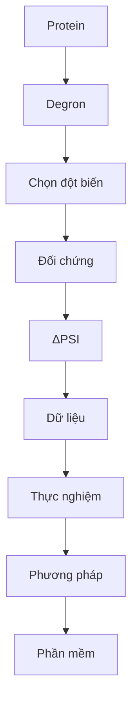

<callout icon="🎯" color="blue_bg">
	**Dự đoán hiệu ứng từng phép thay thế amino acid để hỗ trợ chọn đột biến kiểm chứng.**
	Đọc chín bước trên trang chính; mở trang con khi cần chi tiết.
</callout>

## 1 · Tế bào kiểm soát lượng protein
Lượng protein phụ thuộc vào cả **tổng hợp và phân hủy**. Đề tài tìm hiểu tín hiệu liên quan đến phân hủy.

[Nguồn GIF và giấy phép](https://commons.wikimedia.org/wiki/File:Protein_synthesis_(Translation).gif)
## 2 · Degron là điểm xuất phát
Biết cả đoạn có hoạt tính degron chưa cho biết vai trò từng **residue** — một đơn vị amino acid.
## 3 · Thí nghiệm cần một phép thay thế cụ thể
Cần biết **thay ở đâu, bằng gì, hiệu ứng bao nhiêu**. Một peptide 28 residue có **532** phép thay thế đơn.
<page url="https://app.notion.com/p/3fe4c97ef69581c99fc6cf782a6c09b4">Vì sao cần dự đoán ở mức residue?</page>
## 4 · Dự đoán phải so với công cụ hiện có
Đối chiếu công cụ motif, điểm cả đoạn và mô hình hiệu ứng biến thể.
[Nghiên cứu PAP/ΔPAP](https://doi.org/10.1126/sciadv.adz3483) · [Degformer](https://github.com/Alpine2048/Degformer)
## 5 · Đích dự đoán: ΔPSI
**Peptide tham chiếu + phép thay thế → ΔPSI.**
**ΔPSI = PSI(đột biến) − PSI(tham chiếu).** Dương: reporter bền hơn, phù hợp với khả năng làm yếu degron trong assay. Chấm mọi thay thế tạo ma trận **28 × 19**.
## 6 · Dữ liệu và cách đánh giá
**Số đếm → PSI → ΔPSI → lọc chất lượng → chia cụm protein → đánh giá kèm bất định.**
Zhang 2023: scanning **2.994 peptide**, saturation **91 peptide**. Chia cụm và kiểm replicate để hạn chế chồng lặp và đo nhiễu.
<page url="https://app.notion.com/p/3fe4c97ef6958144bb43dfe2bc8fb5c6">Dataset và quá trình xử lý</page>
## 7 · Bằng chứng hiện tại
Học trực tiếp saturation: **ridge 0,8082 > ΔPAP 0,7693**; AUROC mức ô, macro theo peptide. Chênh lệch **+0,0389**, CI 95% **[0,0216; 0,0571]**. Trình bày riêng kết quả chuyển giao vì khác ngân sách nhãn.
## 8 · Đóng góp phương pháp còn mở
**G2 chưa hoàn tất:** cần thành phần kiến trúc mới có ích ổn định, được kiểm bằng ablation và khoảng bất định. Năm mô hình sức chứa lớn hơn đã thử đều thua ridge.
<page url="https://app.notion.com/p/3fe4c97ef6958196a254da664a53dd18">Kết quả, đối chứng và phần còn mở</page>
## 9 · Phần mềm phục vụ lựa chọn thí nghiệm
**Nhập peptide → xem ma trận → chọn đột biến và đối chứng → kiểm chứng.**
Dịch vụ dự kiến cung cấp bất định, nguồn nhãn và phạm vi áp dụng; harness giúp đánh giá lại mô hình cùng điều kiện. **Chưa xây dựng phần mềm.**
---
**Phạm vi:** degron tự trị trong assay reporter. Chưa suy ra cơ chế E3, hiệu ứng trên protein nguyên vẹn hoặc tính gây bệnh. ClinVar chỉ bổ sung động lực.
Cập nhật <mention-date start="2026-10-19"/>; đề tài chưa được GVHD duyệt khung chính thức theo hồ sơ hiện tại. Trạng thái chính thức và quyết định tiếp tục nằm ở `DECISIONS.md` trong repo CT553H.
