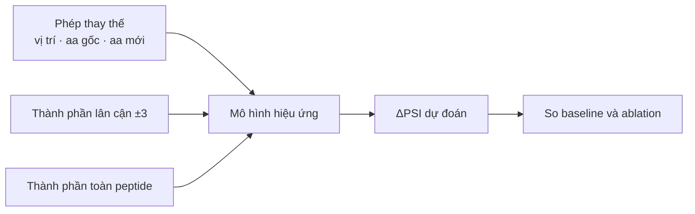
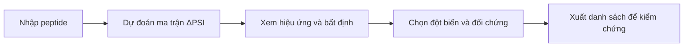

<callout icon="🎯" color="blue_bg">
	**Dự đoán hiệu ứng đột biến degron ở mức residue để hỗ trợ lựa chọn thí nghiệm.**
	Đề tài hướng tới trả lời: với một peptide có hoạt tính degron, thay amino acid tại vị trí nào, bằng amino acid nào, sẽ làm thay đổi độ bền reporter bao nhiêu?
</callout>
Trang này trình bày **ý tưởng nghiên cứu và tính khả thi**. Các trang con cung cấp ví dụ, công thức, quy trình xử lý và phân tích thực nghiệm để mở khi cần trao đổi sâu hơn.

## 1 · Bối cảnh: vì sao cần nghiên cứu tín hiệu phân hủy protein?
Tế bào cần duy trì lượng protein phù hợp để thực hiện chức năng. Lượng protein phụ thuộc vào cả **tổng hợp** và **phân hủy**; vì vậy, hiểu quá trình điều chỉnh lượng protein cũng cần hiểu những tín hiệu khiến protein được đưa tới hệ thống phân hủy.
**Degron** là tín hiệu liên quan đến quá trình đó. Một câu hỏi thực nghiệm cụ thể là: nếu thay đổi trình tự của tín hiệu này, khả năng thúc đẩy phân hủy sẽ thay đổi như thế nào? Đây là điểm nối từ bối cảnh sinh học sang bài toán tính toán của đề tài.

[Nguồn GIF và giấy phép](https://commons.wikimedia.org/wiki/File:Protein_synthesis_(Translation).gif)

## 2 · Từ nhận diện cả đoạn đến vai trò từng amino acid
Một peptide có thể được xác định là có hoạt tính degron, nhưng kết luận đó chưa cho biết **những thay đổi nào sẽ làm hoạt tính mạnh lên hoặc yếu đi**. Các residue — từng đơn vị amino acid trong chuỗi — có thể đóng góp khác nhau; ngay tại cùng một vị trí, hai amino acid thay thế cũng có thể gây hiệu ứng khác nhau.
Vì thế, cần phân biệt ba mức câu hỏi: **cả đoạn có hoạt tính hay không → vị trí nào nhạy với thay đổi → từng phép thay thế tạo hiệu ứng gì**. Đề tài tập trung vào mức cuối, từ đó có thể tổng hợp thành bản đồ độ nhạy theo vị trí.
## 3 · Nhu cầu thực tế: chọn đột biến để kiểm chứng
Khi muốn kiểm tra vai trò của một degron, người nghiên cứu phải lựa chọn một thay đổi cụ thể để tạo mẫu và đo. Một điểm số cho cả đoạn chưa đủ để quyết định nên thay residue nào và thay bằng gì.
Với peptide dài **28 residue**, có **28 × 19 = 532** phép thay thế amino acid đơn. Mô hình có ích nếu giúp ưu tiên các đột biến được dự đoán tạo hiệu ứng mạnh, đồng thời chọn các trường hợp ít ảnh hưởng làm đối chứng. **Khả năng hỗ trợ lựa chọn này là mục tiêu sử dụng; hiệu quả tiết kiệm thí nghiệm chưa được kiểm chứng trực tiếp.**

<page url="https://app.notion.com/p/3fe4c97ef69581c99fc6cf782a6c09b4">Vì sao cần dự đoán ở mức residue?</page>
## 4 · Nghiên cứu hiện có và câu hỏi đề tài cần giải quyết
Các công cụ hiện có hỗ trợ những phần khác nhau của vấn đề. Công cụ motif giúp nhận diện tín hiệu trình tự; **PAP** chấm điểm cả đoạn, có thể lấy chênh lệch điểm trước và sau đột biến làm đối chứng **ΔPAP**; **Degformer** là tiền lệ cần đối chiếu khi dự đoán độ bền từ trình tự.
Do đó, đề tài cần chứng minh **giá trị tăng thêm trong một điều kiện đánh giá rõ ràng**: học từ nhãn hiệu ứng đột biến có giúp dự đoán trên peptide chưa thấy tốt hơn các đối chứng mạnh hay không? Việc xuất ma trận thay thế, tự nó, chưa đủ làm căn cứ tính mới.
[Nghiên cứu PAP — Voutsinos và cộng sự](https://doi.org/10.1126/sciadv.adz3483) · [Mã nguồn Degformer](https://github.com/Alpine2048/Degformer)
## 5 · Định nghĩa bài toán: dự đoán thay đổi độ bền trong assay
**Đầu vào:** peptide tham chiếu và một phép thay thế amino acid, gồm vị trí, amino acid gốc và amino acid mới. **Đầu ra:** hiệu ứng dự đoán của phép thay thế đó, đo bằng **ΔPSI**.
Trong thí nghiệm nguồn, peptide được gắn vào một **reporter** — protein phát huỳnh quang dùng để theo dõi độ bền. **PSI** là điểm độ bền của reporter; PSI cao biểu thị reporter bền hơn.
$$
\Delta PSI=PSI_{\text{đột biến}}-PSI_{\text{tham chiếu}}
$$
**ΔPSI dương** nghĩa là reporter mang đột biến bền hơn, phù hợp với khả năng làm yếu hoạt tính degron trong điều kiện assay. Chấm toàn bộ thay thế tạo thành ma trận **28 vị trí × 19 amino acid thay thế**; mỗi ô nối trực tiếp với một đột biến có thể kiểm chứng.
**Ví dụ minh họa giả định:** ΔPSI = +1,0 nghĩa là điểm PSI tăng một đơn vị so với tham chiếu; đây không phải xác suất gây bệnh hay mức thay đổi thời gian bán hủy.

## 6 · Dữ liệu và thiết kế đánh giá tạo cơ sở khả thi
Nguồn nhãn chính là thí nghiệm đột biến của **Zhang 2023**, gồm hai bộ bổ sung cho nhau. **Scanning** quét từng vị trí theo quy tắc thí nghiệm trên nhiều peptide, giúp khảo sát giá trị của ngữ cảnh. **Saturation** đo nhiều amino acid thay thế tại từng vị trí, phù hợp với việc học và đánh giá ma trận hiệu ứng.
<table header-row="true">
<tr>
<td>Bộ sau xử lý</td>
<td>Peptide degron</td>
<td>Cụm protein</td>
<td>Phép thay thế được chấm</td>
</tr>
<tr>
<td>Scanning — quét</td>
<td>2.994</td>
<td>1.985</td>
<td>83.446</td>
</tr>
<tr>
<td>Saturation — bão hòa</td>
<td>91</td>
<td>89</td>
<td>47.847</td>
</tr>
</table>
Quy trình đi từ **số đếm → chuẩn hóa → PSI → ΔPSI → lọc chất lượng → chia tập → học và đánh giá**. Các peptide cùng cụm protein được giữ cùng phía phép chia để hạn chế việc mô hình gặp các trình tự gần nhau ở cả train và test. Những phép thay thế trong cùng peptide không được coi là các mẫu độc lập hoàn toàn.
Các lần lặp thực nghiệm giúp ước lượng nhiễu và giới hạn đo lường. Nhờ vậy, kết quả mô hình được đọc cùng **độ bất định của dữ liệu**, thay vì xem nhãn là tuyệt đối chính xác.

<page url="https://app.notion.com/p/3fe4c97ef6958144bb43dfe2bc8fb5c6">Dataset và quá trình xử lý</page>
[Nguồn dữ liệu Zhang 2023, phiên bản 2](https://data.mendeley.com/datasets/32h94v2yv2/2)
## 7 · Cách tiếp cận và bằng chứng sơ bộ
Cách tiếp cận hiện tại tách thông tin thành **phép thay thế**, **thành phần amino acid lân cận** và **thành phần toàn peptide**, rồi dùng đối chứng để xác định phần nào thực sự có ích. Phân tích hiện có cho thấy thành phần ở **lân cận ±3** có ích hơn thành phần cả peptide; điều này chưa có nghĩa là vị trí nói chung quan trọng hơn thành phần.
Trong chế độ **học trực tiếp trên saturation**, mô hình ridge M3 đạt **0,8082**, so với **0,7693** của ΔPAP về AUROC mức ô, lấy trung bình theo peptide. Chênh lệch **+0,0389**, khoảng tin cậy 95% **\[0,0216; 0,0571\]**. Đây là bằng chứng sơ bộ cho thấy học từ nhãn hiệu ứng đột biến có giá trị trong thiết kế đánh giá hiện tại.
Tuy nhiên, năm mô hình có sức chứa lớn hơn đã thử đều thua ridge M3. Vì vậy, **kết quả hiện có chưa chứng minh một kiến trúc mới có lợi**. Kết quả chuyển giao từ nguồn nhãn khác phải trình bày riêng vì dùng ngân sách nhãn khác; điểm checkpoint Degformer cũng cần đọc cùng kiểm tra chồng lặp dữ liệu.

*Sơ đồ các nguồn thông tin được kiểm tra; không mô tả một kiến trúc mới đã đạt yêu cầu.*
## 8 · Đóng góp hướng tới và phần phương pháp còn phải chứng minh
**Đóng góp phương pháp hướng tới** là thành phần kiến trúc có ích ổn định cho dự đoán hiệu ứng thay thế, được kiểm tra trên baseline mạnh và bằng **ablation** — bỏ hoặc thay từng thành phần để đo đóng góp riêng. Tính mới cần đối chiếu nghiên cứu liên quan; một lần vượt điểm baseline chưa đủ.
**Khai thác nhãn mức túi** là một hướng đang xem xét: dùng nhãn cho cả peptide để hỗ trợ học đầu ra chi tiết theo residue. Nhãn cả đoạn không trực tiếp chỉ vị trí quan trọng, nên khả năng định vị và hiệu ứng thay thế vẫn phải kiểm trên nhãn mức residue. Chưa có thiết kế cụ thể được chứng minh thành công.
**G2 — mốc kiểm chứng phương pháp — chưa hoàn tất.** Phần đã đạt là kết quả ridge vượt ΔPAP trong benchmark hiện tại; phần còn mở là thành phần kiến trúc mới có lợi ổn định. Đề xuất khảo sát thêm lượng nhãn đang chờ xác nhận trong hồ sơ, chưa phải hướng đã chốt.
<page url="https://app.notion.com/p/3fe4c97ef6958196a254da664a53dd18">Kết quả, đối chứng và phần còn mở</page>
## 9 · Phần mềm đưa kết quả trở lại nhu cầu chọn thí nghiệm
Sản phẩm dự kiến là **dịch vụ dự đoán có bất định** và **bộ công cụ đánh giá tái lập**. Người dùng nhập peptide, xem ma trận hiệu ứng, kiểm tra các phép thay thế cụ thể và xuất danh sách đột biến ưu tiên cùng đối chứng.
Mỗi dự đoán cần đi kèm thông tin về độ bất định, nguồn dữ liệu, phiên bản mô hình và phạm vi áp dụng. Bộ công cụ đánh giá cho phép chạy lại các mô hình với cùng dữ liệu, cách chia tập và thước đo, giúp kiểm tra kết quả thay vì chỉ sử dụng một điểm số.

**Trạng thái:** phần mềm chưa được xây dựng. Hồ sơ ghi nhận GVHD đã chấp nhận trụ phần mềm về nguyên tắc qua trao đổi do Trọng truyền đạt; khung đề tài tổng thể vẫn chưa được duyệt chính thức.
---
### Phạm vi và nội dung cần trao đổi với giáo viên
Đề tài tập trung vào **degron tự trị trong assay reporter**. Kết quả chưa tự suy ra ảnh hưởng trên protein nguyên vẹn, cơ chế nhận diện E3 hoặc tính gây bệnh. ClinVar bổ sung động lực, không làm nhãn xác nhận mô hình; nhãn residue hiện vẫn tập trung ở cùng nguồn Zhang.
Khi trình bày ý tưởng, cần trao đổi về **mức đóng góp phương pháp cần đạt**, cách đánh giá tính hữu ích cho lựa chọn thí nghiệm và phạm vi triển khai phần mềm. Các kết quả đã đo, hướng đang xem xét và sản phẩm dự kiến được phân biệt ở từng mục trên.
Cập nhật <mention-date start="2026-10-19"/>. Đây là bản trình bày từ hồ sơ nghiên cứu; trạng thái chính thức và quyết định nằm ở `DECISIONS.md` trong repo CT553H.
