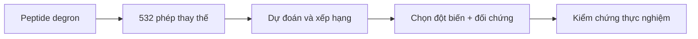

**Residue** là một đơn vị amino acid trong chuỗi protein.
- **Cả đoạn:** peptide này có thúc đẩy phân hủy không?
- **Vị trí:** vị trí nào nhạy với thay đổi?
- **Phép thay thế:** thay amino acid nào bằng amino acid nào sẽ tạo hiệu ứng gì?
**Ví dụ giả định:** peptide dài 28 residue có hoạt tính degron. Thay ở vị trí 7 có thể làm reporter bền hơn, còn vị trí 19 gần như không đổi. Ngay tại vị trí 7, các amino acid thay thế cũng có thể tạo hiệu ứng khác nhau.
Vì thế, người nghiên cứu cần chọn **một phép thay thế cụ thể**. Với 28 × 19 = **532** ứng viên, dự đoán giúp ưu tiên hiệu ứng mạnh và chọn đối chứng ít ảnh hưởng trước khi đo.

**Giới hạn:** đích dự đoán là thay đổi độ bền reporter trong assay. Protein nguyên vẹn, nhận diện E3 và tính gây bệnh cần bằng chứng bổ sung.
[Nghiên cứu Zhang 2023 — dữ liệu đột biến](https://data.mendeley.com/datasets/32h94v2yv2/2)

## Đọc một ô trong ma trận như thế nào?
Mỗi ô đại diện cho **một vị trí và một amino acid thay thế**. Ma trận 28 × 19 gồm các thay thế thực sự; nếu giao diện giữ cả amino acid tham chiếu thì có thể hiển thị 28 × 20, nhưng ô giữ nguyên không phải đột biến mới.
**Ví dụ giả định:** tại cùng vị trí 7, thay bằng A cho ΔPSI = +1,0 còn thay bằng G cho +0,1. Hai dự đoán gợi ý mức ưu tiên khác nhau, nhưng phải đọc cùng độ bất định. Các số này chỉ minh họa cách đọc, không phải kết quả thực nghiệm.

## Từ ma trận đến thiết kế thí nghiệm
Có thể xem xét ứng viên hiệu ứng mạnh và ứng viên ít ảnh hưởng làm đối chứng. Khi chưa có thử nghiệm xác nhận, chỉ nên gọi đây là **danh sách ưu tiên dự đoán**; chưa kết luận mô hình làm giảm số thí nghiệm hoặc xác định được cơ chế phân hủy.
Gộp 19 hiệu ứng tại một vị trí có thể tạo bản đồ độ nhạy, nhưng cách gộp phải được nêu rõ. Bản đồ vị trí không thay thế cho hiệu ứng của một phép thay thế cụ thể.
<mention-page url="https://app.notion.com/p/3fe4c97ef69581ed968df52b445de084">Degron — Lộ trình dự đoán hiệu ứng đột biến</mention-page>
