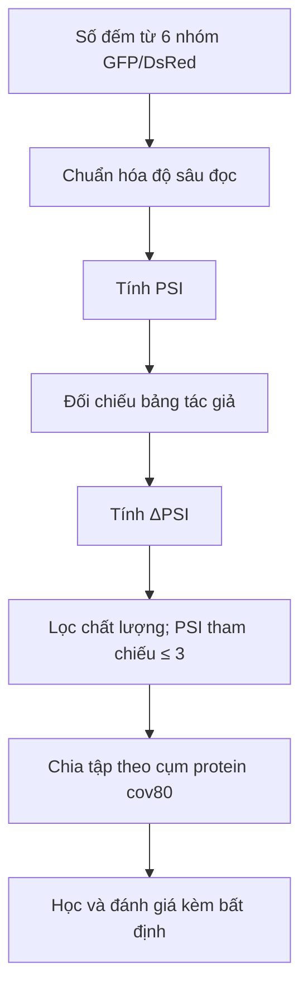
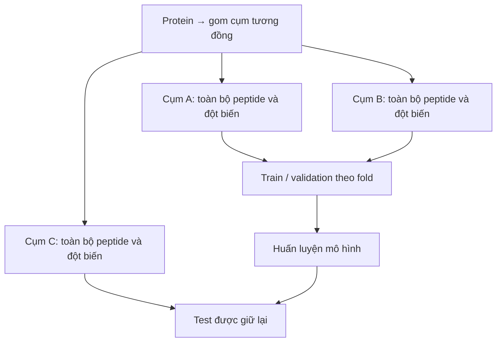

**Nguồn nhãn chính:** [Zhang 2023, Mendeley Data v2](https://data.mendeley.com/datasets/32h94v2yv2/2).
**Scanning:** quét từng vị trí theo quy tắc thí nghiệm; 2.994 peptide, 1.985 cụm, 83.446 phép thay thế.
**Saturation:** khảo sát đủ amino acid tại từng vị trí; sau lọc còn 91 peptide, 89 cụm, 47.847 phép thay thế. Đây là quy mô bộ bão hòa, không phải toàn bộ dữ liệu residue.

**PSI:** trung bình có trọng số của chỉ số nhóm 1–6, dùng số đếm đã chuẩn hóa. PSI thấp: reporter kém bền; PSI cao: bền hơn.
$$
PSI=\frac{\sum_{i=1}^{6}i\,c_i^{norm}}{\sum_{i=1}^{6}c_i^{norm}}
$$
Pipeline đối chiếu **261.865** giá trị hợp lệ của replicate 1; sai lệch lớn nhất khoảng **5 × 10⁻⁷**.
**ΔPSI = PSI(đột biến) − PSI(tham chiếu).** Scanning dùng mốc `mut0`; saturation dùng trung vị các ô giữ nguyên amino acid tham chiếu. BAG6 WT là điều kiện khác, không phải replicate bổ sung.
Giữ phép đo đạt ngưỡng đọc, đúng trình tự/tọa độ và PSI tham chiếu ≤ 3. Nhãn lấy trung bình hai replicate; khác biệt giữa replicate dùng ước lượng nhiễu và trần đo lường.
**Chống chồng lặp:** toàn bộ peptide và đột biến cùng cụm protein nằm cùng phía phép chia; kiểm soát cả chồng lặp scanning–saturation và dữ liệu baseline.
**Nguồn bổ trợ:** UniProt cho trình tự; PAP/Degformer cho đối chứng; Larsen/Voutsinos cho đánh giá mức tile và chuyển assay; ClinVar chỉ bổ sung động lực.
## Vì sao có nhiều ô nhưng vẫn ít mẫu độc lập?
Các phép thay thế của cùng peptide chia sẻ trình tự tham chiếu và nhiều điều kiện đo. Nếu chia ngẫu nhiên từng ô, mô hình có thể đã gặp chính peptide đó khi huấn luyện. Bộ bão hòa có 47.847 phép thay thế được chấm nhưng chỉ **91 peptide thuộc 89 cụm protein**; cần đọc cả hai quy mô.

*Ví dụ minh họa một fold: không tách các ô của cùng cụm sang hai phía. Các cụm A/B/C chỉ là nhãn minh họa.*
## Học trực tiếp và chuyển giao khác nhau thế nào?
**Học trực tiếp saturation:** dùng nhãn bão hòa ở các cụm train để dự đoán các cụm được giữ lại. **Chuyển giao:** học từ nguồn nhãn khác rồi chấm trên bão hòa, có kiểm soát cụm chồng lặp. Hai chế độ trả lời câu hỏi khác nhau và không được xếp chung như thể có cùng ngân sách nhãn.
## Nhiễu thực nghiệm có ý nghĩa gì?
Hai replicate có thể cho hiệu ứng khác nhau dù cùng một đột biến. So sánh replicate cho biết mức độ nhất quán và hỗ trợ ước lượng trần đo lường. Trần này là giới hạn của phép đo đang dùng, không phải cam kết mô hình sẽ đạt được.
Khi tính ΔPSI, sai số ở mốc tham chiếu cũng có thể ảnh hưởng nhiều ô cùng peptide. Vì vậy, suy luận thống kê cần tính đến cấu trúc nhóm và bất định, không chỉ tổng số ô.
<mention-page url="https://app.notion.com/p/3fe4c97ef69581ed968df52b445de084">Degron — Lộ trình dự đoán hiệu ứng đột biến</mention-page>
