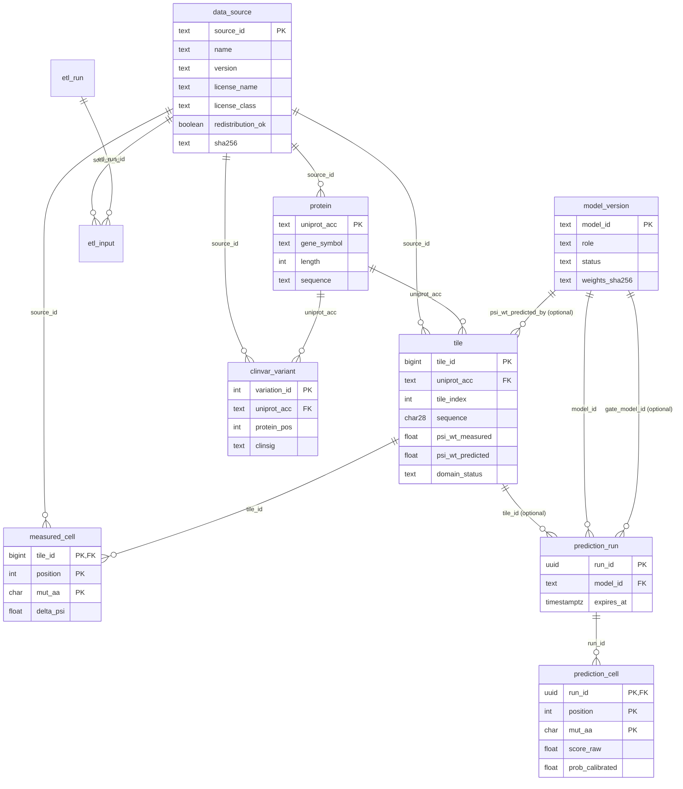
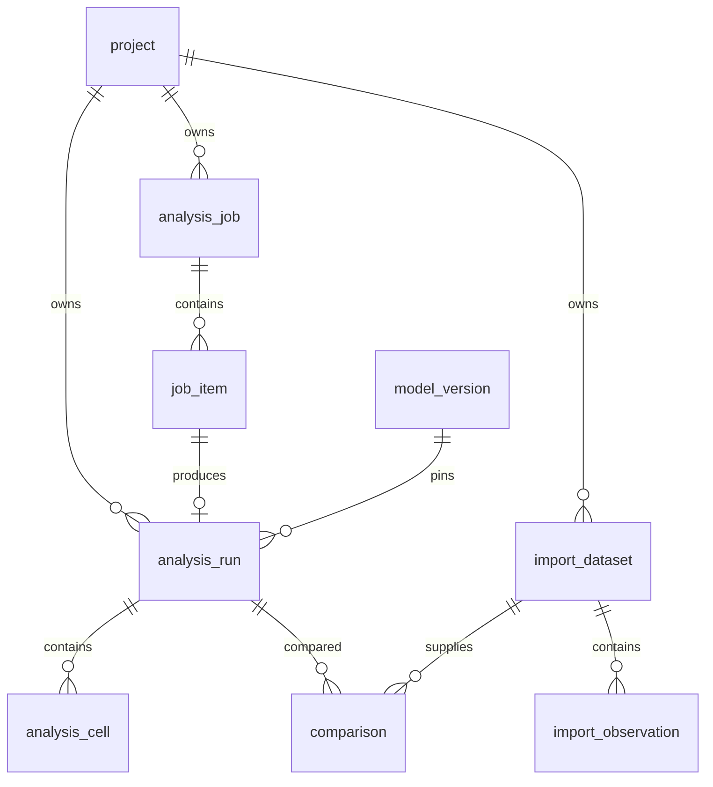

# Database Design

**v0.2 design, 29 Oct 2026.** Read [README.md](README.md) for the accepted local scope. Reference tables and the DDL in §4 describe the baseline; the project/job/import extension in §11 is **planned and not migrated by this task**. Legacy expiring share tables remain documented for code compatibility, not as project history. Sizes are planning estimates unless a dated ETL result is named.

## 1. Design principles

1. **Read-mostly reference data and explicit persistent workspace.** Compute on demand; save immutable completed analyses, never precompute all reference substitutions.
2. **One local operator, no accounts.** Projects own runs, jobs and imported datasets. A preview is transient until explicit save; job/import actions disclose local persistence.
3. **Reference provenance.** Each reference row points to a versioned/licensed/hash-checked `data_source`; snapshots retain the versions used.
4. **Separate user observations.** Project imports never write reference/training tables or weights; source rights and assay metadata remain attached.
5. **Per-tile domain.** Freeze the model/gate evidence, including unknown/borderline, for each analysis; R3 integration is still pending in the baseline.
6. **Retention and integrity.** Saved work survives restart until explicit deletion; transactional job claims and unique item keys prevent duplicate completed analyses.

## 2. Baseline reference and legacy-share entity diagram

The first-release workspace relationships are added in §11; `prediction_run`/`prediction_cell` below are legacy sharing tables, not the new history schema.



`usage_daily` and the Alembic version table are standalone and omitted from the diagram.

## 3. Domain definitions the schema depends on

All taken from the research code (`predict.py`, `coverage.py`, `data/README.md`); each is a fact the ETL must re-verify, not assume.

### 3.1 Tile

A tile is a window of **28 residues** with step **23**: tile *n* (1-based) covers residues `(n-1)*23 + 1 … (n-1)*23 + 28` of the UniProt canonical sequence. Only full 28-residue windows exist, so a protein of length *L* has `n_max = (L - 28) // 23 + 1` tiles (proteins shorter than 28 have none). A tile is **scorable** if all 28 residues are among the 20 standard amino acids. Each tile has 28 × 19 = **532** substitutions.

### 3.2 Positions and substitutions

`position` is 1-based **within the tile** (1…28). `mut_aa` is one of the 20 standard letters and differs from the wild-type letter at that position.

### 3.3 Domain status (the two-tier gate)

The effect model was trained only on peptides with intrinsic `PSI(WT) <= 4.0` (hyper-parameter `DEGRON_PSI_MAX = 4.0`). It cannot know whether a tile is in that domain, so the system attaches a `domain_status` to every tile and every prediction.

The **baseline implementation** assigns `measured_in_domain`/`measured_out_of_domain` by directly comparing screen PSI with 4.0, has unreliable/unknown and reserved predicted states, and lacks `borderline`. This is not the accepted target rule.

The **target** uses the frozen R3 gate artefacts ([research report](../research/r3-domain-gate-2026-10-22/README.md)). Screen PSI is mapped through the logistic gate rather than equated with intrinsic PSI(WT); the reported tier-1 cuts are 2.687 / 3.110, and the typed-sequence tier-2 cuts are 3.700 / 4.426. A `borderline` region is retained. These figures are taken from the R3 report, not new measurements. Store raw measurement, estimator/source, gate ID/hash and final status separately. Add `borderline` to tile/run constraints and API types in the implementation migration; do not relabel historical snapshots under a newer gate.

Known out-of-domain tiles are refused by default; unknown/unreliable/borderline/predicted results carry warnings. An explicit override stays in the run snapshot. Typed sequences are not silently assigned canonical accessions.

`[CHƯA XÁC MINH]` The screen identifies tiles as `<UniProt>_<gene>_<n>` (for example `P00387_CYB5R3_5`). The mapping `n → residues (n-1)*23+1…+28` of **UniProt release 2026_03** assumes the library was built on the same sequences. It is supported for the 176 training peptides (the verification run compares the UniProt-derived tile with the training peptide for every cell and the difference is 0) but has **not** been checked for the other tiles. The ETL therefore records, for every `tile` row with a screen id, whether the derived sequence matches wherever the screen or labels give an independent sequence, and reports the count (§7).

## 4. Baseline DDL (PostgreSQL 16)

This retained baseline is not a complete v0.2 migration: expiring `prediction_run` rows belong to deprecated sharing; new persistent `analysis_run` rows are defined in §11. Domain constraints below require the R3 migration described in §3.3.

Portable subset: `text`, `integer`, `double precision`, `boolean`, `CHECK` and plain/partial indexes work in both PostgreSQL and SQLite. PostgreSQL-only constructs are marked `-- PG`. §8 lists the SQLite substitutions.

```sql
-- ===== reference: provenance =====================================================
CREATE TABLE data_source (
    source_id          text PRIMARY KEY,                 -- e.g. 'zhang2023-mendeley-v2'
    name               text NOT NULL,
    version            text NOT NULL,                    -- release, commit, or retrieval date
    citation           text NOT NULL,
    url                text,
    license_name       text NOT NULL,                    -- 'CC BY 4.0', 'MIT', 'ClinVar attribution policy', ...
    license_class      text NOT NULL CHECK (license_class IN
                         ('open','attribution_required','internal_only','unknown')),
    redistribution_ok  boolean NOT NULL,
    attribution_text   text NOT NULL,                    -- shown in UI and exports
    disclaimer_text    text,                             -- mandatory when not NULL (ClinVar)
    sha256             char(64),                         -- of the file the ETL actually read
    retrieved_on       date,
    -- a source that may not be redistributed can never be marked servable
    CHECK (redistribution_ok OR license_class IN ('internal_only','unknown'))
);

-- ===== reference: proteins and tiles =============================================
CREATE TABLE protein (
    uniprot_acc      text PRIMARY KEY,
    gene_symbol      text,
    protein_name     text,
    length           integer NOT NULL CHECK (length > 0),
    sequence         text    NOT NULL,
    uniprot_release  text    NOT NULL,                   -- '2026_03'
    source_id        text    NOT NULL REFERENCES data_source(source_id),
    CHECK (length = char_length(sequence))               -- PG; SQLite: length(sequence)
);
CREATE INDEX protein_gene_idx ON protein (gene_symbol);

CREATE TABLE tile (
    tile_id            bigserial PRIMARY KEY,            -- PG; SQLite: INTEGER PRIMARY KEY
    uniprot_acc        text    NOT NULL REFERENCES protein(uniprot_acc) ON DELETE CASCADE,
    tile_index         integer NOT NULL CHECK (tile_index >= 1),
    start_pos          integer NOT NULL,                 -- 1-based, protein coordinates
    end_pos            integer NOT NULL,
    sequence           char(28) NOT NULL,
    scorable           boolean NOT NULL,                 -- all 28 residues standard
    screen_peptide_id  text,                             -- 'P00387_CYB5R3_5' when present in the screen
    -- tier 1: measured in the GPS peptidome screen (replicate 1)
    psi_wt_measured    double precision,
    reads_measured     double precision CHECK (reads_measured IS NULL OR reads_measured >= 0),   -- normalised reads, not integer
    -- tier 2: predicted by a gate model (NULL until R3 exists)
    psi_wt_predicted        double precision,
    psi_wt_predicted_by     text REFERENCES model_version(model_id),
    domain_status      text NOT NULL DEFAULT 'unknown' CHECK (domain_status IN
                         ('measured_in_domain','measured_out_of_domain','measured_unreliable',
                          'predicted_in_domain','predicted_out_of_domain','unknown')),
    source_id          text NOT NULL REFERENCES data_source(source_id),
    UNIQUE (uniprot_acc, tile_index),
    CHECK (start_pos = (tile_index - 1) * 23 + 1),
    CHECK (end_pos   = start_pos + 27),
    -- the domain status must be backed by the corresponding evidence
    CHECK (domain_status NOT LIKE 'measured_%' OR psi_wt_measured IS NOT NULL OR domain_status = 'measured_unreliable'),
    CHECK (domain_status NOT LIKE 'predicted_%' OR (psi_wt_predicted IS NOT NULL AND psi_wt_predicted_by IS NOT NULL)),
    CHECK (scorable OR domain_status = 'unknown')
);
CREATE INDEX tile_screen_idx ON tile (screen_peptide_id) WHERE screen_peptide_id IS NOT NULL;
CREATE INDEX tile_domain_idx ON tile (uniprot_acc, domain_status);

-- ===== reference: measured labels (training peptides only) ======================
CREATE TABLE measured_cell (
    tile_id          bigint  NOT NULL REFERENCES tile(tile_id) ON DELETE CASCADE,
    position         integer NOT NULL CHECK (position BETWEEN 1 AND 28),
    mut_aa           char(1) NOT NULL CHECK (mut_aa IN
                       ('A','C','D','E','F','G','H','I','K','L','M','N','P','Q','R','S','T','V','W','Y')),
    delta_psi        double precision NOT NULL,          -- mean of two replicates, minus intrinsic WT PSI
    in_training_set  boolean NOT NULL DEFAULT true,      -- overlay must say so (not an external check)
    source_id        text NOT NULL REFERENCES data_source(source_id),
    PRIMARY KEY (tile_id, position, mut_aa)
);

-- ===== reference: ClinVar overlay ================================================
CREATE TABLE clinvar_variant (
    variation_id        integer PRIMARY KEY,
    uniprot_acc         text    NOT NULL REFERENCES protein(uniprot_acc) ON DELETE CASCADE,
    protein_pos         integer NOT NULL CHECK (protein_pos >= 1),
    ref_aa              char(1) NOT NULL,
    alt_aa              char(1) NOT NULL,
    clinsig             text    NOT NULL CHECK (clinsig IN
                          ('pathogenic','likely_pathogenic','vus','likely_benign','benign','conflicting','other')),
    review_status       text,
    last_evaluated      date,
    clinvar_file_date   date    NOT NULL,                -- Last-Modified of variant_summary.txt.gz
    source_id           text    NOT NULL REFERENCES data_source(source_id),
    CHECK (ref_aa <> alt_aa)
);
CREATE INDEX clinvar_pos_idx ON clinvar_variant (uniprot_acc, protein_pos);

-- ===== models ====================================================================
CREATE TABLE model_version (
    model_id             text PRIMARY KEY,               -- 'm3-ext4.0-platt-v1'
    role                 text NOT NULL CHECK (role IN ('effect','gate')),
    kind                 text NOT NULL,                  -- 'ridge_platt', later e.g. 'esm_ridge_platt'
    status               text NOT NULL CHECK (status IN ('candidate','frozen','retired')),
    is_default           boolean NOT NULL DEFAULT false,
    tile_length          integer NOT NULL DEFAULT 28,
    feature_spec         text NOT NULL,                  -- 'm3-180: wt onehot|mut onehot|tile composition|+-3 context'
    weights_path         text NOT NULL,
    weights_sha256       char(64) NOT NULL,
    event_definition     text NOT NULL,                  -- 'P(DeltaPSI >= 1.0)' - what the probability means
    domain_description   text NOT NULL,
    metrics              jsonb NOT NULL,                 -- PG; SQLite: json text. AUROC + CI, Brier, ...
    calibration          jsonb,
    trained_on_sources   jsonb NOT NULL,                 -- list of source_id
    evidence_label       text NOT NULL DEFAULT 'development OOF benchmark, not external validation',
    card_markdown        text NOT NULL,
    created_at           timestamptz NOT NULL DEFAULT now(),
    frozen_at            timestamptz,
    CHECK (status <> 'frozen' OR frozen_at IS NOT NULL)
);
-- at most one default per role, and only a frozen model can be default
CREATE UNIQUE INDEX model_default_idx ON model_version (role) WHERE is_default;
ALTER TABLE model_version ADD CONSTRAINT default_is_frozen CHECK (NOT is_default OR status = 'frozen');

-- ===== optional persisted predictions (share links only) ========================
CREATE TABLE prediction_run (
    run_id            uuid PRIMARY KEY,                  -- PG; SQLite: text
    input_kind        text NOT NULL CHECK (input_kind IN ('sequence','uniprot_tile')),
    tile_id           bigint REFERENCES tile(tile_id),
    input_sequence    char(28) NOT NULL,
    model_id          text NOT NULL REFERENCES model_version(model_id),
    gate_model_id     text REFERENCES model_version(model_id),
    domain_status     text NOT NULL,
    warnings          jsonb NOT NULL DEFAULT '[]',
    share_token_hash  char(64) NOT NULL UNIQUE,          -- sha256 of a 128-bit token; the token itself is never stored
    created_at        timestamptz NOT NULL DEFAULT now(),
    expires_at        timestamptz NOT NULL,
    CHECK (expires_at > created_at),
    CHECK (expires_at <= created_at + interval '30 days')  -- PG; SQLite: enforced in application
);
CREATE INDEX prediction_run_expiry_idx ON prediction_run (expires_at);

CREATE TABLE prediction_cell (
    run_id           uuid    NOT NULL REFERENCES prediction_run(run_id) ON DELETE CASCADE,
    position         integer NOT NULL CHECK (position BETWEEN 1 AND 28),
    mut_aa           char(1) NOT NULL,
    score_raw        double precision NOT NULL,
    prob_calibrated  double precision NOT NULL CHECK (prob_calibrated BETWEEN 0 AND 1),
    rank_in_tile     integer NOT NULL CHECK (rank_in_tile BETWEEN 1 AND 532),
    PRIMARY KEY (run_id, position, mut_aa)
);

-- ===== operations ================================================================
CREATE TABLE usage_daily (                               -- aggregate counters only, never sequences
    day        date    NOT NULL,
    endpoint   text    NOT NULL,
    model_id   text    NOT NULL DEFAULT '',          -- '' when the endpoint has no model
    n_requests integer NOT NULL DEFAULT 0,
    n_errors   integer NOT NULL DEFAULT 0,
    PRIMARY KEY (day, endpoint, model_id)
);

CREATE TABLE etl_run (
    etl_run_id    bigserial PRIMARY KEY,
    started_at    timestamptz NOT NULL,
    finished_at   timestamptz,
    git_commit    text NOT NULL,
    status        text NOT NULL CHECK (status IN ('running','succeeded','failed')),
    report        jsonb NOT NULL DEFAULT '{}'
);
CREATE TABLE etl_input (
    etl_run_id     bigint NOT NULL REFERENCES etl_run(etl_run_id) ON DELETE CASCADE,
    source_id      text   NOT NULL REFERENCES data_source(source_id),
    file_path      text   NOT NULL,
    sha256_expected char(64) NOT NULL,
    sha256_actual   char(64) NOT NULL,
    PRIMARY KEY (etl_run_id, source_id, file_path)
);
```

Notes on the DDL.

* `prediction_run` holds the sequence the user typed. In the baseline share schema this requires an explicit share request; the new project/job/import schema in §11 persists its own inputs separately. `input_sequence` is deleted with the row at `expires_at`.
* `tile.psi_wt_predicted_by` references `model_version`, which must therefore be created first (or the constraint added afterwards). The migration order is: `data_source`, `model_version`, `protein`, `tile`, then the rest.
* `measured_cell.in_training_set` is `true` for every row in v1, because the product model is fitted on all 176 peptides. The overlay (UC-05) must say "measured data, included in the training of this model" and must never be presented as validation.
* `clinvar_variant` carries `clinvar_file_date` because ClinVar publishes no version number and the file is overwritten weekly.

## 5. Data dictionary

### 5.1 `data_source`

| Column | Type | Null | Meaning |
|---|---|---|---|
| `source_id` | text | no | Stable key, e.g. `zhang2023-mendeley-v2`, `zhang2023-geo-gse240610`, `uniprot-2026_03`, `clinvar-2026-10-12` |
| `name`, `version`, `citation`, `url` | text | no/no/no/yes | Human-readable provenance |
| `license_name` | text | no | Verbatim licence name |
| `license_class` | text | no | `open` (CC BY, MIT, public GEO), `attribution_required` (ClinVar), `internal_only` (Koren), `unknown` (MetaDegron, Larsen) |
| `redistribution_ok` | boolean | no | `true` only if the public API may serve rows derived from it |
| `attribution_text` | text | no | String shown in the footer and written into every export |
| `disclaimer_text` | text | yes | Mandatory string shown next to any data of this source (ClinVar) |
| `sha256`, `retrieved_on` | char(64), date | yes | Of the file the ETL read |

### 5.2 `protein`

`uniprot_acc` (PK), `gene_symbol`, `protein_name`, `length`, `sequence` (canonical Swiss-Prot human, release 2026_03, about 20 thousand rows), `uniprot_release`, `source_id`.

### 5.3 `tile`

| Column | Meaning |
|---|---|
| `tile_id` | Surrogate key |
| `uniprot_acc`, `tile_index` | Natural key; `tile_index` is the 1-based *n* of §3.1 |
| `start_pos`, `end_pos` | Protein coordinates; the checks pin them to `(n-1)*23+1` and `+27` |
| `sequence` | The 28 residues, copied from `protein.sequence` at ETL time |
| `scorable` | False if any residue is non-standard (U, X, B, Z, ...) |
| `screen_peptide_id` | Id used by the GPS peptidome screen when the tile is in it |
| `psi_wt_measured`, `reads_measured` | Tier-1 evidence from replicate 1 of the screen (psi may be NA ⇒ NULL) |
| `psi_wt_predicted`, `psi_wt_predicted_by` | Tier-2 evidence; NULL until a frozen gate model exists |
| `domain_status` | One of §3.3; set by the ETL, and re-set when a gate model is registered |

### 5.4 `measured_cell`

`tile_id`, `position`, `mut_aa` (PK); `delta_psi` = mean over the two saturation replicates of `PSI(mutant) − PSI(WT)` with the **intrinsic** WT (median of the synonymous cells), as defined by the research label pipeline; `in_training_set`; `source_id`. Source: saturation tables (CC BY 4.0). About 92,337 rows (47,847 + 44,490 cells of the 91 + 85 peptides).

### 5.5 `clinvar_variant`

`variation_id` (ClinVar VariationID); UniProt coordinate and amino-acid letters; `clinsig` mapped to seven classes; `review_status`; `last_evaluated`; `clinvar_file_date`. Only missense variants whose reference residue **equals** the UniProt residue at that position are loaded (the research script rejects the rest, 93.0 % accepted).

### 5.6 `model_version`

| Column | Meaning |
|---|---|
| `model_id`, `role`, `kind` | Key; `effect` or `gate`; algorithm family |
| `status`, `is_default`, `frozen_at` | Lifecycle; only a frozen model may be default |
| `feature_spec` | Text description of the feature vector, tied to a code version |
| `weights_path`, `weights_sha256` | The `.npz` the API loads at start-up; the API refuses to start if the hash differs |
| `event_definition` | What the probability is a probability **of** (`P(ΔPSI ≥ 1.0)`); shown wherever a probability is shown |
| `domain_description`, `evidence_label` | Text shown on the model card and in every export |
| `metrics`, `calibration` | JSON copied from the experiment `results.json` (AUROC with CI, Brier, enrichment), with the file path in a key `source_file` |
| `trained_on_sources` | JSON list of `source_id` |
| `card_markdown` | Model card rendered on the *Model card* page |

### 5.7 `prediction_run` / `prediction_cell`

Legacy only: written for the baseline share links, outside v0.2 acceptance. `share_token_hash` is the SHA-256 of a random 128-bit token. `warnings` is the list of warning codes active at creation. `prediction_cell` holds the 532 rows of the run.

### 5.8 Operational tables

`usage_daily` counts requests per day, endpoint and model id; it never contains sequences, accessions or IPs. `etl_run` and `etl_input` record each load with the git commit and the expected and actual SHA-256 of every input file.

## 6. Which table holds which licence

| Table | Source(s) | `license_class` | Public API may serve? | Conditions |
|---|---|---|---|---|
| `protein`, `tile.sequence` | UniProtKB/Swiss-Prot 2026_03 | open (CC BY 4.0) | yes | Attribution |
| `tile.psi_wt_measured`, `reads_measured` | Zhang et al. 2023, GEO GSE240610 Table S1 | open (GEO terms, public) | yes | Attribution to Zhang et al. 2023 |
| `measured_cell` | Zhang et al. 2023, Mendeley Data v2 saturation tables | open (CC BY 4.0) | yes | Attribution; label "training data" |
| `clinvar_variant` | NCBI ClinVar `variant_summary.txt.gz` | attribution_required | yes, with duty | Attribution to ClinVar (PMID 29165669) **and** the diagnostic disclaimer wherever shown |
| `model_version`, `prediction_*` | Own work | open | yes | — |
| *(not loaded)* | Koren et al. 2018 (NIHMS manuscript) | internal_only | **no** | Used only in offline research; ETL aborts if a row references it |
| *(not loaded)* | MetaDegron, ELM-derived tables | unknown / academic only | **no** | Not imported into any table |
| *(not loaded)* | Larsen et al. 2025 | unknown (MIT of repo, data coverage pending) | **no** | Until the email confirmation is on file |
| *(not loaded)* | Voutsinos et al. 2026 (MIT) | open | not needed by v1 | Used for the gate model R3 only if it is trained on it; then registered as `trained_on_sources` |

The ETL enforces the "no" rows: any attempt to insert a `data_source` with `redistribution_ok = false` into `protein`, `tile`, `measured_cell` or `clinvar_variant` fails (§7 step 0).

## 7. ETL design

One script, `app/etl/load.py`, run by `make etl` (outside the web process). **Idempotent**: every step uses upserts keyed on natural keys, and a second run with unchanged inputs changes no row and reports zero diffs. It never modifies `data/`.

**Step 0 — gate.** Load `etl/sources.yaml` (hand-maintained: `source_id`, licence fields, expected SHA-256 and path). For each input file compute SHA-256 and compare with the expected value; write one `etl_input` row each. Abort on mismatch. Abort if a file maps to a source with `redistribution_ok = false`.

| Step | Input (under `topics/degron-footprint/data/`) | Target | Notes |
|---|---|---|---|
| 1 | `README.md` / `sources.yaml` | `data_source` | Expected hashes come from the manifests below |
| 2 | `raw/human-reviewed-2026-10-12.fasta.gz` (manifest `…fasta.manifest.json`) | `protein` | Parse headers `>sp|ACC|GENE_HUMAN`; reject duplicate accessions. 17 accessions from older releases (`raw/uniprot-additional/`) are **not** loaded in v1 |
| 3 | `protein.sequence` | `tile` | Generate all tiles by §3.1; set `scorable`; `domain_status = 'unknown'`. About 490 thousand rows *(to be measured)* |
| 4 | `interim/gps-peptidome-rep1.tsv` (21 MB, 475,506 lines; columns `peptide reads psi`) | `tile.screen_peptide_id`, `psi_wt_measured`, `reads_measured`, `domain_status` | Parse `<acc>_<gene>_<n>`; match `(acc, n)`; unmatched ids are counted, not inserted. Baseline only: direct 4.0 rule. Target: preserve raw screen values and apply the frozen R3 gate (§3.3), with gate provenance and borderline state |
| 5 | Saturation label cache (`processed/learning-curve-sat-ext4.0.npz` plus the peptide index) | `measured_cell` | Peptide id → `tile`; the ETL asserts that the UniProt-derived tile sequence equals the training peptide sequence for all 176 peptides and writes the count of mismatches (expected 0) |
| 6 | `raw/clinvar/variant_summary.txt.gz` (455,785,525 bytes, SHA-256 `a5198a11…28218`) | `clinvar_variant` | Reuse the parsing rules of `research/variant-coverage-2026-10-15/coverage.py`: missense, assembly-independent protein change, reference residue must equal the UniProt residue. Option `--clinvar-scope` = `all`, `in-tiles` or `degron-only` (default `in-tiles`) to control local reference-data size; record the loaded scope |
| 7 | `processed/calibration-p6-model.npz` and `calibration-p6-2026-10-22/results.json` | `model_version` | `model_id = m3-ext4.0-platt-v1`, `status = frozen`, `is_default = true`. Weights are copied to `app/models/` with their SHA-256 |
| 8 | (pending integration) frozen gate model | `tile.psi_wt_predicted*`, `domain_status` | Only for tiles with `domain_status = 'unknown'`; never overwrites a measured status |

**Report.** `etl_run.report` records: rows read, inserted, updated, skipped by reason; number of screen ids that did not match a tile; number of tiles whose derived sequence disagreed with an independent sequence; ClinVar rows rejected for reference mismatch; elapsed time. A run with any non-zero mismatch of step 5 fails.

## 8. SQLite differences (development and tests)

| PostgreSQL | SQLite substitute |
|---|---|
| `bigserial`, `uuid` | `INTEGER PRIMARY KEY`, `text` (UUID as string) |
| `jsonb` | `text` holding JSON; SQLAlchemy `JSON` type handles both |
| `timestamptz`, `interval` | ISO text; the 30-day expiry `CHECK` moves into the application |
| `char_length` | `length` |
| `ALTER TABLE … ADD CONSTRAINT … CHECK` | Declare in the `CREATE TABLE` |
| partial unique index on `is_default` | Supported as is |

Alembic migrations are written with SQLAlchemy 2 constructs so both back-ends use the same revision files. The test plan calls for isolated SQLite tests and local PostgreSQL integration; no CI or PostgreSQL run is claimed by this document. SQLite is not a second accepted product edition.

## 9. Retention and privacy

| Data | Retention |
|---|---|
| Unsaved single-tile preview | Memory only; no input in logs/URLs |
| Saved analysis, job input/result, committed observations | Explicit local save/submit/commit; retained until deletion, no 30-day project expiry |
| Staged import | Proposed 24-hour expiry if not committed; purge staged files/rows |
| Deleted project/dataset/run | Confirm dependencies; remove owned rows/files and comparisons, prevent late worker writes; retain shared reference/model data |
| Legacy share record | Its original ≤30-day rule, solely for baseline compatibility; not used for new project storage |
| Logs | Route templates, status/counts and timing only, no sequences/observations |

The database and workspace files must be copied together for local recovery. Application deletion does not erase external backups. Reference ETL remains rebuildable; user-imported observations and saved history are not rebuildable from reference ETL alone.

## 10. Size estimates *(to be measured by the ETL report)*

| Table | Rows | Rough size with indexes | Basis |
|---|---:|---:|---|
| `protein` | ~20,000 | ~15 MB | Swiss-Prot human, mean length ≈ 560 |
| `tile` | ~490,000 | ~90 MB | ≈ 24 tiles per protein |
| `measured_cell` | 92,337 | ~10 MB | 176 peptides × ≈ 525 cells |
| `clinvar_variant` | ≤ ~2.4 million (scope `all`) | ≤ ~300 MB | 2,564,486 missense, 93.0 % matched; `degron-only` is expected to be much smaller |
| `model_version` | 1–4 | < 1 MB | — |
| `prediction_run`/`cell` | transient | < 10 MB | 532 cells per run, 7-day expiry |

Local sizing must include persistent projects, job snapshots, imports and annotations. Measure rows/bytes per representative job and report disk growth separately from reference tables. There is no free-hosting cap or hosted-database fallback acceptance target. The old transient-share estimate above does not size the new workspace.

## 11. Planned first-release workspace migration

**Design only; no migration or database writes were made in the scope-update task.** Keep the existing reference schema and introduce project-owned tables rather than overloading the legacy share-token/expiry schema.



| Entity | Keys and required fields | Invariants |
|---|---|---|
| `project` | UUID PK, name, description, created/updated UTC, deletion state | Local owner is the workspace; no account FK |
| `analysis_job` | UUID PK, project FK, mode, immutable input/config/source snapshot, model/calibrator/gate hashes, state, timestamps, cancel flag | Mode peptides/protein; pending/running/completed/partial/failed/cancelled; pin configuration on submission |
| `job_item` | PK `(job_id,item_id)`, input ID, normalised peptide, optional verified protein mapping, tile/coverage metadata, state/error, lease owner/expiry | Transactional claim; interrupted unfinished leases are reclaimable; completed items are not recomputed |
| `analysis_run` | UUID PK, project FK, nullable job/item FK, parent run FK, model FK, normalised input, frozen result/provenance/annotation snapshot, created UTC | Unique `(job_id,item_id)` when non-null; immutable; no share token or expiry |
| `analysis_cell` | PK `(analysis_id,position,mut_aa)`, WT, raw/probability/rank/top10 | 532 cells per scored analysis; WT matches saved sequence; values and ordering match the snapshot |
| `import_dataset` | UUID PK, project FK, revision, display name, state, generated file path, file SHA-256, assay/units/source/rights/reference metadata, validation report, created/committed UTC | staged/committed; immutable after commit; new file = new revision, not overwrite; temporary expiry only for staged records |
| `import_observation` | UUID PK, dataset FK, row number, peptide ID/WT sequence, position, WT/mutant, replicate, nullable observed value/missing reason, optional accession/release/start | Unique `(dataset_id,wt_sequence,position,mut_aa,replicate_id)`; validate sequence/coordinate/WT and finite values before commit |
| `comparison` | UUID PK, analysis FK, dataset FK, aggregation/replicate/compatibility selection, alignment/exclusion counts, result/metric snapshot, created UTC | Same project; endpoints/units checked; no update to trained weights or original analysis |

Indexes: projects by update time; analyses `(project_id,created_at,analysis_id)`; jobs `(state,created_at)`; job items `(job_id,state)` and lease expiry; datasets `(project_id,state)`; observations by dataset and mutation key. Paginate history/item results with a stable ID tie-breaker.

Reference and annotation versions used in a saved analysis must remain retrievable, either as immutable versioned artefacts or included snapshots. Replacing the active ClinVar/UniProt load must not change old results. Do not make a saved analysis depend only on mutable current `tile`/`clinvar_variant` rows.

Project deletion first marks deletion/cancellation and prevents worker commits, then deletes comparisons, observations, cells, analyses, job items/jobs and staged/committed owned files in a recoverable transaction/file-cleanup workflow. Run deletion removes its comparisons; dataset deletion removes its observations and comparisons. File-cleanup failures are surfaced and retried rather than reported as complete deletion. Foreign-key constraints must also prevent cross-project job/run/dataset associations. Reference rows, weights and other projects are never cascaded away.

Migration acceptance: local PostgreSQL upgrade from the baseline; create/save/restart/read; interrupted job recovery without duplicate runs; failed import leaves reference tables unchanged; cascade/file cleanup; all checked by HIST/IMP/BATCH tests. No executable DDL for these additions is claimed here.
