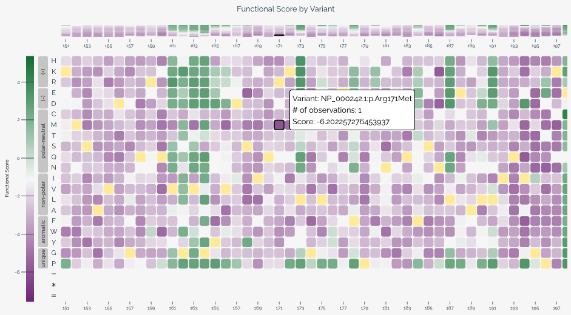
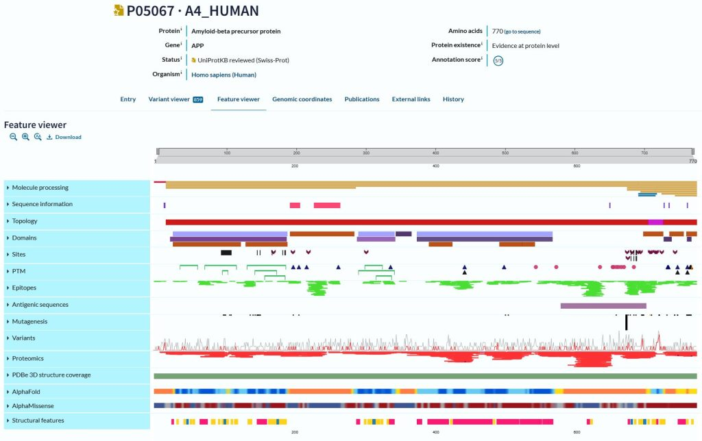
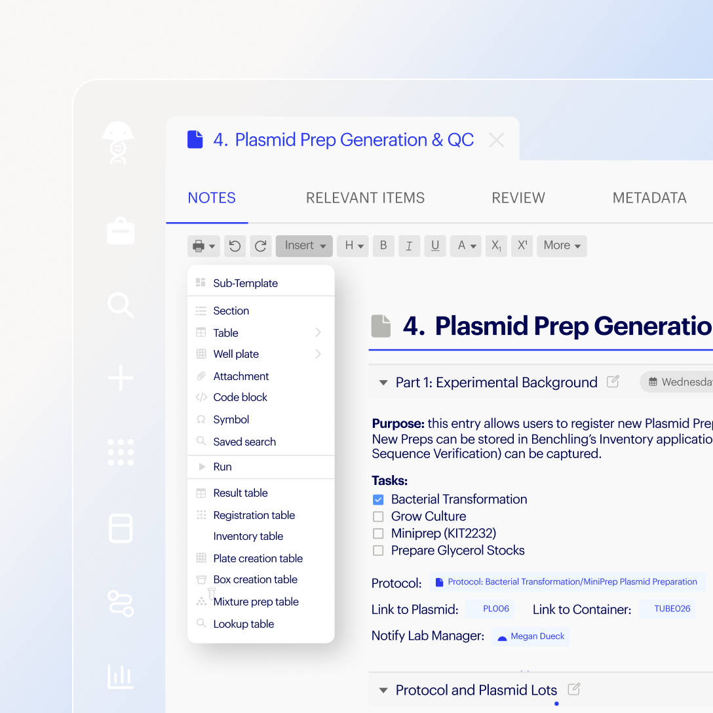
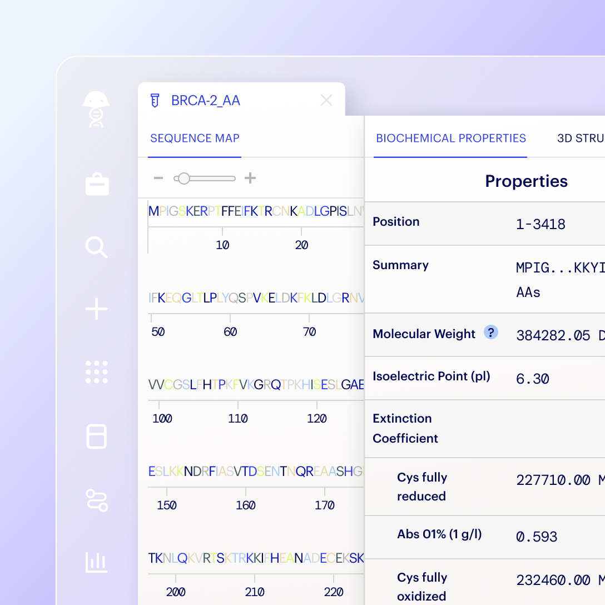
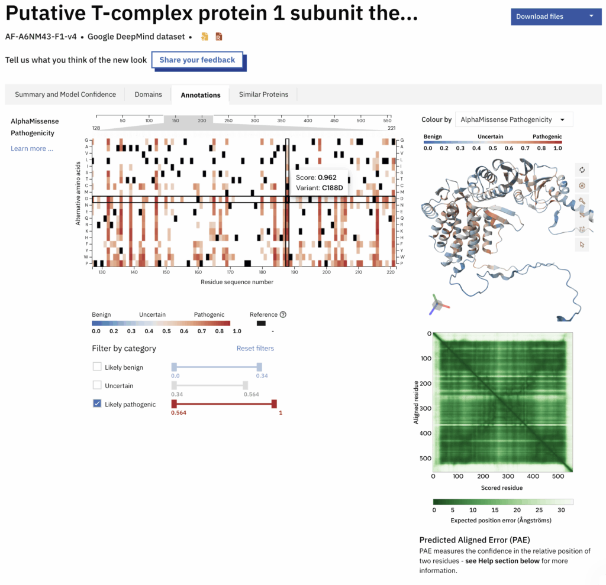
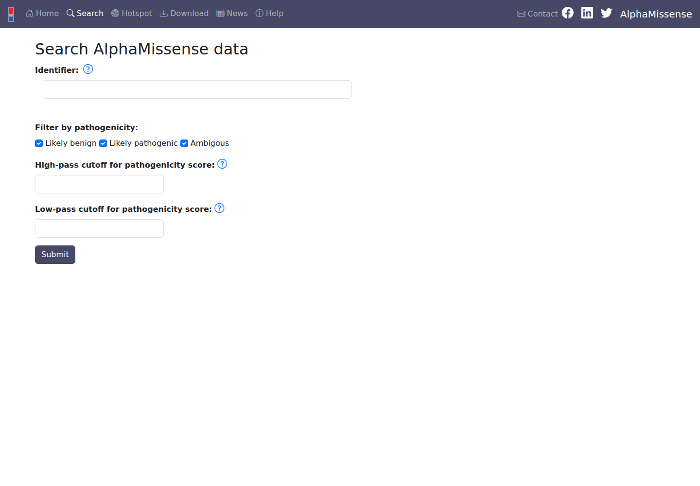
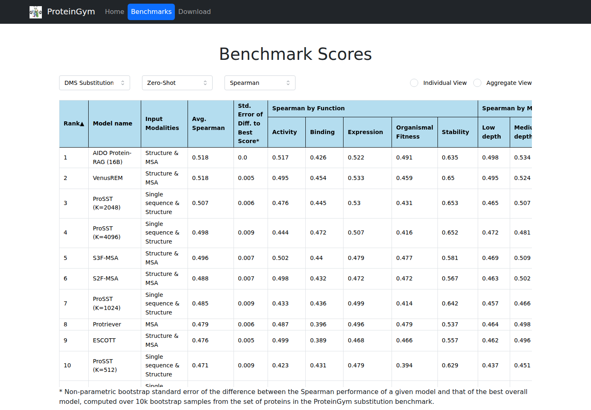

# Khảo sát giao diện và lựa chọn hướng thiết kế Degron Footprint

**Ngày khảo sát: 01/11/2026. Quyết định: người dùng đã chọn B — Workspace nghiên cứu hiện đại trong cùng phiên.** Bản tiếp theo: [Workspace UI v2](../workspace-ui-v2/README.md).

Đây là nghiên cứu tham khảo cho bản thiết kế local. Các tên phong cách A–D là cách phân loại và đề xuất của người thiết kế, không phải tên design system do các ứng dụng tự công bố. Nhận xét về độ phù hợp là suy luận từ yêu cầu BA, chưa phải kết quả kiểm thử với người dùng.

## 1. Kết luận phục vụ lựa chọn

| Hướng | Đặc điểm nhìn thấy ở bản Degron dự kiến | Ưu tiên | Đánh đổi |
|---|---|---|---|
| **A. Cổng phân tích khoa học** | Nền sáng; tiêu đề và metadata rõ; tab theo loại dữ liệu; ma trận và bảng chiếm phần lớn màn hình | Đọc bằng chứng và tra cứu chi tiết | Nhiều thông tin; cần tiết chế để không giống trang cơ sở dữ liệu cũ |
| **B. Workspace nghiên cứu hiện đại — đề xuất** | Sidebar sáng gọn; bố cục phẳng; tab trong dự án; ma trận lớn và bảng chi tiết bên cạnh; một màu nhấn | Cân bằng phân tích, dự án, batch và import | Cần giữ sidebar và vùng tổng quan thật gọn để dành chỗ cho dữ liệu |
| **C. Bàn phân tích tương tác** | Vùng ma trận rộng gần toàn màn hình; thanh công cụ mảnh; inspector bên phải; các vùng chọn đồng bộ | Khám phá từng vị trí và lập shortlist | Nhiều tương tác; cần hướng dẫn ban đầu và phương án bảng/keyboard tốt |
| **D. Tối giản theo tác vụ** | Một tác vụ chính mỗi màn hình; biểu mẫu rõ; từng bước nhập → kiểm tra → kết quả; điều hướng phụ gọn | Dễ học, trình diễn quy trình rõ | Khi làm nhiều dự án/lô phải chuyển màn hình nhiều hơn |

**Đề xuất B đã được người dùng duyệt**, dùng cách trình bày kết quả có liên kết của MaveDB. Phạm vi BA có cả dự án/lịch sử, batch/protein và import/comparison nên cấu trúc workspace phù hợp hơn một trang form đơn lẻ.

## 2. Những ứng dụng đã nghiên cứu

### MaveDB — tham khảo sát nhất cho ma trận hiệu ứng biến thể

- **Quan sát:** nền trắng/xám nhạt, phân cấp tiêu đề và metadata; ảnh chính thức cho thấy ma trận với ô WT riêng, tooltip, legend và vùng điều hướng dọc chuỗi. Tài liệu mô tả lựa chọn biến thể được đồng bộ giữa các biểu đồ.
- **Học cho Degron:** giữ đơn vị phép thay thế rõ; liên kết ô ma trận với dòng bảng và thông tin nguồn; chú giải gần dữ liệu.
- **Giới hạn áp dụng:** hướng trục, thang màu và diễn giải score phải theo BA Degron; không sao chép các nhãn phân loại lâm sàng.
- Nguồn: [trang score set](https://mavedb.org/score-sets/urn:mavedb:00000050-a-1), [tài liệu visualization của dự án](https://github.com/VariantEffect/mavedb-ui/blob/main/docs/content/finding-data/visualizations.md).
- Kiểm tra: trang live hiện metadata nhưng variants còn loading khi chụp. Phân tích ma trận dựa trên ảnh trong tài liệu chính thức dưới đây.

### UniProt — tham khảo cho ngữ cảnh protein và lớp chú giải

- **Quan sát:** điều hướng trái theo chủ đề, header protein có định danh, tab theo chế độ xem. Feature Viewer biểu diễn nhiều lớp chú giải trên cùng trục residue, cho mở rộng từng track.
- **Học cho Degron:** bản đồ tile/coverage có tọa độ nhất quán; chỉ bật các lớp có dữ liệu; metadata và bằng chứng giữ được ngữ cảnh khi đổi view.
- **Giới hạn áp dụng:** Degron chỉ cần các lớp đã được BA duyệt; không mang toàn bộ phân loại của UniProt vào ứng dụng.
- Nguồn: [entry được xem trực tiếp](https://www.uniprot.org/uniprotkb/P04637/entry), [hướng dẫn Feature Viewer của EMBL-EBI](https://www.ebi.ac.uk/training/online/courses/uniprot-exploring-protein-sequence-and-functional-info/exploring-a-uniprotkb-entry/exploring-the-protein-feature-viewer/).
- Kiểm tra: navigation/metadata live tải được, một panel báo lỗi. Ảnh Feature Viewer sau là ảnh hướng dẫn chính thức, không phải ảnh chụp phiên live đó.

### Benchling — tham khảo cho tổ chức công việc nghiên cứu

- **Quan sát:** tài liệu mô tả navigation bên trái, project/folder, breadcrumb, tab và vùng công cụ theo đối tượng; hỗ trợ split workspace. Ảnh sản phẩm công bố cho thấy bề mặt sáng, đường phân cách nhẹ và cấu trúc bảng/tài liệu.
- **Học cho Degron:** dự án là nơi chứa analysis, job và dataset; lịch sử dễ tìm; nút tạo mới và công cụ tại chỗ có vị trí ổn định.
- **Giới hạn áp dụng:** dùng mô hình bố cục, không thêm tài khoản, chia sẻ, quản lý mẫu hay cộng tác của Benchling.
- Nguồn: [Basics of Benchling](https://help.benchling.com/hc/en-us/articles/9684234496013-The-Basics-of-Benchling), [Notebook](https://www.benchling.com/notebook), [Registry](https://www.benchling.com/registry).
- Kiểm tra: đọc được hướng dẫn qua công cụ web; browser gặp 403 tại Help Center. Các ảnh sau do hãng công bố, có xử lý trình bày; không phải một phiên Benchling đã đăng nhập.

### AlphaFold DB / AlphaMissense annotations — tham khảo cho khám phá liên kết

- **Quan sát từ ảnh/hướng dẫn chính thức:** layout sáng chia vùng; heatmap, bộ lọc và viewer cấu trúc có liên kết lựa chọn residue; legend thể hiện ý nghĩa thang số.
- **Học cho Degron:** khi chọn một ô, inspector hiển thị phép thay thế và bằng chứng tương ứng; giữ tọa độ và lựa chọn đồng bộ.
- **Giới hạn áp dụng:** đây là bố cục tương tác tham khảo. Không thêm suy luận cấu trúc 3D hoặc ý nghĩa pathogenicity vào mô hình ΔPSI.
- Nguồn: [Annotations tab — EMBL-EBI](https://www.ebi.ac.uk/training/online/courses/navigating-alphafold-database/understanding-the-structure-prediction-page/annotations-tab/).
- Kiểm tra: phiên live chỉ tải được page shell. Nhận xét vùng annotations dựa trên ảnh/hướng dẫn của EMBL-EBI, ảnh đặt trên đường dẫn năm 2025.

### AlphaMissense Hegedűs lab — tham khảo cho luồng đơn giản

- **Quan sát:** thanh điều hướng trên, form một cột với nhãn rõ, bộ lọc và một nút submit; tài liệu mô tả bảng kết quả và download.
- **Học cho Degron:** màn nhập peptide có thể tập trung một hành động; validation gần field; tùy chọn nâng cao không lấn át tác vụ chính.
- **Giới hạn áp dụng:** đây là portal do Hegedűs lab phát triển để truy cập dự đoán AlphaMissense, không phải ứng dụng do Google DeepMind cung cấp. Chỉ học bố cục và luồng.
- Nguồn: [Search](https://alphamissense.hegelab.org/search), [Help](https://alphamissense.hegelab.org/help).
- Kiểm tra: đã xem form live và từ chối cookie tùy chọn; không gửi truy vấn.

### ProteinGym — tham khảo cho bảng và phân tách benchmark

- **Quan sát trực tiếp:** nền trắng, navigation trên tối, bộ chọn task/regime/metric đặt trước bảng rộng; có Individual/Aggregate view.
- **Học cho Degron:** bộ lọc và ngữ cảnh phải nằm ngay trước bảng; giữ loại dữ liệu/assay rõ khi so sánh.
- **Giới hạn áp dụng:** bảng leaderboard không phải mẫu cho ranking xuyên tile của Degron. Không đưa số benchmark của ProteinGym vào kết quả hệ thống.
- Nguồn: [Benchmarks](https://proteingym.org/benchmarks), [repo chính thức](https://github.com/OATML-Markslab/ProteinGym).
- Kiểm tra: trang benchmark live tải và chụp được. Ảnh chỉ phục vụ phân tích giao diện.

## 3. Chi tiết bốn hướng để lựa chọn

Các màu, mật độ và cấu trúc dưới đây là **đề xuất cho Degron**, không phải token trích xuất từ sản phẩm tham khảo. Màu chính xác và tương phản sẽ được chốt/đo khi dựng prototype.

### A — Cổng phân tích khoa học

- Tham khảo chính: MaveDB + UniProt.
- Cảm giác: nghiêm túc, trực tiếp, giàu thông tin; trắng/xám nhạt với xanh lam làm màu nhấn.
- Trang kết quả ưu tiên metadata → domain/evidence → controls → ma trận → bảng và provenance; thông tin phụ nằm trong tab/section.
- Phù hợp khi muốn đọc và đối chiếu dữ liệu kỹ, bố cục quen thuộc với công cụ bioinformatics.
- Cần hiện đại hóa typography, khoảng cách và bảng; tránh nhiều khung đậm, chữ nhỏ hoặc tài liệu dài nối liên tục.

### B — Workspace nghiên cứu hiện đại

- Tham khảo chính: tổ chức công việc của Benchling + cách xem kết quả của MaveDB.
- Cảm giác: nhẹ, sạch, có hệ thống; sidebar sáng, nền trung tính, chữ than và một màu nhấn teal hoặc lam.
- Dự án có tab Analyses / Jobs / Datasets. Trong kết quả, ma trận là vùng chính; inspector và shortlist nằm bên cạnh hoặc mở theo nhu cầu.
- Phù hợp với toàn bộ UC-01…10 và việc quay lại làm việc nhiều phiên.
- Cần tránh dashboard có hero lớn, số đếm trang trí và card lặp lại; không dùng sidebar tối chiếm ưu thế như bản cũ.

### C — Bàn phân tích tương tác

- Tham khảo chính: cách liên kết các vùng của AlphaFold annotations và MaveDB.
- Cảm giác: một công cụ phân tích chuyên sâu; chrome gọn, canvas ma trận rộng, inspector có thể thu gọn.
- Click một phép thay thế đồng bộ matrix / ranking / annotations; shortlist luôn dễ tiếp cận. Lớp measured và ClinVar bật theo nhu cầu.
- Phù hợp khi phần lớn thời gian dùng hệ thống dành cho khám phá residue và chọn đột biến.
- Cần thiết kế tốt focus/keyboard, bảng thay thế và màn hình nhỏ. **Không bao gồm việc thêm viewer cấu trúc 3D** vào phạm vi hiện tại.

### D — Tối giản theo tác vụ

- Tham khảo chính: AlphaMissense Hegedűs lab; hiện đại hóa typography và biểu mẫu.
- Cảm giác: dễ hiểu, nhẹ, mỗi màn hình có một mục tiêu; nền trắng, màu nhấn đơn, ít vùng cạnh tranh.
- Mở đầu bằng lựa chọn Single / Batch / Protein; import có từng bước chọn file, xác nhận metadata, xem lỗi, commit. Dự án/lịch sử vẫn là chức năng đầy đủ trong navigation.
- Phù hợp với người dùng mới và trình diễn quy trình rõ ràng.
- Đánh đổi: chuyển bước nhiều hơn; so sánh đồng thời và điều hướng nhiều job kém nhanh hơn B/C.

## 4. Ràng buộc giữ nguyên ở mọi hướng

Đối chiếu với [README hệ thống](../../README.md), [SRS](../../srs.md), [UI design](../../ui-design.md), [API](../../api-spec.md), [data design](../../db-design.md) và [test plan](../../test-plan.md):

1. Một ứng dụng local, một người vận hành; đủ single peptide, batch/protein, ClinVar, import/comparison và project/history.
2. Đơn vị dự đoán vẫn là peptide 28 residue và 532 phép thay thế; whole protein dùng cửa sổ 28/step 23, giữ riêng ngữ cảnh chồng lấp và vùng không phủ.
3. Domain, warning và bằng chứng xuất hiện trước score. Xác suất ghi rõ `P(ΔPSI ≥ 1.0)`; score và ClinVar có ý nghĩa riêng.
4. Không diễn giải development OOF như external validation; import không tự trở thành bằng chứng độc lập hoặc dữ liệu huấn luyện.
5. Preview tạm thời; save/submit/commit mới lưu bền. Không để chuỗi sinh học trong URL/localStorage.
6. Có keyboard, focus rõ, bảng thay thế cho biểu đồ và tín hiệu không chỉ dựa vào màu.

**Điểm BA đã xin ý kiến và được duyệt trong phiên 01/11:** `ui-design.md` §3.1 còn lời nhắc về ngưỡng PSI ≤ 4 và không kiểm tra được domain của chuỗi gõ tay; SRS §2.3, API §3 và data design §3.3 yêu cầu gate R3 với nguồn/estimator và borderline. Người dùng đã đồng ý bản UI mới theo SRS/API: hiển thị nguồn/trạng thái gate; nếu chưa có gate thì ghi chưa xác định; không dùng screen PSI ≤ 4 để tự phân loại. Tài liệu BA gốc chưa sửa.

Phần khảo sát này chưa xác định thêm một lỗi BA cần thay đổi phạm vi. Đây không phải xác nhận tính đúng đắn toàn bộ khoa học hoặc runtime.

## 5. Cách sử dụng skill và bằng chứng

- Đã đọc `ui-ux-pro-max`, `design-system`, `ui-styling`; tra danh mục `data-dense-dashboard`, `minimalism-and-swiss-style` và hướng dẫn focus/accessibility.
- Tự động sinh design system trả về các phần không phù hợp như Neumorphism và Enterprise Gateway/Contact Sales. Các phần này bị loại vì không phù hợp công cụ phân tích local; không lưu làm thiết kế đã chọn.
- [inspection.json](inspection.json) ghi URL, thời điểm, trạng thái tải và giới hạn quan sát. [reference-assets.json](reference-assets.json) ghi nguồn ảnh do chủ sản phẩm công bố và SHA-256 của byte tải về.
- cBioPortal đã được tra hướng dẫn nhưng browser live gặp 403; không dùng ảnh trang xác minh làm bằng chứng về giao diện sản phẩm.
- Ảnh EMBL-EBI giữ nguồn trang đào tạo có thông báo CC BY 4.0, trừ chi tiết cấp phép riêng. Ảnh Benchling giữ bản quyền hãng và chỉ dùng làm tham khảo nghiên cứu local; không đưa vào tài sản UI mới. Ảnh MaveDB giữ nguồn repo dự án; không giả định giấy phép dữ liệu score set áp dụng cho mọi ảnh/code.
- Không chỉnh code ứng dụng, mô hình, dữ liệu nghiên cứu hay Figma. Bản thiết kế cũ chưa bị xóa/đổi trạng thái trước khi có hướng mới được duyệt.

**Sau lựa chọn B:** dựng [prototype Workspace UI v2](../workspace-ui-v2/README.md), kiểm tra các luồng rồi bàn giao để người dùng duyệt local. Chưa cập nhật Figma.
